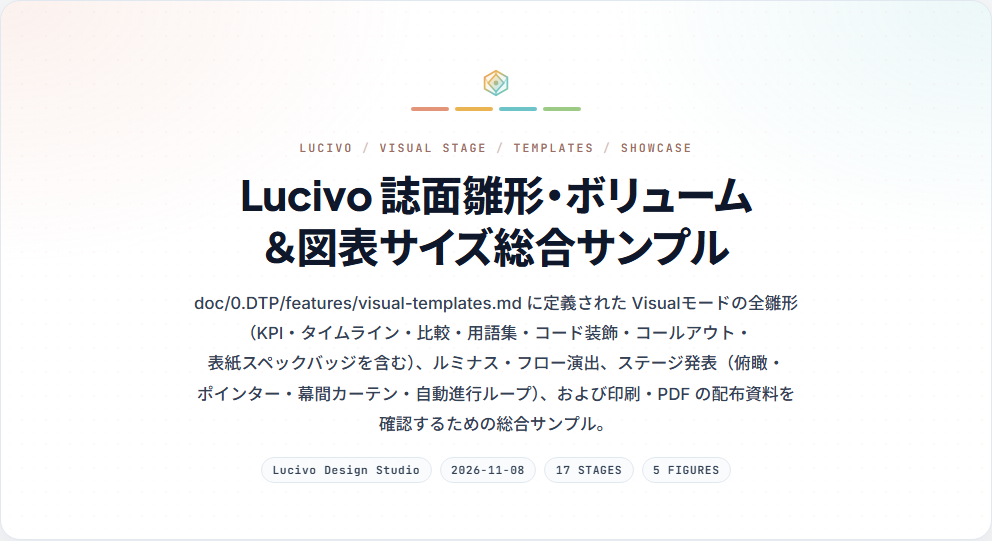
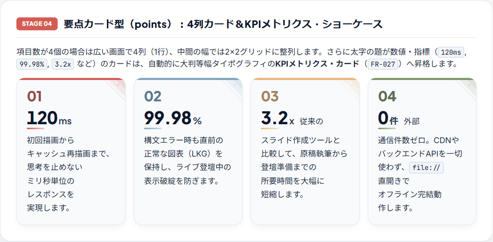

<p align="center">
  <picture>
    <source media="(prefers-color-scheme: dark)" srcset="public/assets/logos/dark/logo_full.svg">
    
  </picture>
</p>

# Lucivo Markdown Presenter — Exhibition-Grade Markdown Viewer —

- **Version**: `0.15.0`
- **Language**: [日本語](README.md) | English

Lucivo is a standalone browser-based viewer for Markdown documents and Mermaid diagrams. Simply open a local Markdown file to switch instantaneously between two viewing modes: a **lightweight specification layout for reading** and an **exhibition- and presentation-grade layout for showcasing**.

<p align="center">
  <a href="https://prankster-freedom.github.io/Lucivo/"><strong>Launch Web Edition</strong></a>
  &nbsp;·&nbsp;
  <a href="https://github.com/prankster-freedom/Lucivo/releases/latest"><strong>Download Standalone Edition (ZIP)</strong></a>
  &nbsp;·&nbsp;
  <a href="https://prankster-freedom.github.io/Lucivo/preview/"><strong>Preview Edition</strong></a>
</p>

<p align="center">
  
  
</p>

| Mode        | Best For                               | Key Features |
| :---------- | :------------------------------------- | :----------- |
| Fast Mode   | Reading and writing specifications & design docs | Clean, distraction-free specification styling prioritizing instant launch, browsing, and editing responsiveness |
| Visual Mode | Talks, exhibitions, and design reviews | Typesets prose and diagrams into presentation- and exhibition-ready layouts across 4 infographic styles |

## Key Features

- **Speed for Reading, Polish for Presenting in One Tool**: Switch between **Fast Mode** for everyday specification review and **Visual Mode** for live audiences with a single click—using the exact same document.
- **Zero-Rebuild Stage Presentations**: No proprietary syntax required. Deliver full-screen, one-chapter-per-scene presentations (with auto-advance, bird's-eye overview, and an optical pointer) directly from standard Markdown and Mermaid.
- **Two Distribution Formats—Web & Standalone (Offline)**: Choose between the full-featured Web Edition and a zero-network Standalone Edition (ZIP) that runs safely offline directly via `file://`.

## Getting Started

Choose the edition that best fits your workflow:

| Edition                         | Best For                              | Link |
| :------------------------------ | :------------------------------------ | :--- |
| Official Release (Web Edition)  | Instant use with zero installation    | [prankster-freedom.github.io/Lucivo](https://prankster-freedom.github.io/Lucivo/) |
| Official Release (Downloadable) | Safe, completely offline environments | [Latest GitHub Release](https://github.com/prankster-freedom/Lucivo/releases/latest) |
| Preview Edition (Web Edition)   | Trying upcoming pre-release features  | [prankster-freedom.github.io/Lucivo/preview](https://prankster-freedom.github.io/Lucivo/preview/) |

- **Web Edition**: Open the official Web Edition link directly in your browser—no installation needed.
- **Standalone Edition (ZIP)**: Download `Lucivo-v<version>.zip` from the latest GitHub Release, extract it, and open `index.html` in your browser.
- **Preview Edition**: A web build reflecting pre-release changes. The version indicator displays `X.Y.Z-canary (build id: <run_id>)`.

> [!NOTE]
> Because the Preview Edition may be unstable, please use the Official Release for everyday work.

> [!TIP]
> Chromium-based browsers (Google Chrome / Microsoft Edge) are recommended for the best experience.

### Feature Comparison by Edition

| Feature                                                           | Web Edition | Standalone Edition (ZIP)       |
| :---------------------------------------------------------------- | :---------: | :----------------------------: |
| Fast Mode & Visual Mode                                           | Yes         | Yes                            |
| Style-specific heading typefaces (Rounded Gothic / Mincho)        | Yes         | — (Uses shared fallback fonts) |
| Stage Presentation (Full-screen, Auto-advance, Overview, Pointer) | Yes         | Yes                            |
| Museum Walk                                                       | Yes         | —                              |

### How to Use

1. **Open a Document**:
   - **Open a File**: Drag and drop a Markdown file (`.md` / `.markdown` / `.txt`) directly onto the window. Character encodings (UTF-8, Shift_JIS, EUC-JP, etc.) and line endings are detected automatically.
   - **Open an Entire Folder**: Drag and drop a folder onto the window to browse its Markdown files from the left sidebar. Supports relative image paths (`images/a.png`) and intra-app navigation for links between Markdown files (`[Overview](overview.md)`). Collapse the sidebar anytime with `«`.
   - **Open from Public URLs & Share Visual State**: Drag and drop a public URL onto the window—or pass `?url=<public_url>`—to open hosted Markdown directly. Supports GitHub `blob` URLs (single files with relative image/link resolution) and `tree` URLs (directory browsing), and encodes display states (`mode` / `theme` / `style` / `tone` / `view` / `layout` / `lang`) in URL query parameters for easy sharing and bookmarking.
   - **Automatic Reload on External Changes**: When a local file opened in a supported browser (such as Chrome or Edge) is modified in an external editor, Lucivo automatically reloads it while preserving your scroll position if you have no unsaved edits. If you are actively editing, it protects your changes and displays a notification bar to reload manually (can be disabled in settings).
2. **Switch Modes**: Click **Fast Mode** or **Visual Mode** in the center of the header to toggle display styles immediately.

### Bundled Samples

| Sample                                                        | Description |
| :------------------------------------------------------------ | :---------- |
| [visual-sample.en.md](public/samples/visual-sample.en.md)     | Visual Mode cover page, editorial templates, tables, Luminous Flow effects, and Stage Presentation |
| [notation_sample.en.md](public/samples/notation_sample.en.md) | Comprehensive Markdown & Mermaid reference (all diagram types, math, callouts, footnotes, emoji, etc.) |
| [notation_sample_extra1.en.md](public/samples/notation_sample_extra1.en.md) | Extended syntax (CommonMark & GFM), images, cross-document links, directory trees, and supplementary math plots |

## Capabilities

### Viewing & Editing

- **Split-Pane View Switching**: Toggle between `Split` (side-by-side editor and preview), `Canvas` (preview only), and `Code` (editor only) in the center of the header.
- **Safe Read & Edit Modes**: Documents open in read-only **Read** mode by default to prevent accidental edits. Toggle between `Read` and `Edit` above the editor. Changes render in real time, and in `Split` view the preview automatically scrolls to follow your cursor position in the editor.
- **Download Save**: Download your edited document as a Markdown file without overwriting the original file. A confirmation dialog appears if you attempt to open another document while holding unsaved changes.
- **Auto-Formatting on Load**: Cleanly normalizes Markdown syntax on load (spaces after `#` headings, blank lines around blocks, list markers, and table column alignment) without altering rendered output (can be disabled in settings).
- **Themes & Color Tones**: Toggle Light and Dark themes via the sun/moon icon in the top-right corner, and choose your preferred color tone from the style bar.

### Supported Content (Markdown & Diagrams)

- **Standard Markdown & GFM**: Supports headings, tables, lists, code blocks, and blockquotes alongside task lists, **GFM footnotes (`[^1]`)**, and **emoji shortcodes (`:rocket:`, etc.)**.
- **Rich Mermaid Diagrams**: High-precision rendering for flowcharts, sequence diagrams, state diagrams, class diagrams, Gantt charts, mindmaps, timelines, pie charts, user journeys, quadrant charts, and more inside ```` ```mermaid ```` blocks.
- **TeX Math Equations**: Renders inline `$…$` and block `$$…$$` math via KaTeX, including equations embedded inside flowchart and sequence diagram labels.
- **Supplementary Math Plots**: Automatically plots explicit single-variable functions ($y = f(x)$) in body text as crisp PNG raster graphs displayed alongside the equation. Supports overlaying multiple curves and explicit domain bounds.
- **GitHub-Flavored Callouts**: Blockquotes starting with `> [!NOTE]`, `[!TIP]`, `[!IMPORTANT]`, `[!WARNING]`, or `[!CAUTION]` render as color-coded alert boxes with dedicated icons.
- **YAML Front Matter**: Metadata enclosed in `---` at the top of a document (`title`, `description`, `tags`, `author`, `date`, etc.) is woven seamlessly into Visual Mode's cover title and spec badges.

### Diagram Controls & Zoom

Each diagram card includes a top-right toolbar for granular inspection and export:

- **Four Zoom Presets**: Choose `Fit` (fit within viewport) or `1:n` (fit to width), or open the dropdown (`▾`) for `n:1` (fit to height) and `100%` (native scale). The same zoom controls are available inside the full-screen `Expand` modal.
- **High-Resolution Export**: Download crisp raster `PNG` or vector `SVG` files in a single click.
- **Edge Routing Styles**: Switch per diagram between Smooth, Step, and Straight connectors in flowcharts, state diagrams, and class diagrams.

> [!NOTE]
> To preserve text legibility, oversized diagrams that would otherwise shrink too small automatically switch to horizontal scrolling.

### Visual Mode

In Visual Mode, choose among four curated visual themes from the top style bar (`Pastel Shapes` / `2-Tier Cards` / `Vibrant Circles` / `Editorial Cream`):

- **Cover Page & Interactive Table of Contents**: Automatically generates an exhibition-grade cover from front matter metadata. Documents with 3–15 chapters automatically receive an interactive Table of Contents slab that jumps to any chapter on click.
- **Automatic Promotion to Editorial Templates**: Analyzes each chapter's (`h2`) structure and volume to apply the best-suited layout:
  - **Lead**: Promotes short chapters into high-impact intro slides with large typography and gradient accent bars.
  - **Key Points**: Transforms bullet lists into card grids—automatically elevating numerical titles into **KPI Metric Cards**, dates/milestones into **Roadmaps**, and Before/After items into **Comparison Cards**.
  - **Split (Commentary + Diagram)**: Pairs concise commentary with a diagram in a vertically centered two-column layout.
  - **Steps**: Turns short numbered lists into horizontal process flows with animated light pulses traveling along the connectors.
  - **Glossary**: Typesets `**Term** — Description` lists into a clean two-column definition dictionary.
  - **Statement**: Frames concise blockquotes in a centered, refined typographic showcase.
- **Editorial Tables & Code Blocks**: Tables automatically apply right-aligned tabular figures (`tabular-nums`) for numeric columns, while code blocks gain a dark console frame with language badges and one-click copy buttons.
- **Luminous Flow & Spotlight Focus**: Light pulses travel along flowchart and sequence diagram edges, while clicking individual key point cards or process steps dims surrounding items to spotlight your selection.

### Stage Presentation

Click **Present** in the header (or press `P`) to enter a full-screen, one-chapter-per-scene presentation—no slide-deck conversion required.

- **Sequential Reveal**: Reveal key point cards or process steps one item at a time in sync with your talk.
- **Live Presenter Controls**:
  - `A`: Auto-advance loop for unattended exhibition booths
  - `O`: Bird's-eye Light Table overview of all scenes (navigate with arrow keys and press `Enter` to jump)
  - `L`: Optical pointer spotlight that follows your cursor to highlight details on large displays
  - `B` / `Q`: Intermission standby curtain for Q&A sessions or breaks
  - `T`: Toggle Light / Dark appearance during a presentation
- **Next-Gen Presentation Mode (Web Edition Exclusive)**:
  - **Museum Walk**: Walk through your document as a 3D exhibition gallery corridor (use `Ctrl` + scroll wheel or `+` / `-` / `0` to step closer to or back from exhibits).

### Printing & PDF Export

Press `Ctrl+P` / `Cmd+P` (or use Print / Save as PDF) to export clean handouts with UI buttons and chrome automatically stripped out.

- **Visual Mode**: Optimized for A4 landscape (`16:10` aspect ratio), placing the cover and each chapter cleanly centered on individual pages.
- **Fast Mode**: Outputs continuous A4 portrait specification pages suited for long-form documentation.
- **Widow & Orphan Protection**: Prevents isolated headings at the bottom of pages, keeping headings paired with their opening paragraphs.

### Keyboard Shortcuts

#### Standard Viewing

| Key                   | Action                                   |
| :-------------------- | :--------------------------------------- |
| `J` / `K` (`]` / `[`) | Scroll to next / previous chapter        |
| `M`                   | Toggle between Fast Mode and Visual Mode |
| `1`–`4`               | Switch Visual Mode styles (1: Pastel Shapes, 2: 2-Tier Cards, 3: Vibrant Circles, 4: Editorial Cream) |
| `P`                   | Start Stage Presentation                 |
| `?`                   | Show keyboard shortcuts reference        |

> [!NOTE]
> Shortcuts are disabled while focus is inside the text editor or other input fields.

#### Stage Presentation

| Key                   | Action                                                                        |
| :-------------------- | :---------------------------------------------------------------------------- |
| `→` / `Space` / Click | Advance to next scene or item                                                 |
| `←`                   | Return to previous scene or item                                              |
| `Home` / `End`        | Jump to first / last scene                                                    |
| `A`                   | Start / stop auto-advance loop (for exhibitions)                              |
| `O`                   | Toggle Light Table scene overview (select with arrow keys, jump with `Enter`) |
| `L`                   | Toggle optical pointer spotlight                                              |
| `B` / `Q`             | Toggle intermission / Q&A standby curtain                                     |
| `T`                   | Toggle Light / Dark theme during presentation                                 |
| `Esc`                 | Exit presentation (or close Overview / Curtain if currently open)             |

## Security & Privacy

- **100% Client-Side Processing**: All loaded files are parsed and rendered entirely inside your browser. No files or document contents are ever uploaded to an external server.
- **DOMPurify Sanitization**: HTML generated from Markdown is strictly sanitized with DOMPurify before rendering.
- **Strict Mermaid Rendering**: Enforces Mermaid's `securityLevel: strict` to block malicious script execution inside diagrams.
- **Safe Local Image Referencing**: Supports rendering `file://` URLs and Windows local paths (`C:\…`) in images while neutralizing local protocol links for security.
- **Usage Analytics (Web Edition Only)**: The Web Edition uses Google Analytics (via Google Tag Manager) solely to understand which design styles, color tones, and presentation modes are most popular. Only the selected style, tone, presentation mode, and distribution type (Official / Preview) are recorded—filenames and document contents are never transmitted. The Standalone Edition (ZIP) contains zero analytics or tracking code.

## Known Limitations

- **Relative Image Paths When Opening a Single Local File**: Due to browser security restrictions, relative image paths (`images/a.png`) cannot be resolved when opening a standalone local Markdown file via drag-and-drop. To display local relative images, drag and drop the entire folder onto the window (documents loaded from a public URL resolve relative paths against the source URL automatically).
- **Re-Confirming Folder Permissions**: While Chrome and Edge remember the last opened folder, browser security policies require re-confirming folder access permission on subsequent launches.
- **Browser Support for External File Reloading**: Automatic reloading when local files change externally relies on the File System Access API (`showOpenFilePicker` / `showDirectoryPicker`), supported in Chromium-based browsers such as Chrome and Edge. In other browsers, reopen the file manually to refresh.

## Developer Documentation

### Documentation Structure

New features and specification updates follow the [Product Concept](doc/1.SRS.md#11-プロダクトコンセプト) (prioritizing speed in Fast Mode and exhibition/presentation quality in Visual Mode).

| Topic                                      | Document                                                  |
| :----------------------------------------- | :-------------------------------------------------------- |
| Product Concept & Requirements (FR / NFR)  | [doc/1.SRS.md](doc/1.SRS.md)                              |
| System Architecture & Key Design Decisions | [doc/2.ARCHITECTURE.md](doc/2.ARCHITECTURE.md)            |
| Detailed Feature Design Notes              | [doc/3.sw_design_notes/](doc/3.sw_design_notes/README.md) |
| Implementation Dependencies & Notes        | [doc/3.implementation/](doc/3.implementation/README.md)   |
| Test Specifications & Verification (TC)    | [doc/4.test_spec/](doc/4.test_spec/README.md)             |
| Change Request Management (CR)             | [doc/6.change_request/](doc/6.change_request/README.md)   |
| Visual Mode Design Specs & Vector Assets   | [doc/0.DTP/](doc/0.DTP/README.md)                         |

## License

Licensed under the [MIT License](LICENSE). See [public/THIRD_PARTY_LICENSES.txt](public/THIRD_PARTY_LICENSES.txt) for licenses of bundled libraries and fonts.

## Release Notes

The two most recent releases are listed below. For the complete version history, see [release-notes.en.md](release-notes.en.md).

### 0.15.0 (2026-11-23)

- feat(ui): Expanded Visual Mode color tones to 20 presets (plus Style Default), made the tone selector menu scrollable, and improved text and accent contrast across Light and Dark appearances
- feat(ui): Added a public URL paste input field on the start screen so users on mobile devices without drag-and-drop can open public Markdown files and GitHub folders directly
- fix(url): Fixed loading GitHub `tree` URLs whose branch names contain slashes (such as `feature/...`)

### 0.14.0 (2026-11-23)

- feat(i18n): Added Japanese and English UI language switching, localized bundled samples, and English documentation
- feat(folder): Added full-text search across all Markdown files in an open folder with jump-to-match navigation
- feat(code): Added theme-adaptive syntax highlighting for code blocks matching Light/Dark appearance and Visual styles
- feat(perf): Expanded incremental rendering for edited blocks and chapters to keep typing and previewing responsive in large documents
- fix(visual): Kept chapters containing tables wider than a two-column track in single-column layout on wide screens so tables remain readable
