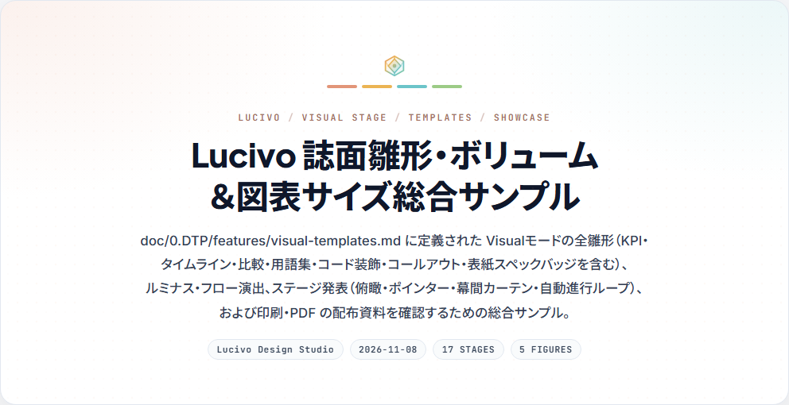
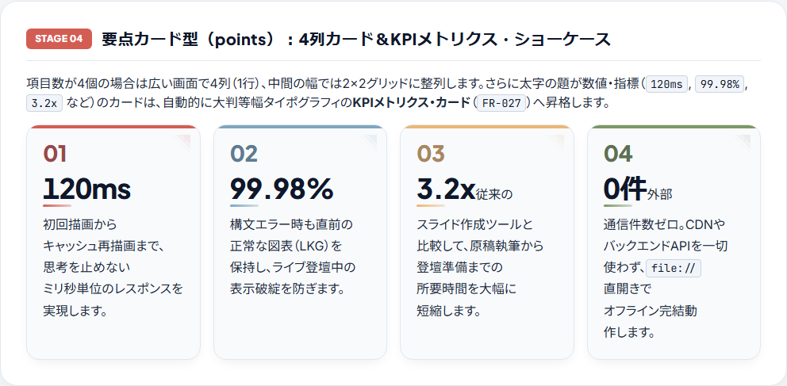

<p align="center">
  <picture>
    <source media="(prefers-color-scheme: dark)" srcset="public/assets/logos/dark/logo_full.svg">
    
  </picture>
</p>

# Lucivo Markdown Presenter — Exhibition-Grade Markdown Viewer —

- **Version**: `0.2.0`

Lucivo（ルシーヴォ）は、Markdown 文書と Mermaid ダイアグラムを表示する、ブラウザだけで動く Markdown ビューアーです。いつもの Markdown をそのまま開くだけで、2 つの見せ方を切り替えられます。

<p align="center">
  
  
</p>

| モード       | こんなときに               | 特長 |
| :----------- | :------------------------- | :--- |
| 高速モード   | 仕様書・設計書を読む、書く | 余計な装飾のない仕様書スタイル。起動から閲覧・入力まで待たされない軽さを最優先にしています |
| Visualモード | 講演・展示会・レビューで見せる | 4 種のインフォグラフィックスタイルで、文書と図をそのまま講演資料・展示素材の品質に組み上げます |

- **インストール不要・オフライン**: `index.html` をブラウザで開くだけで動きます。サーバーもインターネット接続も要りません。
- **独自の記法は不要**: 標準の Markdown と Mermaid で書いた文書を、章の書き方に合わせて自動で誌面に組みます。
- **そのまま発表できる**: 文書を 1 章 1 シーンの全画面で見せる「ステージ発表」で、スライドを作り直さずに発表できます。

## はじめかた

1. [GitHub Releases の最新版](https://github.com/prankster-freedom/Lucivo/releases/latest)から `lucivo-v<版>.zip` をダウンロードして展開し、`lucivo-v<版>` フォルダの中の `index.html` をブラウザで開きます。
2. ヘッダーの「ファイル」→「Markdown を開く…」で、Markdown ファイル（`.md` / `.markdown` / `.txt`、UTF-8）を読み込みます。
3. ヘッダー中央の「高速モード」「Visualモード」で見せ方を切り替えます。

まずは同梱のサンプルを開くと、できることを一通り確かめられます。「ファイル」メニューからワンクリックで開けます。

| サンプル                                                | 内容                                                       |
| :------------------------------------------------------ | :--------------------------------------------------------- |
| [visual-sample.md](public/samples/visual-sample.md)     | Visualモードの表紙・誌面の雛形・表・光の演出・ステージ発表 |
| [notation_sample.md](public/samples/notation_sample.md) | Markdown と Mermaid の記法の一覧（全図種・数式・コールアウトなど） |
| [notation_sample_extra1.md](public/samples/notation_sample_extra1.md) | Markdown の発展的な記法とエッジケース（CommonMark・GFM） |

動作確認は Chromium 系のブラウザ（Google Chrome / Microsoft Edge）で行っています。

## できること

### 閲覧と編集

- **画面の切り替え**: ヘッダー中央の `Split`（エディタとプレビューの左右分割）/ `Canvas`（プレビューのみ）/ `Code`（エディタのみ）で切り替えます。
- **閲覧と編集**: 読み込んだ直後のエディタは、誤って書き換えないよう読み取り専用（`閲覧`）です。エディタ上部の `閲覧` | `編集` で切り替えます。編集するとプレビューにすぐ反映され、`Split` ではカーソルのある見出しの位置へプレビューが追従します。
- **保存**: ヘッダーの「保存」で、エディタの内容を Markdown ファイルとしてダウンロードします（元のファイルは上書きしません）。保存していない編集がある状態で別のファイルを開くと、確認が出ます。
- **テーマ**: 右上の太陽 / 月のアイコンで Light / Dark を、パレット設定でカラーパレット（Cobalt / Emerald / Amber / Royal）を切り替えます。

### 書ける内容

- **Markdown**: 見出し・表・リスト・コード・引用など、GitHub と同じ記法（GFM）を使えます。
- **Mermaid の図**: ```` ```mermaid ```` のコードブロックに書いた図（フローチャート、シーケンス図、状態遷移図、クラス図、ガントチャートなど）を描画します。
- **数式**: `$…$`（インライン）と `$$…$$`（ブロック）で TeX の数式を書けます。フローチャートとシーケンス図のラベルにも `$$…$$` で書けます。
- **コールアウト**: `> [!NOTE]`・`[!TIP]`・`[!IMPORTANT]`・`[!WARNING]`・`[!CAUTION]` で、種類ごとのアイコンと色の付いた注意書きになります（GitHub と同じ記法）。
- **YAML フロントマター**: 文書の先頭の `---` で囲んだ YAML は本文と分けて扱い、ヘッダーの `YAML` ボタンで表示を切り替えます。Visualモードでは、`title`・`description`・`tags` が表紙に使われます。

### 図の操作

各図のカードの右上から、次の操作ができます。

- **表示倍率**: `Fit`（枠の幅に合わせる）/ `1:1`（原寸）。
  - 注意: `Fit` を選んでいても、文字が読めなくなるほど小さくなる大きな図は、文字の判読性を保つため縮小を止め、カードの中で横スクロールになります。
- **書き出し**: `PNG`（高解像度）/ `SVG` のダウンロード、`Expand`（拡大表示）。
- **矢印の形状**: フローチャート・状態遷移図・クラス図では、図ごとに曲線 / 直角 / 直線を選べます（既定は図種ごとに決まっています）。選んだ形状は表示の間だけ保たれ、文書には書き込まれません。

### Visualモード

Visualモードに切り替えると、上部にスタイルバーが現れ、4 種のスタイル（`🎨 パステル図形` / `📋 2段カード` / `⭕ 5色サークル` / `📖 クリームチャート`）を選べます。

- **表紙と目次**: 文書の先頭は、フロントマターの内容から組んだ表紙になります。章が 3〜15 個の文書には目次が付き、項目を押すとその章へ移動します。
- **章の書き方に合わせた誌面**: 章（`h2`）の書き方に応じて、誌面の雛形が自動で切り替わります。
  - 短い段落 → 大きな文字のリード
  - 短い箇条書き → 要点カード（数値の題は KPI カード、日付の題はロードマップ、Before / After の 2 項目は比較カード）
  - `**用語** — 説明` の箇条書き → 用語集
  - 短い番号付きリスト → 手順のフロー
  - 短い引用 → 中央揃えのステートメント
  - 本文と図が 1 つずつの章 → 本文と図の 2 段組み
- **誌面の表とコード**: 表は数値の列が右揃えの誌面の表に、コードブロックは言語ラベルとコピーボタン付きのコンソール枠になります。
- **光の演出**: フローチャートと状態遷移図では結線をたどって光が伝わり、シーケンス図ではメッセージが時系列の順に光ります。要点カードや手順を押すと、そこにスポットライトを当てられます（もう一度押すか `Esc` で解除）。

### ステージ発表

ヘッダーの「発表」（または `P` キー）で、文書を 1 章 1 シーンの全画面で見せます。要点カードと手順は 1 項目ずつ表示します。
| キー                     | 操作                                                             |
| :----------------------- | :--------------------------------------------------------------- |
| `→` / `Space` / クリック | 次へ                                                             |
| `←`                      | 前へ                                                             |
| `Home` / `End`           | 先頭 / 末尾へ                                                    |
| `A`                      | 自動進行（無人の展示向け。最後まで進むと先頭へ戻ります）         |
| `O`                      | 全シーンの一覧（俯瞰）。矢印キーで選んで `Enter` でそのシーンへ  |
| `L`                      | 光のポインター（マウスの位置にスポットライト）                   |
| `B` / `Q`                | 幕間（質疑・休憩用の待機画面。章番号から任意の章へ移動できます） |
| `T`                      | Light / Dark の切り替え                                          |
| `Esc`                    | 終了（一覧・幕間を開いているときは、それを閉じます）             |

### 印刷・PDF

「ファイル」→「印刷 / PDF として保存…」（または `Ctrl+P` / `⌘P`）で、配布資料を刷れます。画面の操作部は刷りません。Visualモードは A4 横に表紙と章を 1 ページずつ、高速モードは A4 縦に仕様書として刷ります。

### キーボードショートカット（閲覧中）

| キー                   | 操作                                                         |
| :--------------------- | :----------------------------------------------------------- |
| `J` / `K`（`]` / `[`） | 次 / 前の章へ                                                |
| `M`                    | 高速モードと Visualモードの切り替え                          |
| `1`〜`4`               | Visualモードのスタイルの切り替え（高速モードからも使えます） |
| `P`                    | ステージ発表を始める                                         |
| `?`                    | ショートカットの一覧                                         |

エディタなどの入力欄にカーソルがあるときは働きません。

## 安全性とプライバシー

- 読み込んだファイルは、ブラウザの中だけで処理します。外部へは送信しません。
- Markdown から作った HTML は、DOMPurify で無害化してから表示します。
- Mermaid の図は、Mermaid の安全な設定（`securityLevel: strict`）で描画します。図のラベルに書いた HTML のタグからスクリプトが実行されることはありません。
- 図のラベルに `` タグで画像を書くと、その画像を表示します。画像の場所がインターネット上の URL のときは、画像を読み込むための通信が発生します。

## 既知の制約

- Dark の高速モードで、マインドマップとタイムラインのノードの塗りが黒に近くなります（白い文字で判読はできます）。
- 大きなフローチャートで、Mermaid の自動配置により、矢印がサブグラフの見出しの上を通ることがあります。
- Visualモードの要点カードの中のインラインコードは、カードの幅によってはコードの枠ごと 2 行に折り返します。

## 開発者向け

### ドキュメントマップ

要求の追加や設計の判断は、[プロダクトコンセプト](doc/1.SRS.md#11-プロダクトコンセプト)（高速モードは軽快さ、Visualモードは見た目の品質を優先）に照らして行います。

| 知りたいこと                                           | ドキュメント                                            |
| :----------------------------------------------------- | :------------------------------------------------------ |
| コンセプトと、何ができるべきか（機能要求・非機能要求） | [doc/1.SRS.md](doc/1.SRS.md)（`FR-<nnn>`, `NFR-<nnn>`） |
| 構成と、主要な設計判断の理由                           | [doc/2.ARCHITECTURE.md](doc/2.ARCHITECTURE.md)          |
| 機能ごとの設計                                         | [doc/3.sw_design_notes/](doc/3.sw_design_notes/README.md)（`DD-<略号>-<nnn>`） |
| コードから読み取りにくい依存と、変更するときの注意     | [doc/3.implementation/](doc/3.implementation/README.md) |
| 何をどう確かめるか、テストの実行方法                   | [doc/4.test_spec/](doc/4.test_spec/README.md)（`TC-<略号>-<nnn>`） |
| 今後の対応を予定している変更要求                       | [doc/6.change_request/](doc/6.change_request/README.md)（`CR-<nnn>`） |
| Visualモードのデザイン（版面・配色・書体・雛形）       | [doc/0.DTP/](doc/0.DTP/README.md)（`DTP-<nnn>`、ラフ `RGH-<nnn>`、素材 `AST-<nnn>`） |

## ライセンス

[MIT License](LICENSE)。同梱のライブラリとフォントのライセンスは [public/THIRD_PARTY_LICENSES.txt](public/THIRD_PARTY_LICENSES.txt) にあります。

## リリースノート

### 0.2.0（2026-11-09）

- feat: ライブラリとフォントを同梱し、インターネットに接続せずに動くようにする
- feat(edge-style): 状態遷移図とクラス図でも矢印の形状を選べるようにする
- feat(file-loading): ロゴと起動時の案内から公開リポジトリを開けるようにする
- feat(samples): 記法サンプル追補版の追加とステージ発表の復元処理を改善する
- feat(viewing): 通常閲覧時のキーボードショートカットとスラブ画像エクスポートを追加する
- feat: Visualモードの誌面表現拡充と発表の幕間・待機演出を追加する
- feat: コールアウト・用語集・印刷の配布資料・Split 表示の編集位置への追従を追加する
- feat(samples): 用語集・コールアウト・印刷・編集位置への追従をサンプルで確認できるようにする
- feat(ui): スタイルバーを Visualモードだけに表示し、編集の状態を閲覧と編集の切り替えで示す
- feat(ui): ] と [ で次と前の章へ移れるようにする
- fix(build-vendor): LICENSE を含まないパッケージでも同梱できるようにする
- fix(deps): 脆弱性の修正を含む版へライブラリを更新する
- fix(deps): Mermaid を 12.3.0、marked を 18.1.3 に更新する
- fix(diagram-rendering): 状態遷移図の分岐とフォークの装飾を Mermaid 12 で戻す
- fix(diagram-rendering): Dark のマインドマップなどの枝ごとの色を明示する
- fix(diagram-rendering): Dark の円グラフのスライスと凡例を読めるようにする
- fix(viewing): J/K 章スクロールと Light 発表時のポインター視認性および ? 案内を改善する
- fix: ステージ発表開始ショートカットのF5競合解消とvisual-sample.mdへの新規訴求ポイント追加
- fix(diagram): 直角のクラス図で継承の三角形が横を向く問題を直す
- fix(diagram): 構文エラーの図がページの下に積み上がる問題を直す
- fix(ui): 誌面にならない章の画像化と、持ち出し先で崩れる HTML の書き出しの操作部を外す

注意: 章の画像化（スラブ画像エクスポート）と HTML の書き出しは、0.2.0 では操作部を外している。作り直しは [CR-001](doc/6.change_request/CR-001_章の画像化とHTMLの書き出しの作り直し.md) で扱う。

### 0.1.0（初期構成）

- プロトタイプ（単一 HTML）を HTML / CSS / JS に分割し、独立した単位として管理開始
