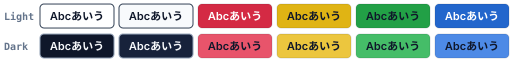

# 10. 晴天の工作舎（Cobalt Workshop）

- **ID**: `cobalt-workshop`
- **トーン区分**: つよい（strong）
- **配色技法**: ドミナント・トーン（明快で力強い視認性）
- **印象・用途**: 迷いのない明快さとエンジニアリングの推進力。カンファレンス登壇・機能紹介向け。

## カラーコード一覧

| 役割 | トークン例 | Light | Dark | 用途 |
| :--- | :--- | :--- | :--- | :--- |
| 第 1 色（主役・朱赤） | `--vs-c1` | `#D42A44` | `#E8546B` | 見出しアクセント・主ノード・カード 1 |
| 第 2 色（副色・山吹） | `--vs-c2` | `#E0B414` | `#ECC63E` | カード 2・手順 2・補助グラフ |
| 第 3 色（展開・常磐） | `--vs-c3` | `#22A046` | `#45BD68` | カード 3・手順 3・分岐 |
| 第 4 色（締め・コバルト） | `--vs-c4` | `#2266CC` | `#4D8AE6` | カード 4・手順 4・補足 |
| ベース背景 | `--diag-canvas` | `#FFFFFF` | `#0F172A` | 図・スラブの背景面 |
| 補助面（カード） | `--vs-card-bg` | `#F8FAFC` | `#17223B` | カード・ノードの面 |
| 境界・線 | `--diag-edge` | `#334155` | `#94A3B8` | 結線・区切り罫線 |
| 文字（主） | `--text-primary` | `#0F172A` | `#F8FAFC` | 本文・見出し・ノード文字 |
| 光彩（グロウ） | `--vs-glow` | `#38BDF8` | `#7DD3FC` | シグナル・ライト・スポットライト |
