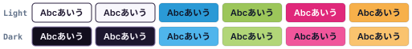

# 16. 教会のステンドグラス（Stained Glass）

- **ID**: `stained-glass`
- **トーン区分**: こい〜あかるい（deep / bright）
- **配色技法**: セパレーション（濃紺の鉛線で鮮やかな 4 色を際立たせる）
- **印象・用途**: 色の境界がくっきり立ち上がる宝石のような輝き。図解・状態遷移・マルチモジュール構成向け。

## カラーコード一覧

| 役割 | トークン例 | Light | Dark | 用途 |
| :--- | :--- | :--- | :--- | :--- |
| 第 1 色（主役・瑠璃） | `--vs-c1` | `#2A9AD6` | `#4FB5EC` | 見出しアクセント・主ノード・カード 1 |
| 第 2 色（副色・萌黄） | `--vs-c2` | `#9CC65A` | `#B2D678` | カード 2・手順 2・補助グラフ |
| 第 3 色（展開・柘榴） | `--vs-c3` | `#E0287A` | `#F0569B` | カード 3・手順 3・分岐 |
| 第 4 色（締め・山吹） | `--vs-c4` | `#F7B04A` | `#FAC36E` | カード 4・手順 4・補足 |
| ベース背景 | `--diag-canvas` | `#FFFFFF` | `#120E1D` | 図・スラブの背景面 |
| 補助面（カード） | `--vs-card-bg` | `#F8F7FC` | `#1C162E` | カード・ノードの面 |
| 境界・線（鉛線） | `--diag-edge` | `#2B2140` | `#7A6B9E` | 結線・セパレーション境界 |
| 文字（主） | `--text-primary` | `#1F1830` | `#F7F5FC` | 本文・見出し・ノード文字 |
| 光彩（グロウ） | `--vs-glow` | `#38BDF8` | `#7DD3FC` | シグナル・ライト・スポットライト |
