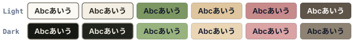

# 17. 抹茶と和三盆（Matcha & Wasanbon）

- **ID**: `matcha-wagashi`
- **トーン区分**: やわらかい〜にぶい（soft / dull）
- **配色技法**: ナチュラルハーモニー（和菓子と茶室の穏やかな自然調和）
- **印象・用途**: ほっと息がつける和の品格。カルチャー紹介・ブランドブック・ワークショップ資料向け。

## カラーコード一覧

| 役割 | トークン例 | Light | Dark | 用途 |
| :--- | :--- | :--- | :--- | :--- |
| 第 1 色（主役・抹茶） | `--vs-c1` | `#7D9763` | `#99B37F` | 見出しアクセント・主ノード・カード 1 |
| 第 2 色（副色・和三盆） | `--vs-c2` | `#DFC69E` | `#EAD6B5` | カード 2・手順 2・補助グラフ |
| 第 3 色（展開・梅鼠） | `--vs-c3` | `#C78A8B` | `#DAA3A4` | カード 3・手順 3・分岐 |
| 第 4 色（締め・黒文字） | `--vs-c4` | `#5E5448` | `#8E8273` | カード 4・手順 4・補足 |
| ベース背景 | `--diag-canvas` | `#FBF9F4` | `#161813` | 図・スラブの背景面 |
| 補助面（カード） | `--vs-card-bg` | `#F3EFE4` | `#20241C` | カード・ノードの面 |
| 境界・線 | `--diag-edge` | `#635E52` | `#9C9688` | 結線・区切り罫線 |
| 文字（主） | `--text-primary` | `#24211B` | `#F4F1E8` | 本文・見出し・ノード文字 |
| 光彩（グロウ） | `--vs-glow` | `#9CCB86` | `#B8E0A4` | シグナル・ライト・スポットライト |
