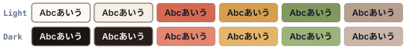

# 19. テラコッタの中庭（Terracotta Courtyard）

- **ID**: `terracotta-courtyard`
- **トーン区分**: やわらかい〜にぶい（soft / dull）
- **配色技法**: ウォームシェード（素焼き・砂壁・オリーブの温かな南欧調）
- **印象・用途**: 手触りのある土と日光の安心感。コミュニティ紹介・編集方針・デザインガイド向け。

## カラーコード一覧

| 役割 | トークン例 | Light | Dark | 用途 |
| :--- | :--- | :--- | :--- | :--- |
| 第 1 色（主役・素焼） | `--vs-c1` | `#D46A52` | `#E48670` | 見出しアクセント・主ノード・カード 1 |
| 第 2 色（副色・黄土） | `--vs-c2` | `#D69F4E` | `#E6B56A` | カード 2・手順 2・補助グラフ |
| 第 3 色（展開・橄欖） | `--vs-c3` | `#839760` | `#9EB37B` | カード 3・手順 3・分岐 |
| 第 4 色（締め・砂岩） | `--vs-c4` | `#B89F8D` | `#CBB5A6` | カード 4・手順 4・補足 |
| ベース背景 | `--diag-canvas` | `#FCF9F5` | `#1B1512` | 図・スラブの背景面 |
| 補助面（カード） | `--vs-card-bg` | `#F5EFE8` | `#261E1A` | カード・ノードの面 |
| 境界・線 | `--diag-edge` | `#6E5B50` | `#A38F83` | 結線・区切り罫線 |
| 文字（主） | `--text-primary` | `#2A1F1A` | `#F7F1EB` | 本文・見出し・ノード文字 |
| 光彩（グロウ） | `--vs-glow` | `#EA6A47` | `#FF9D80` | シグナル・ライト・スポットライト |
