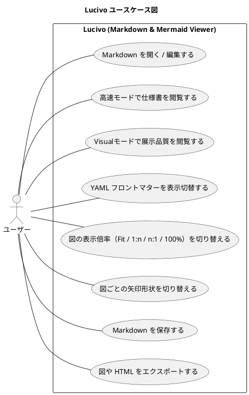
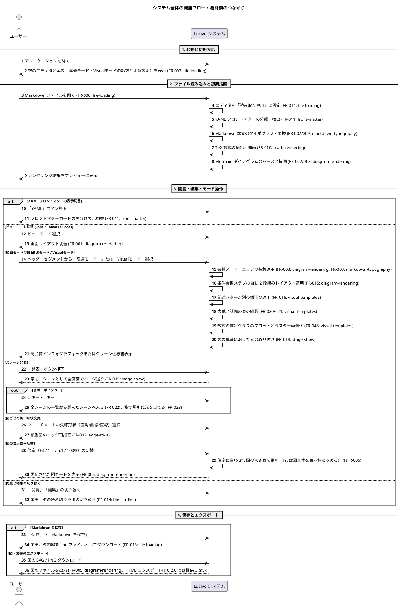

# ソフトウェア要求仕様書 (SRS: Software Requirement Specification)

## 1. 概要

**Lucivo Markdown Presenter — Exhibition-Grade Markdown Viewer —** は、Markdown 文書と Mermaid ダイアグラムを表示・エクスポートする Web アプリケーション（Markdown ビューアー）である。提供形態は **Web 版（GitHub Pages: `https://prankster-freedom.github.io/Lucivo/`）** と **スタンドアロン版（配布 ZIP を展開して `index.html` を開く）** の 2 種類とし、実行環境が `file:` プロトコル以外（`location.protocol !== 'file:'`）のときを Web 版、`file:` のときをスタンドアロン版と判定する。
エンジニアリング仕様書向けのクリーンな「高速モード」と、インフォグラフィック調の 4 スタイルでトップデザイナーレベルのデザインに変換できる「Visualモード」を備える。

- 製品の位置づけは Markdown ビューアーである。エディタ（左ペインでの編集とリアルタイムのプレビュー）は付随的な機能とし、要求の優先度はビューアーとしての表示・閲覧の機能より低い。

### 1.1 プロダクトコンセプト

要求の追加・変更や設計の判断は、本節のコンセプトに照らして行う。

**差別化のポイント**
- 既存の Markdown / Mermaid ビューアーより軽快に動作すること。
- モード切替により対象ドキュメントの表示をトップデザイナーレベルのデザインに変換できること。

**2 つのモードの位置づけ**

| モード       | 最優先すること                               | 目指す水準 |
| :----------- | :------------------------------------------- | :--------- |
| 高速モード   | 軽快に動作すること（至上命題）               | 起動から、その後の編集・閲覧の操作まで、すべての場面で待たされない |
| Visualモード | 見た目の品質。閲覧操作のリアルタイム性は保つ | 各種イベントやショーの講演資料・展示素材として、そのまま表示できる。簡易ビューアーで描画していると感じさせない、トップデザイナーが制作したと思える品質。全体の構図から細部の質感までこだわる |

**判断の指針**
- 高速モードで、速度と見た目・機能が衝突するときは、速度を優先する。起動時の読み込みや、入力のたびに行う処理を増やす変更は、その費用を評価してから採る。
- Visualモードで、品質と速度が衝突するときは、品質を優先する。品質のために、起動（Visualモードへの切り替え、スタイルの切り替えによる描画）や Publishing の操作（画像・HTML の書き出しを含む、発表用に整える操作全般）が重くなるのは許容する。ただし、閲覧の操作（スクロール、図の表示倍率の切替、拡大表示など）は、講演・展示の進行に支障が出ない程度のリアルタイム性を保つ。

### 1.2 ブランドコンセプト（Lucivo — Brand Concept Sheet）

**Lucivo Markdown Presenter — Exhibition-Grade Markdown Viewer —**（読み：ルシーヴォ）

本節は、1.1 のプロダクトコンセプトを表現するブランドの定義である。製品名称コンセプトの詳細は [doc/0.DTP/product-name-concept.md](0.DTP/product-name-concept.md) に定める。製品名・ロゴ・配色などの表現はこれらに従う。

- 製品名は、画面の表示・`<title>`・リポジトリ名・ドキュメント・コード上の名前（クラス名・CLI コマンドなど）のすべてで Lucivo を使う。
- CLI コマンドおよびパッケージ識別子は `lucivo` とする。
- 1.2.5 のビジュアル展開に基づく公式ブランドロゴ素材（`AST-010`〜`012`、`DTP-005`）を、ブラウザタブの Favicon・メインヘッダー左端・起動時の初期案内画面（`FR-007`）に反映し、外観（Light / Dark、`FR-004`）の切り替えに連動させる。
- ブランドカラー（ダーク基調）は、ブランドの表現（ロゴ、アプリの外枠など）に使う。Visualモードの図・カードの配色をブランドカラーに合わせる必要はない（Visualモードの配色は、4 スタイルそれぞれのデザインに従う）。

#### 1.2.1 ネーミングの構造と音韻設計（Phonetics & Origin）
- **語源構成**: `Luc-`（ラテン語：光・透明・明晰） ＋ `Vivo`（イタリア語・スペイン語：鮮明な・躍動する・生命を吹き込む）
- **音韻の狙い**:
  - **完全開音節（母音抜け）**: Lu-ci-vo（3音節）。日本語話者・英語圏話者の双方が初見で迷わず自然に発音できる設計。
  - **先鋭性と躍動のグラデーション**: 先頭の柔らかな母音「Lu-」から、知的な「-ci-」、そして推進力のある「-vo」へと抜ける音の推力により、軽快な俊敏性とモダンテックの先進性を表現。
- **アイデンティティ**: 既存の SaaS・アプリ市場における商標・製品名との重複を回避したオリジナル造語。Markdown による構造化テキストに「光と躍動感（生命）」を与えるプロダクトの魂を体現。

#### 1.2.2 コア・フィロソフィー（Philosophy）
> **「構文に生命を。舞台の上で、鮮烈に躍動する図解。」**  
> プレーンなテキスト構文をただ静的に表示するだけのビューアーにとどまらず、テキストが持つ論理構造を一瞬でスポットライトの当たるプレゼンテーションの主役へと引き上げる。

開発者が日常的に扱う道具としての機能美を保ちながら、舞台や大画面に投影された瞬間に、観客を惹きつける圧倒的な存在感と洗練された光彩を放つ世界観を標榜する。

#### 1.2.3 デュアルモードの体験設計
- **高速モード（Fast Mode）── 思考を邪魔しない絶対的軽快性**: 一切のラグや無駄な装飾を排し、ミリ秒単位でレスポンスする高速レンダリング環境。Markdown と Mermaid を素早く打ち込み、思考のスピードでアイデアを具現化する（`NFR-006`）。
- **Visualモード（Visual Mode）── トップデザイナーレベルのプロ品質**: ノードの配置バランス、タイポグラフィのカーニング、微細なシャドウ、線と光の陰影処理までを極限までチューニング。「Luc-（光）」と「Vivo（躍動）」の名が示す通り、大画面で映える立体感と洗練されたトーン＆マナーで、発表者とプロダクトの信頼性を最大限に引き上げる（`NFR-007`）。

#### 1.2.4 タグラインが約束する提供価値
**— Exhibition-Grade Markdown Viewer —**
- **Exhibition-Grade（展示会・展示素材品質）**: モーターショー、テックカンファレンス、デザインエキシビションなどの**最高峰の舞台にそのまま掲出できる基準**を満たしていることを宣言。
- **Markdown Viewer / Presenter**: ベースが極めて直感的かつオープンな Markdown / Mermaid 記法であることを明示し、開発者やテクニカルライターが学習コストゼロで導入できる道具としての誠実さを担保しつつ、プレゼンターとしての表現力を提供。

#### 1.2.5 ビジュアル＆デザインディレクション方針（Visual Tone & Style）
- **タイポグラフィ**:
  - 表記は `Lucivo`。幾何学的サンセリフによるミニマルモダンなプロポーション。
  - **人間味と知性を兼ね備えた「丸みのある等幅フォント」**のプロポーション。開発者が日常で慣れ親しんだ等幅（モノスペース）コードフォントの論理性をベースに、**角に丸み（ソフトなラウンド・ターミナル）**を持たせる。
  - これにより、「Luc-（光）」のなめらかな広がりと、「Vivo（生命力・躍動）」が持つ温かみ、デジタルツールとしてのとっつきやすさを表現。
- **ブランドカラー**:
  - **ベース**: オブシディアンブラック、ディープスレート（展示ブースや暗転した会場の大画面で引き締まる深みのある黒）。
  - **アクセント**: ルミナスシアン、エレクトリックライト（「Luc-（光）」を象徴する透明度と純度の高い発光色）。
- **全体の質感・トーン＆マナー**:
  - **「硬質で冷たいツール」ではなく「思考に寄り添い、生き生きと動く（Fluid/Organic）プロ向けプレゼンテーションスイート」**としての質感を目指す。

#### 1.2.6 将来のシリーズ展開における位置づけ
- **Lucivo（本作）**:
  - キャラクター: 躍動（Vivo）、スピード、鮮烈、ライブステージ、エネルギッシュな登壇。
  - 主戦場: プレゼンテーション、カンファレンス登壇、展示会資料、リアルタイムレンダリング。
- **Lucimo（将来のストック名称）**:
  - キャラクター: 最上級（Optimo/Massimo）、静謐、普遍、アカデミック、重厚なドキュメンテーション。
  - 展開想定: 長文ナレッジベース、公式技術仕様書ビューアー、静的ドキュメント生成エンジンなど、「静かで最高峰の完成度」を求める別系統プロダクトへ展開。

---

## 2. アクターとユースケース

### 2.1 アクター

| アクター | 説明                                                                                 |
| :------- | :----------------------------------------------------------------------------------- |
| ユーザー | Markdown および Mermaid 記法で仕様書・設計書・インフォグラフィックを作成・閲覧する人 |

### 2.2 ユースケース図

---

## 3. システム全体の機能フロー・機能間のつながり

本節は、Lucivo における主要機能群（各 feature）がユーザー操作を通じてどのように連携するかを示す全体シーケンスである。

---

## 4. 機能要求 (FR) 一覧と feature 要求仕様書への索引

各機能要求の詳細な仕様、背景・根拠、採らなかった案については、リンク先の各 Feature Requirement Specification を参照する。

| ID     | 機能名                                           | 担当 feature                                | 概要                                                                                                                                                                                                      | 詳細要求仕様書                                                                                                   |
| :----- | :----------------------------------------------- | :------------------------------------------ | :-------------------------------------------------------------------------------------------------------------------------------------------------------------------------------------------------------- | :--------------------------------------------------------------------------------------------------------------- |
| FR-001 | ビューモード切替                                 | `diagram-rendering`                         | `Split`（エディタ＋プレビュー）、`Canvas`（プレビューのみ）、`Code`（エディタのみ）の 3 モードを切り替える                                                                                                | [diagram-rendering.md](1.SRS/features/diagram-rendering.md#fr-001-ビューモード切替)                              |
| FR-002 | 高速モード（仕様書表示）                         | `diagram-rendering` / `markdown-typography` | Markdown と Mermaid 図をフラットで高密度なエンジニアリング仕様書スタイルで描画する                                                                                                                        | [diagram-rendering.md](1.SRS/features/diagram-rendering.md#fr-002-高速モード仕様書表示におけるダイアグラムデザイン) / [markdown-typography.md](1.SRS/features/markdown-typography.md#fr-002--fr-003-ドキュメントシート外観) |
| FR-003 | Visualモード                                     | `diagram-rendering` / `markdown-typography` | ヘッダーのセグメントから「高速モード」「Visualモード」を直接切り替え可能とする。Visualモードでは文書と Mermaid 図を 4 種のインフォグラフィックスタイル（Pastel Shapes / 2-Tier Cards / Vibrant Circles & Dots / Editorial Cream）で描画する | [diagram-rendering.md](1.SRS/features/diagram-rendering.md#fr-003-visualモードインフォグラフィック-4-スタイル) / [markdown-typography.md](1.SRS/features/markdown-typography.md#fr-002--fr-003-ドキュメントシート外観) |
| FR-004 | テーマ・パレット切替                             | `edge-style`                                | Light / Dark 外観切替、4 種のカラーパレット（Cobalt / Emerald / Amber / Royal）を切り替える                                                                                                               | [edge-style.md](1.SRS/features/edge-style.md#fr-004-テーマパレット切替)                                          |
| FR-005 | 図の個別操作・エクスポート                       | `diagram-rendering`                         | 各ダイアグラムカードの拡大表示（Expand）、表示倍率切替（Fit / 1:n / n:1 / 100%。Expand の画面でも切り替える）、SVG・PNG ダウンロード、HTML エクスポートを行う（HTML エクスポートは 0.2.0 では提供しない） | [diagram-rendering.md](1.SRS/features/diagram-rendering.md#fr-005-図の個別操作エクスポート)                      |
| FR-006 | Markdown ファイルの読み込み                      | `file-loading`                              | ヘッダーの「開く」メニューの「ファイルを開く…」からローカルファイルをエディタに読み込み、プレビューを更新する                                                                                             | [file-loading.md](1.SRS/features/file-loading.md#fr-006-markdown-ファイルの読み込み)                             |
| FR-007 | 起動時の初期表示                                 | `file-loading`                              | 起動直後のエディタは空とし、プレビューに差別化ポイント（高速モード・Visualモード）と切替方法を含む案内と、代表的なサンプルのサムネイルカード（表示言語別）を表示する                                      | [file-loading.md](1.SRS/features/file-loading.md#fr-007-起動時の初期表示)                                        |
| FR-008 | 同梱サンプルの全図種の描画                       | `diagram-rendering`                         | 同梱の `notation_sample.md` に記載したすべての図を、高速モードと Visualモードの 4 スタイルの両方で意図どおりに描画する                                                                                    | [diagram-rendering.md](1.SRS/features/diagram-rendering.md#fr-008-同梱サンプルの全図種の描画)                    |
| FR-009 | 同梱サンプルの Markdown 記法の描画               | `markdown-typography`                       | 同梱の `notation_sample.md` に記載したすべての Markdown 記法を、高速モードと Visualモードの 4 スタイルの両方で見分けられるように描画する                                                                  | [markdown-typography.md](1.SRS/features/markdown-typography.md#fr-009-同梱サンプルの-markdown-記法の描画)        |
| FR-010 | 数式の描画                                       | `math-rendering`                            | 本文のインライン・ブロック TeX 数式、およびフローチャート・シーケンス図のラベル内の数式を描画する                                                                                                         | [math-rendering.md](1.SRS/features/math-rendering.md#fr-010-数式の描画)                                          |
| FR-011 | YAML フロントマターの表示                        | `front-matter`                              | 文書先頭の YAML フロントマターを本文と分離し、表示の ON / OFF 切替およびシンタックスハイライトを行う                                                                                                      | [front-matter.md](1.SRS/features/front-matter.md#fr-011-yaml-フロントマターの表示)                               |
| FR-012 | 図ごとの矢印の形状                               | `edge-style`                                | 矢印の形状（曲線 / 直角 / 直線）を図ごとに選べるようにする                                                                                                                                                | [edge-style.md](1.SRS/features/edge-style.md#fr-012-図ごとの矢印の形状)                                          |
| FR-013 | Markdown の保存                                  | `file-loading`                              | 「保存」メニューの「Markdown を保存」でエディタの内容を Markdown ファイルとしてダウンロードする                                                                                                           | [file-loading.md](1.SRS/features/file-loading.md#fr-013-markdown-の保存)                                         |
| FR-014 | 読み込み直後の読み取り専用                       | `file-loading`                              | ファイルを読み込んだ直後はエディタを読み取り専用にし、「閲覧」「編集」の切り替えで切り替える                                                                                                              | [file-loading.md](1.SRS/features/file-loading.md#fr-014-読み込み直後の読み取り専用)                              |
| FR-015 | Visualモードの自動 2 段組みレイアウト            | `diagram-rendering`                         | Visualモードのスラブに本文と 1 つの Mermaid 図が含まれ、図が収まる場合は左右 2 段組みで表示する                                                                                                           | [diagram-rendering.md](1.SRS/features/diagram-rendering.md#fr-015-visualモードの自動-2-段組みレイアウト)         |
| FR-016 | Visualモードの記述パターン別の雛形               | `visual-templates`                          | Visualモードのスラブの記述パターン（短い段落、箇条書き、番号付きリスト、引用など）に応じて、リード・要点カード・手順・ステートメントなどの雛形で表示する                                                  | [visual-templates.md](1.SRS/features/visual-templates.md#fr-016-visualモードの記述パターン別の雛形)              |
| FR-017 | Visualモードのベクター装飾素材と動的ステージ演出 | `visual-templates`                          | Visualモードのヒーロー・各雛形に専用ベクター装飾素材（`AST-005`〜`009`）を適用し、カード・手順・スラブのインタラクティブ・スポットライトを提供する                                                        | [visual-templates.md](1.SRS/features/visual-templates.md#fr-017-visualモードのベクター装飾素材と動的ステージ演出) |
| FR-018 | Visualモードのシグナル・ライト                   | `stage-show`                                | 図の結線と手順の接続線の上を、図の構造に沿って光が伝わり、届いたノードや手順の丸が反応する                                                                                                                | [stage-show.md](1.SRS/features/stage-show.md#fr-018-visualモードのシグナルライト)                                |
| FR-019 | Visualモードのステージ発表                       | `stage-show`                                | 章を 1 シーンとして全画面でページ送りし、1 項目ずつの表示と自動進行で講演・展示に使える                                                                                                                   | [stage-show.md](1.SRS/features/stage-show.md#fr-019-visualモードのステージ発表)                                  |
| FR-020 | Visualモードの表紙                               | `visual-templates`                          | フロントマターの `tags`・`title`・`description` と章の構成から、アイブロウ・大きな題名・リード文・目次を持つ表紙を組む。目次から章へ移動できる                                                            | [visual-templates.md](1.SRS/features/visual-templates.md#fr-020-visualモードの表紙)                              |
| FR-021 | Visualモードの誌面の表                           | `visual-templates`                          | 表を横の罫線と見出しのアクセントの線で組み、先頭の列を行の見出し、数値の列を右揃え・等幅の数字、短いラベルの列を 1 行で表示する                                                                           | [visual-templates.md](1.SRS/features/visual-templates.md#fr-021-visualモードの誌面の表)                          |
| FR-022 | 発表の俯瞰（ライトテーブル）                     | `stage-show`                                | 発表中に全シーンを実物のまま縮小して並べ、全体の構成と現在地を示し、選んだシーンへ拡大して入る                                                                                                            | [stage-show.md](1.SRS/features/stage-show.md#fr-022-発表の俯瞰ライトテーブル)                                    |
| FR-023 | 発表の光のポインター                             | `stage-show`                                | 発表中にマウスの位置へスポットライトを当て、周りを沈めて、指している場所を示す                                                                                                                            | [stage-show.md](1.SRS/features/stage-show.md#fr-023-発表の光のポインター)                                        |
| FR-024 | 公開リポジトリへの導線                           | `file-loading`                              | ヘッダーと起動時の案内のロゴ、案内の「最新版はこちら」から、公開リポジトリ（最新版の配布元）を開けるようにする                                                                                            | [file-loading.md](1.SRS/features/file-loading.md#fr-024-公開リポジトリへの導線)                                  |
| FR-049 | 更新の確認                                       | `file-loading`                              | スタンドアロン版ではヘッダーと起動時の案内に「更新を確認」ボタンを置き、押したときだけ最新の GitHub Release を問い合わせて知らせる。Web 版（`location.protocol !== 'file:'`）では常に最新のため表示しない。ヘッダーの README への「ヘルプ」リンクは両版に置く | [file-loading.md](1.SRS/features/file-loading.md#fr-049-更新の確認) |
| FR-025 | ビューイング・ナビゲーションのキーボードショートカット | `stage-show`                          | 通常閲覧画面で、前後の章への移動（J/K）、発表開始（P）、描画モード切替（M）、スタイル切替（1〜4）、操作一覧（?）をキーボードで行えるようにする                                                            | [stage-show.md](1.SRS/features/stage-show.md#fr-025-ビューイングナビゲーションのキーボードショートカット)        |
| FR-026 | Visualモードのスラブ画像エクスポート             | `visual-templates`                          | Visualモードの各スラブ（章）を、オフラインで高精細PNG画像としてクリップボードへコピーまたは保存できるようにする（0.2.0 では提供しない）                                                                   | [visual-templates.md](1.SRS/features/visual-templates.md#fr-026-visualモードのスラブ画像エクスポート)            |
| FR-027 | Visualモードの KPI メトリクス・ショーケース      | `visual-templates`                          | 要点カード型のうち、項目の題が数値・指標（`120ms`, `99.9%`, `3.2x` など）を表すカードを大判等幅タイポグラフィの KPI カードに昇格させる                                                                    | [visual-templates.md](1.SRS/features/visual-templates.md#fr-027-visualモードの-kpi-メトリクスショーケース)       |
| FR-028 | ステージ発表の幕間・質疑（Q&A）スタンバイカーテン | `stage-show`                               | 発表中に `B` / `Q` キーまたは「幕間」ボタンで暗転スタンバイ幕を下ろし、聴衆の視線を演者へ戻しつつ章番号ピルから任意の章へ即座に飛べるようにする                                                           | [stage-show.md](1.SRS/features/stage-show.md#fr-028-ステージ発表の幕間質疑qaスタンバイカーテン)                  |
| FR-029 | Visualモードのタイムライン・ロードマップ修飾     | `visual-templates`                          | 要点カード型の全項目の題が日付・四半期・フェーズ表記で揃っているとき、等幅ピルバッジと接続ガイド付きのロードマップ表現にする                                                                              | [visual-templates.md](1.SRS/features/visual-templates.md#fr-029-visualモードのタイムラインロードマップ修飾)      |
| FR-030 | Visualモードの Before / After 比較ペアカード修飾 | `visual-templates`                          | 要点カード型が 2 項目で、課題側（Before/従来/課題）と解決側（After/導入後/解決）の対になっているとき、視覚的コントラストを付けた比較カードにする                                                          | [visual-templates.md](1.SRS/features/visual-templates.md#fr-030-visualモードの-before--after-比較ペアカード修飾) |
| FR-031 | Visualモードのコード・ショーケースとシンタックスハイライト | `visual-templates`                | Visualモードのコードブロックに、言語ラベル・丸端キャレット装飾（`AST-109`）・ワンクリックコピーボタン付きのコンソール枠と、テーマ（スタイル・トーン・Light/Dark）に調和するシンタックスハイライトを適用する（高速モードでも Light/Dark 連動のシンタックスハイライトを適用） | [visual-templates.md](1.SRS/features/visual-templates.md#fr-031-visualモードのコードショーケース) |
| FR-032 | Visualモードの表紙スペックバッジとドットマトリクス透かし | `visual-templates`                  | 表紙に著者・日付・章数・図数のスペックバッジ行と、背面のドットマトリクス透かし（`AST-110`）を表示する                                                                                                     | [visual-templates.md](1.SRS/features/visual-templates.md#fr-032-visualモードの表紙スペックバッジとドットマトリクス透かし) |
| FR-033 | ステージ発表の自動進行ループ待機演出（Vivo アンビエント・パルス） | `stage-show`               | 自動進行（`A` キー）が最終シーンから先頭（表紙）へ巡回したとき、表紙に緩やかな呼吸光（Vivo アンビエント・パルス）を灯す                                                                                   | [stage-show.md](1.SRS/features/stage-show.md#fr-033-ステージ発表の自動進行ループ待機演出vivo-アンビエントパルス) |
| FR-034 | コールアウト（GitHub アラート記法）              | `markdown-typography`                       | GitHub と同じ `> [!NOTE]`・`[!TIP]`・`[!IMPORTANT]`・`[!WARNING]`・`[!CAUTION]` の引用を、種類ごとのアイコン・ラベル・意味の色を持つ注意書きのパネルとして、高速モードと Visualモードの両方で表示する     | [markdown-typography.md](1.SRS/features/markdown-typography.md#fr-034-コールアウトgithub-アラート記法)           |
| FR-035 | Visualモードの定義リスト型（用語集）             | `visual-templates`                          | 箇条書きの全項目が `**用語** — 説明` の形の章を、等幅の用語と説明を 2 段に組んだ用語集の誌面にする                                                                                                        | [visual-templates.md](1.SRS/features/visual-templates.md#fr-035-visualモードの定義リスト型用語集)                |
| FR-036 | 印刷・PDF の配布資料                             | `visual-templates`                          | ブラウザの印刷（PDF として保存を含む）で、Visualモードは表紙と章を 1 ページずつ、高速モードは仕様書として、画面の操作部を除いて刷る                                                                       | [visual-templates.md](1.SRS/features/visual-templates.md#fr-036-印刷pdf-の配布資料)                              |
| FR-037 | Split 表示の編集位置への追従                     | `diagram-rendering`                         | `Split` 表示で、エディタのカーソルが別の見出しの区間へ移ったとき、プレビューをその見出し（Visualモードはその章）の位置へ送る                                                                              | [diagram-rendering.md](1.SRS/features/diagram-rendering.md#fr-037-split-表示の編集位置への追従)                  |
| FR-038 | 図のドラッグ移動                                 | `diagram-rendering`                         | スクロール表示になった図を、マウスのドラッグでつかんで動かせる                                                                                                                                            | [diagram-rendering.md](1.SRS/features/diagram-rendering.md#fr-038-図のドラッグ移動)                              |
| FR-039 | 図の Ctrl + ホイールの拡大・縮小                 | `diagram-rendering`                         | 図の上で Ctrl を押しながらホイールを回すと、その図だけが、カーソルの位置を中心に拡大・縮小する                                                                                                            | [diagram-rendering.md](1.SRS/features/diagram-rendering.md#fr-039-図の-ctrl--ホイールの拡大縮小)                 |
| FR-040 | ウィンドウのタイトル                             | `file-loading`                              | ファイルを読み込んだら、ウィンドウのタイトルを「ファイル名 - Lucivo」にし、印刷の「PDF として保存」の既定のファイル名をファイル名にする                                                                   | [file-loading.md](1.SRS/features/file-loading.md#fr-040-ウィンドウのタイトル)                                    |
| FR-041 | ドラッグ&ドロップでの読み込み                    | `file-loading`                              | ウィンドウのどこにファイルを落としても開く。ドラッグ中だけ、受け付けの表示を画面全体に重ねる                                                                                                              | [file-loading.md](1.SRS/features/file-loading.md#fr-041-ドラッグドロップでの読み込み)                            |
| FR-042 | ローカルの画像の表示                             | `markdown-typography`                       | `file://` の URL、絶対パス、Windows のパス（`C:\…`）で書いた画像を表示する。読み込めない画像は、読み込めないことと場所を示す                                                                              | [markdown-typography.md](1.SRS/features/markdown-typography.md#fr-042-ローカルの画像の表示)                      |
| FR-043 | 開く・保存のメニュー                             | `file-loading`                              | ヘッダーの操作を「開く」（ファイル・フォルダ・同梱サンプル）と「保存」（Markdown・印刷 / PDF）の 2 つのメニューに分ける                                                                                   | [file-loading.md](1.SRS/features/file-loading.md#fr-043-開く保存のメニュー)                                      |
| FR-044 | フォルダを開く                                   | `file-loading`                              | フォルダを選び、中の Markdown ファイルを左の一覧から開く。一覧は隠せる。Chrome / Edge では前回のフォルダを覚える                                                                                          | [file-loading.md](1.SRS/features/file-loading.md#fr-044-フォルダを開く)                                          |
| FR-045 | フォルダの文書の相対パスの画像                   | `file-loading`                              | フォルダから開いた文書の相対パスの画像を、その文書の場所を基準に表示する                                                                                                                                  | [file-loading.md](1.SRS/features/file-loading.md#fr-045-フォルダの文書の相対パスの画像)                          |
| FR-046 | 文書の中のリンク                                 | `file-loading`                              | フォルダから開いた文書の相対パスの Markdown へのリンクと、見出しへのリンク（`#…`）を、Lucivo の中で開く                                                                                                   | [file-loading.md](1.SRS/features/file-loading.md#fr-046-文書の中のリンク)                                        |
| FR-047 | フォルダ構成のツリー                             | `markdown-typography`                       | 罫線で書いたフォルダ構成を、線を引き直したツリーとして表示する。言語名 `tree` のコードブロック、罫線の行が並ぶ言語名のないコードブロックと段落が対象                                                      | [markdown-typography.md](1.SRS/features/markdown-typography.md#fr-047-フォルダ構成のツリー)                      |
| FR-048 | 文字コードと改行コード                           | `file-loading`                              | 文字コード（UTF-8・UTF-16・Shift_JIS・EUC-JP・ISO-2022-JP）を判定して読み、改行コードを LF にそろえる。保存は UTF-8                                                                                       | [file-loading.md](1.SRS/features/file-loading.md#fr-048-文字コードと改行コード)                                  |
| FR-048 | Visualモードの数式の補足グラフ                   | `visual-templates`                          | Visualモードで、本文のインライン数式・ブロック数式から $x$ の陽関数（$y = f(x)$ 等）を検出し、プロット計算した PNG ラスター画像の補足グラフを数式と併記する                                               | [visual-templates.md](1.SRS/features/visual-templates.md#fr-048-visualモードの数式の補足グラフ)                  |
| FR-050 | 公開 URL パラメータでの読み込み                  | `file-loading`                              | 起動時の URL パラメータ（`?url=...` / `#url=...`）や公開 URL のドラッグ＆ドロップから、GitHub `blob` URL の読み替えを含めて Markdown を読み取り専用で開き、開いた URL をアドレスバーの `?url=` に反映する | [file-loading.md](1.SRS/features/file-loading.md#fr-050-公開-url-パラメータでの読み込み)                         |
| FR-051 | 狭い画面向けのヘッダー・初期表示最適化           | `file-loading`                              | 画面幅 1024px 未満ではヘッダーをマークロゴ・統合メニュー（ファイル/表示/モード/発表/その他/ヘルプ）に整理し（最小保証幅 360px で横スクロールを出さず収める）、1024px 以上 1280px 未満の中間幅では右側のユーティリティ群（設定・アニメーション・YAML・外観・言語・更新確認）を「その他」メニューへ退避してヘッダーが画面幅に収まるようにする。また、1024px 未満では起動時の表示を `Canvas`、エディタ上部のテストボタンを非表示にする。「発表」は画面幅にかかわらずドロップダウン付き独立ボタンとする | — |
| FR-052 | Split 表示のペイン比率調整                       | `file-loading`                              | Split 表示でエディタとプレビューの境目（`#split-resizer`）をドラッグして幅比率（20%〜80%）を変更でき、`localStorage` に保存・復元する                                                                     | —                                                                                                                |
| FR-053 | 読み込み時の Markdown の整形                     | `file-loading`                              | 利用者が開いた文書を、表示を変えずに整えてから表示する（見出しの空白、前後の空行、行末の空白、リストの記号、表の列）。設定でオン・オフでき、「今の文書を整える」でも整える                                | [file-loading.md](1.SRS/features/file-loading.md#fr-053-読み込み時の-markdown-の整形)                            |
| FR-056〜 | 発表モード                                     | `modes`                                     | 発表のドロップダウンから選ぶ見せ方。Web 版で先に提供し、反応を見て廃止するか、スタンドアロン版にも展開するかを決める（version 1.0.0 でも Web 版限定）。モードごとの要求は目次を見る（`ARC-MODE-010`）     | [modes/README.md](1.SRS/features/modes/README.md)                                                                |
| FR-057 | GFM の脚注                                       | `markdown-typography`                       | `[^1]` の参照と定義を、番号つきの上付きの参照と脚注の一覧にする。高速モードは文書末尾、Visualモードは参照した章の末尾に置く                                                                               |                                                                                                                  |
| FR-058 | 絵文字のショートコード                           | `markdown-typography`                       | `:rocket:` のショートコードを、GitHub と同じ名前の絵文字に変換する。対応表は、ショートコードを含む文書を描くときだけ読み込む                                                                              |                                                                                                                  |
| FR-059 | Visualモード要点カード型の主役カード修飾         | `visual-templates`                          | 箇条書き項目を `★` または `☆` で始めると、その項目を色ベタ・拡大の主役カード（`.vs-point-featured`）として表示する（先頭の記号は除去）                                                                    | [visual-templates.md](1.SRS/features/visual-templates.md#fr-059-visualモード要点カード型の主役カード修飾)        |
| FR-060 | Visualモードのアンビエント・グラデーション＆有機的揺らぎ演出 | `visual-templates`              | 「その他」モーダルのオプション切替（既定 OFF）により、半透明・すりガラス・水・光・炎・日光の多層グラデーション背景／前景演出と有機的揺らぎ表現（`AST-135`〜`144`）を適用する                              | [visual-templates.md](1.SRS/features/visual-templates.md#fr-060-visualモードのアンビエントグラデーション有機的揺らぎ演出オプション切替) |
| FR-061 | URL パラメータによる表示状態の指定と反映         | `file-loading`                              | 起動時の URL パラメータ（`mode` / `theme` / `style` / `tone` / `view`）で表示状態を復元し、切り替え時にアドレスバーのクエリを更新する                                                                     | [file-loading.md](1.SRS/features/file-loading.md#fr-061-url-パラメータによる表示状態の指定と反映)                |
| FR-062 | ローカルファイルの外部更新の自動反映             | `file-loading`                              | File System Access API のハンドルで開いたローカルファイルが外部で更新されたとき、未編集ならスクロール位置を保って自動反映し、編集中は上書きせず再読み込みを案内する                                       | [file-loading.md](1.SRS/features/file-loading.md#fr-062-ローカルファイルの外部更新の自動反映)                    |
| FR-063 | Web 版の利用状況計測                             | `file-loading`                              | Web 版（正式版・プレビュー版）において、デザインスタイル・トーン・発表モードが選択されたときに配布種別（`production` / `preview`）とともに Google Analytics へ送信する。ローカル開発・スタンドアロン版・E2E 実行時は送信しない | [file-loading.md](1.SRS/features/file-loading.md#fr-063-web-版の利用状況計測)               |
| FR-064 | フォルダ内文書の横断全文検索と該当箇所への移動   | `file-loading`                              | 開いているフォルダ内の Markdown 文書を横断して全文検索し、ファイル・見出し・前後の文脈で結果を一覧表示して、選んだ箇所の文書を開いて移動・強調表示する                                                    | [file-loading.md](1.SRS/features/file-loading.md#fr-064-フォルダ内文書の横断全文検索と該当箇所への移動)          |
| FR-065 | 表示言語の判定・切り替え・保存                   | `i18n`                                      | ブラウザ言語による初回判定、ヘッダーからの手動切り替え（日本語 / English）、`localStorage` と URL パラメータへの反映を行う                                                                                | [i18n.md](1.SRS/features/i18n.md#fr-065-表示言語の判定切り替え保存)                                              |
| FR-066 | 英語表示の対象範囲と例外定義                     | `i18n`                                      | 画面 UI・描画時挿入文字・発表モード・ユーザー向け文書を英語化し、例外（言語名「日本語」・開いた文書中身・フォント名）を除き日本語が出ないことを保証する                                                   | [i18n.md](1.SRS/features/i18n.md#fr-066-英語表示の対象範囲と例外定義)                                            |
| FR-067 | 同梱サンプルの言語別提供と切り替え               | `i18n`                                      | 日本語版・英語版の同梱サンプルを別ファイルで用意し、表示言語に合わせて「開く」メニューと起動画面リンクが開くほうを切り替える                                                                              | [i18n.md](1.SRS/features/i18n.md#fr-067-同梱サンプルの言語別提供と切り替え)                                      |
| FR-068 | Web 版のサンプルの GitHub 参照                   | `file-loading`                              | Web 版は同梱サンプルを配信物に含めず、起動画面と「開く」メニューのサンプルを GitHub 上の `public/samples/` から公開 URL として読み込む（スタンドアロン版は従来どおり同梱）                                | [file-loading.md](1.SRS/features/file-loading.md#fr-068-web-版のサンプルの-github-参照)                          |
| FR-069 | 発表モードの URL 起動                            | `file-loading`                              | URL パラメータ `present=<発表モードの ID>` で、文書を開いた直後にその発表モードを開始する（外観は `theme` に従う）                                                                                        | [file-loading.md](1.SRS/features/file-loading.md#fr-069-発表モードの-url-起動)                                   |

---

## 5. 非機能要求 (NFR)

| ID      | 項目                   | 内容                                                                        |
| :------ | :--------------------- | :-------------------------------------------------------------------------- |
| NFR-001 | スタンドアロン動作     | バックエンド API を必要とせず、ブラウザのみで完結して動作する               |
| NFR-002 | キャッシュとエラー耐性 | FNV-1a ハッシュによる SVG キャッシュで再描画を高速化し、構文エラー時は直前の正常描画（LKG）を保持する |
| NFR-003 | セキュリティ           | Markdown から生成した HTML は DOMPurify でサニタイズしてから DOM に反映する |
| NFR-004 | 図の視認性             | シーケンス図のライフラインや矢じりは、高速モード・Visualモードの 4 スタイル・Light / Dark のどの組み合わせでも背景と見分けられる線の色・枠線・塗りの色で描画する |
| NFR-005 | 大きな図の判読性       | `Fit` では、文字の大きさの下限を設けず、画面の幅によらず図全体を表示枠に収める。図の文字を読むときは、`n:1`・`100%`・Expand（拡大表示）で拡大して読めるようにする。Visualモードの 2 段組みでは、図の中の文字が表示上 10px 未満になる図を右カラムに入れず、1 段組み（全幅）にする（`FR-015`） |
| NFR-006 | 高速モードの軽快さ     | 起動から、Markdown の入力、プレビューの閲覧、モードや表示の切替まで、高速モードのすべての操作で利用者を待たせない（コンセプト 1.1）。具体的な判定基準（規模区分・応答時間・計測方法）は 5.1 節に定める |
| NFR-007 | Visualモードの表示品質 | 講演資料・展示素材としてそのまま表示できる品質で描画し、閲覧の操作は進行に支障が出ない程度に即座に反応する（コンセプト 1.1）。表示品質は E2E 自動検証（4 スタイル × Light/Dark、文字最小 10px、WCAG コントラスト、2 段組み・多列テーブル収容、印刷 1 ページ収容）とデザイン校正（`dtp` Phase 2、`TC-DIAG-005` 等）の併用で担保し、閲覧操作の応答性基準は 5.1 節に定める |
| NFR-008 | オフライン動作         | スタンドアロン版（ZIP を展開して `public/index.html` を開く使い方）では、インターネットに接続しなくてもすべての表示と操作を使える。Web 版（GitHub Pages）はページを開くときのインターネット接続を必要とし、開いた後の文書読み込みと描画はブラウザ内だけで完結する。HTML エクスポートの出力と、利用者が押したときだけ接続する更新の確認（FR-049）・URL パラメータ指定時のみ取得する外部読み込み（FR-050）はオフライン動作の対象外 |

### 5.1 性能・応答性の判定基準（`NFR-006`・`NFR-007`）

想定する文書の規模を 3 段階に分け、通常・中規模は毎回の CI（`TC-PERF-008`）、大規模は独立ベンチマーク（`tools/bench-long-doc.cjs`）で計測する。構造的要件（遅延読み込み・キャッシュ再利用・差分再描画・`document` への `passive: false` な `wheel` リスナー禁止・画面外スラブの強制レイアウト回避）は E2E（`TC-PERF-001`〜`007`, `009`〜`014`）で必須合格とし、時間計測は実行環境の揺らぎを考慮して「目標値（Target）」と「許容上限（警戒線）」および基準値比 +30% 超の警告で管理する。

**想定する文書の規模区分**

| 規模区分   | 想定する文書                                | 計測用リファレンス                                    |
| :--------- | :------------------------------------------ | :---------------------------------------------------- |
| 通常文書   | 通常の設計書・提案書（数〜十数章、〜30 KB） | `notation_sample.md`（高速）/ `visual-sample.md`（Visual） |
| 中規模文書 | 長めの仕様書（40 章、図・リスト・段落混在） | `tests/e2e/perf-budget.cjs` の `buildLongPerfDoc(40)` |
| 大規模文書 | A4 横換算 400〜500 ページ級の仕様書（480 章・約 44 万字・DOM 約 10 万・画像/図/表/数式/コード混在） | `tools/bench-long-doc.cjs` |

**応答時間の判定基準**

| 対象                | 観点                    | 規模               | 目標値（Target）                               | 許容上限（警戒線）                     | 計測方法                    |
| :------------------ | :---------------------- | :----------------- | :--------------------------------------------- | :------------------------------------- | :-------------------------- |
| `NFR-006`（高速）   | 初回描画（開く時間）    | 通常文書           | 3,000 ms 以下                                  | 5,000 ms（基準値比 +30% 超で調査）     | `TC-PERF-008`（3 回中央値） |
| `NFR-006`（高速）   | 1 文字入力 → 表示反映   | 中規模             | 50 ms 以下                                     | 100 ms                                 | `TC-PERF-008`（3 回中央値） |
| `NFR-006`（高速）   | スクロール（Long Task） | 中規模             | 0 件（0 ms）                                   | 1 件以下（合計 100 ms 以下）           | `TC-PERF-008`               |
| `NFR-006`（高速）   | スクロール（連続ホイール・大ジャンプ） | 大規模 | Long Task 0 件（通常ゾーン rAF p95 ≤ 33.3 ms） | Long Task 1 件以下（最大 100 ms 以下） | `tools/bench-long-doc.cjs` |
| `NFR-006`（高速）   | 図のズーム（`FR-039`）  | 大規模             | 1 回平均 33 ms 以下・Long Task 0 件            | 1 回平均 50 ms 以下                    | `tools/bench-long-doc.cjs`  |
| `NFR-007`（Visual） | 初回描画（4 スタイル）  | 通常文書           | 3,000 ms 以下                                  | 5,000 ms（基準値比 +30% 超で調査）     | `TC-PERF-008`（中央値）     |
| `NFR-007`（Visual） | 1 文字入力 → 表示反映   | 中規模（`shapes`） | 150 ms 以下                                    | 250 ms                                 | `TC-PERF-008`（3 回中央値） |
| `NFR-007`（Visual） | スクロール（Long Task） | 中規模（`shapes`） | 0 件（0 ms）                                   | 1 件以下（合計 100 ms 以下）           | `TC-PERF-008`               |
| `NFR-007`（Visual） | スクロール（連続ホイール） | 大規模（`shapes`） | Long Task 0 件（通常ゾーン rAF p95 ≤ 33.3 ms） | Long Task 1 件以下（最大 120 ms 以下） | `tools/bench-long-doc.cjs` |
| `NFR-007`（Visual） | 図のズーム（`FR-039`）  | 大規模（`shapes`） | 1 回平均 33 ms 以下・Long Task 0 件            | 1 回平均 50 ms 以下                    | `tools/bench-long-doc.cjs`  |
| `NFR-007`（Visual） | 画面幅変更・ブラウザズーム相当 | 大規模（`shapes`） | 1 回平均 150 ms 以下（画面外強制レイアウト 0 件） | 1 回平均 250 ms 以下         | `tools/bench-long-doc.cjs` / `TC-PERF-014` |

## 6. 見直しが必要な点

プロダクトコンセプト（1.1）に照らして見直しが必要な点である。対応するときは、本書への要求の追加・変更から始める。

- 現在、見直しが必要な点はない。
