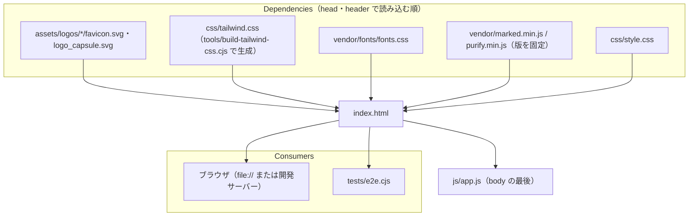

# index.html

ソース: [src/index.html](../../src/index.html)（ひな形。Web 版の `ja/index.html`・`en/index.html`・転送用の `index.html` と、スタンドアロン版の `index.html` は [tools/build-html-pages.cjs](tools/build-html-pages.cjs.md) が作る。アーキテクチャ 4.14 `ARC-PUB-009`）／設計: `DD-FILE-001`〜`007`、`DD-FM-011`、`DD-LIGHT-001`、`DD-SHOW-001`、アーキテクチャ 4.5

## 依存関係

## 変更するときの注意

- **要素の id**: `app.js` と `tests/e2e.cjs` が id で参照している（`#shortcut-modal`、`#zoom-modal` など）。id を変えるときは、両方を検索して直す。
- **head に書かないライブラリ**: Mermaid と KaTeX は、`app.js` の `LIBRARIES` が必要になったときに読み込む（版もそこで固定している）。
- **同梱のライブラリの版**: SVG の後処理の多くが Mermaid の出力の構造（class 名、id、要素の並び）に依存している。版を上げるときは、テストを全件実行し、図の画像を目視で確認する。
- **開く・保存のメニューの項目**: 項目の並び（開く: 「ファイルを開く…」「フォルダを開く…」、同梱サンプル 3 件。保存: 「Markdown を保存（ファイル名）」「印刷 / PDF として保存…」）は `TC-FILE-002`・`TC-FILE-021` が文字で照合している。項目を増やすときはテストも直す。「前回のフォルダ「名前」を開く」（`#menu-open-recent-folder`）は、覚えたフォルダがあるときだけ `hidden` を外すため、テストは表示中の項目だけを数える。
- **Tailwind のクラス**: フォルダの一覧と保存メニューは、`css/tailwind.css` に既にあるクラスと、`css/style.css` の専用のクラス（`.folder-pane` など）だけで組んでいる。新しい Tailwind のクラスを使うときは、`tools/build-tailwind-css.cjs` で作り直す。
- **印刷で隠れる場所**: `body` の直下（`main` 以外）と、`#pane-preview` の中の `#preview-scroll` 以外は、印刷で刷らない（`DD-VTPL-131`）。文書の一部として刷る要素は `#preview-scroll` の中に置く。
- **初期値で隠す要素**: スタイルバー（`#style-bar`）は `.is-hidden`、エディタの「閲覧 / 編集」の切り替え（`#editor-lock`）は `.hidden` を初期値に持ち、`app.js` が表示する（`DD-DIAG-063`、`DD-FILE-041`）。どちらも Tailwind の `flex` などと同じ要素に付くため、`style.css` の詳細度の高い規則で隠している。初期値のクラスを外すと、起動直後に表示される。
- **HTML エクスポート**: `document.documentElement.outerHTML` を書き出すため、`<head>` の読み込み（KaTeX の CSS など）は書き出した HTML にもそのまま入る。0.2.0 では、ヘッダーの `HTML` ボタン（`#btn-export-html`）を置いていない（`DD-OFF-005`、`CR-001`）。作り直すときにボタンを戻す。
- **参照は `./` で書く（`ARC-PUB-009`）**: ひな形の `src`・`href` は `./` からの相対パスで書く。言語別のページ（1 階層深い）では、ビルドが `../` に書き換える。`./` 以外（`assets/…` のような書き方）は書き換わらず、言語別のページで読めなくなる。JavaScript で組み立てるアセットの参照は、`assetUrl()`（`src/ts/ui/asset-url.ts`）を通す。
- **Web 版の利用状況計測（GTM / GA4、`DD-FILE-095`）**: ひな形 `src/index.html` の `LUCIVO_WEB_ANALYTICS_START`〜`END` は `gtm.js?id=GTM-KMQ3KLNT` 読み込み前に `gtm.start`（`event: 'gtm.js'`）を `dataLayer` へ積み、スタンドアロン版ビルド（`tools/build-app.cjs --channel standalone`）では除去される。GTM / GA4 側の設定および確認手順は次のとおり。
  - **GTM の変数（データレイヤー変数）**: `release_channel`、`design_style`、`tone`、`present_mode` の 4 つをデータレイヤー変数として作成する。
  - **GTM のトリガー（カスタムイベント）**: イベント名 `design_style_select`、`tone_select`、`present_mode_select` に対応するカスタムイベントトリガーを作成する（`.*` 正規表現一致で `^(design_style_select|tone_select|present_mode_select)$` にまとめることも可）。
  - **GTM のタグ（GA4 イベント）**: 対象イベントごとに GA4 イベントタグを作成し、イベントパラメータに `release_channel` と該当パラメータ（`design_style` / `tone` / `present_mode`）を割り当てて公開する。
  - **GA4 のカスタムディメンション**: GA4 管理画面（カスタム定義）で `release_channel`、`design_style`、`tone`、`present_mode` をイベントスコープのカスタムディメンションとして登録する。
  - **動作確認（GTM Preview / GA4 リアルタイム）**:
    1. GTM の「プレビュー」でカナリー版（`/preview/`）または正式版を開き、Tag Assistant のタイムライン先頭に `Container Loaded`（`gtm.js` / `gtm.start`）が発火していることを確認する。
    2. デザインスタイル・トーン・発表モード（メニュー選択時）を切り替え、それぞれのカスタムイベントが発火して `release_channel` がプレビュー版で `preview`、正式版で `production` になっていることを確認する。
    3. GA4 の「DebugView」または「レポート > リアルタイム」で、`design_style_select` / `tone_select` / `present_mode_select` とパラメータが受信されていることを確認する。
    4. `http://localhost` 等のローカルビルドおよび `dist/index.html`（`file://`）ではカスタムイベントが送信されないことを確認する。
