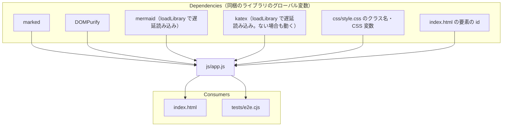

# js/app.js

ソース: [js/app.js](../../../public/js/app.js)／設計: [3.sw_design_notes/](../../3.sw_design_notes/README.md) の全 feature（FILE, DIAG, MD, MATH, FM, EDGE, VTPL, LIGHT, SHOW）

ビルドなしで `file://` から動かすため（`NFR-001`）、モジュールに分けない単一のスクリプトで、関数と状態はグローバルに置いている。

## 依存関係

## 変更するときの注意

- **テストからの間接的な依存**: `tests/e2e.cjs` は、ページ内のグローバルな `state`・`renderApp`・`lastLoadedMarkdown` と、`#telemetry-status` の文言（`Rendering` を含むかどうかで描画の完了を判定）を直接参照する。名前や文言を変えるときはテストも直す。
- **CSS との間接的な依存**: 生成する HTML のクラス名（`lucivo-math`、`front-matter`、`fm-*`、`edge-curve-btn`、`exhibition-*`、`vs-*` など）と、雛形の組み替えで付ける CSS 変数（`--vs-n`、`--vs-cols`、`--vs-cols-wide`）は `style.css` が前提にしている。`--accent` などの CSS 変数は `syncCssTokens()` がパレットに合わせて上書きする。
- **描画結果のキャッシュのキー**: 図の SVG は、Mermaid のコードと見た目に関わる設定（外観、パレット、矢印の形状、スタイル、モード）のハッシュをキーにキャッシュする。図の見た目に影響する設定を追加したら、キーにも含める。含めないと、設定を変えても古い図が表示される。
- **要素の探索範囲**: 図のカードの要素は、表示中のコンテナの中だけから探す。`document` 全体から探すと、別のモードの同じ番号のカードを拾う（`DD-DIAG-003`）。
- **DOM に入れる前と後**: `postProcessSvg()` は文書に入れていない要素を処理するため、計算後のスタイルや大きさは取れない。それらが必要な処理は `applyReadableFit()`（およびその中の `updateSlabSplit()`）のように DOM に入れた後に行う。キャッシュから表示するたびにも呼ぶ。
- **雛形の判定の閾値**: 雛形を選ぶ条件の数値（`TEMPLATE_LIMITS`）は、デザイン仕様 `DTP-VTPL-001` と同じ値にする。変えるときは、デザイン仕様とテスト仕様（`TC-VTPL-*`）も直す（`DD-VTPL-001`）。定義リスト型（`isGlossaryList()`）は要点カード型より先に調べる。順を入れ替えると、2〜6 個のダッシュ区切りの箇条書きが要点カード型になる（`DD-VTPL-019`）。
- **コールアウトを置き換える位置**: `decorateAlerts()` は、Visualモードでは `buildVisualStageHtml()` で雛形の判定より前に呼ぶ。判定の後に動かすと、コールアウトだけの章がステートメント型になる（`DD-MD-021`）。
- **見出しの元の行**: `renderApp()` は最上位のトークンの `raw` の改行を数えて `srcLine` を付ける。トークンを足す・除く処理（図のスロットへの置き換えなど）を入れるときも、行の数え方は元のトークンの `raw` で進める。`renderer.heading`（`setupMarkedHeadings()`）を別の拡張で上書きすると、`data-src-line` が出力されず、編集位置への追従（`FR-037`）が止まる（`DD-DIAG-060`）。
- **プレビューのスクロール**: J/K の章移動と編集位置への追従は、`previewScrollTopOf()` と `scrollBehavior()` を共有する。上端からの余白（`PREVIEW_SCROLL_MARGIN`）を変えると、両方とテスト（`TC-DIAG-022`）に効く。
- **雛形の装飾要素とスポットライト**: `applySlabTemplate()` で追加する `.vs-card-ornament`・`.vs-step-chevron`、および `decorateCodeBlocks()` で追加する `.vs-code-caret`・`.vs-code-copy-btn`、表紙の `.vs-cover-spec-pill` はテキストノードを持たない空要素とし、ラベルは `data-*` 属性＋CSS 擬似要素で描画する（`TC-VTPL-003` が高速モードと Visualモードの `textContent` およびインライン要素数の完全一致を検査するため）。また、スポットライト操作（`setupVisualStageInteractions()`）は `#visual-stage-container` へのイベントデリゲーションとクラス付け替えだけで行い、`getComputedStyle` や再描画を呼ばない（`DD-VTPL-015`, `TC-PERF-002`）。
- **表紙の値と表の列の判定**: 表紙は `readCoverMeta()` がフロントマターの原文から読んだ値で組むため、`renderApp()` は `buildVisualStageHtml()` に YAML の原文を渡す。`author` / `date` は単一行スカラー値のみを読み取り、入れ子ブロックは無視する（`TC-VTPL-015` の入れ子 `author.title` を除外するため）。表紙の上限（`COVER_LIMITS`）と表の列の判定（`NUMERIC_CELL`・`EMPTY_CELL`・`TABLE_LABEL_CHARS`）の値は、デザイン仕様 `DTP-VTPL-100`・`110` と同じにする。目次の項目は `button` のため、クリックの委譲で `a, button` を除外する前に処理する（`DD-VTPL-040`〜`045`）。
- **モーダル開閉の共通化**: `#zoom-modal` と `#shortcut-modal` の表示状態確認・開閉は `isModalOpen(id)` / `setModalOpen(id, open)` に統一しており、`stage.js` からもこれを参照する。
- **スラブ画像エクスポート**: `renderSlabToBlob()` は SVG `foreignObject` と Canvas を使ってスラブを高解像度 PNG 化する。外部ライブラリを増やさず、オフラインで完結する（`NFR-008`）。スラブのクローンから `.slab-actions` と `canvas.signal-light-canvas` を除外して描画する。ただし、スタイルシートを埋め込んでおらず、失敗や 250ms の超過で題名とリードだけの簡易な絵に切り替わるため、出力は誌面にならない。0.2.0 では `SLAB_IMAGE_EXPORT_ENABLED = false` で操作部を出していない（`DD-VTPL-124`、`CR-001`）。
- **構文エラーの図**: Mermaid には `suppressErrorRendering: true` を渡し、`processDirtyBlocks()` の `catch` で `#d<描画 ID>` が残っていれば消す。Mermaid は構文エラーのときに `body` へエラーの図を描いたまま例外を投げるため（`DD-DIAG-064`）。
- **HTML の書き出し**: 処理は残しているが、0.2.0 ではボタン（`#btn-export-html`）がないため、つながない（`DD-OFF-005`、`CR-001`）。
- **キーボードナビゲーションと入力抑止**: `setupKeyboardShortcuts()` は非発表時に動作し、`document.activeElement` が `isEditableElement`（textarea / input / select）の場合はショートカットを抑止して文字入力を優先する（`DD-KEY-001`）。
- **図の SVG に光を足さない**: 光は `js/stage.js` が SVG の外の Canvas に描く。`postProcessSvg()` の結果はキャッシュされ、PNG / SVG の書き出しにそのまま使うため、見た目の演出の要素を SVG に足すと書き出しに混ざる（`DD-LIGHT-003`）。
- **サニタイズの順序**: 本文とフロントマターの HTML は DOMPurify を通してから DOM に入れる。KaTeX の数式だけは、サニタイズ後に置き場所へ描画する（KaTeX の出力はサニタイズで崩れるため、`DD-MATH-020`）。
- **遅延読み込み**: `window.mermaid` / `window.katex` は、図・数式が現れるまで存在しない。`window.LucivoStage` は Visualモードの描画で読み込むまで存在しない。`setupMermaid()` は Mermaid がなければ何もしないため、描画の直前（`processDirtyBlocks()` で `loadLibrary('mermaid')` を待った後）に呼ぶ。
- **Mermaid の `securityLevel`**: `strict` にしている。`loose` に戻すと、開いた Markdown の図の中の HTML とクリック時のスクリプト呼び出しが有効になる。
- **Tailwind のクラス**: 生成する HTML で新しい Tailwind のクラスを使ったら、`tools/build-tailwind-css.cjs` で `css/tailwind.css` を作り直す。
- **Mermaid の設定は描画ごと**: `mermaid.initialize()` はグローバルな設定のため、図ごとに異なる設定（モード、矢印の形状）は、各図の `mermaid.render()` の直前に `setupMermaid()` で設定し直している。レイアウトも図ごとで、`getMermaidLayout(code, curve)` が決める（直角のクラス図とマインドマップは Mermaid の既定のレイアウト、他は `dagre`。`DD-EDGE-005`）。既定のレイアウトでは `curve` の設定が効かないため、直角以外の形状やフローチャートをこの分岐に入れない。
- **モードの切替の画面の状態**: 高速モード / Visualモードのボタンの選択状態とスタイルバーの表示は、`syncStageModeUi()` だけで切り替える（`DD-DIAG-063`）。`state.isVisualMode` を変える処理を足すときは、あわせてこの関数を呼ぶ。
- **図のドラッグと Ctrl + ホイール**: `setupDiagramPanZoom()` は、図のカードではなく `document` にイベントを 1 回だけ付ける（`DD-DIAG-070`）。カードは描画のたびに作り直されるため。`wheel` は `passive: false` で付けないと `preventDefault()` が効かず、ブラウザのページ全体のズームが起きる。拡大の幅は CSS 変数 `--zoom-width` で渡す（`DD-DIAG-071`）。SVG の `style` の幅は、`Fit` / `1:1` の CSS の `!important` に負ける。
- **ウィンドウのタイトル**: `document.title` は `applyLoadedMarkdown()` だけで変える（`DD-FILE-050`）。読み込みの経路を増やすときは、`applyLoadedMarkdown()` を通すと、タイトル・読み取り専用・破棄の確認が揃う。

