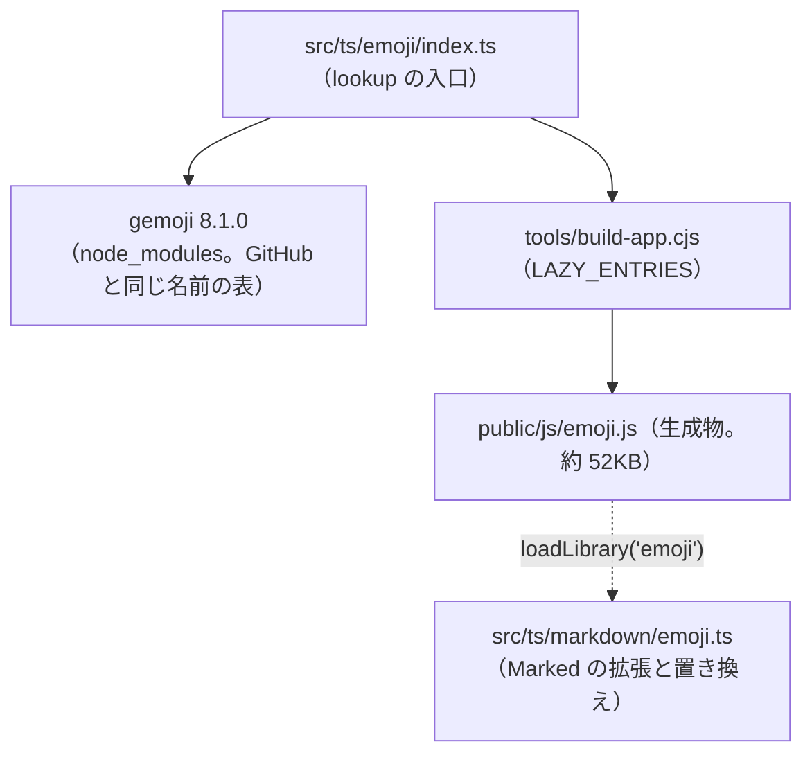

# js/emoji.js

ソース: [src/ts/emoji/index.ts](../../../src/ts/emoji/index.ts)／生成物: `public/js/emoji.js`／設計: `DD-MD-070`〜`072`

ショートコード（`:rocket:` など）を含む文書を描くときだけ読み込む部品。`window.LucivoEmoji.lookup(name)` を公開する。

## 依存関係

## 注意点

- 表は起動時に読み込まない（`NFR-006`）。`src/ts/markdown/emoji.ts` が、`:名前:` の形が文書に現れたときだけ `loadLibrary('emoji')` で読み込む。
- 生成物は `public/js/` の中のため、コミットしない。`gemoji` のライセンス（MIT）は `node_modules` に残る。ライブラリの更新は、`package.json` の版を上げて `npm run build` し、`TC-MD-021` を通す。
- HTML の書き出しは、置き換えた後の絵文字をそのまま含むため、配布先に表は要らない（`EXPORT_URLS` に足さない）。
