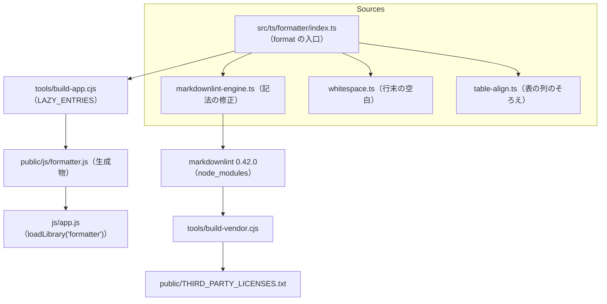

# js/formatter.js

ソース: [src/ts/formatter/](../../../src/ts/formatter/)（`index.ts`・`markdownlint-engine.ts`・`whitespace.ts`・`table-align.ts`）／生成物: `public/js/formatter.js`／設計: `DD-FILE-088`〜`092`

文書を読み込むとき・「今の文書を整える」のときだけ読み込む部品。`window.LucivoFormatter.format(markdown)` を公開する。

## 依存関係

## 変更するときの注意

- **生成物を直接直さない**: `public/js/formatter.js` は `npm run build:prod` で作る。生成物はコミットしない（`doc/2.ARCHITECTURE.md` 4.14）ので、ソースを直したらビルドし直して確かめる。
- **見えない文字**: 同梱する markdownlint の部品は、ゼロ幅接合子などの見えない文字を含む。`charset: 'ascii'` でビルドしているので、出力ではエスケープになる。設定を外すと `npm run lint` が失敗する。
- **規則を足すとき**: 表示を変えないか、作者の書き方を不要に変えないかを確かめる。規則を足したら、`tests/fixtures/format/messy.md` に乱れの例を、`messy.expected.md` に整えた結果を足し、TC-FILE-036・037 を合格させる。
- **ライセンス**: markdownlint の版を変えたら `npm run build:vendor` を実行し、`public/THIRD_PARTY_LICENSES.txt` を作り直す（同梱したパッケージを esbuild の metafile から集める）。
- **テストへの影響**: 「ファイルを開く…」で開いた文書は整える。元のファイルとエディタの内容を照らし合わせるテストは、整形を止めるか、整えた文書と照らし合わせる（TC-FILE-029・035）。
