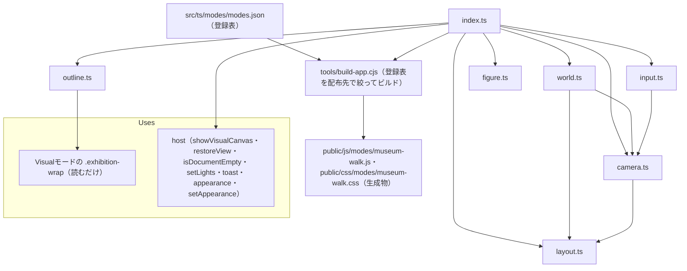

# js/modes/museum-walk

ソース: [src/ts/modes/museum-walk/](../../../../src/ts/modes/museum-walk/)／生成物: `public/js/modes/museum-walk.js`・`public/css/modes/museum-walk.css`（コミットしない）／設計: `DD-MWLK-001`〜`011`／目次: [README.md](README.md)

発表のドロップダウンで「ミュージアム・ウォーク」を選んだときだけ読み込む部品（登録表の `stage: "web"`）。読み込まれたときに `LucivoModes.register('museum-walk', { enter, exit, info, walkTo })` で自分を登録する。`walkTo` はテストと確認用。

| ファイル    | 役割                                                                                          | DOM      |
| :---------- | :-------------------------------------------------------------------------------------------- | :------- |
| `index.ts`  | 始める・終える（`enter`・`exit`）、毎フレームの更新の呼び出し、終了ボタン、調整のパネル、登録 | 作る     |
| `outline.ts` | Visualモードの DOM から、表紙・章・ブロック（小見出し・本文・箇条書き・表・引用・図）を読み取る | 読むだけ |
| `layout.ts` | 文書の構造を、奥行きに沿った割り付け（区間・門・立体図・パーツ）に変える。寸法の表 `LAYOUT`   | 触らない |
| `camera.ts` | カメラワーク（`CAMERA_SPEC`・`cues()`・`direct()`）                                           | 触らない |
| `world.ts`  | 割り付けから 3D の空間を組み立て、毎フレーム更新する。パーツの高さを測る                      | 作る     |
| `input.ts`  | ホイール・キー・ポインター、歩く速さの計算（`stepWalk()`）                                    | 受けるだけ |
| `figure.ts` | 図の SVG を Blob の URL の画像にする（線とノードの 2 層に分ける）                             | 読むだけ |
| `style.css` | 空間の質感（Dark / Light）、パーツ・門・立体図・画面に固定の表示。すべて `#museum-walk` の中  | —        |

## 依存関係

## 変更するときの注意

- **カメラワークの見直し**: `camera.ts` の 3 つ（`CAMERA_SPEC` の値、`cues()` の場所ごとの指示、`direct()` の組み合わせ方）だけを直す。値は、URL に `museum-tune` を含めて開き（例: `index.html?museum-tune`）、`C` キーのパネルで歩きながら動かせる。決めた値は「コピー」で JSON に書き出し、`CAMERA_SPEC` の初期値へ写す。
- **割り付けの見直し**: 門・広間・小部屋の間隔と、パーツの幅は `layout.ts` の `LAYOUT` にまとめている。規則を変えたら、詳細設計の「割り付けの規則」も直す。パーツの列・門・立体図は、区間の境目をまたがないように置く（壁の位置 `half` を、パーツの手前の端の区間で決めるため）。
- **歩いている間に再ペイントしない**: 壁・床・天井のタイル（`.mw-wall`・`.mw-floor`・`.mw-ceil`）に、子要素・疑似要素・CSS 変数の書き換え・`filter` を足さない。毎フレーム書くのは `opacity`・`display`・`transform` だけで、値が変わったときだけ書く（`DTP-MWLK-070`）。画面の外の要素は `visibility: hidden` ではなく `display: none` で外す。
- **文字のぼけ**: 壁の文字のパーツと立体図は、2 倍の大きさで組み、`transform` の末尾の `scale(0.5)` で置く。CSS の文字の大きさは、表示の大きさの 2 倍で書く（例: 本文は 34px 相当を `68px`）。
- **Visualモードの DOM を書き換えない**: `outline.ts` は複製（`cloneNode`）して使い、`id`・ボタン・飾りを消す。元の DOM に触ると、終えたあとの Visualモードが崩れる。
- **図の画像**: `figure.ts` が作る Blob の URL は、外観ごとに保持して `exit()` で解放する。`T` で外観を切り替えたときは、`host.setAppearance()` で図を再描画して図板（`.mw-fig-frame.is-dark` / `.is-light`）と画像を追従させる。Mermaid の図でない層の構造（`.nodes`・`.edgePaths` がない）のときは、1 枚の画像にする。
- **本体に触れない**: 本体の中身を使わず、`enter(host)` で受け取る host だけを使う（`ARC-MODE-006`）。外観の初期値は `localStorage`（`lucivo-museum-walk-appearance`、未保存時は `'dark'`）から決め、本体の外観と異なるときは `host.setAppearance()` で図を描き直して読み取る。終了時は `host.restoreView()` で本体の外観を元に戻す。
- **CSS の名前**: クラスは `mw-` で始め、すべて `#museum-walk` の中に書く。本体の CSS（`.wall` などの一般的な名前）とぶつけない。
- **テスト**: `walkTo(z)` で位置を決めて確かめる。画面なしの Chromium は毎秒のコマ数が少なく、1 コマの進みに上限（0.05 秒分）があるため、キーを押し続けるテストは、短い距離を長めに押して確かめる。
