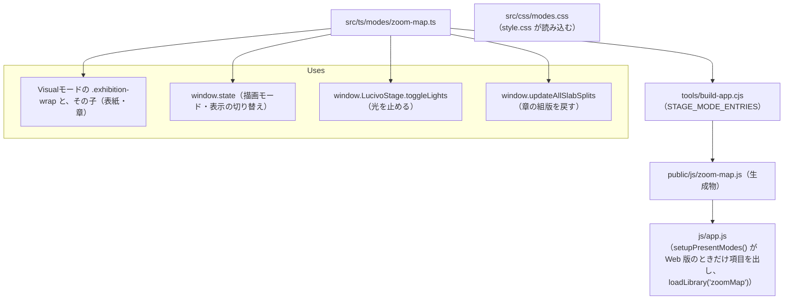

# js/zoom-map.js

ソース: [src/ts/modes/zoom-map.ts](../../../src/ts/modes/zoom-map.ts)、[src/css/modes.css](../../../src/css/modes.css)／生成物: `public/js/zoom-map.js`／設計: `DD-SHOW-110`〜`114`

発表のドロップダウンで「ズーミング・マップ」を選んだときだけ読み込む部品（Web 版だけ）。`window.LucivoZoomMap`（`enter`・`exit`・`next`・`prev`・`goTo`・`info`）を公開する。

## 依存関係

## 変更するときの注意

- **章を複製しない**: Visualモードの章の DOM をそのまま並べ直す。終えるときに、付けたスタイル（`.exhibition-wrap` の `transform`・`width`・`height`、章の `left`・`top`・`width`）をすべて外す。外し忘れると、Visualモードの組版が崩れる（TC-SHOW-018 で、付けたスタイルが残らないことを確かめる）。
- **`.exhibition-wrap` の幅**: container queries の基準のため、平面の全体の幅を付けない。章の幅（1200px）のままにし、平面の大きさはモジュールの中の `state.plane` で持つ。
- **`will-change`**: 動いている間だけ付ける（`.is-flying`）。止まっても残すと、拡大した文字がぼける。
- **Web 版だけ**: 入口の項目は `index.html` で `hidden` にしておき、`app.ts` が Web 版のときだけ外す。スタンドアロン版では部品を読み込まない（TC-SHOW-015）。
- **テスト**: Web 版の TC は、テストの中で `public/` を配る HTTP サーバー（`startWebServer()`）を立てて確かめる。
