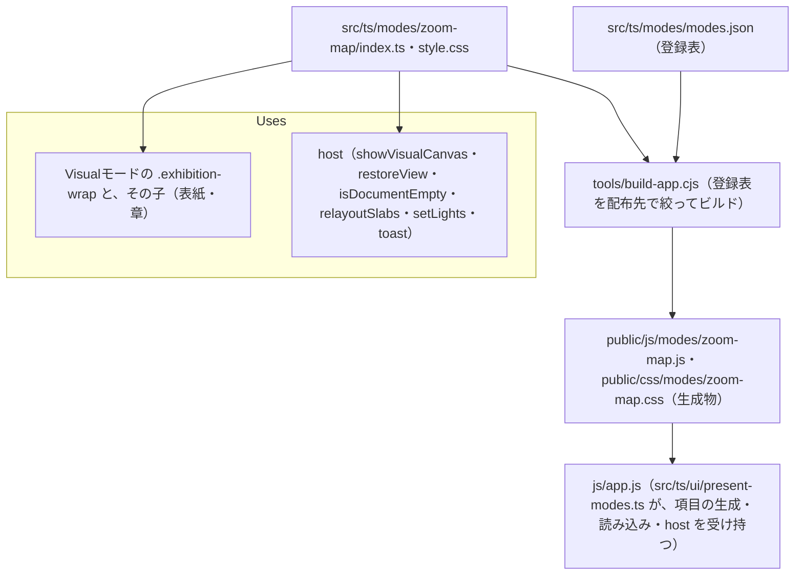

# js/modes/zoom-map

ソース: [src/ts/modes/zoom-map/](../../../../src/ts/modes/zoom-map/)（`index.ts`・`style.css`）／生成物: `public/js/modes/zoom-map.js`・`public/css/modes/zoom-map.css`（コミットしない）／設計: `DD-SHOW-110`〜`114`／目次: [README.md](README.md)

発表のドロップダウンで「ズーミング・マップ」を選んだときだけ読み込む部品（登録表の `stage: "web"`）。読み込まれたときに `LucivoModes.register('zoom-map', { enter, exit, info, next, prev, goTo })` で自分を登録する。`next`・`prev`・`goTo` はテストが使う。

## 依存関係

## 変更するときの注意

- **章を複製しない**: Visualモードの章の DOM をそのまま並べ直す。終えるときに、付けたスタイル（`.exhibition-wrap` の `transform`・`width`・`height`、章の `left`・`top`・`width`）をすべて外す。外し忘れると、Visualモードの組版が崩れる（TC-SHOW-018 で、付けたスタイルが残らないことを確かめる）。
- **`.exhibition-wrap` の幅**: container queries の基準のため、平面の全体の幅を付けない。章の幅（1200px）のままにし、平面の大きさはモジュールの中の `state.plane` で持つ。
- **`will-change`**: 動いている間だけ付ける（`.is-flying`）。止まっても残すと、拡大した文字がぼける。
- **本体に触れない**: 本体の中身（`window.state`、`#btn-visual-mode` のクリックなど）を使わず、`enter(host)` で受け取る host だけを使う（`ARC-MODE-006`）。表示の切り替えと、戻す表示（光の演出・スクロールの位置を含む）は host が受け持つ。
- **`relayoutSlabs()`**: 章の幅を変えたあと、章の中の 2 段組みの判定をやり直す。以前の実装は、`updateAllSlabSplits()` を引数なしで呼んでおり、関数は対象の要素がないと何もせずに戻るため、実際には判定をやり直していなかった。今は `#visual-stage-container` を渡して、実際に判定をやり直す。
- **提供する版**: 項目は登録表から本体が作る。スタンドアロン版には、ビルドの時点でモードを入れない（TC-SHOW-015、`TC-MODE-005`）。
- **テスト**: Web 版の TC は、テストの中で `public/` を配る HTTP サーバー（`startWebServer()`）を立てて確かめる。テストは `LucivoModes.get('zoom-map')` を通してモードを操作する。
