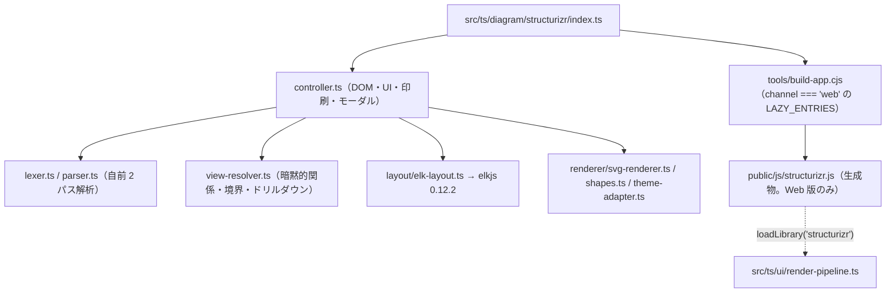

# js/structurizr.js

ソース: [src/ts/diagram/structurizr/index.ts](../../../src/ts/diagram/structurizr/index.ts)／生成物: `public/js/structurizr.js`（Web 版限定）／設計: `ARC-STR-001`〜`007`, `DD-DIAG-090`〜`094`

Markdown の ```` ```structurizr ```` / ```` ```structurizr-dsl ```` コードブロックを含む文書を描くときだけ Web 版で遅延読み込みする部品。`window.LucivoStructurizr` を公開する。

## 依存関係



## 注意点

- 起動時および Structurizr を含まない文書では読み込まない（`NFR-006`）。`channel === 'web'` のビルドでのみ生成し、スタンドアロン版（`dist/`）には含めない（`NFR-008`）。
- 画面表示中の `<svg>` は既存図と同じく `[data-stage-index]` の直下に配置し（`DD-DIAG-090`）、ビュー切替バーと印刷専用コンテナ（`.lucivo-structurizr-print-all`）を兄弟要素に置く。
- `elkjs`（`EPL-2.0 OR GPL-3.0-or-later`）のライセンス本文は、Web 版ビルド時に `public/js/STRUCTURIZR_LICENSES.txt` として自動出力する。
- 版の更新時は `package.json` の `"elkjs"` を更新し、`npm run test:unit`（`tests/structurizr-core.test.cjs`）および `node tests/e2e.cjs testStructurizr` を通す。
