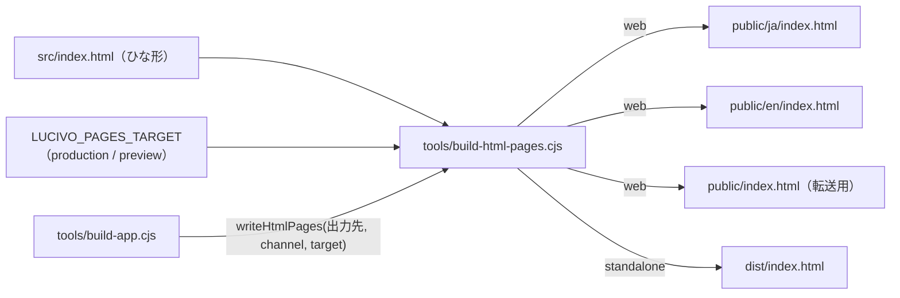

# tools/build-html-pages.cjs

ソース: [tools/build-html-pages.cjs](../../../tools/build-html-pages.cjs)／設計: アーキテクチャ設計書 4.14 `ARC-PUB-009`、要求 `FR-065`／テスト: `TC-I18N-005`〜`009`、[tests/build-html-pages.test.cjs](../../../tests/build-html-pages.test.cjs)

## 依存関係

## 注意点

- **転送のスクリプトは文字列にして埋め込む**: `lucivoLangRedirect()` は、`toString()` で文字列にし、esbuild で縮めて `<script>` に入れる。関数の外の変数や `require` したものを参照すると、ブラウザで動かない。転送用のページは 1KB 未満に収める（単体テストで確かめる）。処理を足すときは、大きさに気を付ける。
- **`<meta charset>` の直後に入れる**: 言語別のページでは、転送のスクリプトを `<meta charset="UTF-8" />` の直後に入れ、計測（GTM）より先に動かす。ひな形のこの行の書き方を変えると、ビルドが止まる。
- **参照の書き換えは `./` で始まるものだけ**: `src="./…"`・`href="./…"` を `../` に書き換える。ひな形に `./` 以外の相対パスを書くと、言語別のページで読めなくなる。
- **README への導線**: ひな形には日本語版の README を開く URL（`/preview/ja/`）を書き、英語版のページでは英語版の URL（`/preview/en/` と `README.en.md`）に置き換える。URL を変えるときは、`src/ts/i18n/index.ts` の `getReadmeViewerUrl()` と、本スクリプトの `README_URL_JA`・`README_URL_EN` をそろえる。
- **説明文と OGP の文言（`PAGE_META`）**: 言語ごとの説明文と `og:locale` を持つ。日本語版を正とし、日本語版を変えたら、同じ作業の中で英語版も訳して変える（`AGENTS.repo.md` 12 章）。タイトルはひな形の `<title>` を使うため、ここには持たない。`og:image` は `OGP_IMAGE`（`AST-147`。[build-ogp-image.cjs.md](build-ogp-image.cjs.md)）を指す。
- **`LUCIVO_PAGES_TARGET`**: 未指定は `production`（`hreflang` を書く）。`/preview/` のビルド（`deploy.yml`）だけが `preview` を渡し、`noindex` を書いて `hreflang` を書かない。
