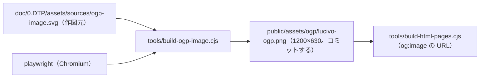

# tools/build-ogp-image.cjs

ソース: [tools/build-ogp-image.cjs](../../../tools/build-ogp-image.cjs)／デザイン: `DTP-010`、素材: `AST-147`／設計: アーキテクチャ設計書 4.14 `ARC-PUB-009` とファイルの分類

## 依存関係

## 注意点

- **ビルドのたびには動かさない**: 書き出しにブラウザが要るため、`css/tailwind.css` と同じく事前生成としてコミットする。作図元を変えたら、`node tools/build-ogp-image.cjs` を実行し、PNG もコミットする。
- **Web 版だけ**: `tools/build-app.cjs` は、`assets/ogp/` をスタンドアロン版（`dist/`）へ写さない（`WEB_ONLY`）。
- **大きさ**: 単体テスト（`tests/build-html-pages.test.cjs`）が、PNG の幅と高さ（1200×630）を確かめる。
