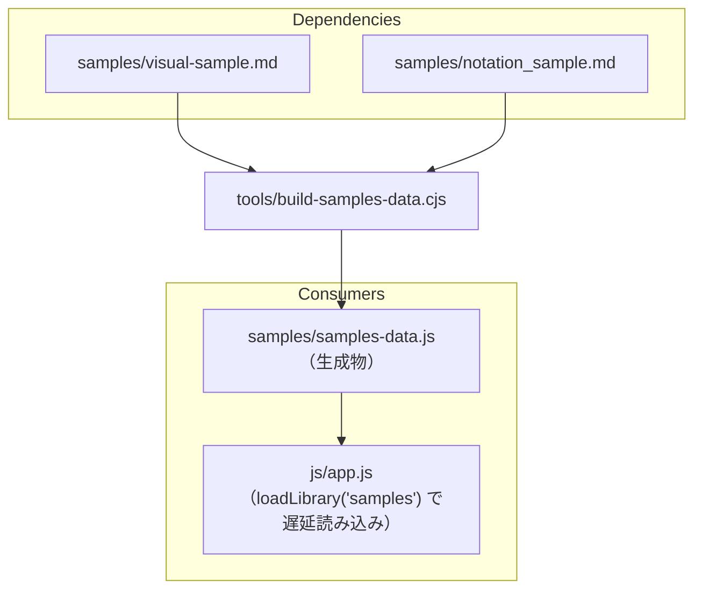

# tools/build-samples-data.cjs

ソース: [tools/build-samples-data.cjs](../../../tools/build-samples-data.cjs)／設計: `DD-FILE-015`

## 依存関係

## 変更するときの注意

- `samples/samples-data.js` はビルドの出力でコミットしない（`doc/2.ARCHITECTURE.md` 4.14）。`tools/build-app.cjs` が、出力先（`public/` または `dist/`）に毎回作る。このスクリプトは、出力先を受け取る関数 `buildSamplesData(outRoot)` を書き出し、単体でも実行できる。
- `samples/*.md` は、常に `public/samples/` から読む。ここを変えた後は、ビルドし直さないと `file://` で古いサンプルが読み込まれ、`TC-FILE-003` の一致検証が失敗する。
- 改行コードは LF（`\n`）に統一し、先頭の UTF-8 BOM（`\uFEFF`）は除いて出力する。
