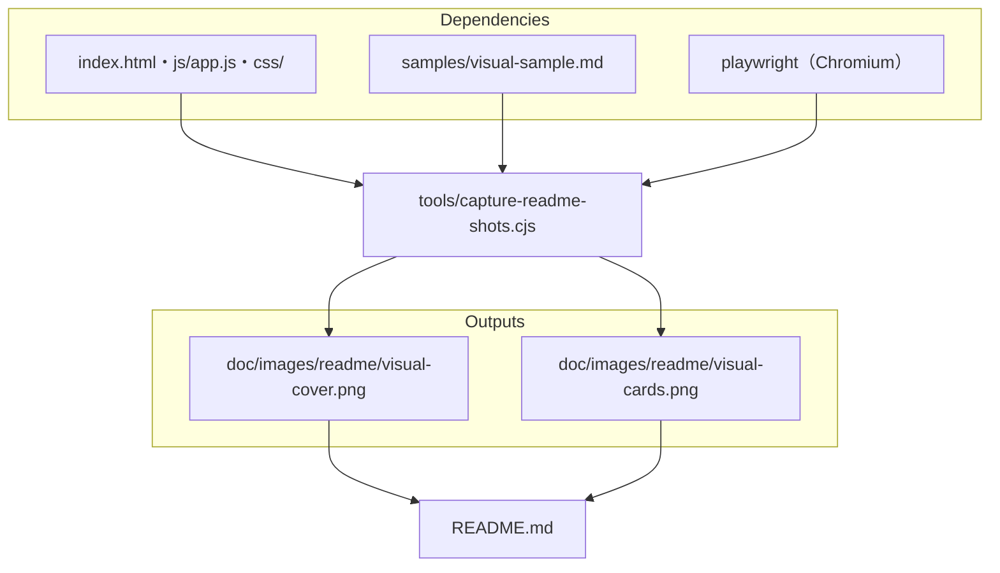

# tools/capture-readme-shots.cjs

ソース: [tools/capture-readme-shots.cjs](../../../tools/capture-readme-shots.cjs)

README の冒頭に載せる画面写真（Visualモードの表紙と要点カード）を撮り直す。主にエージェントが、画面の見た目を変えたときに実行する。配布物には含めない。

## 使い方

```sh
node tools/capture-readme-shots.cjs [出力先のフォルダ]
```

既定の出力先は `doc/images/readme/`（`AGENTS.repo.md` 2 章）。Playwright の Chromium が必要（`npx playwright install chromium`）。

## 依存関係



## 変更するときの注意

- 撮る章は、`visual-sample.md` の章の題（「4列カード」）で探している。サンプルの章の題を変えたら、スクリプトも合わせる。
- 右下の状態表示（`#telemetry-pill`）と章の操作部（`.slab-actions`）は、CSS で隠して撮る。README の写真に操作部を写さないため。
- 撮った後は、画像を開いて、崩れや写り込みがないことを確かめてからコミットする。
