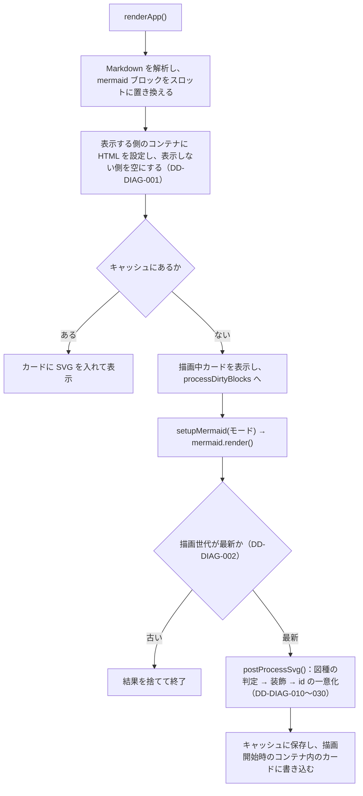

# 図の描画と後処理（diagram-rendering）

対応する要求: `FR-002`, `FR-003`, `FR-008`, `FR-010`, `FR-015`, `NFR-002`, `NFR-004`, `NFR-005`（[1.SRS.md](../../1.SRS.md) および [1.SRS/features/diagram-rendering.md](../../1.SRS/features/diagram-rendering.md)）／アーキテクチャ: [2.ARCHITECTURE.md](../../2.ARCHITECTURE.md) 4.2・4.3・4.6・4.9

## 1. 描画の流れ

## 2. 描画先の管理

| ID          | 項目                 | 設計                                                                                                                                                  | 対応する要求        |
| :---------- | :------------------- | :---------------------------------------------------------------------------------------------------------------------------------------------------- | :------------------ |
| DD-DIAG-001 | 非表示側の破棄       | `renderApp()` は、表示しない側のコンテナ（高速モードの `#standard-doc-container` または `#visual-stage-container`）の中身を空にする                   | `FR-003`, `NFR-004` |
| DD-DIAG-002 | 描画世代             | `renderApp()` を呼ぶたびに `renderGeneration` を 1 増やし、`processDirtyBlocks()` に描画開始時の世代・コンテナ・モードを渡す。`mermaid.render()` の前後で世代が変わっていれば、結果を DOM にもキャッシュにも反映せずに終了する | `FR-003`, `NFR-002` |
| DD-DIAG-003 | 書き込み先の探索範囲 | 描画結果の書き込み先と、カードのボタン（Fit / 1:1 / PNG / SVG / Expand）の操作対象は、描画開始時のコンテナの中から探す（`document` 全体から探さない） | `FR-003`, `FR-005`  |
| DD-DIAG-004 | 直前の正常描画       | 直前の正常描画（LKG）は、図の番号とモード（`std` / `vis-<スタイル>`）の組で保持する。構文エラーのとき、別のモードの図が表示されないようにするため     | `NFR-002`           |
| DD-DIAG-005 | 拡大表示の後始末     | 拡大モーダルを閉じたら、モーダルに複製した SVG を消す                                                                                                 | `FR-005`            |

- **背景（不具合の原因）**: 以前は表示しない側のコンテナに図が残っていた。このため、`document.querySelector('[data-stage-index=N]')` が非表示側のカードを先に見つけ、Visualモードへの初回の切り替えで、描画結果が非表示の高速モード側に書き込まれていた。その結果、Visualモード側のカードが「描画中」のまま残った。DD-DIAG-001 と DD-DIAG-003 で再発を防ぐ。

## 3. SVG の後処理（`postProcessSvg`）

`aria-roledescription` 属性で図種を判定し、モードに応じて装飾した後、id を一意にする。

| ID          | 項目                     | 設計                                                                                                                                                                                                                      | 対応する要求 |
| :---------- | :----------------------- | :------------------------------------------------------------------------------------------------------------------------------------------------------------------------------------------------------------------------ | :----------- |
| DD-DIAG-010 | id の一意化              | SVG 内のすべての id に SVG 自身の id を接頭辞として付け、属性中の `url(#…)`（`style` 属性の `url("#…")` を含む）、`href` / `xlink:href`、`aria-labelledby` / `aria-describedby` の参照を書き換える。1 つの SVG の中で同じ id が重複する場合（タイムラインの `node-undefined` など）は、2 つ目以降に連番を付け、参照は最初の要素に向けたままにする | `FR-008`, `NFR-004` |
| DD-DIAG-011 | ノード装飾を適用する図種 | `NODE_DECORATED_TYPES`（`flowchart-v2` / `flowchart` / `stateDiagram`）だけに、`g.node` の形・塗りの置き換えとサブグラフの装飾を適用する                                                                                  | `FR-008`     |
| DD-DIAG-012 | シーケンス図の装飾       | シーケンス図には、モードに応じて DD-DIAG-020 と DD-DIAG-021 を適用する                                                                                                                                                    | `NFR-004`    |
| DD-DIAG-013 | マーカーの大きさ         | Visualモードでノード装飾を適用した図は、線幅を基準に拡大されるマーカー（`markerUnits` が既定のもの）を、`viewBox` を付けたうえで `userSpaceOnUse` の固定サイズ（元の 1.6 倍）にする。線を太くすると矢じりが巨大になるため | `FR-008`     |

- **背景（DD-DIAG-010）**: Mermaid は、シーケンス図の矢じり（`#arrowhead`, `#crosshead`, `#filled-head`, `#sequencenumber`）、ER 図の端点、ジャーニー図・タイムラインの矢じりを、図をまたいで同じ id で出力する。同じページに同じ id があると、`url(#…)` は文書中で最初の要素を参照する。参照先が非表示の要素や別の図の要素になると、矢じりやグラデーションが描かれないか、別の図の配色になる。
- **背景（DD-DIAG-011）**: 判定に `aria-roledescription` を使うのは、Mermaid がすべての図種でこの属性に図種名を出力するため（`12.3.0` で同梱サンプルの全図種を確認した）。

### DD-DIAG-043 Mermaid 12 の出力への対応（`FR-008`）

Mermaid 12 は既定の見た目・レイアウト・余白が 10 系と異なり、図の装飾が前提にする出力の構造も変わった。従来の組版と装飾を保つため、次の設定と後処理を行う。

- `look: 'classic'` と `layout: 'dagre'` を指定する。既定の `neo` と `elk` では `flowchart.curve` が効かず、矢印の形状を選べない（`FR-012`）
- 直角のクラス図にも `layout` を指定しない（`edge-style.md` の DD-EDGE-005）
- マインドマップには `layout` を指定しない。`dagre` を指定すると、放射状ではなく樹形に配置される。`layout` は図種によらず図全体に効くため、図ごとに `setupMermaid` の引数で切り替える
- `flowchart.padding` と `state.padding` は 10 系の約半分の値にし、`minNodeWidth` を 0 にする。12 は余白を両側に効かせ、短いラベルも最小幅まで広げるので、そのままでは図が広がり、Visualモードの 2 段組みが 1 段に変わる
- フローチャートのスタジアム形のノードは `path` で出力されるので、`rect` に置き換える（`normalizeStadiumNodes`）。クラス図や要件図の箱も同じ `g.basic.label-container` で出力されるので、フローチャートの `outer-path` に限る
- 状態遷移図の分岐（`<<choice>>`）とフォーク・ジョイン（`<<fork>>` / `<<join>>`）は `path` で出力されるので、10 系と同じ `polygon.state-start` と `rect.fork-join` に置き換える（`normalizeStateNodes`）。図の装飾と CSS がこの形を前提にしている
- 矢印のラベルは `.labelBkg` と `p` で包まれる。背景と余白が重なって十字形に見えないよう、背景は `span.edgeLabel` の 1 枚だけにする（`style.css`）

### DD-DIAG-035 ノードの文字の折り返し（`FR-008`、`DTP-004`）

- 文節の折り返し: ノードの文字（`.nodeLabel` とその `p`）に `word-break: auto-phrase` と `text-wrap: balance` を指定する（`diagrams.css`）。全モードに適用する。
- 番号と本文を同じ行に: フローチャートの図を描く直前に、ノードの文字の先頭の番号の後の空白を、改行しない空白（U+00A0）に置き換える（`prepareMermaidSource`、`mermaid-config.ts`）。対象は、形の開き記号（`[`・`(`・`{`・`>`）または引用符 `"` の直後の「数字 1〜3 桁 + 任意の英字 1 字 + ピリオド（`.` / `．`）」と、それに続く空白で、空白の後に文字が続くときに限る。改行しない空白は、Mermaid の文字参照 `#160;` で渡す（Mermaid が描くときに文字に変える）。文字そのものをソースに書くと、ソースとビルドの出力に見えない文字が入り、`npm run lint` で止まる（esbuild は `String.fromCharCode(0xa0)` も文字に置き換えて出力する）。著者の Markdown と、描画結果のキャッシュのキー（元のコード）は変えない。
- 測るときと描いた後の太さをそろえる: Visualモードでは、ノードの文字の太さ（`VISUAL_NODE_LABEL_WEIGHT`。shapes・cards・circles は 700、editorial は 600）を Mermaid の `themeCSS` に渡す（`setupMermaid`）。後処理（`svg-visual-styles.ts`）も同じ定数で太さを付ける。高速モードの `themeCSS` は空にする。
- 背景: Mermaid 12 は、ノードの文字を既定の幅（`flowchart.wrappingWidth`、120px）で文字単位に折り返していた。「集ま／る」のような語の途中の改行と、1 文字だけの最終行ができていた（#145）。Mermaid は図の SVG を文書の中に置いて文字の大きさを測るため、アプリの CSS（文節の折り返し）も、図の `<style>`（`themeCSS`。Mermaid は描く前に入れる）も、測るときに効く。このため、1 つの文節が幅より長いときは、ノードが広がって 1 行に収まり、形からはみ出さない。
- 背景（番号）: `auto-phrase` は番号の後の空白を折り返しの候補にするため、CSS だけでは「1.／ユーザー入力イベント検知」のように番号だけの行ができる。
- 背景（太さ）: Visualモードの後処理は、測った後に文字を太くする（600 → 700）。太くした文字が測った幅に収まらずに折り返し、1 行分の高さの形（スタジアム形など）から下にはみ出していた。
- 採らなかった案: 著者に ` ` で改行を書かせる案（Markdown をそのまま使える方針に反する）。後処理で行を組み直す案（後処理は DOM に入れる前の SVG に行うため、文字の幅を測れない。測れる `applyReadableFit` では、ノードの大きさと矢印の位置がもう決まっている）。折り返しの幅（`wrappingWidth`）を広げる案（横に並ぶ図が縮んで文字が小さくなる。縦長の図の横の空白（#146）と合わせて検討する）。
- 対応していないブラウザ（`auto-phrase` に対応していない Firefox・Safari）では、通常の折り返しになる。番号の置き換えと太さの統一は、どのブラウザでも効く。
- 2 段カード（`cards`）では、上部の帯の分だけ文字を下へずらす（`capH / 2`）ため、`setupMermaid` 側で `flowchart.padding` を通常の `11` から `22` に広げ、2 行の文字やスタジアム形でも上下の余白を保てるようにしている（#187）。

## 4. 配色

### DD-DIAG-020 シーケンス図の配色（`NFR-004`）

`styleSequenceDiagram()` で、次の要素の色を指定する。

| 要素                                       | 高速モード                          | Visualモード            |
| :----------------------------------------- | :---------------------------------- | :---------------------- |
| ライフライン（縦の線、破線 `5 4`、1.25px） | Light `#64748B` / Dark `#94A3B8`    | スタイルの `lifeline`   |
| 活性区間の矩形（塗り・枠 1.5px）           | 塗り: パレットの枠線色の半透明（Light 16% / Dark 30%）、枠: パレットの枠線色 | スタイルの `activationBg` / `activationBorder` |
| メッセージ線（2px。応答の破線は `6 4`）    | パレットの線色                      | スタイルの `edgeStroke` |
| 矢じり・番号の円                           | メッセージ線と同じ色                | メッセージ線と同じ色    |
| 番号の文字                                 | Light `#FFFFFF` / Dark キャンバス色 | `#FFFFFF`               |

- ライフラインは、Mermaid が class に `"200"` を含めて出力するため（`10.9` 系は `"200"`、`12.3.0` は `"actor-line 200"`）、`line[id^="actor"]` と `line[class~="200"]` で選ぶ。
- 応答メッセージ（`-->>`）の破線は意味を持つため、実線に置き換えない。

### DD-DIAG-021 Visualモードの配色（`FR-008`）

- Visualモードは、スタイルごとの配色（Light は `VISUAL_THEMES`、Dark は `VISUAL_THEMES_DARK`）を `setupMermaid(true)` で Mermaid の配色変数に渡す（Dark は DD-DIAG-024）。
- ノード装飾を適用しない図種（クラス図、ER 図、ガント、円グラフ、ジャーニー、4 象限、要求図、Git グラフ、マインドマップ、タイムライン、XY チャート）は、この配色だけで描画する。
- シーケンス図の参加者の箱は、参加者名ごとに色を割り当て、上下の箱を同じ色にする。
- Circles スタイルでは、ひし形・平行四辺形も円形ノードと同じパレットで塗る（白文字を淡い塗りの上に載せないため）。
- Editorial スタイルでは、状態遷移図の並行（fork / join）のバー（高さ 10 以下の矩形）を白で塗らず、Mermaid の線の色のまま残す（白いバーはクリーム色の背景に溶けて見えないため）。
- Circles スタイルで、明るいキャメル色（`#ECB674`、`CIRCLE_DARK_TEXT_FILLS`）の塗りの上の文字は、白ではなく濃い茶色にする（白ではコントラストが足りないため）。
- Cards スタイルの帯はカードの上部に重なるため、ノードのラベルを帯の高さの半分だけ下げ、帯の下の白い部分の中央に置く。
- ヒーロー（文書の題名）は、`h1` があればその文字、なければ読み込んだファイル名（拡張子なし）を表示し、どちらもなければ出さない。文書と関係のない固定の文言は表示しない。
- 見出し（ヒーローと各スラブの `h2`）の文字は、`textContent` をエスケープしてから HTML に埋め込む。そのまま埋め込むと、見出しに書いた `&lt;img …&gt;` などが HTML として解釈される（`NFR-003`）。
- Cards スタイルのステップ記号（A, B, C…）は、カード化したノードだけを図の上から順（同じ高さは左から）に付ける。記号は A〜Z の後、AA, AB…と続け、1 つの図の中で重複させない（ノードの多い図で記号が繰り返されると、ステップを識別できないため）。

### DD-DIAG-022 図種別の配色変数（`FR-008`）

派生色に任せると判読できなくなる図種は、`setupMermaid()` で配色変数を明示する。

| 図種           | 配色変数                                                 | 理由                              |
| :------------- | :------------------------------------------------------- | :-------------------------------- |
| ER 図          | `attributeBackgroundColorOdd` / `Even`                   | Dark で属性行が白地に白文字になる |
| ガントチャート | `sectionBkgColor*`, `taskBkgColor`, `taskText*Color`, `activeTask*`, `doneTask*`, `crit*`, `gridColor` | Dark でバーの文字が背景に埋もれる |
| XY チャート    | `xyChart`（背景を透明、軸・文字・系列の色）              | 白地に淡い色の棒になる。Dark で白い板が浮いて見える |
| 円グラフ       | `pieStrokeColor`, `pieOuterStrokeColor`, `pie*TextColor` | 境界線の既定が黒のため、Dark で暗い扇形どうしの境目が見えない |

- ガントチャートは、描画時のページ幅で横長に生成され、表示枠に縮小されて文字が極小になる。このため、`gantt.useWidth` を表示枠に近い 820 にする。

### DD-DIAG-023 空のエッジラベル（`FR-008`）

- ラベルのない矢印にも、Mermaid は空のエッジラベルを図の原点に出力する。`style.css` の `svg .edgeLabel:empty, svg .edgeLabel span:empty` で余白と背景をなくし、小さな図形として見えないようにする。

### DD-DIAG-024 Dark の Visualモード

- カード背景（`.infographic-bg-<スタイル>`）は、Dark では各スタイルの調子を保った暗い色にする（`style.css`）。
- `VISUAL_THEMES_DARK` は、Light の配色に、背景の上に直接描く線・文字（結線、ラベル、ライフライン、サブグラフ、装飾しない図種のノード）を明るくする共通の値（`VISUAL_DARK_BASE`）と、スタイルごとの派生色（`VISUAL_DARK_ACCENTS`）を重ねたもの。
- 装飾したノードの塗り（色付きの図形・白いカード）と、その上の文字・シーケンス図の参加者の箱の文字は、外観によらず同じ色にする（塗りが明るいまま変わらないため）。
- 装飾で決め打ちしていた結線の色（Shapes・Cards）は配色の `edgeStroke` に、サブグラフの磨りガラスは Dark では暗い半透明にする。シーケンス図の番号は、明るい円の上に載るため暗い色にする。
- PNG の書き出しの背景は、Dark では配色の `canvasBg` にする（明るい文字が白い背景に消えないため）。
- 背景: 以前は外観によらずカードを明るくしていたが、Dark で使う利用者にとってまぶしく、画面の調子がそろわなかった。

### DD-DIAG-025 Dark の枝ごとの色と円グラフの色（`FR-008`）

- マインドマップ・タイムライン・ジャーニーの枝ごとの色（`cScale0`〜`11`）を、Dark では明示する（`darkSectionScale`）。色相を 30 度前後ずつずらし、明度をそろえた色にする。文字は明るい色（`cScaleLabel0`〜`11`）にする。
- 背景: Mermaid は `darkMode` のとき、テーマの派生色を暗くする。派生のままでは、Dark の背景の上でノードと枝が黒く沈み、読めなかった（`10.9` 系から同じ）。
- 円グラフの色（`pie1`〜`pie12`）も、Dark では同じ色相の色を明示し、スライスの上の文字を明るくする（`pieSectionTextColor`）。派生のままでは、一部のスライスと凡例が背景に沈んでいた（`10.9` 系から同じ）。

### DD-DIAG-026 Light の Visualモードの枝ごとの色（`FR-008`、`DTP-003`）

- マインドマップ・タイムラインなどの枝ごとの色（`cScale0`〜`11`、縁の `cScalePeer`、下線の `cScaleInv`、文字の `cScaleLabel`）を、Light の Visualモードではスタイルの 4 色（`VISUAL_STYLE_PALETTES`。CSS の `--vs-c1`〜`c4` と同じ値）から作って明示する（`lightSectionScale(style)`）。塗りは 4 色を白で薄めた 3 段（`LIGHT_SECTION_TINTS`）、文字は濃紺。
- 背景: Mermaid の base テーマは、枝の色を主色の色相を 30 度ずつ回して派生させる。派生のままでは、蛍光の黄緑などの彩度の高い色になり、誌面の淡い調子から浮いていた（#148）。
- マインドマップの中心（`.section-root`）は、描画の後で、スタイルの第 1 色に塗り直す（`decorateMindmapRoot`）。中心の色は Mermaid では Git グラフと共通の変数（`git0`）から決まるため、変数で変えると Git グラフの色も変わる。書き出し（PNG・SVG）にも残るよう、要素のスタイルに書く。利用者が `style` で指定した色は上書きしない。
- 円グラフ（`pie1`〜）・Git グラフ（`git0`〜）・ジャーニー（`fillType0`〜）は別の変数のため、この変更では変わらない。高速モードと Dark は変えない。
- スタイルの 4 色は、数式の補足グラフ（`MATH_PLOT_PALETTES`）と同じ定義を使う（定義を 1 か所にする）。

### DD-DIAG-027 Light の Visualモードの円グラフの色（`FR-008`、`DTP-003`）

- 扇の色（`pie1`〜`pie12`）と不透明度（`pieOpacity: 1`）を、Light の Visualモードではスタイルの 4 色から作って明示する（`lightPieScale(style)`）。
- 背景: 派生のままでは、淡い主色から作った半透明（0.7）の色になり、扇同士と、凡例の色見本と背景の区別がつかなかった（#150）。
- 扇の上の文字は、扇の塗りの相対輝度が 0.3 未満のときだけ白にする（`enhancePieChart` の中で、扇の `fill` から計算する。要素の大きさは計測しない）。
- 凡例の色見本の輪郭は、塗りの色に濃紺（Dark では白）を 28% 混ぜた色（`color-mix`）を、Visualモードのときに付ける。高速モードは輪郭なしのまま。
- Dark の扇の色は `DD-DIAG-025` のまま変えない。

### DD-DIAG-028 ガント・タイムライン・ジャーニーの文字と余白（`FR-008`、`NFR-005`、`DTP-004`）

- Visualモードでは、図種ごとの Mermaid の設定で文字と箱を大きくする（`setupMermaid`）。ガントは `fontSize`・`sectionFontSize` 15、`barHeight` 32、`leftPadding` 96。ジャーニーは箱 176×60、`leftMargin` 132。タイムラインは、文字の大きさがテーマ変数の `fontSize` で決まるため、タイムラインの図を描くときだけ 17px を渡す（`setupMermaid` に図のコードを渡して図種を見分ける）。高速モードの設定は変えない。
- ガントの後処理（`enhanceGantt`）: 題を 21px・800、軸の日付を 12.5px、縦の罫線を薄くする。隣と重なる日付は、右から順に確かめて隠す（期間の終わりの日付を残す）。重なりは、目盛りの `transform` の位置と、文字数から見積もった幅で判断する（後処理は DOM に入れる前の SVG に行うため、大きさを計測できない）。マイルストーンの名前は、ひし形から 8px 離す。
- ジャーニーの後処理（`enhanceJourney`）: 区分と作業の名前は `foreignObject` の中の `div` で、テーマの文字の大きさのまま出力される。箱に合わせて 18px・17px にする。登場人物の丸の色は、テーマ変数 `actor0`〜`5` にスタイルの 4 色を渡す（図種別の設定 `actorColours` は効かない）。
- 余白の詰め（`applyReadableFit`）: タイムラインとジャーニー（`TIGHT_VIEWBOX_TYPES`）は、Mermaid が図の周りに広い余白を取る。図を DOM に入れた後に `getBBox()` で中身の大きさを測り、`viewBox` を中身と 16px の余白に詰める。計測は描画結果のキャッシュのキーごとに 1 回で、結果（`fit.viewBox`）を Fit の計算と一緒に保存する。ガントは、`getBBox()` が実際より大きな幅を返す（軸の要素による）ため、対象にしない。
- 背景: これらの図種は横長で、枠の幅に合わせて 0.77 倍前後に縮む。既定の 13px が 10px 前後になり、発表で年や作業名が読めなかった（#149）。図種の設定で大きくできる所は設定で、できない所（ジャーニーの `div`、ガントの軸）は後処理で大きくする。
- 採らなかった案: `Fit` に文字の下限を設けて上げる案（全図種に効き、図が枠からはみ出して横スクロールが増える。`Fit` は下限なしで図全体を収める。`DD-DIAG-030`）。

### DD-DIAG-029 4 象限チャートの点の名前と象限の塗り（`FR-008`、`DTP-003`）

- 点の名前（`g.data-point text`）を、点の右上に置き直す（`enhanceQuadrantChart`）。位置は点の `cx`・`cy`・`r` から決め、左寄せにする。右端の近く（名前が図の右端を超えると見積もられるとき）は、点の左上に右寄せで置く。幅は文字数から見積もる（後処理は DOM に入れる前の SVG に行うため、大きさを計測できない）。高速モードと Visualモードの両方で行う。
- 背景: Mermaid の既定は点の真下・中央で、名前が点に重なって欠けていた（#151）。
- Light の Visualモードでは、象限の塗り（`quadrant1Fill`〜`4`）と文字・点の色を、スタイルの 4 色から作って明示する（`lightQuadrantScale(style)`）。派生のままでは、4 つの象限がほぼ同じ色になり、違いが伝わらなかった。Dark と高速モードの塗りは変えない。

## 5. 表示倍率と図の中の数式

| ID          | 項目                       | 設計                                                                                                                                                                                                                                                                                                                                                                                     | 対応する要求        |
| :---------- | :------------------------- | :--------------------------------------------------------------------------------------------------------------------------------------------------------------------------------------------------------------------------------------------------------------------------------------------------------------------------------------------------------------------------------------- | :------------------ |
| DD-DIAG-030 | 判読できる幅と `1:1` の原寸幅 | 図をカードに入れた後に `applyReadableFit(svg)` を呼ぶ。図の中の文字を持つ要素（`text`、`foreignObject` 内の要素）の計算後の文字サイズの最小値 `minFont` を求め、判読できる幅 `viewBox の幅 × min(1, 10 / minFont)` px（`MIN_FIT_FONT_PX` = 10）を SVG の `data-readable-width` に設定する。この幅は `Fit` の下限には使わず（SVG に `min-width` を付けない）、2 段組みの判定（`DD-DIAG-042`）と印刷の段組みの判定（`data-print-stacked`。440px を超えると 1 段組み。`DD-VTPL-139`）だけに使う。あわせて `viewBox の幅`（`Math.ceil(viewBox.width)`）を CSS 変数 `--natural-width` に設定する。`1:1` 表示（`.is-actual-size`）では `width: var(--natural-width) !important; min-width: var(--natural-width) !important; flex-shrink: 0 !important;` により常に元の `viewBox` 幅（1.0 倍）で表示する。描画の直後と、キャッシュから表示したときの両方で呼ぶ | `FR-005`, `NFR-005` |
| DD-DIAG-031 | シーケンス図の数式のずらし | `styleSequenceDiagram()` で、SVG 直下の `foreignObject`（Mermaid がメッセージの数式を入れる要素）の `y` を 6 小さくする（上へずらす）。文字色を、高速モードはパレットの `nodeText`、Visualモードはスタイルの `nodeText` に指定する                                                                                                                                                       | `FR-010`, `NFR-005` |
| DD-DIAG-033 | 小さな図の拡大の上限       | `applyReadableFit()` は、`viewBox の幅 × MAX_FIT_SCALE（1.5）` を CSS 変数 `--fit-max-width` に設定する。表示枠の CSS は `max-width: min(100%, var(--fit-max-width))` とする                                                                                                                                                                                                             | `NFR-007`           |
| DD-DIAG-034 | 計算結果のキャッシュ       | `applyReadableFit(svg, cacheKey)` は、計算結果（`naturalWidth`、判読できる幅 `readableWidth`、上限 `maxWidth`、詰めた `viewBox`）を描画結果のキャッシュのキーごとに `fitCache` に保存する。キャッシュから表示するときは、計算後のスタイルを調べ直さない。図のキャッシュ（`svgCache`・`lkgCache`・`fitCache`）は上限 200 件の LRU（`LruCache`）とし、長く編集しても増え続けないようにする | `NFR-006`           |
| DD-DIAG-032 | 表示枠からはみ出す図       | 図の表示枠（`.diagram-viewport`、`.exhibition-viewport`）は `justify-content: flex-start` とし、表示枠の子要素（SVG、描画中・構文エラーの表示）は左右の `margin` を `auto` にして中央に置く。はみ出す場合は左端から表示し、横スクロールで全体を見られる                                                                                                                                  | `NFR-005`           |

- **背景（DD-DIAG-030、下限をなくした理由）**: 以前は判読できる幅を SVG の `min-width` に付け、`Fit` の縮小の下限にしていた。横幅の大きい図が枠に収まらず、スマホの幅で横スクロールが必要になり、`Fit` の目的（図全体を一画面に収める）に合わなかったため外した（#433、`NFR-005`）。文字を読むときは `n:1`・`100%`・Expand で拡大する。
- **背景（DD-DIAG-030、`1:1` の原寸幅）**: Mermaid が出力する `<svg width="100%" style="max-width: …px" viewBox="0 0 W H">` に対して、`.is-actual-size` で固定値の `width: auto !important; min-width: 680px !important` を指定すると、フレックスコンテナ（`.exhibition-viewport`）内では `width: auto` がコンテナ幅（100%）に縮み、小さな図（`viewBox` 幅 260px など）では `1:1` が 680px に拡大される逆転現象が起きる。`--natural-width` に `viewBox.width` を渡して `1:1` 時の `width`・`min-width` に使うことで、図の大小によらず `1:1` は常に正確な原寸（1.0 倍）となる。
- **gitGraph の表示の大きさ**: Mermaid `10.9` 系の gitGraph は固定の幅（`width` 属性）で出力されたため、`Fit` の拡大が効かず原寸で表示されていた。`12.3.0` は他の図種と同じ `width="100%"` と `max-width` で出力するので、他の図種と同じく `Fit` で表示枠の幅まで拡大される（上限は `MAX_FIT_SCALE`）。
- **背景（DD-DIAG-031）**: Mermaid（`10.9` 系、`12.3.0` で確認）は、数式の `foreignObject` の下端をメッセージ線の位置にそろえて配置する。和の記号の添字や分数の分母が線に接し、重なって見えるため。6 は、線の太さ（2px）と、文字と線の間に必要な余白から決めた値。また、数式（MathML）はページの文字色を継承するため、Visualモードの Dark では、明るいカードの上に白い文字で描かれて見えなくなる。このため文字色も指定する。
- **背景（DD-DIAG-032）**: 表示枠は `justify-content: center` で SVG を中央に置いていた。この状態で SVG が表示枠より広くなると、左右へ均等にはみ出し、左側がスクロールでも見えない位置になる。左右の `margin: auto` は余白があるときだけ中央に置き、はみ出すときは 0 になる。ただし、`margin: auto` が 0 になった場合は `justify-content` が効くため、`margin: auto` だけでは解決せず、`justify-content` を `flex-start` にする必要がある（テストで確認した）。

## 6. Visualモードの自動 2 段組みレイアウト

| ID          | 項目                                      | 設計                                                                                                                                                                                                                                                                                                                                                                                                                                                                                                                                                                                                                                                                                                                              | 対応する要求        |
| :---------- | :---------------------------------------- | :-------------------------------------------------------------------------------------------------------------------------------------------------------------------------------------------------------------------------------------------------------------------------------------------------------------------------------------------------------------------------------------------------------------------------------------------------------------------------------------------------------------------------------------------------------------------------------------------------------------------------------------------------------------------------------------------------------------------------------- | :------------------ |
| DD-DIAG-040 | 2 段組み対象スラブの構築                  | `buildVisualStageHtml()` でスラブの要素群を調べ、`.lucivo-slot` がちょうど 1 つあり、かつ `h2`・`.front-matter`・`.lucivo-slot` 以外の要素ノード（本文要素）が 1 つ以上あり、かつ本文要素に小見出し（`h3`〜`h6`）・表（`table`）・コードブロック（`pre`）を含まない場合は、スラブに `.exhibition-slab-split` を付け、`h2`（および先頭の `.front-matter`）の下に `

…

…

` を出力する                                                                                                                                                                                                                        | `FR-015`, `FR-016`  |
| DD-DIAG-041 | 2 段組みの CSS グリッド                   | `.exhibition-slab-split > .exhibition-slab-body` は CSS Grid（左 `minmax(15rem, 5fr)`、右 `minmax(0, 7fr)`、`align-items: start`）で横並びにする。`.is-stacked` が付いた場合と画面幅 `767px` 以下の場合は `grid-template-columns: minmax(0, 1fr)`（縦積み 1 段）にする                                                                                                                                                                                                                                                                                                                                                                                                                                                            | `FR-015`, `NFR-007` |
| DD-DIAG-042 | 幅超過時の 1 段組みへの自動フォールバック | `applyReadableFit()` の直後、図の倍率切替（`Fit` / `1:1`）時、ビューモード切替（`Split` / `Canvas`）時、およびウィンドウの `resize` 時に `updateSlabSplit()` を呼ぶ。いったん `.is-stacked` を外し、SVG に判読できる幅（`data-readable-width`）を一時的に `min-width` として付け、表示枠に `.is-measuring` を付けて図の光の Canvas を隠した状態で `scrollWidth` を読み、すぐに両方を外す（光は図の大きさの変化に 1 コマ遅れて追うため、古い大きさの Canvas ではみ出しを誤って測らないように）。`updateAllSlabSplits()` も同じ判定を、全スラブの書き込み・読み取りをまとめて行う。`.exhibition-viewport` に `.is-actual-size`（`1:1` 表示）が付いているか、または `scrollWidth > clientWidth + 1` であれば、`.is-stacked` を付ける | `FR-015`, `NFR-005` |
| DD-DIAG-044 | 2 段組みの解説の置き方と図の拡大の上限    | (1) `buildVisualStageHtml()` は、2 段組みのスラブの本文要素が `isLeadProse(els)`（段落だけで 2 つ以下、合計 `TEMPLATE_LIMITS.leadChars` 字以内。リード型の判定と同じ関数）のとき、本文を `div.vs-lead` で囲んで `.exhibition-slab-prose` に入れる。(2) `.exhibition-slab-split:not(.is-stacked)` の `.exhibition-slab-prose` は `align-self: stretch` の縦の flex にし、`::before`・`::after`（`flex: 1 1 0`）を上下の空きにする。`::before` は `max-height: var(--split-prose-offset)`（`18rem`）とする。(3) `applyReadableFit()` は、図の縦横比（`viewBox` の幅 ÷ 高さ）を `--fit-aspect` で図に渡す。`.exhibition-slab-split:not(.is-stacked)` の図（`1:1` と、ステージ発表中の `html.is-stage-show` を除く。発表では `fitSceneDiagrams()` が図の幅を決める。`DD-SHOW-004`）は、`max-width` を `min(100%, --fit-max-width, max(--natural-width, --fit-aspect × --split-fit-height))` にする（`--split-fit-height` は `30rem`） | `FR-015`, `NFR-007`, `DTP-VTPL-060` |
| DD-DIAG-045 | 図の表示倍率（Fit / 1:n / n:1 / 100%）    | (1) 部品の HTML と切替の処理は `scale-mode.ts` にまとめ、図のカード（`createDiagramCard()`）と Expand の画面（`#zoom-scale-picker`）で同じものを使う。`Fit`・`1:n` はボタン、`n:1`・`100%` は `.scale-more` のプルダウン（`role="menu"`）。プルダウンの中を選ぶと、開くボタンに選んだ倍率（`n:1 ▾` など）を出す。プルダウンは外を押すか `Esc` で閉じ、開いているときの `Esc` は、モーダルを閉じる処理より先に受け取る。(2) `setScaleMode()` は、表示枠に `is-scale-fit`・`is-scale-width`・`is-scale-height`・`is-actual-size` のどれか 1 つを付ける。カードの既定は `is-scale-fit`。(3) カードの大きさは CSS で決める（`diagrams.css`）。描画領域の高さ `--fit-area-height` は `max(16rem, 100dvh - 12rem)`。`Fit` は `max-width` に `--fit-aspect × --fit-area-height` を加える（2 段組みでは `DD-DIAG-044` の上限とも組み合わせる）。`n:1` は幅を `--fit-aspect × --fit-area-height` にする。`1:n` は既定の規則のまま。`Fit`・`1:n` に文字の下限は設けない（`NFR-005`）。ステージ発表とズーミング・マップの間は使わない（どちらも、図や章の大きさを画面に合わせる仕組みを持つ）。(4) Expand の画面は `#zoom-viewport` を `container-type: size` にし、`100cqw`・`100cqh` を描画領域として幅を決める。カードの拡大の上限は使わない。開くときに `--fit-aspect`・`--natural-width` を図に入れ直し、`Fit` にする。(5) 図のカードの見出しは `z-index` で表示枠より手前に置き、開いたプルダウンが光の層を持つ表示枠に隠れないようにする | `FR-005`, `NFR-005`, `NFR-007` |

- **背景（DD-DIAG-040）**: 先頭スラブに `.front-matter` が含まれる場合、`.front-matter` を `.exhibition-slab-body` の外（スラブの先頭子要素）に置くことで、フロントマターが常にスラブ最上部に全幅表示される設計（`DD-FM-030`）と両立させる。
- **背景（DD-DIAG-042）**: 固定のノード数や `viewBox` 幅の閾値だけで判定すると、文字の大きさや画面幅（`Split` と `Canvas` の差）によって、右カラム内で横スクロールが出る図や、逆に収まるのに 1 段になる図が出る。判読できる幅を一時的に `min-width` に付けて実際の `scrollWidth > clientWidth + 1` を調べることで、文字が 10px 未満に縮むかどうかと完全に一致した判定ができる。`Fit` に下限はないが、2 段組みの判定には判読できる幅を使い続ける。大きな図を右カラムに入れると、文字が読めないほど小さく縮むため（`FR-015`）。また `getComputedStyle` を呼ばないため、`TC-PERF-002` のキャッシュ再描画条件（`getComputedStyle` 呼び出し 0 回）も維持される。
- **背景（DD-DIAG-044）**: 解説の位置と図の拡大の上限は、どちらも CSS だけで決め、描画のときに大きさを測らない（`NFR-007`）。上下中央を `justify-content: center` にしないのは、解説が図より長いときに、解説が枠の上へはみ出すため。上下に伸びる空きなら、空きが 0 になるだけで、解説は上端から始まる。上の空きに上限を付けるのは、画面より長い図で、解説が章の最初の画面に見えるようにするため（上下中央だけだと、高さ 2,000px の図では解説が 1,000px 下になる）。図の拡大の上限を高さで決めるのは、縦長の図を幅に合わせて拡大すると、図だけが高くなり、解説の下の空きが広がるため。高さの上限を幅に直すために、縦横比を図に渡す。`--natural-width` との `max()` で、高さの上限のために等倍より縮むことはない（縮小の下限は `DD-DIAG-030` のまま）。
- **背景（DD-DIAG-045）**: カードの描画領域の高さは、プレビューの高さを測らず、画面の高さから決める。図は見えたときに遅れて描かれ、描くたびに測ると軽快さ（`NFR-007`）を損なうため。目安の差し引き（`12rem`）は、ツールバー・スタイルバー・カードの見出しと余白の合計。Expand の画面は表示枠の大きさが決まっているため、コンテナクエリの単位で正確に合わせる。`1:n` の拡大の上限（`MAX_FIT_SCALE`）はカードだけに残す。カードは誌面の中で小さな図が大きくなりすぎないことを優先し、Expand は細部を見る画面のため、描画領域いっぱいに合わせる。
- **採らなかった案（DD-DIAG-045）**: 4 つすべてをボタンで並べる案。カードの見出しの操作部が増え、狭い幅で折り返す。`<select>` を使う案。ほかのボタンと見た目がそろわない。
- **採らなかった案（DD-DIAG-044）**: 図の高さを測って、スラブにクラスを付ける方式。`updateSlabSplit()` と同じ場所で測れるが、図は見えたときに遅れて描かれるため、描かれるたびに解説の大きさが変わる。短い解説かどうかは文字数で決まるため、誌面を組むとき（`buildVisualStageHtml()`）に決める。

## 7. Split 表示の編集位置への追従（`FR-037`）

| ID          | 項目                                  | 設計 |
| :---------- | :------------------------------------ | :--- |
| DD-DIAG-060 | 見出しの元の行                        | `renderApp()` は、フロントマターの行数（`countLinesBefore(rawMarkdown, rawMarkdown.length - body.length)`）から始め、Marked の最上位のトークンごとに `raw` の改行を数えて進め、`heading` のトークンに `srcLine`（0 始まりの元の行番号）を付ける。`setupMarkedHeadings()` で登録した `renderer.heading` が、`srcLine` を `data-src-line` 属性として出力する（DOMPurify は `data-*` 属性を残す） |
| DD-DIAG-061 | 追従の契機と間引き                    | エディタの `click`・`keyup`・`input` と、エディタにフォーカスがあるときの `renderApp()` の終わりで `scheduleFollow()` を呼ぶ。`requestAnimationFrame` で 1 フレームに 1 回の `followEditorCaret()` にまとめる。`state.viewMode` が `split` 以外のとき、ステージ発表中（`html.is-stage-show`）は何もしない |
| DD-DIAG-062 | 送り先と送り直しの判定                | 描画のたびに表示中のコンテナの `[data-src-line]` から見出しの行番号と要素の一覧を 1 回だけ作る（`rebuildFollowIndex()`）。`followEditorCaret()` は、前回のカーソル位置からの差分だけで改行を数えてカーソルの行を求め（文書が変わったときは数え直す、`getCaretLine()`）、一覧を二分探索してその行以前で最後の見出しを選ぶ（`findFollowTarget()`）。Visualモードは見出しを含むスラブ（`.exhibition-slab`）を送り先とし、スラブの最初の見出しの行を区間の鍵にする。鍵（なければ `'top'`）が前回（`followedKey`）と同じなら送らない。違えば `#preview-scroll` を送り先の上端が表示枠の上端から 16px（`PREVIEW_SCROLL_MARGIN`）の位置へスクロールする（`previewScrollTopOf()`、動きを減らす設定では即座に）。ファイルを読み込んだら鍵を消す |
| DD-DIAG-065 | 逆向きの追従（プレビュー → エディタ） | `#preview-scroll` の `click` で `followPreviewClick()` を呼ぶ。`Split` 以外・ステージ発表中・文字選択中・`a, button, summary, input, select, textarea, .diagram-controls` 等の操作要素のクリック時は何もしない。クリック対象（またはその前の最も近い `followIndex` の見出し、Visualモードではスラブ内の最初の見出し）の `srcLine` を求め、エディタ内の該当行の先頭文字オフセットへカーソルを移し、ミラー要素で算出した行位置の上端（16px 余白）へ `editor.scrollTop` を合わせる。あわせて `runtime.followedKey` をその鍵に更新し、エディタ→プレビューの呼び返しを防ぐ |

- **背景（DD-DIAG-060）**: 最上位のトークンの `raw` をつなげると本文に一致するため、改行を数えるだけで元の行がわかる。構文解析の結果を使うので、コードブロックの中の `#` を見出しと誤らない。入れ子の見出し（引用の中の `#` など）は `srcLine` を持たず、追従の対象にしない。
- **背景（DD-DIAG-061）**: カーソルの行を求める処理は改行を数えるだけで、レイアウトを読まない。入力のたびの描画は 250ms の間引きのまま変わらないため、高速モードの軽快さ（`NFR-006`）を損なわない。入力で見出しを書き足した直後は、描画が終わるまで新しい見出しの要素がないため、描画の後にもう一度区間を引く。
- **背景（DD-DIAG-062）**: 区間の鍵が変わったときだけ送ることで、利用者がプレビューを手で読み進めた位置を、同じ区間の編集の間は保つ。Visualモードで小見出しを鍵にすると、同じスラブの中の小見出しの間を動くたびにスラブの上端へ戻されるため、スラブを単位にする。
- **リファクタリング**: J/K の章移動（`scrollSection()`、`FR-025`）と共通の、スクロール位置の計算（`previewScrollTopOf()`）と動きを減らす設定の判定（`scrollBehavior()`）を関数にまとめた。

## 8. スタイルバーの表示（`FR-003`）

| ID          | 項目                       | 設計 |
| :---------- | :------------------------- | :--- |
| DD-DIAG-063 | Visualモードのときだけ表示 | スタイルバー（`#style-bar`）は、初期値で `.is-hidden`（`display: none`）とする。`syncStageModeUi(isVisual)` が、モードの切替ボタンの `is-active` と、スタイルバーの `.is-hidden` をまとめて切り替える。`setStageMode()` と、キーボードの `1`〜`4` で高速モードから Visualモードに切り替える `selectInfographicStyle()` から呼ぶ |

- **背景（DD-DIAG-063）**: スタイルは Visualモードの配色・装飾にしか効かない。以前は高速モードでも表示し、押すと Visualモードへ切り替えていたため、モードを変えるつもりのない操作で画面が変わった（要求仕様書 `FR-003`）。表示の切り替えは、Tailwind の `flex` より詳細度の高い `.style-bar.is-hidden` で行う（`tailwind.css` は事前生成のため、新しいユーティリティを増やさない）。

## 9. 構文エラーの図の後片付け（`NFR-002`）

| ID          | 項目                             | 設計 |
| :---------- | :------------------------------- | :--- |
| DD-DIAG-064 | Mermaid にエラーの図を描かせない | `setupMermaid()` で `suppressErrorRendering: true` を設定する。`processDirtyBlocks()` の `catch` では、Mermaid が描画のために `body` に置いた一時的な要素（`#d<描画 ID>`）が残っていれば消してから、直前の正常な図（LKG）か自前のエラー表示を出す |

- **背景（DD-DIAG-064）**: Mermaid の `mermaid.render()` は、構文エラーのとき、エラーの図（「Syntax error in text」）を `body` の一時的な要素に描いたまま例外を投げる。描画 ID は毎回 `Date.now()` で変わるため、入力の途中で構文エラーになるたびに、プレビューの外（ページの下）にエラーの図が積み上がり、正しい構文に直しても消えなかった。エラーはアプリが図のカードの中に表示するため、Mermaid のエラーの図は要らない。

## 10. 図のドラッグ移動と Ctrl + ホイールの拡大・縮小（`FR-038`、`FR-039`）

| ID          | 項目                 | 設計 |
| :---------- | :------------------- | :--- |
| DD-DIAG-070 | ドラッグ移動         | `setupDiagramPanZoom()` で、`document` の `pointerdown`・`pointermove`・`pointerup`・`pointercancel` を受け取る。マウスの左ボタンの `pointerdown` が、SVG を持つ図の表示枠（`.diagram-viewport`、`.exhibition-viewport`）の上で、表示枠がスクロールできる（`scrollWidth > clientWidth + 1`、縦も同じ）ときだけ始める。リンクとボタンの上では始めない。`setPointerCapture()` で表示枠の外へ出ても追い、移動量の分だけ表示枠の `scrollLeft`・`scrollTop` を戻す。ドラッグ中は `.is-panning`（`cursor: grabbing`、`user-select: none`）を付ける。4px（`PAN_CLICK_TOLERANCE_PX`）より動いたら、離した直後の `click` を、キャプチャの段階で 1 回だけ止める |
| DD-DIAG-071 | Ctrl + ホイールの拡大・縮小 | `document` の `wheel` を `passive: false` で受け取り、`ctrlKey` が付いていて、図の表示枠の上のときだけ `preventDefault()` してページ全体のズームを止め、`zoomDiagram()` を呼ぶ。倍率は原寸（`viewBox` の幅）に対する比で、`DIAGRAM_ZOOM_MIN`（0.25）〜`DIAGRAM_ZOOM_MAX`（4）に収める。1 回の変化は `exp(-deltaY × 0.0015)` 倍（`deltaMode` が行のときは 16px / 行に換算）。表示枠に `.is-zoomed` と `data-zoom`、SVG に CSS 変数 `--zoom-width` を設定し、CSS で `width`・`min-width` をその幅にする（`max-width: none`）。`Fit` / `1:1` のボタンの選択を外し、`updateSlabSplit()` で 2 段組みを判定し直す |
| DD-DIAG-072 | カーソルの位置を保つ | 拡大・縮小の前に、カーソルの下の点を SVG の幅・高さに対する比で求める。大きさを変えた後の SVG の位置から、同じ点がカーソルの下に来るよう、表示枠の `scrollLeft` と、縦にスクロールする最も近い祖先（`findScrollParent()`。プレビューの `#preview-scroll`）の `scrollTop` をずらす。表示枠より小さい図は、表示枠の中央に置かれる（DD-DIAG-032）ため、横の位置は保てない |
| DD-DIAG-073 | 倍率の解除           | `Fit` / `1:1` のボタンを押したら、`clearDiagramZoom()` で `.is-zoomed`・`data-zoom`・`--zoom-width` を外してから、選んだ表示にする。描き直し（`renderApp()`）ではカードを作り直すため、`Fit` に戻る |
| DD-DIAG-074 | つかめることの表示   | `mouseover` で、カーソルの下の図の表示枠に、スクロールできるときだけ `.is-pannable`（`cursor: grab`）を付ける。倍率を変えた後（DD-DIAG-071、073）も付け直す。表示枠の中のリンクは `cursor: pointer` のままにする |
| DD-DIAG-075 | 受け付けない場面     | `html.is-stage-show`（ステージ発表中）は、ドラッグも拡大・縮小も受け付けない。発表は SVG の幅を `--scene-width` で決めるため。タッチ（`pointerType` が `mouse` 以外）は、ブラウザ標準のスクロールのままにする |

- **背景（DD-DIAG-070、要素ごとにしない理由）**: 図のカードは描画のたびに作り直されるため、表示枠ごとにイベントを付けると、付け直しと二重の登録の管理が要る。`document` で 1 回だけ受け取り、`closest()` で表示枠を探す。
- **背景（DD-DIAG-070、クリックを止める理由）**: Mermaid の図の中のリンクの上でドラッグを始めて離すと、`click` が起き、ドラッグしただけでリンクが動く。`click` が起きなかったときに次の本当のクリックを止めないよう、止める処理は直後のタスクで外す。
- **背景（DD-DIAG-071、CSS 変数で幅を渡す理由）**: `Fit` と `1:1` の幅は CSS の `!important` で決めている（DD-DIAG-030、033）。SVG の `style` に幅を直接書いても CSS の `!important` に負けるため、同じ詳細度の `.is-zoomed` のルールで `--zoom-width` を使う。
- **背景（DD-DIAG-072、縦のスクロール）**: 図の表示枠は縦にスクロールせず、図の高さに合わせて伸びる。拡大で図が縦に伸びると、プレビューの中で図より下の内容が押し下げられるため、縦の位置はプレビューのスクロールで保つ。スクロールの範囲の端では、それ以上動かせない。

## 11. 可視領域優先・非同期図描画（`NFR-006`、#236）

| ID          | 項目                             | 設計 |
| :---------- | :------------------------------- | :--- |
| DD-DIAG-080 | 表示領域に近い図の優先描画       | `processDirtyBlocks()` は未描画ブロックの配列から、毎図の描画前に `#preview-scroll` の表示領域と交差している図（上から順）、次いで表示領域の中心に近い図を選んで描画する（`pickNextDirtyBlockIndex()`）。途中でスクロールされても次の 1 図から新しい可視領域が優先される |
| DD-DIAG-081 | メインスレッドへの譲歩           | 図を 1 つ描くごとに `yieldToMain()`（`scheduler.yield()`、未対応ブラウザは `setTimeout(0)`）でブラウザへ制御を返し、長いタスクを分割して入力・スクロールを止めない。譲歩の前後で描画世代（`isStale()`）を検査し、再描画・モード切替が起きたら古い描画を中断する |
| DD-DIAG-082 | 画面外ブロックの描画省略（#238） | 高速モードで直下の要素が 200 ブロック以上の長い文書のみ `#standard-doc-container` に `.has-content-visibility` を付与し、初期表示領域（先頭 24 要素）を除く `:nth-child(n+25)` に `content-visibility: auto` と `contain-intrinsic-size: auto none auto <高さ>`（通常 80px・表/コード 200px・図 360px）を適用する。印刷時（`@media print`）は `content-visibility: visible !important` に戻し、Split 追従時は実高さ確定後に 1 フレーム補正を行う |
| DD-DIAG-083 | 高速モード・Visualモードの差分再描画（#235, #251, #329） | 高速モードでは `buildStdBlockGroups()` で HTML タグ開閉の均衡を保った論理ブロック単位へ、Visualモードでは `buildVisSlabGroups()` で `h2` 区切りの章（スラブ）単位へ分け、脚注を含む文書でも先頭・末尾の未変更グループ（`prefix` / `suffix`）の DOM ノードを残したまま、変更があった中央区間だけを HTML 化・サニタイズ・後処理して差し替える。脚注参照に割り当てられた番号（`num:occ:seg`）は差分キーに含め、章・末尾の脚注一覧トークン（`__isFootnotes`）は閉じタグのない `
` を含む自己完結ブロックとして扱う。各ブロック／スラブ生成時に `[data-src-line]` 見出し要素配列（`headingEls`）をキャッシュし、後続見出しの行番号更新と追従目次（`followIndex`）の再構築を全文 DOM 走査（`querySelectorAll`）なしで行う。Visualモードの見出しテキスト抽出（`headingTokenText()`）はインライン記法を含まない見出しで DOMPurify・DOM 生成を省略し、H2 改題時は表紙（`.exhibition-hero`）の DOM を作り直さず目次項目の文字列のみ更新する。参照リンク定義（`parsed.links`）変化・図数変化・未完了図あり・モード/外観切替・HTML タグ不均衡時は全体再描画へフォールバックする。入力デバウンスは前回の描画時間に応じて 120〜250ms に適応させる |

## 12. Structurizr（C4 モデル）描画と多ビュー操作（`FR-071`, `ARC-STR-001`〜`007`）

| ID          | 項目                                               | 設計                                                                                                                                                                                                                                                                                                                                                                                                                        |                                                      |     |     |
| :---------- | :------------------------------------------------- | :-------------------------------------------------------------------------------------------------------------------------------------------------------------------------------------------------------------------------------------------------------------------------------------------------------------------------------------------------------------------------------------------------------------------------- | ---------------------------------------------------- | --- | --- |
| DD-DIAG-090 | `:scope > svg` 制約との整合                        | `applyReadableFit()`・`updateSlabSplit()`・`fitSceneDiagrams()` はビューポート（`[data-stage-index]`）直下の子 `<svg>` を前提とする。Structurizr カードでも画面表示中の `<svg>` をビューポート直下に置き、ビュー切替バー（`.lucivo-structurizr-bar`）と全ビュー印刷コンテナ（`.lucivo-structurizr-print-all`）をビューポートの兄弟要素として配置することで、既存倍率・2 段組み・パン/ズーム・発表フィットをそのまま共有する |                                                      |     |     |
| DD-DIAG-091 | ELK 複合座標の絶対座標化とレイアウトキャッシュ     | `elkjs` の複合ノード（`hierarchyHandling: 'INCLUDE_CHILDREN'`）では子要素座標が親境界相対、エッジ座標が `edge.container` 相対で返るため、`elk-layout.ts` で再帰的に絶対座標へ正規化する。計算済み `ViewLayout` は `fnv1aHash(code) + ':' + viewKey` でキャッシュし、外観・スタイル・モード切替時に ELK を再実行しない                                                                                                       |                                                      |     |     |
| DD-DIAG-092 | レキサーでの `#HEX` カラーと `#` コメントの区別    | Structurizr DSL の `styles` は引用符なしの `#1168bd` 形式と `#` 行コメントを併用するため、`lexer.ts` では `/^#[0-9a-fA-F]{3,8}(?:[\s}]                                                                                                                                                                                                                                                                                      | $)/` に一致しない `#` のみをコメントとして読み飛ばす |     |     |
| DD-DIAG-093 | エクスポート時の CSS 変数インライン展開            | 画面上の C4 SVG は `--c4-*` トークンを参照してテーマ切替に即時追従するが、単体 SVG / PNG 書き出し時は `cloneSvgWithInlineStyles()` がライブ DOM から `getComputedStyle()` で実色を取得してクローンへ展開し、外部ビューアーでの色崩れを防ぐ                                                                                                                                                                                  |                                                      |     |     |
| DD-DIAG-094 | 非同期プリレンダリングと印刷フック                 | 初期ビュー描画直後に `requestIdleCallback`（フォールバック `setTimeout`）で全ビューを `.lucivo-structurizr-print-all` へ順次格納する。Lucivo 印刷メニュー（`#menu-print`）では `window.LucivoStructurizr.ensureAllViewsRendered()` を `await` してから `window.print()` を呼ぶ                                                                                                                                              |                                                      |     |     |
| DD-DIAG-095 | 階層識別子スコープ解決（`!identifiers hierarchical`） | 公式仕様（`docs.structurizr.com/dsl/identifiers`）に従い、`group` は識別子スコープに含めず親要素の識別子のみをスタックに積んで完全修飾識別子（例: `ss.wa`, `ss.api.ctrl`）を登録する。Pass 2 の参照解決（`resolveIdentifier`）は参照箇所のスコープスタックを深さ降順に探索してからルートへフォールバックし、ブロック内相対参照・上位参照・ドット修飾参照を統一的に解決する。`collectViewRefs` では `=` / `->` を伴う式フィルタのみスキップし、ドット修飾識別子を通常参照として受理する |  |  |  |
| DD-DIAG-096 | 定数・変数展開（`!const` / `!constant` / `!var`）  | `lexer.ts` の `WORD` 読み込みで引用符なしの `${NAME}` を `{` / `}` ブロック記号と誤認しないよう一体トークンとして切り出し、`parser.ts` の `next()` で定義済み定数マップを用いて逐次展開する（未定義 `${...}` はそのまま保持）。`!const` / `!constant` は再定義時に `DUPLICATE_IDENTIFIER` 警告で既存値を維持し、`!var` は再定義を許可する                                                                                   |                                                      |     |     |
| DD-DIAG-097 | 内蔵 `default` テーマのカスケード順（`themes.ts`） | オフライン完結原則（`NFR-001`）を維持するため外部 URL は引き続き `THEME_IGNORED` 警告とする一方、`theme default` / `themes default` は `themes.ts` の内蔵プリセットへ解決する。Pass 2 で `[...themeStyles, ...workspaceStyles]` の順に合成することで、DSL 内の記述順にかかわらずワークスペース `styles` が常に優先上書きされる                                                                                              |                                                      |     |     |
| DD-DIAG-098 | 式フィルタのトークン再構築と逐次評価（`expression.ts`） | `parser.ts` の `collectViewRules()` で空白なしの隣接トークン列・スペース区切りの `->` / `&&` / `                                                                                                                                                                                                                                                                                                                       |                                                      | ` および引用符付き式文字列を 1 式へ再構築し、Pass 2 で識別子参照を内部要素 ID へ正規化して未定義参照や未対応要素型を `ParseWarning` へ収集する。`view-resolver.ts` は `ViewSpec.rules` を記述順に逐次評価し、要素追加時は新規追加要素に関わる関係を自動有効化、関係式 `exclude` は要素を残してエッジのみ除外、関係式 `include` は両端要素がビューに存在する関係のみ再有効化する |  |
| DD-DIAG-099 | `filtered` ビュー解決とベースビュー非表示          | 公式仕様（`docs.structurizr.com/dsl/cookbook/filtered-view/`）に従い、`filtered <baseKey> <include                                                                                                                                                                                                                                                                                                                          | exclude> <tags> [key]` はベースビューを解決したうえで `tags` の OR 一致でノード・エッジをフィルタリングし、端点が欠けたエッジと空境界を除去して `autoLayout` を継承する。`resolveAllStructurizrViews()` では `filtered` ビューに参照されたベースビューを一覧から隠し（ドリルダウン先も対応する `filtered` ビューへ補正）、`view=<baseKey>` が明示指定された場合のみ `controller.ts` がベースビューを表示対象へ補完する |  |  |

