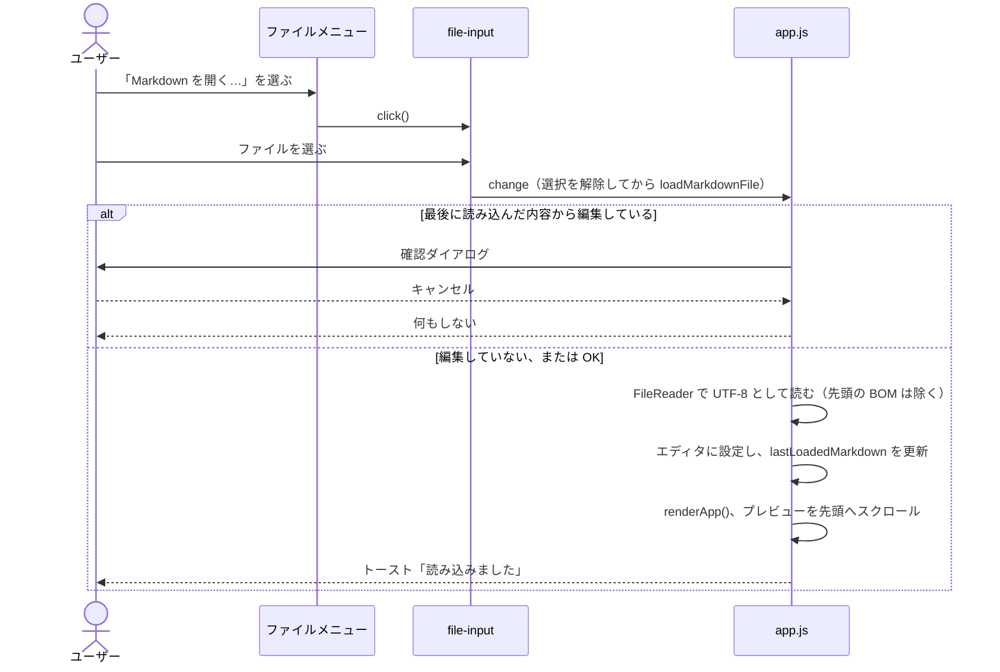
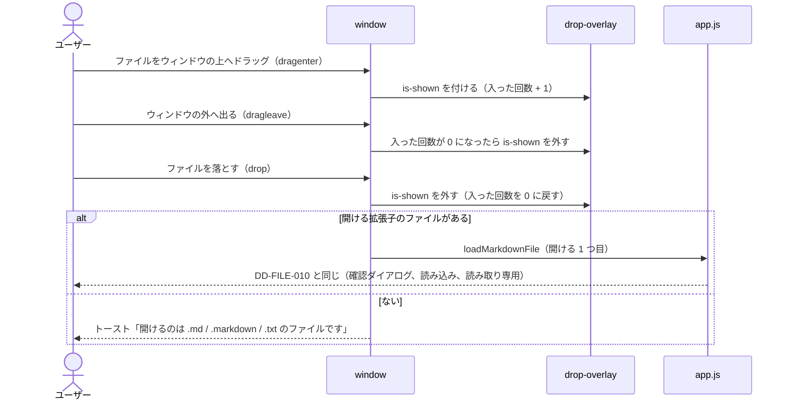

# ファイルの読み込み・保存と初期表示（file-loading）

対応する要求: `FR-006`, `FR-007`, `FR-013`, `FR-014`（[1.SRS.md](../../1.SRS.md) および [1.SRS/features/file-loading.md](../../1.SRS/features/file-loading.md)）／アーキテクチャ: [2.ARCHITECTURE.md](../../2.ARCHITECTURE.md) 4.1

## 1. 画面要素

| ID          | 要素                                                               | 内容                                                                                                                                                                                                                                                                            | 対応する要求 |
| :---------- | :----------------------------------------------------------------- | :------------------------------------------------------------------------------------------------------------------------------------------------------------------------------------------------------------------------------------------------------------------------------ | :----------- |
| DD-FILE-001 | ファイルメニューボタン（`#btn-file-menu`）                         | ヘッダーのロゴの右に置く。押すとメニューを開閉する。開閉の状態を `aria-expanded` に反映する                                                                                                                                                                                     | `FR-006`     |
| DD-FILE-002 | ファイルメニュー（`#file-menu`）                                   | 「Markdown を開く…」（`#menu-open-markdown`）の下に区切り線と「同梱サンプル」見出しを置き、上段に「`Visualモードサンプル (visual-sample.md)`」（`#menu-sample-visual`）、下段に「`記法サンプル (notation_sample.md)`」（`#menu-sample-notation`）を並べる。外側のクリックまたは Esc キーで閉じる | `FR-006` |
| DD-FILE-003 | ファイル選択（`#file-input`）                                      | 非表示の `<input type="file">`。受け付ける拡張子は `.md` / `.markdown` / `.txt`                                                                                                                                                                                                 | `FR-006`     |
| DD-FILE-004 | 初期案内（`EMPTY_GUIDE_HTML`）                                     | エディタが空（空白だけの場合を含む）のとき、プレビューに表示する。上部にブランド・フルバナーロゴ（`AST-012`）を配置し、高速モードではプレビューの本文に、Visualモードでは 1 枚のスラブに入れて表示する                                                                          | `FR-007`, `DTP-005` |
| DD-FILE-005 | 保存ボタン（`#btn-save-markdown`）                                 | ヘッダーのファイルメニューボタンの右に置く。表示は「保存」                                                                                                                                                                                                                      | `FR-013`     |
| DD-FILE-006 | 編集の状態（`#editor-lock`、`#btn-edit-lock`、`#btn-edit-unlock`） | エディタのヘッダーに、`閲覧` / `編集` の 2 つ並びの切り替え（`.pill-container` + `.pill-btn.editor-lock-btn`、`role="group"`）を置く。今の状態のボタンに `is-active` と `aria-pressed="true"` を付ける（`DTP-006`）。起動直後は隠し、ファイルを読み込んだ後は表示したままにする | `FR-014`     |
| DD-FILE-007 | ブランドロゴと Favicon（`#app-favicon`、`.brand-logo-light`、`.brand-logo-dark`） | `<head>` に Favicon（`AST-010`）、ヘッダー左端にカプセルロゴ（`AST-011`）、初期案内にフルバナーロゴ（`AST-012`）を配置する。画像ロゴは Light 用・Dark 用の両方を配置して `body[data-appearance]` の CSS で即座に表示を切り替え、Favicon はテーマ切替時に `href` を `./assets/logos/${state.appearance}/favicon.svg` に更新する | `FR-004`, `FR-007`, `DTP-005` |
| DD-FILE-008 | ドロップの受け付けの表示（`#drop-overlay`）                        | `<body>` の最後（トーストの前）に置く。画面全体に重ね、普段は `opacity: 0`・`visibility: hidden`・`pointer-events: none` で隠す。ドラッグ中だけ `.is-shown` を付けて表示し、`aria-hidden` を合わせて切り替える。見た目は `DTP-007`                                              |              |

## 2. 処理

### DD-FILE-010 ファイルの読み込み

- **編集中の判定**: エディタの内容が `lastLoadedMarkdown`（最後に読み込んだ内容。起動直後は空文字列）と異なれば、編集中とみなす。起動直後の空の状態から入力した場合も編集中になる（`FR-006`）。
- **確認のタイミング**: ファイルを選んだ後に確認する。ファイル選択をキャンセルしたときに確認ダイアログを出さないため。
- **同じファイルの再選択**: `change` の処理の最初に `input.value` を空にする。空にしないと、同じファイルを続けて選んだときに `change` が発生しない。
- **文字コード**: UTF-8 として読む。UTF-8 以外のファイルは文字化けするが、今回の増分では対応しない（未対応と明記する）。
- **読み込みの失敗**: `FileReader` の `error` で、エラーをコンソールに出力し、トーストで知らせる。エディタの内容は変えない。

### DD-FILE-015 同梱サンプルのワンクリック読み込み

- ファイルメニューのサンプル項目（`[data-sample-file]`）が押されたら、メニューを閉じて `loadBundledSample(fileName)` を呼ぶ。
- DD-FILE-010 と同じく `confirmDiscardEdits(fileName)` で未保存の編集有無を確認する。
- `window.location.protocol !== 'file:'`（HTTP / HTTPS 配信時）は `fetch('./samples/' + fileName)` で取得する。`file://` 直開き時（または `fetch` 失敗時）は、CORS コンソールエラーを出さないよう `fetch` を呼ばずに `loadLibrary('samples')` で `./samples/samples-data.js`（`tools/build-samples-data.cjs` で生成）を遅延読み込みし、`window.LUCIVO_SAMPLES[fileName]` から本文を取得する。
- 取得後は `applyLoadedMarkdown(text, fileName)` で DD-FILE-010 と同一の状態更新（エディタ反映、`lastLoadedMarkdown` と `currentFileName` の更新、`setEditorReadOnly(true)`、`renderApp()`、先頭スクロール、トースト表示）を行う。

### DD-FILE-020 起動時の初期表示

- 起動時にエディタへ何も設定せず、`renderApp()` を呼ぶ。エディタが空のため、DD-FILE-004 の案内が表示される。
- サンプル文書は `app.js` に埋め込まない（`FR-007`）。サンプルは同梱の [notation_sample.md](../../../public/samples/notation_sample.md) を、利用者が DD-FILE-010 で開く。

### DD-FILE-030 保存

- `saveMarkdownFile()` は、エディタの内容を `text/markdown;charset=utf-8` の `Blob` にして、`downloadBlob()` でダウンロードする。BOM は付けない。
- ファイル名は `currentFileName`（最後に読み込んだファイルの名前。読み込んでいない場合は `untitled.md`）とする。
- 保存した後は `lastLoadedMarkdown` を保存した内容にする。別のファイルを読み込むときに、保存済みの内容について確認ダイアログを出さないため（`FR-006`）。
- 保存したことをトースト「「ファイル名」を保存しました」で知らせる。
- 読み取り専用の間も保存できる。

### DD-FILE-040 読み取り専用

- `setEditorReadOnly(isReadOnly)` は、エディタの `readOnly` 属性、DD-FILE-006 の切り替えの表示と選択状態、エディタの内容を変えるボタン（`#btn-test-err`）の `disabled` をまとめて切り替える。
- DD-FILE-010 で読み込みに成功したら、`setEditorReadOnly(true)` を呼ぶ。`編集` を押したら `setEditorReadOnly(false)` を呼び、エディタにフォーカスを移す。

### DD-FILE-041 読み取り専用に戻す

- `閲覧`（`#btn-edit-lock`）を押したら `setEditorReadOnly(true)` を呼ぶ。編集中の内容はそのまま残す（保存していない内容は、次のファイルの読み込み時に DD-FILE-010 の確認で守る）。
- `setEditorReadOnly` は、どちらの状態でも切り替えを表示する。切り替えを隠すのは、起動直後にファイルをまだ読み込んでいない間だけ（初期値の `hidden`）とする。
- **背景**: 以前は読み取り専用のときだけ「読み取り専用」の表示とアクセント色の「編集」ボタンを出し、編集を始めると隠していた。ボタンの色が選択中の印に見えて編集中に見えたうえ、読み取り専用に戻す手段がなかった（要求仕様書 `FR-014`）。
- 起動時は `setEditorReadOnly(false)` の状態とする（DD-FILE-020）。

### DD-FILE-050 ウィンドウのタイトル（`FR-040`）

- `applyLoadedMarkdown(rawText, fileName)` で、`document.title` を `fileName + APP_TITLE_SUFFIX`（`' - Lucivo'`）にする。ファイル選択（DD-FILE-010）、同梱サンプル（DD-FILE-015）、ドロップ（DD-FILE-060）は、どれも `applyLoadedMarkdown()` を通るため、1 か所で揃う。
- 起動直後のタイトルは `index.html` の `<title>` のままとする。保存（DD-FILE-030）ではファイル名が変わらないため、タイトルも変えない。
- 印刷（`window.print()`）の「PDF として保存」の既定のファイル名は、ブラウザが `document.title` から決める。Lucivo から既定のファイル名を直接指定する手段はない。

### DD-FILE-060 ドラッグ&ドロップでの読み込み（`FR-041`）

- **受け付ける場所**: `setupFileDrop()` で、`window` の `dragenter`・`dragover`・`dragleave`・`drop` を受け取る。どの要素の上に落としても開くよう、要素ごとには受け付けない。
- **ファイルのドラッグだけ扱う**: `dataTransfer.types` に `Files` を含むときだけ処理する。エディタの中での文字のドラッグなど、ファイルでないドラッグは、ブラウザ標準の動作のままにする。
- **既定の動作を止める**: `dragover` と `drop` で `preventDefault()` を呼ぶ。`dragover` で止めないと `drop` が起きず、`drop` で止めないとブラウザがファイルをそのまま開いて Lucivo の画面から移る。`dragover` では `dropEffect` を `copy` にする。
- **表示の出し入れ**: 子要素の間を動くと、新しい要素の `dragenter` の後に、前の要素の `dragleave` が起きる。`dragenter` で 1 増やし、`dragleave` で 1 減らして、0 になったとき（ウィンドウの外へ出たとき）だけ表示を消す。
- **開けるファイル**: ファイル名が `DROPPABLE_FILE_PATTERN`（`.md` / `.markdown` / `.txt`。大文字・小文字を区別しない）に合うもののうち、1 つ目を `loadMarkdownFile()` に渡す。ファイル選択（DD-FILE-003）の `accept` と同じ拡張子にする。拡張子で判定するのは、`.md` の MIME タイプ（`File.type`）が OS とブラウザによって空になるため。
