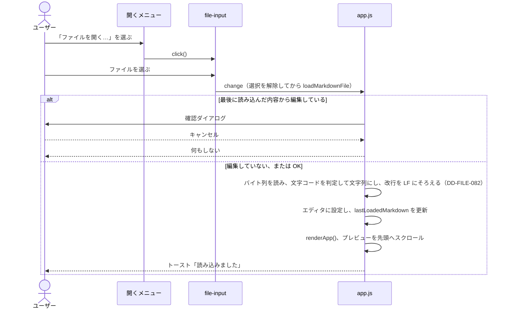
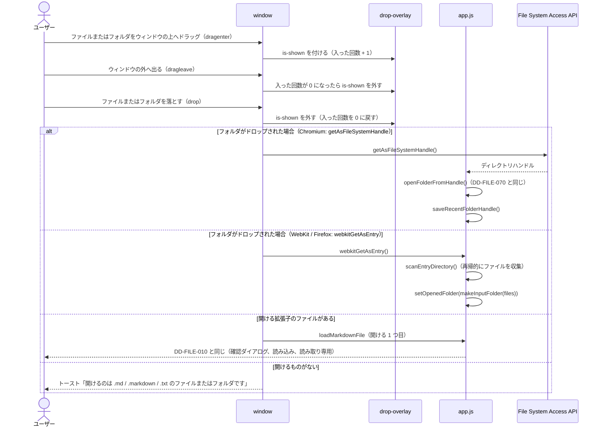
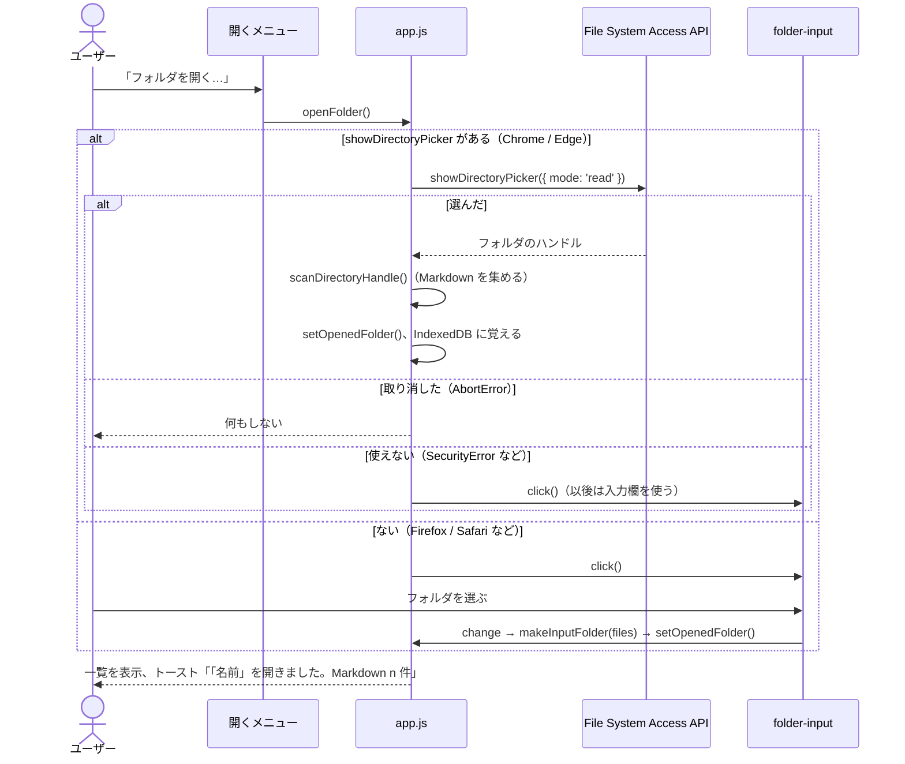

# ファイルの読み込み・保存と初期表示（file-loading）

対応する要求: `FR-006`, `FR-007`, `FR-013`, `FR-014`（[1.SRS.md](../../1.SRS.md) および [1.SRS/features/file-loading.md](../../1.SRS/features/file-loading.md)）／アーキテクチャ: [2.ARCHITECTURE.md](../../2.ARCHITECTURE.md) 4.1

## 1. 画面要素

| ID          | 要素                                                               | 内容                                                                                                                                                                                                                                                                            | 対応する要求 |
| :---------- | :----------------------------------------------------------------- | :------------------------------------------------------------------------------------------------------------------------------------------------------------------------------------------------------------------------------------------------------------------------------ | :----------- |
| DD-FILE-001 | 開くボタン（`#btn-file-menu`）                                     | ヘッダーのロゴの右に置く。表示は「開く」。押すとメニューを開閉する。開閉の状態を `aria-expanded` に反映する。もう一方のメニュー（DD-FILE-009）は閉じる（`closeHeaderMenus()`）                                                                                                  | `FR-006`     |
| DD-FILE-002 | 開くメニュー（`#file-menu`）                                       | 「ファイルを開く…」（`#menu-open-markdown`）、「フォルダを開く…」（`#menu-open-folder`）、前回のフォルダがあれば「前回のフォルダ「名前」を開く」（`#menu-open-recent-folder`。ないときは `hidden`）の下に区切り線と「同梱サンプル」見出しを置き、「`Visualモードサンプル (visual-sample.md)`」（`#menu-sample-visual`）、「`記法サンプル (notation_sample.md)`」（`#menu-sample-notation`）、「`記法サンプル追補版 (notation_sample_extra1.md)`」（`#menu-sample-notation-extra`）を並べる。外側のクリックまたは Esc キーで閉じる | `FR-006` |
| DD-FILE-003 | ファイル選択（`#file-input`）                                      | 非表示の `<input type="file">`。受け付ける拡張子は `.md` / `.markdown` / `.txt`                                                                                                                                                                                                 | `FR-006`     |
| DD-FILE-004 | 初期案内（`EMPTY_GUIDE_HTML`）                                     | エディタが空（空白だけの場合を含む）のとき、プレビューに表示する。上部にブランド・フルバナーロゴ（`AST-012`）を配置し、高速モードではプレビューの本文に、Visualモードでは 1 枚のスラブに入れて表示する                                                                          | `FR-007`, `DTP-005` |
| DD-FILE-005 | Markdown の保存（`#btn-save-markdown`）                            | 保存メニュー（DD-FILE-009）の項目。表示は「Markdown を保存（ファイル名）」で、ファイル名（`#save-file-name`）は読み込んだときに `applyLoadedMarkdown()` が書き換える                                                                                                            | `FR-013`     |
| DD-FILE-006 | 編集の状態（`#editor-lock`、`#btn-edit-lock`、`#btn-edit-unlock`） | エディタのヘッダーに、`閲覧` / `編集` の 2 つ並びの切り替え（`.pill-container` + `.pill-btn.editor-lock-btn`、`role="group"`）を置く。今の状態のボタンに `is-active` と `aria-pressed="true"` を付ける（`DTP-006`）。起動直後は隠し、ファイルを読み込んだ後は表示したままにする | `FR-014`     |
| DD-FILE-007 | ブランドロゴと Favicon（`#app-favicon`、`.brand-logo-light`、`.brand-logo-dark`） | `<head>` に Favicon（`AST-010`）、ヘッダー左端にカプセルロゴ（`AST-011`）、初期案内にフルバナーロゴ（`AST-012`）を配置する。画像ロゴは Light 用・Dark 用の両方を配置して `body[data-appearance]` の CSS で即座に表示を切り替え、Favicon はテーマ切替時に `href` を `./assets/logos/${state.appearance}/favicon.svg` に更新する | `FR-004`, `FR-007`, `DTP-005` |
| DD-FILE-008 | ドロップの受け付けの表示（`#drop-overlay`）                        | `<body>` の最後（トーストの前）に置く。画面全体に重ね、普段は `opacity: 0`・`visibility: hidden`・`pointer-events: none` で隠す。ドラッグ中だけ `.is-shown` を付けて表示し、`aria-hidden` を合わせて切り替える。見た目は `DTP-007`                                              |              |
| DD-FILE-009 | 保存ボタンと保存メニュー（`#btn-save-menu`、`#save-menu`）         | 開くボタンの右に置く。表示は「保存」。押すとメニューを開閉し、もう一方のメニューは閉じる。項目は「Markdown を保存（ファイル名）」（DD-FILE-005）と「印刷 / PDF として保存…」（`#menu-print`、`DD-VTPL-133`）。見た目は開くメニューと同じ（`.file-menu`）                        | `FR-013`, `FR-036`, `FR-043` |
| DD-FILE-077 | フォルダの一覧（`#folder-pane`、`#folder-list`）と帯（`#btn-folder-show`） | `#workspace-main` の先頭（エディタの左）に置く。見出しにフォルダの名前（`#folder-pane-name`）、「フォルダを閉じる」（`#btn-folder-close`）、「一覧を隠す」（`#btn-folder-hide`）を置く。隠したときは帯（`#btn-folder-show`）だけを出す。フォルダを開いていないときは、どちらも `hidden`。見た目は `DTP-008` | `FR-044` |
| DD-FILE-078 | フォルダの選択（`#folder-input`）                                  | 非表示の `<input type="file" webkitdirectory multiple>`。File System Access API が使えないときに使う（DD-FILE-071）                                                                                                                                                             | `FR-044`     |

## 2. 処理

### DD-FILE-010 ファイルの読み込み

- **編集中の判定**: エディタの内容が `lastLoadedMarkdown`（最後に読み込んだ内容。起動直後は空文字列）と異なれば、編集中とみなす。起動直後の空の状態から入力した場合も編集中になる（`FR-006`）。
- **確認のタイミング**: ファイルを選んだ後に確認する。ファイル選択をキャンセルしたときに確認ダイアログを出さないため。
- **同じファイルの再選択**: `change` の処理の最初に `input.value` を空にする。空にしないと、同じファイルを続けて選んだときに `change` が発生しない。
- **文字コード**: `file.arrayBuffer()` でバイト列を読み、`decodeMarkdown()`（DD-FILE-082）で文字コードを判定してから開く（`FR-048`）。
- **読み込みの失敗**: `FileReader` の `error` で、エラーをコンソールに出力し、トーストで知らせる。エディタの内容は変えない。

### DD-FILE-015 同梱サンプルのワンクリック読み込み

- 開くメニューのサンプル項目（`[data-sample-file]`）が押されたら、メニューを閉じて `loadBundledSample(fileName)` を呼ぶ。
- DD-FILE-010 と同じく `confirmDiscardEdits(fileName)` で未保存の編集有無を確認する。
- `window.location.protocol !== 'file:'`（HTTP / HTTPS 配信時）は `fetch('./samples/' + fileName)` で取得する。`file://` 直開き時（または `fetch` 失敗時）は、CORS コンソールエラーを出さないよう `fetch` を呼ばずに `loadLibrary('samples')` で `./samples/samples-data.js`（`tools/build-samples-data.cjs` で生成）を遅延読み込みし、`window.LUCIVO_SAMPLES[fileName]` から本文を取得する。
- 取得後は `applyLoadedMarkdown(text, fileName)` で DD-FILE-010 と同一の状態更新（エディタ反映、`lastLoadedMarkdown` と `currentFileName` の更新、`setEditorReadOnly(true)`、`renderApp()`、先頭スクロール、トースト表示）を行う。

### DD-FILE-020 起動時の初期表示

- 起動時にエディタへ何も設定せず、`renderApp()` を呼ぶ。エディタが空のため、DD-FILE-004 の案内が表示される。
- サンプル文書は `app.js` に埋め込まない（`FR-007`）。サンプルは同梱の [notation_sample.md](../../../public/samples/notation_sample.md) を、利用者が DD-FILE-010 で開く。

### DD-FILE-030 保存

- `saveMarkdownFile()` は、エディタの内容を `text/markdown;charset=utf-8` の `Blob` にして、`downloadBlob()` でダウンロードする。BOM は付けない。
- ファイル名は `currentFileName`（最後に読み込んだファイルの名前。読み込んでいない場合は `untitled.md`）とする。
- 保存した後は `lastLoadedMarkdown` を保存した内容にする。別のファイルを読み込むときに、保存済みの内容について確認ダイアログを出さないため（`FR-006`）。
- 保存したことをトースト「「ファイル名」を保存しました」で知らせる。
- 読み取り専用の間も保存できる。

### DD-FILE-040 読み取り専用

- `setEditorReadOnly(isReadOnly)` は、エディタの `readOnly` 属性、DD-FILE-006 の切り替えの表示と選択状態、エディタの内容を変えるボタン（`#btn-test-err`）の `disabled` をまとめて切り替える。
- DD-FILE-010 で読み込みに成功したら、`setEditorReadOnly(true)` を呼ぶ。`編集` を押したら `setEditorReadOnly(false)` を呼び、エディタにフォーカスを移す。

### DD-FILE-041 読み取り専用に戻す

- `閲覧`（`#btn-edit-lock`）を押したら `setEditorReadOnly(true)` を呼ぶ。編集中の内容はそのまま残す（保存していない内容は、次のファイルの読み込み時に DD-FILE-010 の確認で守る）。
- `setEditorReadOnly` は、どちらの状態でも切り替えを表示する。切り替えを隠すのは、起動直後にファイルをまだ読み込んでいない間だけ（初期値の `hidden`）とする。
- **背景**: 以前は読み取り専用のときだけ「読み取り専用」の表示とアクセント色の「編集」ボタンを出し、編集を始めると隠していた。ボタンの色が選択中の印に見えて編集中に見えたうえ、読み取り専用に戻す手段がなかった（要求仕様書 `FR-014`）。
- 起動時は `setEditorReadOnly(false)` の状態とする（DD-FILE-020）。

### DD-FILE-050 ウィンドウのタイトル（`FR-040`）

- `applyLoadedMarkdown(rawText, fileName)` で、`document.title` を `fileName + APP_TITLE_SUFFIX`（`' - Lucivo'`）にする。ファイル選択（DD-FILE-010）、同梱サンプル（DD-FILE-015）、ドロップ（DD-FILE-060）は、どれも `applyLoadedMarkdown()` を通るため、1 か所で揃う。
- 起動直後のタイトルは `index.html` の `<title>` のままとする。保存（DD-FILE-030）ではファイル名が変わらないため、タイトルも変えない。
- 印刷（`window.print()`）の「PDF として保存」の既定のファイル名は、ブラウザが `document.title` から決める。Lucivo から既定のファイル名を直接指定する手段はない。

### DD-FILE-060 ドラッグ&ドロップでの読み込み（`FR-041`）

- **受け付ける場所**: `setupFileDrop()` で、`window` の `dragenter`・`dragover`・`dragleave`・`drop` を受け取る。どの要素の上に落としても開くよう、要素ごとには受け付けない。
- **ファイルやフォルダのドラッグだけ扱う**: `dataTransfer.types` に `Files` を含むときだけ処理する。エディタの中での文字のドラッグなど、ファイルでないドラッグは、ブラウザ標準の動作のままにする。
- **既定の動作を止める**: `dragover` と `drop` で `preventDefault()` を呼ぶ。`dragover` で止めないと `drop` が起きず、`drop` で止めないとブラウザがファイルやフォルダをそのまま開いて Lucivo の画面から移る。`dragover` では `dropEffect` を `copy` にする。
- **表示の出し入れ**: 子要素の間を動くと、新しい要素の `dragenter` の後に、前の要素の `dragleave` が起きる。`dragenter` で 1 増やし、`dragleave` で 1 減らして、0 になったとき（ウィンドウの外へ出たとき）だけ表示を消す。表示パネルの文言は「ファイルまたはフォルダをドロップして開く」。
- **待つ前に取り出す**: ブラウザは、`drop` の処理の中で最初に `await` した後、`dataTransfer` の中身（`items`・`files`）を読めなくする（空になる）。そのため、処理の最初で、待つ前に、ファイルの一覧（`files`）、各項目の `webkitGetAsEntry()` の結果、`getAsFileSystemHandle()` の呼び出し（Promise）をすべて取り出し、その後でまとめて待つ。待った後に `dataTransfer` を読むと、ファイルを落としても一覧が空になり、開けない（0.6.0 の不具合。#69）。
- **フォルダの判定と優先**: `dataTransfer.items` を走査し、Chromium では `item.getAsFileSystemHandle()`（`handle.kind === 'directory'`）、WebKit / Firefox 等では `item.webkitGetAsEntry()`（`entry.isDirectory`）でフォルダを検出する。ファイルとフォルダが一緒に落とされたときは、フォルダを優先して開く（フォルダ内に関連ファイルが含まれている可能性が高いため）。
  - Chromium の場合はハンドルから直接 `openFolderFromHandle()` を実行し、前回のフォルダ（IndexedDB）にも記憶する。
  - WebKit / Firefox の場合は `scanEntryDirectory()` でディレクトリ内を再帰走査（`isSkippedFolderName` で隠しフォルダ等を除外）し、`makeInputFolder()` 経由で開く。
- **開けるファイル**: フォルダがない場合、ファイル名が `DROPPABLE_FILE_PATTERN`（`.md` / `.markdown` / `.txt`。大文字・小文字を区別しない）に合うもののうち、1 つ目を `loadMarkdownFile()` に渡す。ファイル選択（DD-FILE-003）の `accept` と同じ拡張子にする。拡張子で判定するのは、`.md` の MIME タイプ（`File.type`）が OS とブラウザによって空になるため。

### DD-FILE-070 フォルダを開く（`FR-044`）

- **フォルダの形をそろえる**: どちらの方式も、`openedFolder = { name, files, truncated, getFile(path) }` にそろえる。`files` は Markdown ファイルだけの `{ path, name, dir }`（`path` はフォルダの中のパス。区切りは `/`）。`getFile(path)` は、画像を含むフォルダの中の任意のファイルを `File`（見つからなければ `null`）で返す。一覧（DD-FILE-074）、ファイルを開く処理（DD-FILE-075）、画像（DD-FILE-076）は、方式を区別しない。
- **新しいフォルダを開いたとき**: 読み込んだ画像の URL を捨て（DD-FILE-076）、`currentFolderPath` を `null` にする（前に開いていた文書は、新しいフォルダの文書ではない）。一覧は隠していても表示に戻す。

### DD-FILE-071 入力欄の方式（`FR-044`）

- `showDirectoryPicker` がないとき、または一度失敗して `preferFolderInput` が立っているときは、`#folder-input` を `click()` する。
- `showDirectoryPicker` が `AbortError` 以外で失敗したら（`file://` で拒まれたなど）、`preferFolderInput` を立て、その場で `#folder-input` も `click()` する。クリックの直後の扱いが切れていて、ブラウザが入力欄を開かないときは、利用者がもう一度「フォルダを開く…」を押せば開く。
- `makeInputFolder(fileList)` は、`webkitRelativePath` の先頭（選んだフォルダの名前）を除いたパスで、すべてのファイルを `Map` に入れる。隠しフォルダと `node_modules` の中のファイルは除く。
- `change` の処理の最初に `input.value` を空にする（同じフォルダを続けて選んでも `change` が起きるように。DD-FILE-010 と同じ）。

### DD-FILE-072 Markdown を集める（`FR-044`）

- `scanDirectoryHandle(root)` は、`entries()` で深さ優先にたどる。名前が `.` で始まるフォルダと `node_modules` は入らない（`isSkippedFolderName()`）。
- 拡張子は `DROPPABLE_FILE_PATTERN`（`.md` / `.markdown` / `.txt`）で判定する（DD-FILE-003、060 と同じ）。
- 上限: ファイルは `FOLDER_FILE_LIMIT`（2,000 件）、深さは `FOLDER_DEPTH_LIMIT`（12）。ファイルの上限に達したら打ち切り、`truncated` を立てる（トーストに「先頭の 2,000 件」と出す）。
- 並び順（`sortFolderFiles()`）: フォルダの直下（`dir === ''`）を先に、その後は `dir`、同じ `dir` の中は `name` の順。比べ方は `Intl.Collator('ja', { numeric: true, sensitivity: 'base' })`（数字は数の大きさの順、大文字・小文字を区別しない）。

### DD-FILE-073 前回のフォルダ（`FR-044`）

- File System Access API で開いたフォルダのハンドルを、IndexedDB（DB `lucivo`、ストア `handles`、キー `recentFolder`）に保存する。ハンドルは構造化複製で保存できる。
- 起動時（`setupFolder()`）に読み出し、あれば「前回のフォルダ「名前」を開く」（`#menu-open-recent-folder`）を表示する。押したら `queryPermission()`、許可がなければ `requestPermission()`（クリックの直後に求める必要がある）を呼び、`granted` なら DD-FILE-070 と同じく開く。
- IndexedDB が使えない・保存に失敗したときは、コンソールに警告を出すだけで、フォルダを開く動作は続ける。

### DD-FILE-074 一覧の表示と隠す（`FR-044`、`DTP-008`）

- `renderFolderList()` は、`openedFolder` がなければ一覧と帯を隠す。あれば、隠したかどうか（`isFolderPaneCollapsed()`）に応じて一覧か帯のどちらかを出し、一覧を作り直す。
- 一覧は、`dir` が変わるところに `.folder-list-dir`（`docs/sub/` のようにパスと `/`）を置き、ファイルごとに `.folder-list-item`（`data-path`、`title` にパス）を置く。ファイル名は `textContent` で入れる（ファイル名に HTML を書かれても解釈しない）。
- 開いているファイル（`currentFolderPath`）には `is-current` と `aria-current="page"` を付ける。`applyLoadedMarkdown()` のたびに描き直すため、フォルダの外のファイルを開いたら、印は消える。
- 隠したかどうかは `localStorage` の `lucivo.folderPaneCollapsed`（`'1'` / `'0'`）に覚える。`localStorage` を使えないときは、`#folder-pane` の `data-collapsed` で、その場だけ切り替える。
- 狭い画面（`max-width: 1023.98px`）では、CSS で一覧と帯を `position: absolute` にして重ね、ファイルを選んだら `setFolderPaneCollapsed(true)` で隠す。

### DD-FILE-075 一覧からファイルを開く（`FR-044`）

- `openFolderFile(path)` は、`getFile(path)` でファイルを探し、見つからなければ「「パス」はフォルダの中に見つかりません」と知らせる。見つかったら `confirmDiscardEdits(name)`（DD-FILE-010）で確かめてから、`file.arrayBuffer()` を `decodeMarkdown()`（DD-FILE-082）で文字列にし、`applyLoadedMarkdown(text, name, path, false, 文字コード)` を呼ぶ。開けたら `true` を返す。一覧に載らないファイル（件数の上限を超えたもの）も、フォルダの中にあれば開く（DD-FILE-079 のリンクから開くため）。
- `applyLoadedMarkdown()` の第 3 引数 `folderPath` を `currentFolderPath` に入れる。ファイル選択・ドロップ・同梱サンプルは `null`（相対パスの基準がない）。
- 読んでいる間に別のフォルダを開いた場合は、読んだ内容を使わない。

### DD-FILE-076 相対パスの画像（`FR-045`）

- DOMPurify のフック（`DD-MD-040`）で、`openedFolder` があり、`currentFolderPath` が `null` でなく、`src` が相対パス（`isRelativeSrc()`: URL の形式も `/` `#` で始まる形もない）のとき:
  - `resolveFolderPath(文書のフォルダ, src)` でフォルダの中のパスにする。`?` と `#` から後を除き、`\` を `/` にそろえ、`decodeURIComponent()` で `%20` や日本語を元に戻し、`.` と `..` を解く。フォルダの外へ出たら `null`。
  - 解けたら `data-folder-src` にパスを入れる。読み込み済み（`folderImageUrls` に blob URL がある）なら `src` をその URL にして残し、なければ `src` を消す（`index.html` のフォルダを基準に読みに行かせない）。
  - フォルダの外なら、`data-folder-src` に元の値、`data-folder-outside` を付けて `src` を消す。
- 描画の後（`renderApp()` の `wrapTables()` の直後）に `resolveFolderImages(container)` を呼び、`src` のない `img[data-folder-src]` を、`getFile()` → `URL.createObjectURL()` で表示する。見つからなければ「フォルダの中に見つかりません」、フォルダの外なら「開いたフォルダの外の画像は表示できません」の枠（`DD-MD-041`）に置き換える。
- `folderImageUrls` は、パス → blob URL（読み込み中は `Promise`）。同じ画像を何度描き直しても読み直さない。フォルダを閉じる・別のフォルダを開くときに `URL.revokeObjectURL()` で捨てる。
- **背景（blob URL にする理由）**: File System Access API も入力欄も、ファイルの中身（`File`）は渡すが、`file://` のパスは渡さない。`URL.createObjectURL()` なら、`file://` のページでも画像として表示できる。DOMPurify は `blob:` の URL を許さないため、フックの中で `setAttribute()` して `forceKeepAttr` で残す（`DD-MD-040` と同じ）。
- **背景（描画の後に読む理由）**: ファイルの読み込みは非同期で、DOMPurify のフックの中では待てない。描画の後に読み、読み込み済みの URL は次の描画からフックの中で使う。

### DD-FILE-079 文書の中の Markdown へのリンク（`FR-046`）

- `setupDocumentLinks()` で、`#preview-scroll` の `click` を受け取り、`a[href]` の `href` 属性（書いたままの値）を調べる。左クリックだけを扱う。
- `href` が相対パス（`isRelativeSrc()`）で、`#` と `?` から前が `DROPPABLE_FILE_PATTERN` に合うときは、`preventDefault()` でブラウザの移動を止める。
  - フォルダを開いていない（`openedFolder` がない、または `currentFolderPath` が `null`）→ トースト「Markdown へのリンクは、「開く」→「フォルダを開く…」で開いた文書で使えます」
  - `resolveFolderPath(文書のフォルダ, パス)`（DD-FILE-076）が `null`（フォルダの外）→ トースト「開いたフォルダの外のファイルは開けません」
  - それ以外 → `openFolderFile(path)`（DD-FILE-075）。今の文書と同じパスなら開き直さない。開けて、`#` 以降があれば DD-FILE-080 で見出しへ送る
- それ以外のリンク（`https://` など、Markdown 以外の相対パス）は、何もしない（ブラウザの動作のまま）。

### DD-FILE-080 見出しへのリンク（`FR-046`）

- `href` が `#` で始まるときは、`preventDefault()` して `scrollToHeadingAnchor()` を呼ぶ。見つからなければトースト「リンク先の見出しが見つかりません」。
- `scrollToHeadingAnchor(anchor)` は、`decodeURIComponent()` で戻したアンカーを `headingSlug()` にかけ、プレビューの `h1`〜`h6` の中から、文字を `headingSlug()` にかけたものが一致する最初の見出しを探す。Visualモードでは見出しを含むスラブ（`.exhibition-slab`）を、高速モードでは見出しを、`previewScrollTopOf()` と `scrollBehavior()`（J/K の章移動と同じ）で送る。
- `headingSlug(text)`: 前後の空白を除き、小文字にし、文字（`\p{L}`）・数字（`\p{N}`）・空白・`_`・`-` 以外を除き、空白を `-` にする（GitHub の見出しのアンカーと同じ形。同じ見出しが複数あるときの `-1` などの番号には対応しない）。

### DD-FILE-081 同梱サンプルの相対パス（`FR-046`）

- `loadBundledSample()` は `applyLoadedMarkdown(text, fileName, null, true)` で読み込み、`currentSampleFile` にファイル名を入れる。ファイル選択・ドロップ・フォルダの一覧から開いたときは `null` にする。
- 画像: DOMPurify のフック（`DD-MD-040`）で、フォルダの文書（DD-FILE-076）でなく、`currentSampleFile` があり、`src` が相対パスのときは、`resolveFolderPath('', src)` で `samples` フォルダの中のパスにし、`samples/` を前に付けて（パスの区切りごとに `encodeURIComponent()`）`src` にする。`index.html` から見た相対パスのため、`file://` でもそのまま読める。`samples` の外を指すときは何もしない（読み込めない表示になる）。
- リンク: DD-FILE-079 の処理で、フォルダの文書でなく、`currentSampleFile` があるときは、`resolveFolderPath('', パス)` が `BUNDLED_SAMPLES`（`tools/build-samples-data.cjs` の `FILES` と同じ 3 件）にあれば `loadBundledSample()` で開き、`#` 以降があれば DD-FILE-080 で見出しへ送る。今の文書と同じなら開き直さない。なければ「「パス」は同梱サンプルにありません」と知らせる。
- `loadBundledSample()` は、開けたら `true`、取り消し・読み込みの失敗は `false` を返す（リンクから開いた後に見出しへ送るかを決めるため）。

### DD-FILE-082 文字コードの判定と改行コード（`FR-048`）

`ts/utils/text-decode.ts` の `decodeMarkdown(buffer)` が、`{ text, encoding, newline }` を返す。ファイル選択・ドロップ（`loadMarkdownFile()`）とフォルダ（`openFolderFile()`）の両方が使う。

1. **BOM**: `EF BB BF` → UTF-8（BOM）、`FF FE` → UTF-16LE、`FE FF` → UTF-16BE。BOM の後を `TextDecoder` で読む。
2. **UTF-8**: `new TextDecoder('utf-8', { fatal: true })` で読めれば UTF-8。ただし、ESC（`0x1B`）で始まる文字集合の切り替え（`ESC $ B` など）があれば ISO-2022-JP として読み直す（ISO-2022-JP は 7 ビットの文字だけで書くため、UTF-8 としても正しく読めてしまう）。
3. **Shift_JIS と EUC-JP**: UTF-8 として正しくなければ、`shift_jis`（WHATWG では CP932 を含む）と `euc-jp` の両方で読み、「置き換え文字（`U+FFFD`）の数 × 1000 + 半角カタカナの数」が小さいほうを選ぶ。取り違えると、読めない文字か、半角カタカナの並びが多く出るため。
4. **改行コード**: `normalizeText()` で、先頭の BOM の文字を除き、`\r\n` と `\r` を `\n` にする。元の改行コードは `detectNewline()` で `LF` / `CRLF` / `CR` / `mixed` / `none` として返す（今は表示に使わない）。

- 見えない文字・紛らわしい文字（`U+FEFF`、`U+FFFD`、半角カタカナの範囲、ESC）は、ソースに直接書かず `String.fromCharCode()` で作る（`npm run lint`）。

### DD-FILE-083 読み込みと保存の知らせ（`FR-048`）

- `applyLoadedMarkdown()` の第 5 引数 `encoding`（既定は `UTF-8`）を `currentFileEncoding` に入れる。改行コードは、ここでも `normalizeText()` で LF にそろえる（同梱サンプルを含め、エディタに入れる内容と `lastLoadedMarkdown` を一致させるため。DD-FILE-010 の編集中の判定）。
- 読み込みのトースト: UTF-8 系（`isUtf8Family()`: `UTF-8`・`UTF-8 (BOM)`）なら「「名前」を読み込みました」、それ以外は「「名前」を 文字コード として読み込みました（保存は UTF-8 になります）」。
- 保存のトースト: `currentFileEncoding` が UTF-8 系でなければ「「名前」を UTF-8 で保存しました（元は 文字コード）」。
