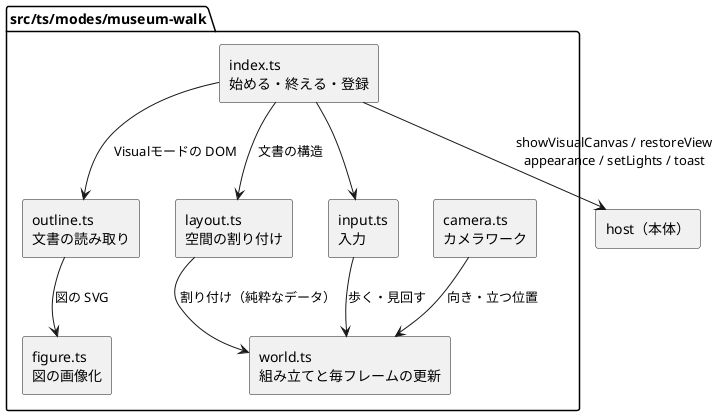

# 詳細設計: ミュージアム・ウォーク（`museum-walk`）

要求: [museum-walk.md](../../../1.SRS/features/modes/museum-walk.md)（`FR-056`、#63）／デザイン仕様: [museum-walk.md](../../../0.DTP/features/modes/museum-walk.md)（`DTP-MWLK-010`〜`070`）／ソース: `src/ts/modes/museum-walk/`／目次: [README.md](README.md)

発表モードの登録・host の設計は `doc/2.ARCHITECTURE.md` 4.16（`ARC-MODE-001`〜`010`）による。この設計は、モード固有の部分だけを書く。

## 部品の分け方

| ID          | 項目             | 設計 |
| :---------- | :--------------- | :--- |
| DD-MWLK-001 | 部品と入口       | 登録表（`src/ts/modes/modes.json`）の行（`stage: "web"`）から、`src/ts/modes/museum-walk/index.ts` を `js/modes/museum-walk.js`、`style.css` を `css/modes/museum-walk.css` にビルドする。フォルダの中は、上の図の 7 つのファイルに分ける。`index.ts` 以外は、DOM を読み取る `outline.ts`・`figure.ts` と、DOM を作る `world.ts`・`input.ts` を除いて、DOM に触らない純粋な処理にする（`layout.ts`・`camera.ts`）。モードは本体のモジュールを `import` せず、`host` だけを使う（`ARC-MODE-006`） |
| DD-MWLK-002 | 始める・終える   | 始めるときは、`host.isDocumentEmpty()` が真なら `host.toast()` で知らせて何もしない。偽なら `host.showVisualCanvas()` で今の表示（外観を含む）を覚えて Visualモードの Canvas 表示に切り替え、図の描画を待つ。開始外観は `localStorage`（`lucivo-museum-walk-appearance`、未保存時は `'dark'`）から決め、本体の外観と異なるときは `host.setAppearance()` で図を対象外観へ描き直してから文書の構造を読み取る（DD-MWLK-003）。`<body>` の直下に全画面の重ね（`#museum-walk`）を作って空間を組み立てる。歩いている間は `host.setLights(false)` で図の光を止める（重ねの下の Visualモードは見えないため）。全画面表示を求める（断られても続ける）。終えるときは、毎フレームの更新と入力の受け付けを止め、重ねを消し、図の画像の URL を解放し、全画面表示を戻してから、`host.restoreView()` で覚えた表示（外観・光の有無・スクロールの位置を含む）に戻す。`Esc` と、右上の終了ボタン（スマホには `Esc` がないため）で終える |
| DD-MWLK-003 | 文書の読み取り   | Visualモードの DOM を読むだけで、書き換えない。表紙（`.exhibition-hero`）の題名（`.vs-cover-title`）と概要（`.vs-cover-deck`）を表紙の門に、章（`.exhibition-slab`）の `h2` の題名（番号の札を除いた文字）を章の門にする。`h2` のない章（最初の `h2` より前の部分）は、表紙の門の後ろの導入にする。章の中は、次の要素を文書の順に取り出す: `h3`〜`h6`（小見出し）、`p`（本文）、`li`・`dl` の行（箇条書き）、`blockquote`・`.md-alert`（引用）、`[data-stage-index]`（図）、`table`・`pre`（表・コード）。取り出した要素の中にある要素は、重ねて取り出さない（例: `li` の中の `p`）。フロントマター（`.front-matter`）と章の操作（`.slab-actions`）は読まない。中身は `cloneNode` で複製し、`id` 属性・ボタン・飾り（`.vs-card-ornament` など）を消してから使う |
| DD-MWLK-004 | 空間の割り付け   | `layout.ts` が、文書の構造を、奥行き（z）に沿った割り付けに変える。入力は文字の量の代わりに、各パーツの実際の高さ（組み立てたパーツの `offsetHeight` を測った値）を受け取る。出力は、断面の区間（通路・広間・小部屋）、門、立体図、壁のパーツ（左右・z・y・幅）、突き当たりの位置である。規則は下の「割り付けの規則」による。寸法と間隔は、ファイルの先頭の表（`LAYOUT`）にまとめる |
| DD-MWLK-005 | カメラワーク     | `camera.ts` に、値の表（`CAMERA_SPEC`）、場所ごとの指示（`cues()`）、組み合わせ方（`direct()`）の 3 つだけを置く。演出を見直すときは、この 3 つだけを直す。`cues()` は、割り付け（門・区間・突き当たりの位置）から、場所ごとの効き具合（0〜1）と、向き・立つ位置・見上げる角度を返す。`direct()` は、歩く速さから「歩いている間は先を見て、止まると壁を向く」基本の向きを決め、その上に `cues()` を重ね、縦長の画面の補正（`DTP-MWLK-060`）と近寄り（`zoom`: 横位置の壁側シフト・視野 `fov` 補正・移動中の上下の揺れ `zoomBob` / `zoomBobSpeed`）を上乗せし、場所ごとの半幅上限でクランプしたうえで指数の追従で滑らかに近づける。前進・後退の上下の揺れ（`bob` / `bobStep`）と近寄りの揺れ（`zoomBob` / `zoomBobSpeed`）、および前進・後退のホイール係数（`wheelSpeed`）と近寄りホイール刻み（`zoomWheelStep`）はそれぞれ独立したキーとして `CAMERA_SPEC` に持たせる（#275, #293, #294, #295） |
| DD-MWLK-006 | 組み立てと更新   | `world.ts` が、割り付けから DOM を作り、毎フレーム更新する。壁・床・天井は 1000px ごとのタイルで、子要素と疑似要素を持たない 1 枚の要素にし、大きさ・`transform`・背景は作るときに 1 度だけ設定する。毎フレーム書き換えるのは、世界全体の `transform`、各要素の `opacity`（霞みは 40 段階に量子化）と `display`、近づくと現れるパーツの `transform` だけで、値が変わったときだけ書く（`DTP-MWLK-070`）。画面の外とカメラの後ろの要素は `display: none` で外す。壁の文字のパーツは、2 倍の大きさで組み、`transform` の末尾の `scale(0.5)` で置く（`DTP-MWLK-030`）。門の題名は、門の幅に 2 行以内で収まるまで文字を小さくする（204px から 72px まで） |
| DD-MWLK-007 | 図の画像化       | `figure.ts` が、図の SVG を `XMLSerializer` で文字列にし、Blob の URL を作って `` で置く。画像の中の SVG は別の文書になるため、元の図と id が重複せず、矢じりやグラデーションの参照が崩れない。流れ図など、ノード（`.nodes`）と線（`.edgePaths`）の層を持つ図は、片方を隠す `<style>` を差し込んだ 2 枚の画像にし、線の層の手前にノードの層を立てる（`DTP-MWLK-050`）。層を持たない図は 1 枚にする。画像は 2 倍の大きさで置いて `scale(0.5)` で縮める。`T` キーで外観を切り替えたときは、選んだ外観を `localStorage` に保存し、`host.setAppearance()` で本体の図を新しい外観で再描画し、外観ごとの画像を取り直して図板（`.mw-fig-frame.is-dark` / `.is-light`）と `` を同期更新する（一度作った画像は外観ごとに保持し、`exit()` で解放する） |
| DD-MWLK-008 | 入力             | `input.ts` が、ホイール・キー・ポインターを重ねの上で受ける。キーは `document` の捕捉の段階で受け、扱ったキーは本体のショートカットに渡さない。前へ: `↑` `→` `W` `Space` `PageDown` `Enter`、後ろへ: `↓` `←` `S` `PageUp` `Backspace`。押している間は一定の速さで歩き、220ms より短い 1 回押しは歩幅（`stride`）だけ進む。通常ホイールは `CAMERA_SPEC.wheelSpeed` を係数として上回し（`deltaY < 0`）で前へ、下回し（`deltaY > 0`）で後ろへ進み、`Ctrl`＋ホイールのズームイン・アウト（`CAMERA_SPEC.zoomWheelStep`、上回しで近寄る・下回しで離れる）と向きをそろえる（#305, #295）。上下のスワイプで歩き、ドラッグで見回す（見回した向きは、立ち止まって指を離した後もそのまま残る）。近寄る・離れる・戻る: `Ctrl`＋ホイール、`+`（`=`）・`-`・`0`（`Ctrl` / `Meta` 併用も捕捉してブラウザ標準ズームを上書きする）。歩き出し（歩行キー・通常ホイール・スワイプ）で近寄り目標を自動で 0 に戻す。`G` 視線の自動、`T` 外観、`R`・`Home` 入口へ、`Esc` 終了。始めるときに、エディタなどのフォーカスを外す |
| DD-MWLK-009 | 動きを減らす設定 | `prefers-reduced-motion: reduce` のときは、止まるときの滑りを短くし（`friction` を 6 に）、1 回押しの歩幅を短くし、近寄りの上下の揺れを 0 にして即座に切り替え、門を通り抜けるときの光と、パーツが壁から滑り出す動きをなくす（現れるのは不透明度だけにする） |
| DD-MWLK-010 | 調整のパネル     | URL に `museum-tune` を含めて開いたときだけ、`C` キーでカメラワークの値を動かすパネルを出す。パネルは `CAMERA_SPEC` から作り（近寄りと上下の動きの項目を含む）、決めた値を JSON に書き出せる。書き出した値は `camera.ts` の表へ写す |
| DD-MWLK-011 | テストの入口     | `info()` は `active`・カメラの位置（`z`, `x`, `yaw`, `zoom`, `zoomTarget`, `fov`, `bob`）・入口と突き当たりの位置・外観・視線の自動の入切・門（位置と題名）・区間（種類と範囲）・立体図とパーツの数を返す。テストと確認用に、`walkTo(z)`（その位置へ移り、向きと立つ位置を落ち着き先まで進める）を登録する |

## 割り付けの規則（DD-MWLK-004）

進む向きは -z で、入口は `z = -300`。壁のパーツは、左の壁に置く（止まると左の壁を向くため）。右の壁には、章ごとに番号と題名の札（種類 `number`）だけを置く。

| 文書の要素                   | 空間                                                                              |
| :--------------------------- | :-------------------------------------------------------------------------------- |
| 題名と概要（表紙）           | 入口から 1000px 先の表紙の門。題名がないときは `MUSEUM WALK` を題名にする         |
| `h2`（章）                   | 前のパーツの奥の端から 700px 先に門。門を通り抜けた 640px 先から、章のパーツを置く。右の壁の門から 900px 先に章の札 |
| `h3`〜`h6`                   | 新しい列を始め、列の一番上（`y = -380`）に置く。後ろに影（`h3shadow`）を重ねる    |
| `p`・表・コード              | 今の列の下に積む。列の下端（`y = 300`）を越えるときは、220px 先に新しい列を始める |
| 箇条書き（同じリストの項目） | 1 項目ずつ 280px 先へずらし、前の項目の下に置く（階段状）。下端を越えるときは、新しい列の上から続ける |
| 図                           | 通路を 200px 置いてから、長さ 1800px の広間を開き、真ん中に立体図を立てる。図は、幅 1100px・高さ 520px に収まるよう縮め、枠の下端を目の高さの 180px 下に置く（図の前で止まっても、枠の上端が画面に収まる）。広間の壁にはパーツを置かない。説明の文は、図の前の最も近い小見出し、なければ章の題名 |
| `blockquote`・コールアウト   | 通路を 300px 置いてから、小部屋を開き、入って 300px の左の壁に引用の銘板を置く。小部屋の長さは、銘板の幅に 520px を足した長さ（後ろ 220px の余白を含む）。銘板の高さが 380px を越えるときは、文字を小さくし（`is-small`）、それでも越えるときだけ幅を 760px まで広げる（止め位置・向き `alcoveYaw: 68°` で長い引用も画面内に収める） |
| 最後                         | 最後のパーツの奥の端から 900px 先に突き当たりの壁                                 |

- 区間は、奥行きの順に途切れなく並べ、広間と小部屋の間は通路で埋める。パーツの列・門・立体図は、どれも 1 つの区間の中に収める（区間の境目をまたがない）。断面が変わる境目には、袖の壁と垂れ壁を置く（`DTP-MWLK-020`）。
- 区間ごとの色（`--tint`）は、手前にある門の数で決め、5 色を順に使う（`DTP-MWLK-010`）。

## 背景と採らなかった案

- **背景（DD-MWLK-002・003）**: 図の配色と組版（KaTeX の数式など）は Visualモードで描いたものを使うため、`host.showVisualCanvas()` で Visualモードに切り替えてから読む。Visualモードの DOM は、雛形（`DD-VTPL-010` 以降）で要素を入れ物に包み直すが、`h3`・`p`・`li` などの要素そのものは残る。そのため、要素の種類で取り出せば、雛形の違いに左右されない。
- **背景（DD-MWLK-003）**: 複製した中身の `id` を消すのは、見出しの `id` が元の文書と重複し、目次やリンクの飛び先が二重になるため。
- **背景（DD-MWLK-004）**: パーツの高さを、文字数から見積もらずに測るのは、数式・画像・入れ子の箇条書きなど、文字数では高さが決まらない中身があるため。割り付けを純粋な処理にしたのは、門・広間・小部屋の規則を変えるときに、組み立てや毎フレームの更新に触れずに済ませるため。
- **背景（DD-MWLK-005）**: 視線の動かし方は、作り込みで見直しが多く入る。空間の組み立てや入力と切り離し、値の表と場所ごとの指示を宣言的に持つことで、見直す場所を 1 つのファイルに閉じる。
- **背景（DD-MWLK-007）**: 図を `` にするのは、PNG の書き出しと同じ方法で、図の SVG がそれだけで描けることを確かめているため。
- **背景（DD-MWLK-008）**: 発表用のリモコンは `→` `PageDown` を送る。リモコンの 1 回押しで歩幅だけ進むようにして、展示の場でリモコンでも歩けるようにする（発表の用途は前提にしないが、操作は妨げない）。
- 採らなかった案:
  - 図の SVG を複製し、`id` に接頭辞を付けて置き換える案: Mermaid の `<style>` が `#<id>` で書かれているため、属性と文字列の両方を置き換える必要があり、置き換え漏れで配色が崩れやすい。
  - Visualモードの章を、複製せずにそのまま 3D 空間へ配置してカメラを動かす案: 章の中のパーツを、壁ごとに別々の奥行きへ置けない。終えるときに組版を戻す手間も大きい。
  - Markdown を、モードの中で解析し直す案: Markdown の解析器を、モードの部品にも同梱することになり、読み込みが重くなる。数式と図の描画も、やり直しになる。
  - カメラワークの調整パネルを、いつでも `C` キーで出す案: 利用者に、開発者向けの画面を見せることになる。
  - 試作の `E`（近づくと現れる）・`P`（奥行き）の入切: 試作で演出を比べるためのもので、利用者には要らない。
