# Color Museum — A Gallery of Light and Color

They say color has no right answer, yet every day we choose colors for someone. Here are no swatch lists, only posters, windows, and mountains painted with Lucivo's 203 tones. To choose is to leave something unchosen.

> [!NOTE]
> Choose "Museum Walk" from the Present menu to walk this document as a 3D corridor. Walk with `↑` `↓` or the wheel, look around by dragging, switch the gallery lighting (Dark / Light) with `T`, and return with `Esc`.

## Light Splits into Color

**From one light, to infinite stories.**

Behind every color we choose stand countless colors we did not. Perhaps a work is the quiet of that.


## A Map of Feeling

Red is passion, blue is calm. Say it so flatly and color dies a little. Thinned, red is a cheek's warmth; sunk deep, old blood. Tone shapes feeling more than hue. Here, 14 tones sit on two axes: warm to cool, soft to hard.

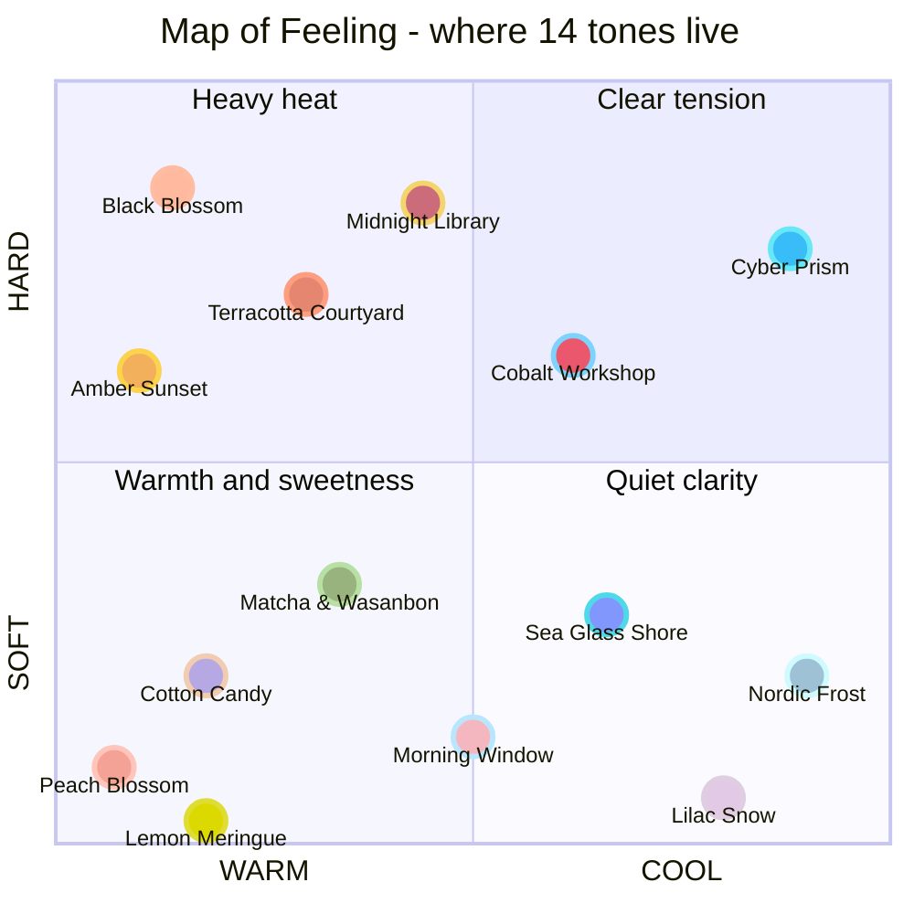

<span style="display:block;margin-top:.9em;padding-left:.8em;border-left:.12em solid currentColor;font-size:max(.56em, 13px);line-height:1.6;max-width:62em;"><span style="display:block;font-family:'JetBrains Mono',ui-monospace,Consolas,monospace;font-size:.82em;letter-spacing:.2em;opacity:.65;">WORK 01</span><span style="display:block;font-weight:700;margin:.15em 0 .1em;">“Map of Feeling”</span>The positions are not measurements. The maker of this exhibition placed them by reading the words attached to each tone. Where would you put them? A map has as many errors as it has viewers.</span>

> A machine can tell sixteen million colors apart. But only someone who has lived through loneliness knows which color is "lonely." Then is a color chosen by someone who knows loneliness only as a word a fake? If your chest ached a little when you saw it.

## Following the Light of a Day

### Six Windows

Before we owned clocks, we told the time by the color of light. Morning blue brings drowsiness, evening amber the road home, midnight indigo a time that is only ours.

<span style="display:flex;gap:.45em;width:100%;max-width:36em;"><span style="display:block;flex:1;min-width:0;"><span style="display:block;position:relative;overflow:hidden;height:4.2em;border-radius:1.6em 1.6em .2em .2em;border:.08em solid #857B91;background:linear-gradient(180deg, #3C4D64 0%, #263345 100%);"><span style="position:absolute;left:50%;bottom:18%;width:1.2em;height:1.2em;margin-left:-.6em;border-radius:50%;background:#BAE6FD;box-shadow:0 0 .9em .2em #BAE6FD;"></span><span style="position:absolute;left:0;right:0;bottom:0;height:22%;background:#F5B7BF;opacity:.9;"></span><span style="position:absolute;left:50%;top:0;bottom:0;width:.06em;background:#857B91;opacity:.5;"></span></span><span style="display:block;margin-top:.35em;font-size:max(.46em, 11px);line-height:1.35;text-align:center;"><span style="display:block;font-family:'JetBrains Mono',ui-monospace,Consolas,monospace;letter-spacing:.1em;color:#BAE6FD;">06:00</span>Morning Window</span></span><span style="display:block;flex:1;min-width:0;"><span style="display:block;position:relative;overflow:hidden;height:4.2em;border-radius:1.6em 1.6em .2em .2em;border:.08em solid #947879;background:linear-gradient(180deg, #3C3545 0%, #1E1924 100%);"><span style="position:absolute;left:50%;bottom:52%;width:1.2em;height:1.2em;margin-left:-.6em;border-radius:50%;background:#FDE047;box-shadow:0 0 .9em .2em #FDE047;"></span><span style="position:absolute;left:0;right:0;bottom:0;height:22%;background:#F67386;opacity:.9;"></span><span style="position:absolute;left:50%;top:0;bottom:0;width:.06em;background:#947879;opacity:.5;"></span></span><span style="display:block;margin-top:.35em;font-size:max(.46em, 11px);line-height:1.35;text-align:center;"><span style="display:block;font-family:'JetBrains Mono',ui-monospace,Consolas,monospace;letter-spacing:.1em;color:#FDE047;">10:00</span>Citrus Market</span></span><span style="display:block;flex:1;min-width:0;"><span style="display:block;position:relative;overflow:hidden;height:4.2em;border-radius:1.6em 1.6em .2em .2em;border:.08em solid #877B8F;background:linear-gradient(180deg, #2A3854 0%, #101B30 100%);"><span style="position:absolute;left:50%;bottom:70%;width:1.2em;height:1.2em;margin-left:-.6em;border-radius:50%;background:#7DD3FC;box-shadow:0 0 .9em .2em #7DD3FC;"></span><span style="position:absolute;left:0;right:0;bottom:0;height:22%;background:#EB576D;opacity:.9;"></span><span style="position:absolute;left:50%;top:0;bottom:0;width:.06em;background:#877B8F;opacity:.5;"></span></span><span style="display:block;margin-top:.35em;font-size:max(.46em, 11px);line-height:1.35;text-align:center;"><span style="display:block;font-family:'JetBrains Mono',ui-monospace,Consolas,monospace;letter-spacing:.1em;color:#7DD3FC;">13:00</span>Cobalt Workshop</span></span><span style="display:block;flex:1;min-width:0;"><span style="display:block;position:relative;overflow:hidden;height:4.2em;border-radius:1.6em 1.6em .2em .2em;border:.08em solid #8A7E71;background:linear-gradient(180deg, #433540 0%, #231921 100%);"><span style="position:absolute;left:50%;bottom:24%;width:1.2em;height:1.2em;margin-left:-.6em;border-radius:50%;background:#FCD34D;box-shadow:0 0 .9em .2em #FCD34D;"></span><span style="position:absolute;left:0;right:0;bottom:0;height:22%;background:#F2AF5C;opacity:.9;"></span><span style="position:absolute;left:50%;top:0;bottom:0;width:.06em;background:#8A7E71;opacity:.5;"></span></span><span style="display:block;margin-top:.35em;font-size:max(.46em, 11px);line-height:1.35;text-align:center;"><span style="display:block;font-family:'JetBrains Mono',ui-monospace,Consolas,monospace;letter-spacing:.1em;color:#FCD34D;">17:00</span>Amber Sunset</span></span><span style="display:block;flex:1;min-width:0;"><span style="display:block;position:relative;overflow:hidden;height:4.2em;border-radius:1.6em 1.6em .2em .2em;border:.08em solid #877B8F;background:linear-gradient(180deg, #2D3548 0%, #121826 100%);"><span style="position:absolute;left:50%;bottom:46%;width:1.1em;height:1.1em;margin-left:-.55em;border-radius:50%;box-shadow:inset -.3em -.1em 0 0 #F3D56B;"></span><span style="position:absolute;left:0;right:0;bottom:0;height:22%;background:#CC6B79;opacity:.9;"></span><span style="position:absolute;left:50%;top:0;bottom:0;width:.06em;background:#877B8F;opacity:.5;"></span></span><span style="display:block;margin-top:.35em;font-size:max(.46em, 11px);line-height:1.35;text-align:center;"><span style="display:block;font-family:'JetBrains Mono',ui-monospace,Consolas,monospace;letter-spacing:.1em;color:#F3D56B;">21:00</span>Midnight Library</span></span><span style="display:block;flex:1;min-width:0;"><span style="display:block;position:relative;overflow:hidden;height:4.2em;border-radius:1.6em 1.6em .2em .2em;border:.08em solid #897A8E;background:linear-gradient(180deg, #2A3043 0%, #0C101E 100%);"><span style="position:absolute;left:50%;bottom:66%;width:1.1em;height:1.1em;margin-left:-.55em;border-radius:50%;box-shadow:inset -.3em -.1em 0 0 #67E8F9;"></span><span style="position:absolute;left:0;right:0;bottom:0;height:22%;background:#FF4760;opacity:.9;"></span><span style="position:absolute;left:50%;top:0;bottom:0;width:.06em;background:#897A8E;opacity:.5;"></span></span><span style="display:block;margin-top:.35em;font-size:max(.46em, 11px);line-height:1.35;text-align:center;"><span style="display:block;font-family:'JetBrains Mono',ui-monospace,Consolas,monospace;letter-spacing:.1em;color:#67E8F9;">00:00</span>Neon Arcade</span></span></span>
<span style="display:block;margin-top:.9em;padding-left:.8em;border-left:.12em solid currentColor;font-size:max(.56em, 13px);line-height:1.6;max-width:62em;"><span style="display:block;font-family:'JetBrains Mono',ui-monospace,Consolas,monospace;font-size:.82em;letter-spacing:.2em;opacity:.65;">WORK 02</span><span style="display:block;font-weight:700;margin:.15em 0 .1em;">“Six Windows”</span>Six windows of one shape in one wall. Only the color of the sky and the height of the sun and moon change. The hour is carried not by numbers but by the color of the air.</span>

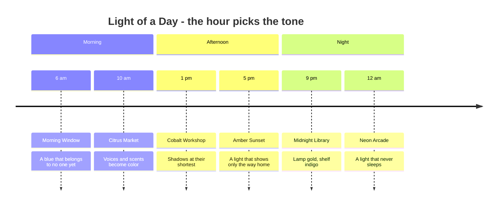

## A Poster in Color

### Four Voices

Four posters, one template. Type and layout never changed; only color and picture did. Yet one hushes, one runs, one settles, one glows. Color is not decoration. It is a page's tone of voice.

<span style="display:block;margin-top:.9em;padding-left:.8em;border-left:.12em solid currentColor;font-size:max(.56em, 13px);line-height:1.6;max-width:62em;"><span style="display:block;font-family:'JetBrains Mono',ui-monospace,Consolas,monospace;font-size:.82em;letter-spacing:.2em;opacity:.65;">WORK 03　·　midnight-library</span><span style="display:block;font-weight:700;margin:.15em 0 .1em;">“Reading Night”　<span style="font-weight:400;opacity:.75;">Midnight Library</span></span>Gold appears in only one place, as the lamp. The dark is left wide on purpose, as room for the reader to fill with their own imagination. A kindness that lights everything takes away the freedom to read.</span>

<span style="display:block;margin-top:.9em;padding-left:.8em;border-left:.12em solid currentColor;font-size:max(.56em, 13px);line-height:1.6;max-width:62em;"><span style="display:block;font-family:'JetBrains Mono',ui-monospace,Consolas,monospace;font-size:.82em;letter-spacing:.2em;opacity:.65;">WORK 04　·　cobalt-workshop</span><span style="display:block;font-weight:700;margin:.15em 0 .1em;">“Make Sunday”　<span style="font-weight:400;opacity:.75;">Cobalt Workshop</span></span>Primary colors quarrel. Children love a quarrel of colors anyway. Rather than impose an adult idea of harmony, the proportions of the band (7 : 2 : 1) alone decide who leads.</span>

<span style="display:block;margin-top:.9em;padding-left:.8em;border-left:.12em solid currentColor;font-size:max(.56em, 13px);line-height:1.6;max-width:62em;"><span style="display:block;font-family:'JetBrains Mono',ui-monospace,Consolas,monospace;font-size:.82em;letter-spacing:.2em;opacity:.65;">WORK 05　·　matcha-wagashi</span><span style="display:block;font-weight:700;margin:.15em 0 .1em;">“Winter Tea”　<span style="font-weight:400;opacity:.75;">Matcha & Wasanbon</span></span>Muted colors do not raise their voices, just as no one shouts in a tearoom. The circle is left open on purpose. A broken circle keeps more of the hand than a perfect one.</span>

<span style="display:block;margin-top:.9em;padding-left:.8em;border-left:.12em solid currentColor;font-size:max(.56em, 13px);line-height:1.6;max-width:62em;"><span style="display:block;font-family:'JetBrains Mono',ui-monospace,Consolas,monospace;font-size:.82em;letter-spacing:.2em;opacity:.65;">WORK 06　·　cyber-prism</span><span style="display:block;font-weight:700;margin:.15em 0 .1em;">“TECH NIGHT”　<span style="font-weight:400;opacity:.75;">Cyber Prism</span></span>No more than two colors glow. The future is always drawn dazzling, but dazzle makes people close their eyes. The dark borders and lines carry the rest, holding the light up.</span>

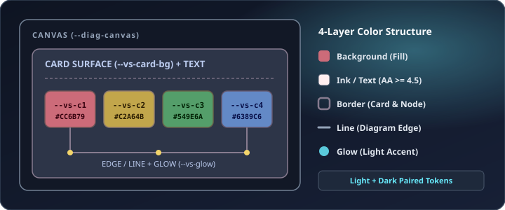

> Take a poster apart and it splits into four roles: background, text, border, line. Each Lucivo tone pairs every color with the text color that sits on it. Beauty must not cost legibility. A beauty that cannot be read leaves someone behind.

## The Rhythm of Proportion

### Two Silences

More than the number of colors, what matters is the proportion of area. The two color fields are painted with the same three colors of Amber Sunset. They differ only in how much the colors yield to one another.

<span style="display:block;margin-top:.9em;padding-left:.8em;border-left:.12em solid currentColor;font-size:max(.56em, 13px);line-height:1.6;max-width:62em;"><span style="display:block;font-family:'JetBrains Mono',ui-monospace,Consolas,monospace;font-size:.82em;letter-spacing:.2em;opacity:.65;">WORK 11　·　amber-sunset</span><span style="display:block;font-weight:700;margin:.15em 0 .1em;">“Colors that Yield”　<span style="font-weight:400;opacity:.75;">Amber Sunset</span></span>On the left, the accent retreats to 5% and becomes a lamp. On the right, three colors speak at the same volume, and no one can hear any of them. Evenness does not always make harmony.</span>

### Color Has an Order

Don't decide every color at once. Lay the ground, pick a key color, add a second and third in relation to it, place one accent last. The hall's diagram shows that order in the real colors of Amber Sunset.

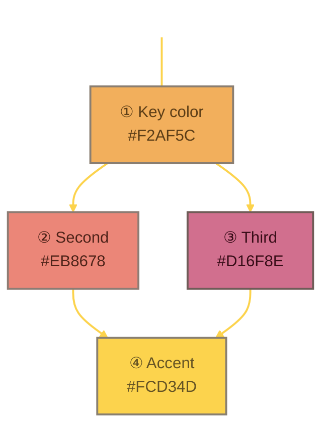

## The Room of Four Seasons

### One Ridge

All four ridges grow from one seed; only the air was redrawn. Spring and summer use Light palettes, autumn and winter Dark. To change a season, you need not move the mountains.

<span style="display:block;margin-top:.9em;padding-left:.8em;border-left:.12em solid currentColor;font-size:max(.56em, 13px);line-height:1.6;max-width:62em;"><span style="display:block;font-family:'JetBrains Mono',ui-monospace,Consolas,monospace;font-size:.82em;letter-spacing:.2em;opacity:.65;">WORK 07　·　spring-mist</span><span style="display:block;font-weight:700;margin:.15em 0 .1em;">“The ridge in spring”　<span style="font-weight:400;opacity:.75;">Spring Mist</span></span>Petals did not bloom in order to fall. Yet because they fall, we look up.</span>

<span style="display:block;margin-top:.9em;padding-left:.8em;border-left:.12em solid currentColor;font-size:max(.56em, 13px);line-height:1.6;max-width:62em;"><span style="display:block;font-family:'JetBrains Mono',ui-monospace,Consolas,monospace;font-size:.82em;letter-spacing:.2em;opacity:.65;">WORK 08　·　sea-glass-shore</span><span style="display:block;font-weight:700;margin:.15em 0 .1em;">“The ridge in summer”　<span style="font-weight:400;opacity:.75;">Sea Glass Shore</span></span>Glass worn by the waves lost its corners and became beautiful. Is being worn down by time called decay, or maturity?</span>

<span style="display:block;margin-top:.9em;padding-left:.8em;border-left:.12em solid currentColor;font-size:max(.56em, 13px);line-height:1.6;max-width:62em;"><span style="display:block;font-family:'JetBrains Mono',ui-monospace,Consolas,monospace;font-size:.82em;letter-spacing:.2em;opacity:.65;">WORK 09　·　terracotta-courtyard</span><span style="display:block;font-weight:700;margin:.15em 0 .1em;">“The ridge in autumn”　<span style="font-weight:400;opacity:.75;">Terracotta Courtyard</span></span>The color of a sunset can be kept exactly, as a color code. The walk home that day cannot. Color is a record; memory lives somewhere else.</span>

<span style="display:block;margin-top:.9em;padding-left:.8em;border-left:.12em solid currentColor;font-size:max(.56em, 13px);line-height:1.6;max-width:62em;"><span style="display:block;font-family:'JetBrains Mono',ui-monospace,Consolas,monospace;font-size:.82em;letter-spacing:.2em;opacity:.65;">WORK 10　·　nordic-frost</span><span style="display:block;font-weight:700;margin:.15em 0 .1em;">“The ridge in winter”　<span style="font-weight:400;opacity:.75;">Nordic Frost</span></span>The colder the color, the better it teaches us the warmth of a lamp. In a world without cold, no one lights a window.</span>

> To tell a season, you do not need vividness. Spring thin, summer clear, autumn muddied, winter dark and cold. Move the tone alone, and the air is replaced.

## The Archive of 203

### Named Colors

The archive holds 203 tones, each with a name like "Morning Window." A color code names a color for machines; an image name names it for people. Once named, a color borrows someone's memory.

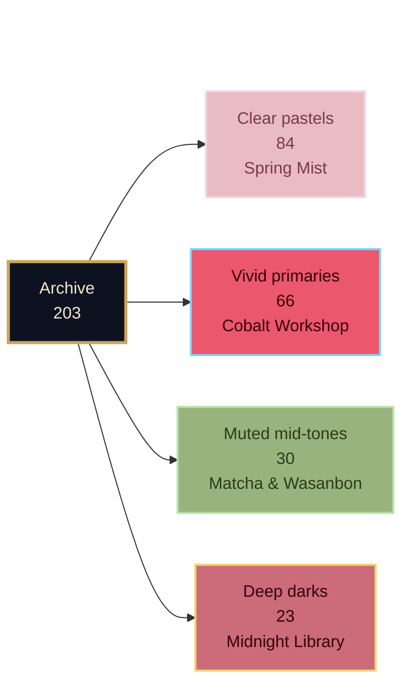

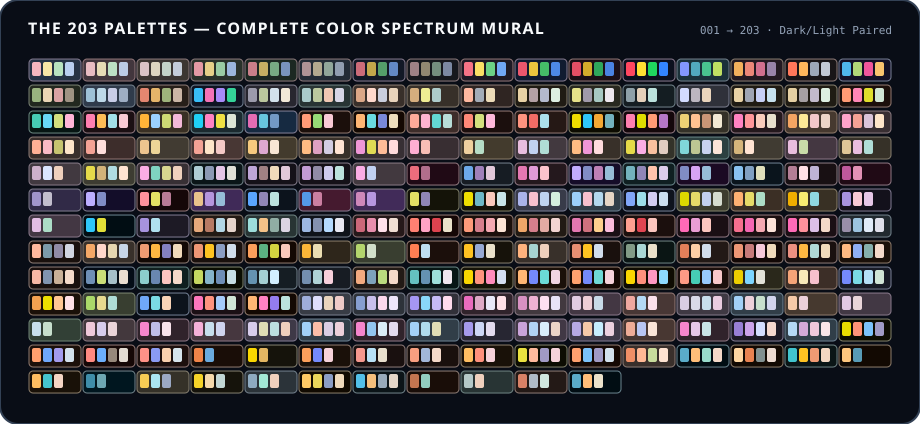

<span style="display:block;margin-top:.9em;padding-left:.8em;border-left:.12em solid currentColor;font-size:max(.56em, 13px);line-height:1.6;max-width:62em;"><span style="display:block;font-family:'JetBrains Mono',ui-monospace,Consolas,monospace;font-size:.82em;letter-spacing:.2em;opacity:.65;">WORK 12</span><span style="display:block;font-weight:700;margin:.15em 0 .1em;">“Mural of the Archive”</span>203 tones in numerical order, each cell holding four colors from the lead color onward. Up close, each has its own character; from afar, they become strata. A list is convenient, but inside a list a color grows a little quiet.</span>

> The colors in this exhibition were named by a person, arranged by a machine, and are now being seen by you. Who is the author? Perhaps the last person to be moved may count among them.

## Begin with Your Color

### Take It Home

A tone you like can be dressed onto your own document from the header's "Color Tone" menu. Add `tone`, `theme`, and `present` to the URL and you can hand someone the same colors and the same staging.

```text
?tone=midnight-library&theme=dark&present=museum-walk
```

> [!TIP]
> When in doubt, choose not from color but from the feeling you want to deliver. "Midnight Library" for a night talk, "Cobalt Workshop" for a children's guide, "Matcha Wagashi" for a Japanese-style event.
