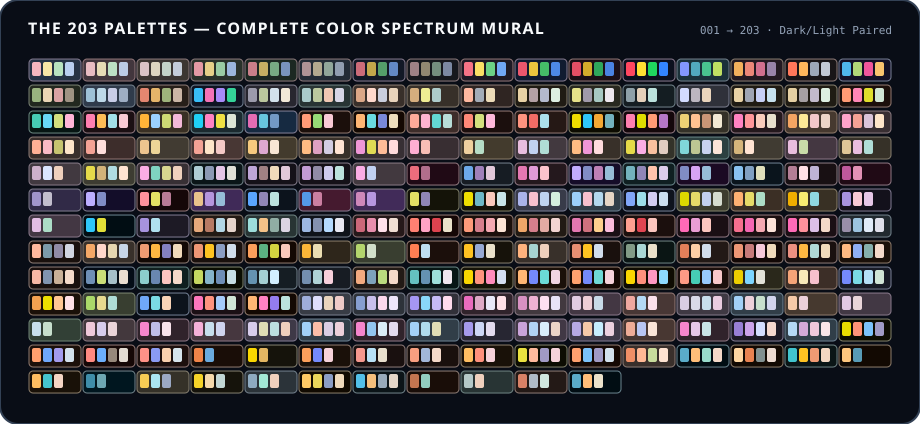
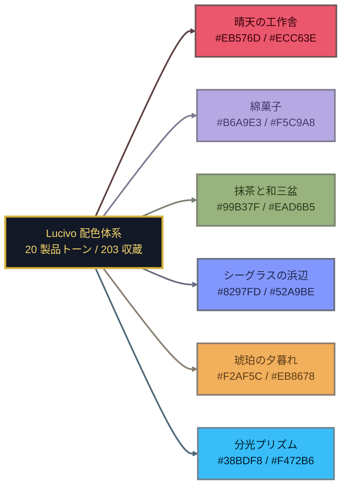
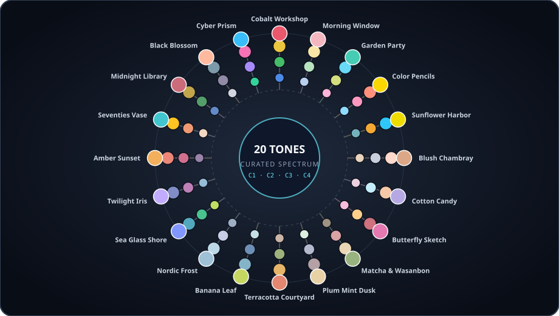

# 配色ミュージアム — 光と色の回廊

色は、言葉より先に文書の空気を決める。Lucivo の厳選 20 パターンと全 203 種のカラートーンを、実色スウォッチ・立体図・ベクター壁画とともに巡る公式展示回廊。

- **背景（Canvas / Card）**: 展示室の空気と奥行きを決める土台の色
- **文字（Ink）**: コントラスト比 4.5 以上（WCAG AA）を保つ判読の色
- **境界（Border）**: カードやノードの輪郭を静かに引き締める枠の色
- **線・光彩（Line / Glow）**: 図表のつながりと Dark 空間の発光を描く色

> [!NOTE]
> スクロールまたは上下キーで回廊を歩き、ドラッグで見回せます。`T` キーで Dark / Light の展示照明を切り替え、`Esc` で Visual モードへ戻れます。

## 1. 厳選 20 パターン — 色彩の立体標本

ヘッダーの「カラートーン」メニューから即座に適用できる 20 の製品版トーンを、6 つのムードに分けて展示する。広間の立体スタンドは、各トーンの実際の背景色・文字色・枠線・線の色で組み上げている。

### 1.1 明快・ビジネス・ポップ

視認性と爽快さを両立した、企画書・技術解説の主軸となる 5 トーン。

<table>
<thead>
<tr><th>#</th><th>トーン名 / ID</th><th>Dark 配色（背景・文字・境界・線・光彩）</th><th>Light 配色</th></tr>
</thead>
<tbody>
<tr><td>010</td><td><strong>晴天の工作舎</strong> <code>cobalt-workshop</code></td><td>C1C2C3C4✦</td><td>C1C2C3C4✦</td></tr>
<tr><td>001</td><td><strong>朝の窓辺</strong> <code>morning-window</code></td><td>C1C2C3C4✦</td><td>C1C2C3C4✦</td></tr>
<tr><td>033</td><td><strong>春のガーデンパーティー</strong> <code>garden-party</code></td><td>C1C2C3C4✦</td><td>C1C2C3C4✦</td></tr>
<tr><td>140</td><td><strong>色鉛筆</strong> <code>color-pencils</code></td><td>C1C2C3C4✦</td><td>C1C2C3C4✦</td></tr>
<tr><td>043</td><td><strong>向日葵の港</strong> <code>sunflower-harbor</code></td><td>C1C2C3C4✦</td><td>C1C2C3C4✦</td></tr>
</tbody>
</table>

### 1.2 ペール・淡色・フェミニン

柔らかな光と低い彩度で、余白の呼吸を引き立てる 3 トーン。

<table>
<thead>
<tr><th>#</th><th>トーン名 / ID</th><th>Dark 配色（背景・文字・境界・線・光彩）</th><th>Light 配色</th></tr>
</thead>
<tbody>
<tr><td>023</td><td><strong>頬紅とシャンブレー</strong> <code>blush-chambray</code></td><td>C1C2C3C4✦</td><td>C1C2C3C4✦</td></tr>
<tr><td>171</td><td><strong>綿菓子</strong> <code>cotton-candy</code></td><td>C1C2C3C4✦</td><td>C1C2C3C4✦</td></tr>
<tr><td>107</td><td><strong>蝶のスケッチ</strong> <code>butterfly-sketch</code></td><td>C1C2C3C4✦</td><td>C1C2C3C4✦</td></tr>
</tbody>
</table>

### 1.3 ナチュラル・和・アース

抹茶・土壁・葉脈など自然界の質感に根ざした、落ち着いた 4 トーン。

<table>
<thead>
<tr><th>#</th><th>トーン名 / ID</th><th>Dark 配色（背景・文字・境界・線・光彩）</th><th>Light 配色</th></tr>
</thead>
<tbody>
<tr><td>017</td><td><strong>抹茶と和三盆</strong> <code>matcha-wagashi</code></td><td>C1C2C3C4✦</td><td>C1C2C3C4✦</td></tr>
<tr><td>026</td><td><strong>プラムと薄荷の夕べ</strong> <code>plum-mint-dusk</code></td><td>C1C2C3C4✦</td><td>C1C2C3C4✦</td></tr>
<tr><td>019</td><td><strong>テラコッタの中庭</strong> <code>terracotta-courtyard</code></td><td>C1C2C3C4✦</td><td>C1C2C3C4✦</td></tr>
<tr><td>132</td><td><strong>バナナの葉</strong> <code>banana-leaf</code></td><td>C1C2C3C4✦</td><td>C1C2C3C4✦</td></tr>
</tbody>
</table>

### 1.4 クール・マリン・紫

霜柱・シーグラス・黄昏の青紫が、静謐な知性を演出する 3 トーン。

<table>
<thead>
<tr><th>#</th><th>トーン名 / ID</th><th>Dark 配色（背景・文字・境界・線・光彩）</th><th>Light 配色</th></tr>
</thead>
<tbody>
<tr><td>018</td><td><strong>北欧の霜柱</strong> <code>nordic-frost</code></td><td>C1C2C3C4✦</td><td>C1C2C3C4✦</td></tr>
<tr><td>013</td><td><strong>シーグラスの浜辺</strong> <code>sea-glass-shore</code></td><td>C1C2C3C4✦</td><td>C1C2C3C4✦</td></tr>
<tr><td>075</td><td><strong>黄昏のアイリス</strong> <code>twilight-iris</code></td><td>C1C2C3C4✦</td><td>C1C2C3C4✦</td></tr>
</tbody>
</table>

### 1.5 レトロ・夕暮れ

琥珀色の残照と 70 年代クラフトの温もりを宿す 2 トーン。

<table>
<thead>
<tr><th>#</th><th>トーン名 / ID</th><th>Dark 配色（背景・文字・境界・線・光彩）</th><th>Light 配色</th></tr>
</thead>
<tbody>
<tr><td>014</td><td><strong>琥珀の夕暮れ</strong> <code>amber-sunset</code></td><td>C1C2C3C4✦</td><td>C1C2C3C4✦</td></tr>
<tr><td>191</td><td><strong>70 年代の花瓶</strong> <code>seventies-vase</code></td><td>C1C2C3C4✦</td><td>C1C2C3C4✦</td></tr>
</tbody>
</table>

### 1.6 重厚・シック・サイバー

暗所のステージやミュージアム・ウォークで真価を発揮する重厚な 3 トーン。

<table>
<thead>
<tr><th>#</th><th>トーン名 / ID</th><th>Dark 配色（背景・文字・境界・線・光彩）</th><th>Light 配色</th></tr>
</thead>
<tbody>
<tr><td>007</td><td><strong>夜を編む図書館</strong> <code>midnight-library</code></td><td>C1C2C3C4✦</td><td>C1C2C3C4✦</td></tr>
<tr><td>113</td><td><strong>黒と白い花</strong> <code>black-blossom</code></td><td>C1C2C3C4✦</td><td>C1C2C3C4✦</td></tr>
<tr><td>020</td><td><strong>分光プリズムと黒曜石</strong> <code>cyber-prism</code></td><td>C1C2C3C4✦</td><td>C1C2C3C4✦</td></tr>
</tbody>
</table>

## 2. 色の骨格 — 背景・文字・境界・線の調和

1 つのカラートーンは単なる 4 色の羅列ではない。すべての色に対して「背景に使ったときの文字色」「境界の色」「線の色」を組で設計し、Light と Dark の両面で破綻しない配色を保証している。

> 暗い展示室では「黒に鮮やかな色を置く」だけでは目が疲れる。ベース背景に微かな色相を混ぜ、境界線と光彩の明度を抑えることで、長時間の閲覧でも美しい立体感が生まれる。

## 3. 全 203 色の大回廊

`doc/0.DTP/assets/color-tones/` に収蔵されている全 203 種のカラートーンを、12 種ごとのガラス額縁プレートで展示する。各スウォッチの中の短い横線は「線（Line）」の色、外枠は「境界（Border）」の色、丸い `✦` は「光彩（Glow）」を表す。

### 3.1 収蔵コレクション 001–012

<table>
<thead>
<tr><th>#</th><th>イメージ名 / ID</th><th>区分</th><th>Dark 実色見本</th><th>Light 実色見本</th></tr>
</thead>
<tbody>
<tr><td>001</td><td><strong>朝の窓辺</strong> <code>morning-window</code></td><td>あさい（light）</td><td>C1C2C3C4✦</td><td>C1C2C3C4✦</td></tr>
<tr><td>002</td><td><strong>春霞のさくら</strong> <code>spring-mist</code></td><td>うすい（pale）</td><td>C1C2C3C4✦</td><td>C1C2C3C4✦</td></tr>
<tr><td>003</td><td><strong>生成りのアトリエ</strong> <code>linen-atelier</code></td><td>あかるいはいみ（light grayish）</td><td>C1C2C3C4✦</td><td>C1C2C3C4✦</td></tr>
<tr><td>004</td><td><strong>植物標本と乾いた紙</strong> <code>botanical-herbarium</code></td><td>やわらかい（soft）</td><td>C1C2C3C4✦</td><td>C1C2C3C4✦</td></tr>
<tr><td>005</td><td><strong>雨上がりの苔庭</strong> <code>rainy-moss-garden</code></td><td>にぶい（dull）</td><td>C1C2C3C4✦</td><td>C1C2C3C4✦</td></tr>
<tr><td>006</td><td><strong>霧の港町</strong> <code>foggy-harbor</code></td><td>はいみ（grayish）</td><td>C1C2C3C4✦</td><td>C1C2C3C4✦</td></tr>
<tr><td>007</td><td><strong>夜を編む図書館</strong> <code>midnight-library</code></td><td>くらい（dark）</td><td>C1C2C3C4✦</td><td>C1C2C3C4✦</td></tr>
<tr><td>008</td><td><strong>炭とインクの書斎</strong> <code>charcoal-study</code></td><td>くらいはいみ（dark grayish）</td><td>C1C2C3C4✦</td><td>C1C2C3C4✦</td></tr>
<tr><td>009</td><td><strong>陽だまりの果実市</strong> <code>citrus-market</code></td><td>あかるい（bright）</td><td>C1C2C3C4✦</td><td>C1C2C3C4✦</td></tr>
<tr><td>010</td><td><strong>晴天の工作舎</strong> <code>cobalt-workshop</code></td><td>つよい（strong）</td><td>C1C2C3C4✦</td><td>C1C2C3C4✦</td></tr>
<tr><td>011</td><td><strong>深紅と紺青の舞台幕</strong> <code>antique-velvet</code></td><td>こい（deep）</td><td>C1C2C3C4✦</td><td>C1C2C3C4✦</td></tr>
<tr><td>012</td><td><strong>深夜の電脳祭</strong> <code>neon-arcade</code></td><td>さえた（vivid）</td><td>C1C2C3C4✦</td><td>C1C2C3C4✦</td></tr>
</tbody>
</table>

### 3.2 収蔵コレクション 013–024

<table>
<thead>
<tr><th>#</th><th>イメージ名 / ID</th><th>区分</th><th>Dark 実色見本</th><th>Light 実色見本</th></tr>
</thead>
<tbody>
<tr><td>013</td><td><strong>シーグラスの浜辺</strong> <code>sea-glass-shore</code></td><td>あさい〜やわらかい（light / soft）</td><td>C1C2C3C4✦</td><td>C1C2C3C4✦</td></tr>
<tr><td>014</td><td><strong>琥珀の夕暮れ</strong> <code>amber-sunset</code></td><td>やわらかい〜にぶい（soft / dull）</td><td>C1C2C3C4✦</td><td>C1C2C3C4✦</td></tr>
<tr><td>015</td><td><strong>窯の熾火と灰</strong> <code>kiln-ember</code></td><td>にぶい〜つよい（dull / strong）</td><td>C1C2C3C4✦</td><td>C1C2C3C4✦</td></tr>
<tr><td>016</td><td><strong>教会のステンドグラス</strong> <code>stained-glass</code></td><td>こい〜あかるい（deep / bright）</td><td>C1C2C3C4✦</td><td>C1C2C3C4✦</td></tr>
<tr><td>017</td><td><strong>抹茶と和三盆</strong> <code>matcha-wagashi</code></td><td>やわらかい〜にぶい（soft / dull）</td><td>C1C2C3C4✦</td><td>C1C2C3C4✦</td></tr>
<tr><td>018</td><td><strong>北欧の霜柱</strong> <code>nordic-frost</code></td><td>うすい〜あかるいはいみ（pale / light grayish）</td><td>C1C2C3C4✦</td><td>C1C2C3C4✦</td></tr>
<tr><td>019</td><td><strong>テラコッタの中庭</strong> <code>terracotta-courtyard</code></td><td>やわらかい〜にぶい（soft / dull）</td><td>C1C2C3C4✦</td><td>C1C2C3C4✦</td></tr>
<tr><td>020</td><td><strong>分光プリズムと黒曜石</strong> <code>cyber-prism</code></td><td>あかるい＋くらい（bright + dark）</td><td>C1C2C3C4✦</td><td>C1C2C3C4✦</td></tr>
<tr><td>021</td><td><strong>白磁と静けさ</strong> <code>porcelain-hush</code></td><td>ごくうすい＋くらいはいみ（very pale + dark grayish）</td><td>C1C2C3C4✦</td><td>C1C2C3C4✦</td></tr>
<tr><td>022</td><td><strong>観葉植物の陽だまり</strong> <code>fern-sunroom</code></td><td>うすい＋にぶい（pale + dull）</td><td>C1C2C3C4✦</td><td>C1C2C3C4✦</td></tr>
<tr><td>023</td><td><strong>頬紅とシャンブレー</strong> <code>blush-chambray</code></td><td>うすい＋あかるいはいみ（pale + light grayish）</td><td>C1C2C3C4✦</td><td>C1C2C3C4✦</td></tr>
<tr><td>024</td><td><strong>若葉ライムと流木</strong> <code>lime-driftwood</code></td><td>うすい＋にぶい（pale + dull）</td><td>C1C2C3✦</td><td>C1C2C3✦</td></tr>
</tbody>
</table>

### 3.3 収蔵コレクション 025–036

<table>
<thead>
<tr><th>#</th><th>イメージ名 / ID</th><th>区分</th><th>Dark 実色見本</th><th>Light 実色見本</th></tr>
</thead>
<tbody>
<tr><td>025</td><td><strong>珊瑚と石板の入江</strong> <code>coral-slate-cove</code></td><td>やわらかい＋にぶい（soft + dull）</td><td>C1C2C3✦</td><td>C1C2C3✦</td></tr>
<tr><td>026</td><td><strong>プラムと薄荷の夕べ</strong> <code>plum-mint-dusk</code></td><td>あかるいはいみ＋くらいはいみ（light grayish + dark grayish）</td><td>C1C2C3C4✦</td><td>C1C2C3C4✦</td></tr>
<tr><td>027</td><td><strong>レモンと黒鉛</strong> <code>lemon-graphite</code></td><td>ごくうすい＋くらい（very pale + dark）</td><td>C1C2C3C4✦</td><td>C1C2C3C4✦</td></tr>
<tr><td>028</td><td><strong>波の泡と石畳</strong> <code>seafoam-cobble</code></td><td>うすい＋くらいはいみ（pale + dark grayish）</td><td>C1C2C3✦</td><td>C1C2C3✦</td></tr>
<tr><td>029</td><td><strong>ラベンダーとカシミア</strong> <code>lavender-cashmere</code></td><td>うすい＋あかるいはいみ（pale + light grayish）</td><td>C1C2C3✦</td><td>C1C2C3✦</td></tr>
<tr><td>030</td><td><strong>夕凪の港と砂</strong> <code>harbor-twilight</code></td><td>うすい＋くらいはいみ（pale + dark grayish）</td><td>C1C2C3C4✦</td><td>C1C2C3C4✦</td></tr>
<tr><td>031</td><td><strong>小麦とピューター</strong> <code>wheat-pewter</code></td><td>あかるいはいみ＋くらいはいみ（light grayish + dark grayish）</td><td>C1C2C3C4✦</td><td>C1C2C3C4✦</td></tr>
<tr><td>032</td><td><strong>ポップなシャーベット</strong> <code>pop-sorbet</code></td><td>さえた＋ごくうすい（vivid + very pale）</td><td>C1C2C3C4✦</td><td>C1C2C3C4✦</td></tr>
<tr><td>033</td><td><strong>春のガーデンパーティー</strong> <code>garden-party</code></td><td>あかるい＋つよい（bright + strong）</td><td>C1C2C3C4✦</td><td>C1C2C3C4✦</td></tr>
<tr><td>034</td><td><strong>虹色のスニーカー</strong> <code>iridescent-sneaker</code></td><td>うすい＋さえた（pale + vivid）</td><td>C1C2C3C4✦</td><td>C1C2C3C4✦</td></tr>
<tr><td>035</td><td><strong>若草の野原</strong> <code>spring-meadow</code></td><td>うすい＋あかるい（pale + bright）</td><td>C1C2C3C4✦</td><td>C1C2C3C4✦</td></tr>
<tr><td>036</td><td><strong>ピンクレモネード</strong> <code>pink-lemonade</code></td><td>さえた＋ごくうすい（vivid + very pale）</td><td>C1C2C3C4✦</td><td>C1C2C3C4✦</td></tr>
</tbody>
</table>

### 3.4 収蔵コレクション 037–048

<table>
<thead>
<tr><th>#</th><th>イメージ名 / ID</th><th>区分</th><th>Dark 実色見本</th><th>Light 実色見本</th></tr>
</thead>
<tbody>
<tr><td>037</td><td><strong>夜のベリーソーダ</strong> <code>berry-soda-night</code></td><td>さえた＋くらい（vivid + dark）</td><td>C1C2C3✦</td><td>C1C2C3✦</td></tr>
<tr><td>038</td><td><strong>スイカのピクニック</strong> <code>watermelon-picnic</code></td><td>つよい＋うすい（strong + pale）</td><td>C1C2C3✦</td><td>C1C2C3✦</td></tr>
<tr><td>039</td><td><strong>レトロなプールサイド</strong> <code>retro-poolside</code></td><td>あかるい＋こい（bright + deep）</td><td>C1C2C3C4✦</td><td>C1C2C3C4✦</td></tr>
<tr><td>040</td><td><strong>フラミンゴのラグーン</strong> <code>flamingo-lagoon</code></td><td>あかるい＋うすい（bright + pale）</td><td>C1C2C3C4✦</td><td>C1C2C3C4✦</td></tr>
<tr><td>041</td><td><strong>苺とライムのソーダ</strong> <code>strawberry-lime</code></td><td>さえた＋うすい（vivid + pale）</td><td>C1C2C3✦</td><td>C1C2C3✦</td></tr>
<tr><td>042</td><td><strong>赤煉瓦と冬の空</strong> <code>brick-skyline</code></td><td>こい＋うすい（deep + pale）</td><td>C1C2C3✦</td><td>C1C2C3✦</td></tr>
<tr><td>043</td><td><strong>向日葵の港</strong> <code>sunflower-harbor</code></td><td>さえた＋こい（vivid + deep）</td><td>C1C2C3C4✦</td><td>C1C2C3C4✦</td></tr>
<tr><td>044</td><td><strong>真夏のカーニバル</strong> <code>carnival-night</code></td><td>さえた＋こい（vivid + deep）</td><td>C1C2C3C4✦</td><td>C1C2C3C4✦</td></tr>
<tr><td>045</td><td><strong>夢見る夕暮れ</strong> <code>dusk-dream</code></td><td>うすい＋あかるいはいみ（pale + light grayish）</td><td>C1C2C3C4✦</td><td>C1C2C3C4✦</td></tr>
<tr><td>046</td><td><strong>水彩のにじみ</strong> <code>watercolor-blush</code></td><td>うすい＋つよい（pale + strong）</td><td>C1C2C3C4✦</td><td>C1C2C3C4✦</td></tr>
<tr><td>047</td><td><strong>朝のシャーベット</strong> <code>morning-sorbet</code></td><td>ごくうすい＋うすい（very pale + pale）</td><td>C1C2C3C4✦</td><td>C1C2C3C4✦</td></tr>
<tr><td>048</td><td><strong>パンパスグラスの輝き</strong> <code>pampas-glow</code></td><td>うすい＋あかるいはいみ（pale + light grayish）</td><td>C1C2C3C4✦</td><td>C1C2C3C4✦</td></tr>
</tbody>
</table>

### 3.5 収蔵コレクション 049–060

<table>
<thead>
<tr><th>#</th><th>イメージ名 / ID</th><th>区分</th><th>Dark 実色見本</th><th>Light 実色見本</th></tr>
</thead>
<tbody>
<tr><td>049</td><td><strong>絵の中の庭</strong> <code>painted-garden</code></td><td>うすい＋やわらかい（pale + soft）</td><td>C1C2C3C4✦</td><td>C1C2C3C4✦</td></tr>
<tr><td>050</td><td><strong>薔薇の花びら</strong> <code>rose-petal</code></td><td>うすい（pale）</td><td>C1C2✦</td><td>C1C2✦</td></tr>
<tr><td>051</td><td><strong>はちみつビスケット</strong> <code>honey-biscuit</code></td><td>うすい＋あかるいはいみ（pale + light grayish）</td><td>C1C2✦</td><td>C1C2✦</td></tr>
<tr><td>052</td><td><strong>桃の花</strong> <code>peach-blossom</code></td><td>うすい＋ごくうすい（pale + very pale）</td><td>C1C2C3✦</td><td>C1C2C3✦</td></tr>
<tr><td>053</td><td><strong>ライラックとカスタード</strong> <code>lilac-custard</code></td><td>うすい（pale）</td><td>C1C2C3✦</td><td>C1C2C3✦</td></tr>
<tr><td>054</td><td><strong>ラベンダーと杏</strong> <code>lavender-apricot</code></td><td>うすい＋あかるいはいみ（pale + light grayish）</td><td>C1C2C3C4✦</td><td>C1C2C3C4✦</td></tr>
<tr><td>055</td><td><strong>果樹園のキャンディ</strong> <code>candy-orchard</code></td><td>うすい＋やわらかい（pale + soft）</td><td>C1C2C3C4✦</td><td>C1C2C3C4✦</td></tr>
<tr><td>056</td><td><strong>桜餅</strong> <code>sakura-mochi</code></td><td>うすい（pale）</td><td>C1C2✦</td><td>C1C2✦</td></tr>
<tr><td>057</td><td><strong>ミントとカスタード</strong> <code>mint-custard</code></td><td>ごくうすい（very pale）</td><td>C1C2✦</td><td>C1C2✦</td></tr>
<tr><td>058</td><td><strong>菖蒲と薄荷の霧</strong> <code>iris-mint-mist</code></td><td>ごくうすい（very pale）</td><td>C1C2C3✦</td><td>C1C2C3✦</td></tr>
<tr><td>059</td><td><strong>オーキッドと杏</strong> <code>orchid-apricot</code></td><td>うすい＋やわらかい（pale + soft）</td><td>C1C2C3✦</td><td>C1C2C3✦</td></tr>
<tr><td>060</td><td><strong>レモンとオーキッド</strong> <code>lemon-orchid</code></td><td>うすい＋やわらかい（pale + soft）</td><td>C1C2C3C4✦</td><td>C1C2C3C4✦</td></tr>
</tbody>
</table>

### 3.6 収蔵コレクション 061–072

<table>
<thead>
<tr><th>#</th><th>イメージ名 / ID</th><th>区分</th><th>Dark 実色見本</th><th>Light 実色見本</th></tr>
</thead>
<tbody>
<tr><td>061</td><td><strong>パステルの入江</strong> <code>pastel-lagoon</code></td><td>ごくうすい＋あかるい（very pale + bright）</td><td>C1C2C3C4✦</td><td>C1C2C3C4✦</td></tr>
<tr><td>062</td><td><strong>麻と砂</strong> <code>linen-sand</code></td><td>ごくうすい＋あかるいはいみ（very pale + light grayish）</td><td>C1C2✦</td><td>C1C2✦</td></tr>
<tr><td>063</td><td><strong>ライラックと新芽</strong> <code>lilac-sprout</code></td><td>ごくうすい（very pale）</td><td>C1C2✦</td><td>C1C2✦</td></tr>
<tr><td>064</td><td><strong>ライラックとミントの浜</strong> <code>lilac-mint-sand</code></td><td>うすい＋あかるいはいみ（pale + light grayish）</td><td>C1C2C3✦</td><td>C1C2C3✦</td></tr>
<tr><td>065</td><td><strong>ペリウィンクルとモーブ</strong> <code>periwinkle-mauve</code></td><td>ごくうすい＋あかるいはいみ（very pale + light grayish）</td><td>C1C2C3✦</td><td>C1C2C3✦</td></tr>
<tr><td>066</td><td><strong>ライムとアクアの砂丘</strong> <code>lime-aqua-dune</code></td><td>うすい＋あかるいはいみ（pale + light grayish）</td><td>C1C2C3C4✦</td><td>C1C2C3C4✦</td></tr>
<tr><td>067</td><td><strong>翡翠とオーキッド</strong> <code>jade-orchid</code></td><td>うすい＋やわらかい（pale + soft）</td><td>C1C2C3C4✦</td><td>C1C2C3C4✦</td></tr>
<tr><td>068</td><td><strong>水晶玉と静物</strong> <code>crystal-orb</code></td><td>うすい＋くらいはいみ（pale + dark grayish）</td><td>C1C2C3C4✦</td><td>C1C2C3C4✦</td></tr>
<tr><td>069</td><td><strong>紫の刻</strong> <code>violet-hour</code></td><td>やわらかい＋くらい（soft + dark）</td><td>C1C2C3C4✦</td><td>C1C2C3C4✦</td></tr>
<tr><td>070</td><td><strong>タロットと月</strong> <code>tarot-moon</code></td><td>あかるいはいみ＋くらい（light grayish + dark）</td><td>C1C2C3C4✦</td><td>C1C2C3C4✦</td></tr>
<tr><td>071</td><td><strong>霧の中の蘭</strong> <code>orchid-mist</code></td><td>やわらかい＋ごくうすい（soft + very pale）</td><td>C1C2✦</td><td>C1C2✦</td></tr>
<tr><td>072</td><td><strong>プラムとコーラル</strong> <code>plum-coral</code></td><td>つよい＋くらい（strong + dark）</td><td>C1C2✦</td><td>C1C2✦</td></tr>
</tbody>
</table>

### 3.7 収蔵コレクション 073–084

<table>
<thead>
<tr><th>#</th><th>イメージ名 / ID</th><th>区分</th><th>Dark 実色見本</th><th>Light 実色見本</th></tr>
</thead>
<tbody>
<tr><td>073</td><td><strong>コバルトとプラム</strong> <code>cobalt-plum</code></td><td>こい＋あかるいはいみ（deep + light grayish）</td><td>C1C2C3✦</td><td>C1C2C3✦</td></tr>
<tr><td>074</td><td><strong>ベリーと花びら</strong> <code>berry-blossom</code></td><td>こい＋うすい（deep + pale）</td><td>C1C2C3✦</td><td>C1C2C3✦</td></tr>
<tr><td>075</td><td><strong>黄昏のアイリス</strong> <code>twilight-iris</code></td><td>やわらかい＋こい（soft + deep）</td><td>C1C2C3C4✦</td><td>C1C2C3C4✦</td></tr>
<tr><td>076</td><td><strong>真夜中の桃</strong> <code>midnight-peach</code></td><td>うすい＋くらい（pale + dark）</td><td>C1C2C3C4✦</td><td>C1C2C3C4✦</td></tr>
<tr><td>077</td><td><strong>アメジストの空</strong> <code>amethyst-sky</code></td><td>やわらかい＋こい（soft + deep）</td><td>C1C2C3✦</td><td>C1C2C3✦</td></tr>
<tr><td>078</td><td><strong>インクと便箋</strong> <code>ink-cream</code></td><td>あかるい＋くらいはいみ（bright + dark grayish）</td><td>C1C2C3✦</td><td>C1C2C3✦</td></tr>
<tr><td>079</td><td><strong>アンティークの化粧台</strong> <code>antique-vanity</code></td><td>うすい＋くらい（pale + dark）</td><td>C1C2C3✦</td><td>C1C2C3✦</td></tr>
<tr><td>080</td><td><strong>夜会のドレス</strong> <code>magenta-plum</code></td><td>つよい＋くらい（strong + dark）</td><td>C1C2✦</td><td>C1C2✦</td></tr>
<tr><td>081</td><td><strong>真夜中のラベンダー</strong> <code>midnight-lavender</code></td><td>くらい＋あかるいはいみ（dark + light grayish）</td><td>C1C2✦</td><td>C1C2✦</td></tr>
<tr><td>082</td><td><strong>紫のベルベット</strong> <code>violet-velvet</code></td><td>こい＋やわらかい（deep + soft）</td><td>C1C2✦</td><td>C1C2✦</td></tr>
<tr><td>083</td><td><strong>夜市のネオン</strong> <code>night-market-neon</code></td><td>つよい＋くらい（strong + dark）</td><td>C1C2C3✦</td><td>C1C2C3✦</td></tr>
<tr><td>084</td><td><strong>砂漠の夜</strong> <code>desert-night</code></td><td>こい＋うすい（deep + pale）</td><td>C1C2C3✦</td><td>C1C2C3✦</td></tr>
</tbody>
</table>

### 3.8 収蔵コレクション 085–096

<table>
<thead>
<tr><th>#</th><th>イメージ名 / ID</th><th>区分</th><th>Dark 実色見本</th><th>Light 実色見本</th></tr>
</thead>
<tbody>
<tr><td>085</td><td><strong>コバルトと薄荷の夜</strong> <code>cobalt-mint-night</code></td><td>こい＋ごくうすい（deep + very pale）</td><td>C1C2C3✦</td><td>C1C2C3✦</td></tr>
<tr><td>086</td><td><strong>ワインとコバルト</strong> <code>wine-cobalt</code></td><td>くらい＋こい（dark + deep）</td><td>C1C2✦</td><td>C1C2✦</td></tr>
<tr><td>087</td><td><strong>夜の蘭</strong> <code>orchid-night</code></td><td>やわらかい＋くらい（soft + dark）</td><td>C1C2✦</td><td>C1C2✦</td></tr>
<tr><td>088</td><td><strong>真夜中のライム</strong> <code>midnight-lime</code></td><td>くらい＋うすい（dark + pale）</td><td>C1C2✦</td><td>C1C2✦</td></tr>
<tr><td>089</td><td><strong>春のマルシェ</strong> <code>fresh-market</code></td><td>さえた＋うすい（vivid + pale）</td><td>C1C2C3C4✦</td><td>C1C2C3C4✦</td></tr>
<tr><td>090</td><td><strong>パステルの雲</strong> <code>pastel-cloud</code></td><td>ごくうすい（very pale）</td><td>C1C2C3C4✦</td><td>C1C2C3C4✦</td></tr>
<tr><td>091</td><td><strong>桃色の地平</strong> <code>pink-horizon</code></td><td>うすい（pale）</td><td>C1C2C3C4✦</td><td>C1C2C3C4✦</td></tr>
<tr><td>092</td><td><strong>デニムとライラック</strong> <code>denim-lilac</code></td><td>うすい＋つよい（pale + strong）</td><td>C1C2C3C4✦</td><td>C1C2C3C4✦</td></tr>
<tr><td>093</td><td><strong>レモンメレンゲ</strong> <code>lemon-meringue</code></td><td>ごくうすい＋うすい（very pale + pale）</td><td>C1C2C3C4✦</td><td>C1C2C3C4✦</td></tr>
<tr><td>094</td><td><strong>みかんと薄荷</strong> <code>tangerine-mint</code></td><td>あかるい＋うすい（bright + pale）</td><td>C1C2C3✦</td><td>C1C2C3✦</td></tr>
<tr><td>095</td><td><strong>杏とプール</strong> <code>apricot-pool</code></td><td>あかるい＋うすい（bright + pale）</td><td>C1C2C3✦</td><td>C1C2C3✦</td></tr>
<tr><td>096</td><td><strong>菫と頬紅</strong> <code>violet-blush</code></td><td>うすい＋こい（pale + deep）</td><td>C1C2C3✦</td><td>C1C2C3✦</td></tr>
</tbody>
</table>

### 3.9 収蔵コレクション 097–108

<table>
<thead>
<tr><th>#</th><th>イメージ名 / ID</th><th>区分</th><th>Dark 実色見本</th><th>Light 実色見本</th></tr>
</thead>
<tbody>
<tr><td>097</td><td><strong>ライラックとミント</strong> <code>lilac-mint</code></td><td>ごくうすい（very pale）</td><td>C1C2✦</td><td>C1C2✦</td></tr>
<tr><td>098</td><td><strong>ライムとシアン</strong> <code>lime-cyan</code></td><td>さえた（vivid）</td><td>C1C2✦</td><td>C1C2✦</td></tr>
<tr><td>099</td><td><strong>菫と氷</strong> <code>violet-ice</code></td><td>こい＋ごくうすい（deep + very pale）</td><td>C1C2✦</td><td>C1C2✦</td></tr>
<tr><td>100</td><td><strong>海と素焼きの器</strong> <code>terracotta-sea</code></td><td>うすい＋くらい（pale + dark）</td><td>C1C2C3C4✦</td><td>C1C2C3C4✦</td></tr>
<tr><td>101</td><td><strong>流木とティール</strong> <code>driftwood-teal</code></td><td>にぶい＋うすい（dull + pale）</td><td>C1C2C3C4✦</td><td>C1C2C3C4✦</td></tr>
<tr><td>102</td><td><strong>青いシャツとスレート</strong> <code>oxford-shirt</code></td><td>うすい＋くらいはいみ（pale + dark grayish）</td><td>C1C2C3C4✦</td><td>C1C2C3C4✦</td></tr>
<tr><td>103</td><td><strong>押し花</strong> <code>pressed-flowers</code></td><td>うすい＋くらい（pale + dark）</td><td>C1C2C3C4✦</td><td>C1C2C3C4✦</td></tr>
<tr><td>104</td><td><strong>ルージュの赤</strong> <code>rouge-red</code></td><td>さえた＋くらい（vivid + dark）</td><td>C1C2C3C4✦</td><td>C1C2C3C4✦</td></tr>
<tr><td>105</td><td><strong>桃色のチュール</strong> <code>peach-tulle</code></td><td>うすい＋こい（pale + deep）</td><td>C1C2C3C4✦</td><td>C1C2C3C4✦</td></tr>
<tr><td>106</td><td><strong>ドライローズ</strong> <code>dried-rose</code></td><td>あかるいはいみ＋くらい（light grayish + dark）</td><td>C1C2C3C4✦</td><td>C1C2C3C4✦</td></tr>
<tr><td>107</td><td><strong>蝶のスケッチ</strong> <code>butterfly-sketch</code></td><td>うすい＋こい（pale + deep）</td><td>C1C2C3C4✦</td><td>C1C2C3C4✦</td></tr>
<tr><td>108</td><td><strong>赤いベルベット</strong> <code>red-velvet</code></td><td>つよい＋うすい（strong + pale）</td><td>C1C2C3✦</td><td>C1C2C3✦</td></tr>
</tbody>
</table>

### 3.10 収蔵コレクション 109–120

<table>
<thead>
<tr><th>#</th><th>イメージ名 / ID</th><th>区分</th><th>Dark 実色見本</th><th>Light 実色見本</th></tr>
</thead>
<tbody>
<tr><td>109</td><td><strong>蘭とマゼンタ</strong> <code>orchid-magenta</code></td><td>さえた＋うすい（vivid + pale）</td><td>C1C2C3✦</td><td>C1C2C3✦</td></tr>
<tr><td>110</td><td><strong>薔薇のキャンディ</strong> <code>rose-candy</code></td><td>さえた＋ごくうすい（vivid + very pale）</td><td>C1C2C3C4✦</td><td>C1C2C3C4✦</td></tr>
<tr><td>111</td><td><strong>コーラルとライラック</strong> <code>coral-lilac</code></td><td>さえた＋うすい（vivid + pale）</td><td>C1C2C3C4✦</td><td>C1C2C3C4✦</td></tr>
<tr><td>112</td><td><strong>雷雲の空</strong> <code>thunder-sky</code></td><td>ごくうすい＋くらい（very pale + dark）</td><td>C1C2C3C4✦</td><td>C1C2C3C4✦</td></tr>
<tr><td>113</td><td><strong>黒と白い花</strong> <code>black-blossom</code></td><td>くらい＋あかるいはいみ（dark + light grayish）</td><td>C1C2C3C4✦</td><td>C1C2C3C4✦</td></tr>
<tr><td>114</td><td><strong>バナナの朝</strong> <code>banana-morning</code></td><td>うすい＋やわらかい（pale + soft）</td><td>C1C2C3C4✦</td><td>C1C2C3C4✦</td></tr>
<tr><td>115</td><td><strong>レトロな夕陽</strong> <code>retro-sunburst</code></td><td>つよい＋くらい（strong + dark）</td><td>C1C2C3C4✦</td><td>C1C2C3C4✦</td></tr>
<tr><td>116</td><td><strong>柑橘とネイビー</strong> <code>citrus-navy</code></td><td>つよい＋くらいはいみ（strong + dark grayish）</td><td>C1C2C3C4✦</td><td>C1C2C3C4✦</td></tr>
<tr><td>117</td><td><strong>桃色の壁と庭</strong> <code>pink-wall-garden</code></td><td>つよい＋こい（strong + deep）</td><td>C1C2C3C4✦</td><td>C1C2C3C4✦</td></tr>
<tr><td>118</td><td><strong>マスタードとクリーム</strong> <code>mustard-cream</code></td><td>つよい＋ごくうすい（strong + very pale）</td><td>C1C2✦</td><td>C1C2✦</td></tr>
<tr><td>119</td><td><strong>若葉</strong> <code>fresh-leaf</code></td><td>あかるい＋ごくうすい（bright + very pale）</td><td>C1C2✦</td><td>C1C2✦</td></tr>
<tr><td>120</td><td><strong>赤と空色</strong> <code>red-sky</code></td><td>つよい＋うすい（strong + pale）</td><td>C1C2✦</td><td>C1C2✦</td></tr>
</tbody>
</table>

### 3.11 収蔵コレクション 121–132

<table>
<thead>
<tr><th>#</th><th>イメージ名 / ID</th><th>区分</th><th>Dark 実色見本</th><th>Light 実色見本</th></tr>
</thead>
<tbody>
<tr><td>121</td><td><strong>古いポスター</strong> <code>vintage-poster</code></td><td>つよい＋にぶい（strong + dull）</td><td>C1C2C3✦</td><td>C1C2C3✦</td></tr>
<tr><td>122</td><td><strong>テラコッタとセージ</strong> <code>terracotta-sage</code></td><td>にぶい＋うすい（dull + pale）</td><td>C1C2C3✦</td><td>C1C2C3✦</td></tr>
<tr><td>123</td><td><strong>マスタードと赤</strong> <code>mustard-signal</code></td><td>つよい（strong）</td><td>C1C2C3✦</td><td>C1C2C3✦</td></tr>
<tr><td>124</td><td><strong>セージと炭</strong> <code>sage-charcoal</code></td><td>あかるいはいみ＋くらいはいみ（light grayish + dark grayish）</td><td>C1C2C3✦</td><td>C1C2C3✦</td></tr>
<tr><td>125</td><td><strong>夕焼けと霧</strong> <code>sunset-mist</code></td><td>つよい＋ごくうすい（strong + very pale）</td><td>C1C2C3✦</td><td>C1C2C3✦</td></tr>
<tr><td>126</td><td><strong>レトロなルージュ</strong> <code>retro-rouge</code></td><td>つよい＋くらい（strong + dark）</td><td>C1C2C3C4✦</td><td>C1C2C3C4✦</td></tr>
<tr><td>127</td><td><strong>70 年代のダイナー</strong> <code>seventies-diner</code></td><td>つよい＋あかるいはいみ（strong + light grayish）</td><td>C1C2C3C4✦</td><td>C1C2C3C4✦</td></tr>
<tr><td>128</td><td><strong>観葉植物のアトリエ</strong> <code>botanical-studio</code></td><td>にぶい＋あかるい（dull + bright）</td><td>C1C2C3C4✦</td><td>C1C2C3C4✦</td></tr>
<tr><td>129</td><td><strong>抽象画のキャンバス</strong> <code>abstract-canvas</code></td><td>やわらかい＋くらい（soft + dark）</td><td>C1C2C3C4✦</td><td>C1C2C3C4✦</td></tr>
<tr><td>130</td><td><strong>シダの森</strong> <code>fern-forest</code></td><td>あかるい＋くらい（bright + dark）</td><td>C1C2C3C4✦</td><td>C1C2C3C4✦</td></tr>
<tr><td>131</td><td><strong>白鳥の湖</strong> <code>swan-lake</code></td><td>うすい＋こい（pale + deep）</td><td>C1C2C3C4✦</td><td>C1C2C3C4✦</td></tr>
<tr><td>132</td><td><strong>バナナの葉</strong> <code>banana-leaf</code></td><td>つよい＋くらい（strong + dark）</td><td>C1C2C3C4✦</td><td>C1C2C3C4✦</td></tr>
</tbody>
</table>

### 3.12 収蔵コレクション 133–144

<table>
<thead>
<tr><th>#</th><th>イメージ名 / ID</th><th>区分</th><th>Dark 実色見本</th><th>Light 実色見本</th></tr>
</thead>
<tbody>
<tr><td>133</td><td><strong>港の霧</strong> <code>harbor-fog</code></td><td>あかるいはいみ＋くらい（light grayish + dark）</td><td>C1C2C3✦</td><td>C1C2C3✦</td></tr>
<tr><td>134</td><td><strong>ネイビーと頬紅</strong> <code>navy-blush</code></td><td>あかるいはいみ＋くらい（light grayish + dark）</td><td>C1C2C3✦</td><td>C1C2C3✦</td></tr>
<tr><td>135</td><td><strong>紺と杏の庭</strong> <code>navy-apricot-garden</code></td><td>こい＋やわらかい（deep + soft）</td><td>C1C2C3C4✦</td><td>C1C2C3C4✦</td></tr>
<tr><td>136</td><td><strong>入江と紺</strong> <code>lagoon-navy</code></td><td>こい＋うすい（deep + pale）</td><td>C1C2C3C4✦</td><td>C1C2C3C4✦</td></tr>
<tr><td>137</td><td><strong>フラミンゴとヤシ</strong> <code>flamingo-palm</code></td><td>さえた＋ごくうすい（vivid + very pale）</td><td>C1C2C3C4✦</td><td>C1C2C3C4✦</td></tr>
<tr><td>138</td><td><strong>風船のパーティー</strong> <code>balloon-party</code></td><td>さえた＋うすい（vivid + pale）</td><td>C1C2C3C4✦</td><td>C1C2C3C4✦</td></tr>
<tr><td>139</td><td><strong>絵の具のチューリップ</strong> <code>painted-tulips</code></td><td>あかるい＋こい（bright + deep）</td><td>C1C2C3C4✦</td><td>C1C2C3C4✦</td></tr>
<tr><td>140</td><td><strong>色鉛筆</strong> <code>color-pencils</code></td><td>さえた（vivid）</td><td>C1C2C3C4✦</td><td>C1C2C3C4✦</td></tr>
<tr><td>141</td><td><strong>スプリンクルのアイス</strong> <code>sprinkle-cone</code></td><td>つよい＋うすい（strong + pale）</td><td>C1C2C3C4✦</td><td>C1C2C3C4✦</td></tr>
<tr><td>142</td><td><strong>レモンと空</strong> <code>lemon-sky</code></td><td>さえた＋ごくうすい（vivid + very pale）</td><td>C1C2C3✦</td><td>C1C2C3✦</td></tr>
<tr><td>143</td><td><strong>杏とクリーム</strong> <code>apricot-cream</code></td><td>あかるい＋うすい（bright + pale）</td><td>C1C2C3✦</td><td>C1C2C3✦</td></tr>
<tr><td>144</td><td><strong>海風</strong> <code>ocean-breeze</code></td><td>こい＋うすい（deep + pale）</td><td>C1C2C3C4✦</td><td>C1C2C3C4✦</td></tr>
</tbody>
</table>

### 3.13 収蔵コレクション 145–156

<table>
<thead>
<tr><th>#</th><th>イメージ名 / ID</th><th>区分</th><th>Dark 実色見本</th><th>Light 実色見本</th></tr>
</thead>
<tbody>
<tr><td>145</td><td><strong>柑橘のシャーベット</strong> <code>citrus-sherbet</code></td><td>さえた＋うすい（vivid + pale）</td><td>C1C2C3C4✦</td><td>C1C2C3C4✦</td></tr>
<tr><td>146</td><td><strong>野原のソルベ</strong> <code>meadow-sorbet</code></td><td>うすい＋あかるい（pale + bright）</td><td>C1C2C3✦</td><td>C1C2C3✦</td></tr>
<tr><td>147</td><td><strong>桃とコバルト</strong> <code>peach-cobalt</code></td><td>つよい＋うすい（strong + pale）</td><td>C1C2C3✦</td><td>C1C2C3✦</td></tr>
<tr><td>148</td><td><strong>パーティーの紙吹雪</strong> <code>party-confetti</code></td><td>さえた＋うすい（vivid + pale）</td><td>C1C2C3C4✦</td><td>C1C2C3C4✦</td></tr>
<tr><td>149</td><td><strong>南国の夕暮れ</strong> <code>tropical-dusk</code></td><td>さえた＋こい（vivid + deep）</td><td>C1C2C3C4✦</td><td>C1C2C3C4✦</td></tr>
<tr><td>150</td><td><strong>薄葉紙</strong> <code>tissue-paper</code></td><td>ごくうすい＋あかるいはいみ（very pale + light grayish）</td><td>C1C2C3C4✦</td><td>C1C2C3C4✦</td></tr>
<tr><td>151</td><td><strong>ラベンダーの霞</strong> <code>lavender-haze</code></td><td>うすい＋にぶい（pale + dull）</td><td>C1C2C3C4✦</td><td>C1C2C3C4✦</td></tr>
<tr><td>152</td><td><strong>モルフォ蝶の翅</strong> <code>morpho-wing</code></td><td>うすい＋やわらかい（pale + soft）</td><td>C1C2C3C4✦</td><td>C1C2C3C4✦</td></tr>
<tr><td>153</td><td><strong>カーネーションの湯</strong> <code>carnation-bath</code></td><td>ごくうすい＋つよい（very pale + strong）</td><td>C1C2C3C4✦</td><td>C1C2C3C4✦</td></tr>
<tr><td>154</td><td><strong>ウニの殻</strong> <code>sea-urchin</code></td><td>ごくうすい＋にぶい（very pale + dull）</td><td>C1C2C3C4✦</td><td>C1C2C3C4✦</td></tr>
<tr><td>155</td><td><strong>朝のヴェール</strong> <code>morning-veil</code></td><td>ごくうすい（very pale）</td><td>C1C2C3✦</td><td>C1C2C3✦</td></tr>
<tr><td>156</td><td><strong>頬紅と空</strong> <code>blush-sky</code></td><td>ごくうすい＋うすい（very pale + pale）</td><td>C1C2C3✦</td><td>C1C2C3✦</td></tr>
</tbody>
</table>

### 3.14 収蔵コレクション 157–168

<table>
<thead>
<tr><th>#</th><th>イメージ名 / ID</th><th>区分</th><th>Dark 実色見本</th><th>Light 実色見本</th></tr>
</thead>
<tbody>
<tr><td>157</td><td><strong>真珠の霧</strong> <code>pearl-mist</code></td><td>ごくうすい（very pale）</td><td>C1C2C3C4✦</td><td>C1C2C3C4✦</td></tr>
<tr><td>158</td><td><strong>春のリボン</strong> <code>spring-ribbon</code></td><td>ごくうすい＋うすい（very pale + pale）</td><td>C1C2C3C4✦</td><td>C1C2C3C4✦</td></tr>
<tr><td>159</td><td><strong>桃の花びら</strong> <code>peach-petal</code></td><td>うすい＋ごくうすい（pale + very pale）</td><td>C1C2✦</td><td>C1C2✦</td></tr>
<tr><td>160</td><td><strong>ライラックと雪</strong> <code>lilac-snow</code></td><td>ごくうすい（very pale）</td><td>C1C2✦</td><td>C1C2✦</td></tr>
<tr><td>161</td><td><strong>薄荷と霜</strong> <code>mint-frost</code></td><td>ごくうすい（very pale）</td><td>C1C2✦</td><td>C1C2✦</td></tr>
<tr><td>162</td><td><strong>ドラジェ</strong> <code>sugared-almond</code></td><td>ごくうすい（very pale）</td><td>C1C2C3✦</td><td>C1C2C3✦</td></tr>
<tr><td>163</td><td><strong>フクシアのヴェール</strong> <code>fuchsia-veil</code></td><td>ごくうすい＋つよい（very pale + strong）</td><td>C1C2C3✦</td><td>C1C2C3✦</td></tr>
<tr><td>164</td><td><strong>氷と花</strong> <code>ice-blossom</code></td><td>ごくうすい＋うすい（very pale + pale）</td><td>C1C2C3✦</td><td>C1C2C3✦</td></tr>
<tr><td>165</td><td><strong>パステルのプリズム</strong> <code>pastel-prism</code></td><td>ごくうすい（very pale）</td><td>C1C2C3C4✦</td><td>C1C2C3C4✦</td></tr>
<tr><td>166</td><td><strong>青とサーモン</strong> <code>blue-salmon</code></td><td>うすい（pale）</td><td>C1C2C3C4✦</td><td>C1C2C3C4✦</td></tr>
<tr><td>167</td><td><strong>水晶とフクシア</strong> <code>crystal-fuchsia</code></td><td>ごくうすい＋つよい（very pale + strong）</td><td>C1C2C3C4✦</td><td>C1C2C3C4✦</td></tr>
<tr><td>168</td><td><strong>春の池</strong> <code>spring-pond</code></td><td>ごくうすい＋うすい（very pale + pale）</td><td>C1C2C3✦</td><td>C1C2C3✦</td></tr>
</tbody>
</table>

### 3.15 収蔵コレクション 169–180

<table>
<thead>
<tr><th>#</th><th>イメージ名 / ID</th><th>区分</th><th>Dark 実色見本</th><th>Light 実色見本</th></tr>
</thead>
<tbody>
<tr><td>169</td><td><strong>菫のささやき</strong> <code>violet-whisper</code></td><td>ごくうすい＋こい（very pale + deep）</td><td>C1C2C3✦</td><td>C1C2C3✦</td></tr>
<tr><td>170</td><td><strong>朝のライラック</strong> <code>morning-lilac</code></td><td>ごくうすい＋うすい（very pale + pale）</td><td>C1C2C3C4✦</td><td>C1C2C3C4✦</td></tr>
<tr><td>171</td><td><strong>綿菓子</strong> <code>cotton-candy</code></td><td>ごくうすい＋うすい（very pale + pale）</td><td>C1C2C3C4✦</td><td>C1C2C3C4✦</td></tr>
<tr><td>172</td><td><strong>ペリウィンクルと桃</strong> <code>periwinkle-peach</code></td><td>ごくうすい＋うすい（very pale + pale）</td><td>C1C2C3✦</td><td>C1C2C3✦</td></tr>
<tr><td>173</td><td><strong>蘭と水</strong> <code>orchid-aqua</code></td><td>ごくうすい＋つよい（very pale + strong）</td><td>C1C2C3✦</td><td>C1C2C3✦</td></tr>
<tr><td>174</td><td><strong>藤の夕べ</strong> <code>wisteria-dusk</code></td><td>ごくうすい＋こい（very pale + deep）</td><td>C1C2C3C4✦</td><td>C1C2C3C4✦</td></tr>
<tr><td>175</td><td><strong>天使の羽</strong> <code>angel-wing</code></td><td>ごくうすい（very pale）</td><td>C1C2C3C4✦</td><td>C1C2C3C4✦</td></tr>
<tr><td>176</td><td><strong>原色のスケッチ</strong> <code>primary-sketch</code></td><td>さえた＋くらい（vivid + dark）</td><td>C1C2C3C4✦</td><td>C1C2C3C4✦</td></tr>
<tr><td>177</td><td><strong>コバルトとみかん</strong> <code>cobalt-tangerine</code></td><td>つよい＋ごくうすい（strong + very pale）</td><td>C1C2C3C4✦</td><td>C1C2C3C4✦</td></tr>
<tr><td>178</td><td><strong>陶器の手</strong> <code>ceramic-hands</code></td><td>さえた＋くらい（vivid + dark）</td><td>C1C2C3C4✦</td><td>C1C2C3C4✦</td></tr>
<tr><td>179</td><td><strong>メンフィスの図形</strong> <code>memphis-shapes</code></td><td>つよい＋うすい（strong + pale）</td><td>C1C2C3C4✦</td><td>C1C2C3C4✦</td></tr>
<tr><td>180</td><td><strong>みかんと空</strong> <code>tangerine-sky</code></td><td>つよい（strong）</td><td>C1C2✦</td><td>C1C2✦</td></tr>
</tbody>
</table>

### 3.16 収蔵コレクション 181–192

<table>
<thead>
<tr><th>#</th><th>イメージ名 / ID</th><th>区分</th><th>Dark 実色見本</th><th>Light 実色見本</th></tr>
</thead>
<tbody>
<tr><td>181</td><td><strong>黄土とレモン</strong> <code>ochre-lemon</code></td><td>つよい（strong）</td><td>C1C2✦</td><td>C1C2✦</td></tr>
<tr><td>182</td><td><strong>頬紅とテラコッタ</strong> <code>blush-terracotta</code></td><td>うすい＋こい（pale + deep）</td><td>C1C2C3✦</td><td>C1C2C3✦</td></tr>
<tr><td>183</td><td><strong>赤と空とリネン</strong> <code>red-sky-linen</code></td><td>つよい＋うすい（strong + pale）</td><td>C1C2C3✦</td><td>C1C2C3✦</td></tr>
<tr><td>184</td><td><strong>スレートとコーラル</strong> <code>slate-coral</code></td><td>にぶい＋つよい（dull + strong）</td><td>C1C2C3✦</td><td>C1C2C3✦</td></tr>
<tr><td>185</td><td><strong>夕焼けキャンディ</strong> <code>sunset-candy</code></td><td>つよい＋うすい（strong + pale）</td><td>C1C2C3✦</td><td>C1C2C3✦</td></tr>
<tr><td>186</td><td><strong>ライムとサーモン</strong> <code>lime-salmon</code></td><td>さえた＋くらい（vivid + dark）</td><td>C1C2C3C4✦</td><td>C1C2C3C4✦</td></tr>
<tr><td>187</td><td><strong>モダンなポスター</strong> <code>modern-poster</code></td><td>つよい＋くらい（strong + dark）</td><td>C1C2C3C4✦</td><td>C1C2C3C4✦</td></tr>
<tr><td>188</td><td><strong>懐かしい果樹園</strong> <code>nostalgic-orchard</code></td><td>うすい＋にぶい（pale + dull）</td><td>C1C2C3C4✦</td><td>C1C2C3C4✦</td></tr>
<tr><td>189</td><td><strong>古い花柄</strong> <code>vintage-floral</code></td><td>こい＋あかるい（deep + bright）</td><td>C1C2C3C4✦</td><td>C1C2C3C4✦</td></tr>
<tr><td>190</td><td><strong>ブラインドの影</strong> <code>window-blinds</code></td><td>つよい＋くらい（strong + dark）</td><td>C1C2C3C4✦</td><td>C1C2C3C4✦</td></tr>
<tr><td>191</td><td><strong>70 年代の花瓶</strong> <code>seventies-vase</code></td><td>つよい＋うすい（strong + pale）</td><td>C1C2C3C4✦</td><td>C1C2C3C4✦</td></tr>
<tr><td>192</td><td><strong>杏と真夜中</strong> <code>apricot-midnight</code></td><td>あかるい＋くらい（bright + dark）</td><td>C1C2✦</td><td>C1C2✦</td></tr>
</tbody>
</table>

### 3.17 収蔵コレクション 193–203

<table>
<thead>
<tr><th>#</th><th>イメージ名 / ID</th><th>区分</th><th>Dark 実色見本</th><th>Light 実色見本</th></tr>
</thead>
<tbody>
<tr><td>193</td><td><strong>入江の夕陽</strong> <code>lagoon-sunset</code></td><td>つよい＋うすい（strong + pale）</td><td>C1C2C3✦</td><td>C1C2C3✦</td></tr>
<tr><td>194</td><td><strong>深い港</strong> <code>deep-harbor</code></td><td>くらい＋にぶい（dark + dull）</td><td>C1C2✦</td><td>C1C2✦</td></tr>
<tr><td>195</td><td><strong>スレートとバター</strong> <code>slate-butter</code></td><td>にぶい＋うすい（dull + pale）</td><td>C1C2C3✦</td><td>C1C2C3✦</td></tr>
<tr><td>196</td><td><strong>マスタードと霧</strong> <code>mustard-fog</code></td><td>あかるいはいみ＋つよい（light grayish + strong）</td><td>C1C2C3✦</td><td>C1C2C3✦</td></tr>
<tr><td>197</td><td><strong>スレートと薄荷</strong> <code>slate-mint</code></td><td>にぶい＋うすい（dull + pale）</td><td>C1C2C3✦</td><td>C1C2C3✦</td></tr>
<tr><td>198</td><td><strong>ネイビーとマスタード</strong> <code>navy-mustard</code></td><td>くらい＋あかるい（dark + bright）</td><td>C1C2C3C4✦</td><td>C1C2C3C4✦</td></tr>
<tr><td>199</td><td><strong>レトロな旅</strong> <code>retro-travel</code></td><td>つよい＋あかるいはいみ（strong + light grayish）</td><td>C1C2C3C4✦</td><td>C1C2C3C4✦</td></tr>
<tr><td>200</td><td><strong>薄荷と煉瓦</strong> <code>mint-brick</code></td><td>うすい＋にぶい（pale + dull）</td><td>C1C2✦</td><td>C1C2✦</td></tr>
<tr><td>201</td><td><strong>錫と頬紅</strong> <code>pewter-blush</code></td><td>にぶい＋うすい（dull + pale）</td><td>C1C2✦</td><td>C1C2✦</td></tr>
<tr><td>202</td><td><strong>錆と霜</strong> <code>rust-frost</code></td><td>くらい＋あかるいはいみ（dark + light grayish）</td><td>C1C2C3✦</td><td>C1C2C3✦</td></tr>
<tr><td>203</td><td><strong>深い青緑と杏</strong> <code>teal-apricot</code></td><td>こい＋あかるい（deep + bright）</td><td>C1C2C3✦</td><td>C1C2C3✦</td></tr>
</tbody>
</table>

## 4. 光と装飾素材のギャラリー

カラートーンに `public/assets/motifs/` の光彩・水面・プリズム等のベクター素材を重ねることで、簡易ビューアーを超えた誌面と展示空間が完成する。

| 素材ファイル | 役割 | プレビュー |
| :--- | :--- | :--- |
| `brand-light-leak.svg` | 光のにじみ・ブランド背景 |  |
| `hero-prism.svg` | 表紙プリズム装飾 |  |
| `luminous-orbit.svg` | 軌道・光輪アクセント |  |
| `organic-water-undulation.svg` | 水面の有機ゆらぎ |  |
| `dot-matrix-texture.svg` | ドットテクスチャ |  |
| `logo_full.svg` (Dark) | 公式ブランドロゴ |  |

## 5. 好きなトーンで開く・共有する

URL パラメータに `tone`・`theme`・`present` を組み合わせれば、好みの配色と演出をそのままリンクで共有できる。

| パラメータ | 指定例 | 効果 |
| :--- | :--- | :--- |
| `tone` | `tone=midnight-library` | 指定したカラートーンで開く |
| `theme` | `theme=dark` | Dark 外観で開く |
| `present` | `present=museum-walk` | 文書を開くと同時にミュージアム・ウォークを起動 |

> [!TIP]
> 気に入ったトーンを見つけたら、アドレスバーの URL をそのまま共有するだけで、同じ世界観を相手に届けられます。
