# 配色ミュージアム — 光と色の回廊

色に正解はない、と人は言う。それでも私たちは毎日、誰かのために色を選んでいる。この回廊には色見本を置かない。203 のトーンから色を借りて、ポスターを刷り、窓を開け、季節の山を描いた。選ぶことは、何かを選ばないことでもある。その跡をたどってほしい。

> [!NOTE]
> 発表メニューから「ミュージアム・ウォーク」を選ぶと、この文書を立体の回廊として歩けます。`↑` `↓`・ホイールで歩き、ドラッグで見回し、`T` で展示照明（Dark / Light）を切り替え、`Esc` で戻ります。

## 光が、色に分かれる

**一本の光から、無限の物語へ。**

ひとつの色の向こうに、選ばれなかった無数の色がいる。作品とは、その静けさのことかもしれない。


## 色は、気持ちの座標

赤は情熱、青は冷静。そう言い切った瞬間に、色は少しだけ死ぬ。同じ赤でも、うすく溶かせば頬の温度になり、深く沈めれば古い血の記憶になる。印象を決めるのは色相よりも、明るさと鮮やかさ、つまりトーンのほうだ。最初の広間では、14 のトーンを「あたたかい ⇔ つめたい」「やわらかい ⇔ かたい」の 2 本の軸の上に置いた。

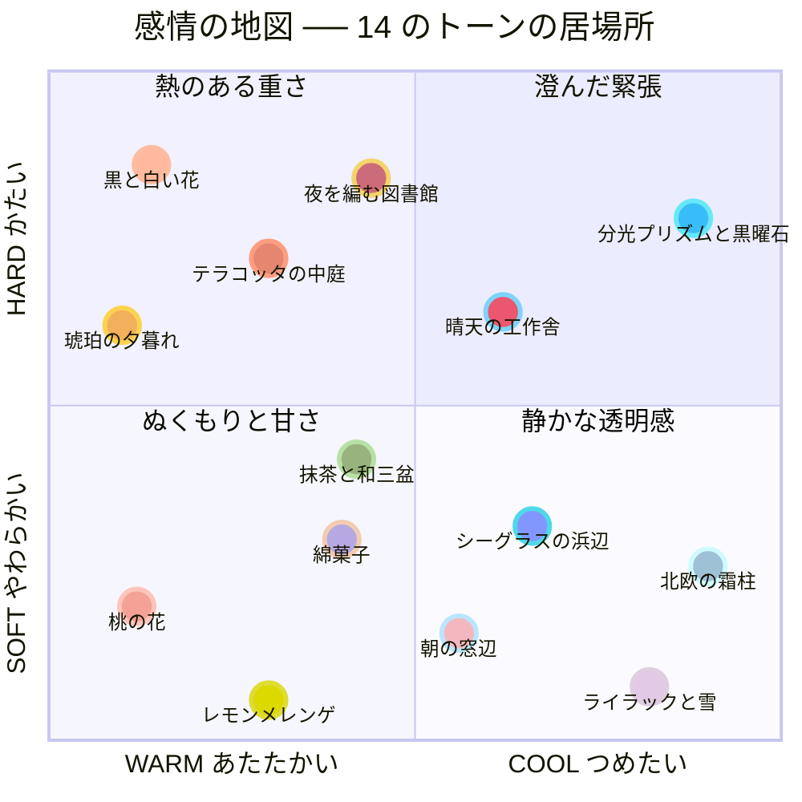

<span style="display:block;margin-top:.9em;padding-left:.8em;border-left:.12em solid currentColor;font-size:max(.56em, 13px);line-height:1.6;max-width:62em;"><span style="display:block;font-family:'JetBrains Mono',ui-monospace,Consolas,monospace;font-size:.82em;letter-spacing:.2em;opacity:.65;">WORK 01</span><span style="display:block;font-weight:700;margin:.15em 0 .1em;">《感情の地図》</span>点の位置は測定値ではない。トーンに添えられた言葉を読み、この展示の作り手が置いた。あなたなら、どこに置くだろう。地図の誤差は、見る人の数だけある。</span>

> 機械は 1600 万の色を見分けられる。けれど、どの色が「さみしい」のかを知っているのは、さみしさを生きた者だけだ。では、さみしさを言葉でしか知らない者が選んだ色は、偽物だろうか。その色を見て、あなたの胸が少し痛んだなら。

## 一日の光をたどる

### 六つの窓

人は時計を持つ前から、光の色で時刻を知っていた。朝の青は眠気を、夕方の琥珀は帰り道を、深夜の藍は自分だけの時間を連れてくる。

<span style="display:flex;gap:.45em;width:100%;max-width:36em;"><span style="display:block;flex:1;min-width:0;"><span style="display:block;position:relative;overflow:hidden;height:4.2em;border-radius:1.6em 1.6em .2em .2em;border:.08em solid #857B91;background:linear-gradient(180deg, #3C4D64 0%, #263345 100%);"><span style="position:absolute;left:50%;bottom:18%;width:1.2em;height:1.2em;margin-left:-.6em;border-radius:50%;background:#BAE6FD;box-shadow:0 0 .9em .2em #BAE6FD;"></span><span style="position:absolute;left:0;right:0;bottom:0;height:22%;background:#F5B7BF;opacity:.9;"></span><span style="position:absolute;left:50%;top:0;bottom:0;width:.06em;background:#857B91;opacity:.5;"></span></span><span style="display:block;margin-top:.35em;font-size:max(.46em, 11px);line-height:1.35;text-align:center;"><span style="display:block;font-family:'JetBrains Mono',ui-monospace,Consolas,monospace;letter-spacing:.1em;color:#BAE6FD;">06:00</span>朝の窓辺</span></span><span style="display:block;flex:1;min-width:0;"><span style="display:block;position:relative;overflow:hidden;height:4.2em;border-radius:1.6em 1.6em .2em .2em;border:.08em solid #947879;background:linear-gradient(180deg, #3C3545 0%, #1E1924 100%);"><span style="position:absolute;left:50%;bottom:52%;width:1.2em;height:1.2em;margin-left:-.6em;border-radius:50%;background:#FDE047;box-shadow:0 0 .9em .2em #FDE047;"></span><span style="position:absolute;left:0;right:0;bottom:0;height:22%;background:#F67386;opacity:.9;"></span><span style="position:absolute;left:50%;top:0;bottom:0;width:.06em;background:#947879;opacity:.5;"></span></span><span style="display:block;margin-top:.35em;font-size:max(.46em, 11px);line-height:1.35;text-align:center;"><span style="display:block;font-family:'JetBrains Mono',ui-monospace,Consolas,monospace;letter-spacing:.1em;color:#FDE047;">10:00</span>陽だまりの果実市</span></span><span style="display:block;flex:1;min-width:0;"><span style="display:block;position:relative;overflow:hidden;height:4.2em;border-radius:1.6em 1.6em .2em .2em;border:.08em solid #877B8F;background:linear-gradient(180deg, #2A3854 0%, #101B30 100%);"><span style="position:absolute;left:50%;bottom:70%;width:1.2em;height:1.2em;margin-left:-.6em;border-radius:50%;background:#7DD3FC;box-shadow:0 0 .9em .2em #7DD3FC;"></span><span style="position:absolute;left:0;right:0;bottom:0;height:22%;background:#EB576D;opacity:.9;"></span><span style="position:absolute;left:50%;top:0;bottom:0;width:.06em;background:#877B8F;opacity:.5;"></span></span><span style="display:block;margin-top:.35em;font-size:max(.46em, 11px);line-height:1.35;text-align:center;"><span style="display:block;font-family:'JetBrains Mono',ui-monospace,Consolas,monospace;letter-spacing:.1em;color:#7DD3FC;">13:00</span>晴天の工作舎</span></span><span style="display:block;flex:1;min-width:0;"><span style="display:block;position:relative;overflow:hidden;height:4.2em;border-radius:1.6em 1.6em .2em .2em;border:.08em solid #8A7E71;background:linear-gradient(180deg, #433540 0%, #231921 100%);"><span style="position:absolute;left:50%;bottom:24%;width:1.2em;height:1.2em;margin-left:-.6em;border-radius:50%;background:#FCD34D;box-shadow:0 0 .9em .2em #FCD34D;"></span><span style="position:absolute;left:0;right:0;bottom:0;height:22%;background:#F2AF5C;opacity:.9;"></span><span style="position:absolute;left:50%;top:0;bottom:0;width:.06em;background:#8A7E71;opacity:.5;"></span></span><span style="display:block;margin-top:.35em;font-size:max(.46em, 11px);line-height:1.35;text-align:center;"><span style="display:block;font-family:'JetBrains Mono',ui-monospace,Consolas,monospace;letter-spacing:.1em;color:#FCD34D;">17:00</span>琥珀の夕暮れ</span></span><span style="display:block;flex:1;min-width:0;"><span style="display:block;position:relative;overflow:hidden;height:4.2em;border-radius:1.6em 1.6em .2em .2em;border:.08em solid #877B8F;background:linear-gradient(180deg, #2D3548 0%, #121826 100%);"><span style="position:absolute;left:50%;bottom:46%;width:1.1em;height:1.1em;margin-left:-.55em;border-radius:50%;box-shadow:inset -.3em -.1em 0 0 #F3D56B;"></span><span style="position:absolute;left:0;right:0;bottom:0;height:22%;background:#CC6B79;opacity:.9;"></span><span style="position:absolute;left:50%;top:0;bottom:0;width:.06em;background:#877B8F;opacity:.5;"></span></span><span style="display:block;margin-top:.35em;font-size:max(.46em, 11px);line-height:1.35;text-align:center;"><span style="display:block;font-family:'JetBrains Mono',ui-monospace,Consolas,monospace;letter-spacing:.1em;color:#F3D56B;">21:00</span>夜を編む図書館</span></span><span style="display:block;flex:1;min-width:0;"><span style="display:block;position:relative;overflow:hidden;height:4.2em;border-radius:1.6em 1.6em .2em .2em;border:.08em solid #897A8E;background:linear-gradient(180deg, #2A3043 0%, #0C101E 100%);"><span style="position:absolute;left:50%;bottom:66%;width:1.1em;height:1.1em;margin-left:-.55em;border-radius:50%;box-shadow:inset -.3em -.1em 0 0 #67E8F9;"></span><span style="position:absolute;left:0;right:0;bottom:0;height:22%;background:#FF4760;opacity:.9;"></span><span style="position:absolute;left:50%;top:0;bottom:0;width:.06em;background:#897A8E;opacity:.5;"></span></span><span style="display:block;margin-top:.35em;font-size:max(.46em, 11px);line-height:1.35;text-align:center;"><span style="display:block;font-family:'JetBrains Mono',ui-monospace,Consolas,monospace;letter-spacing:.1em;color:#67E8F9;">00:00</span>深夜の電脳祭</span></span></span>
<span style="display:block;margin-top:.9em;padding-left:.8em;border-left:.12em solid currentColor;font-size:max(.56em, 13px);line-height:1.6;max-width:62em;"><span style="display:block;font-family:'JetBrains Mono',ui-monospace,Consolas,monospace;font-size:.82em;letter-spacing:.2em;opacity:.65;">WORK 02</span><span style="display:block;font-weight:700;margin:.15em 0 .1em;">《六つの窓》</span>同じ壁に、同じ形の窓を 6 つ。変えたのは空の色と、太陽と月の高さだけだ。時刻は数字ではなく、空気の色で伝わる。</span>

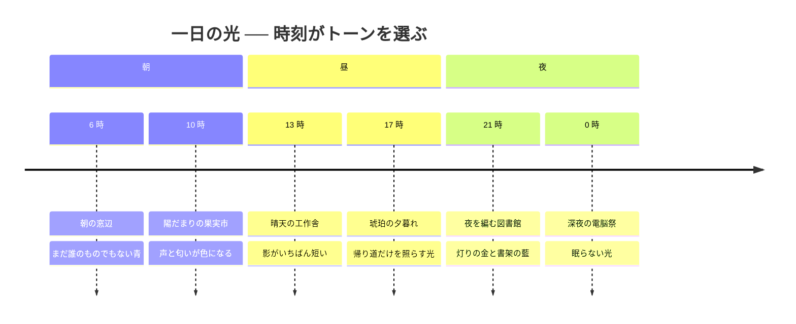

## 色を着た一枚

### 同じ型紙、違う声色

4 枚のポスターは、同じ型紙から刷った。文字の大きさも置き場所も変えていない。変えたのは色と絵だけだ。それなのに、読書会は声をひそめ、工作フェアは走り出し、茶会は息を整え、テック・ナイトは目を光らせる。色は飾りではない。誌面の声色である。

<span style="display:block;margin-top:.9em;padding-left:.8em;border-left:.12em solid currentColor;font-size:max(.56em, 13px);line-height:1.6;max-width:62em;"><span style="display:block;font-family:'JetBrains Mono',ui-monospace,Consolas,monospace;font-size:.82em;letter-spacing:.2em;opacity:.65;">WORK 03　·　midnight-library</span><span style="display:block;font-weight:700;margin:.15em 0 .1em;">《夜の読書会》　<span style="font-weight:400;opacity:.75;">夜を編む図書館／ナチュラルハーモニー</span></span>金は「灯り」として 1 か所にだけ置いた。暗がりを広く残したのは、読む人が自分の想像で埋める余白のためだ。照らしすぎる親切は、ときに読む自由を奪う。</span>

<span style="display:block;margin-top:.9em;padding-left:.8em;border-left:.12em solid currentColor;font-size:max(.56em, 13px);line-height:1.6;max-width:62em;"><span style="display:block;font-family:'JetBrains Mono',ui-monospace,Consolas,monospace;font-size:.82em;letter-spacing:.2em;opacity:.65;">WORK 04　·　cobalt-workshop</span><span style="display:block;font-weight:700;margin:.15em 0 .1em;">《つくる日曜日》　<span style="font-weight:400;opacity:.75;">晴天の工作舎／ドミナント・トーン</span></span>原色どうしは喧嘩する。それでも子どもは、喧嘩する色が好きだ。大人の「調和」を押しつけず、帯の比率（7 : 2 : 1）だけで主従を付けた。</span>

<span style="display:block;margin-top:.9em;padding-left:.8em;border-left:.12em solid currentColor;font-size:max(.56em, 13px);line-height:1.6;max-width:62em;"><span style="display:block;font-family:'JetBrains Mono',ui-monospace,Consolas,monospace;font-size:.82em;letter-spacing:.2em;opacity:.65;">WORK 05　·　matcha-wagashi</span><span style="display:block;font-weight:700;margin:.15em 0 .1em;">《冬の茶会》　<span style="font-weight:400;opacity:.75;">抹茶と和三盆／ナチュラルハーモニー</span></span>にごりのある色は、声を張らない。茶室で誰も大きな声を出さないのと同じだ。円相はわざと閉じなかった。完全な円より、欠けた円のほうが人の手の跡を残す。</span>

<span style="display:block;margin-top:.9em;padding-left:.8em;border-left:.12em solid currentColor;font-size:max(.56em, 13px);line-height:1.6;max-width:62em;"><span style="display:block;font-family:'JetBrains Mono',ui-monospace,Consolas,monospace;font-size:.82em;letter-spacing:.2em;opacity:.65;">WORK 06　·　cyber-prism</span><span style="display:block;font-weight:700;margin:.15em 0 .1em;">《TECH NIGHT》　<span style="font-weight:400;opacity:.75;">分光プリズムと黒曜石／コンプレックスハーモニー</span></span>光る色は 2 つまで。未来はいつも眩しく描かれるが、眩しさは人に目を閉じさせる。残りの色には、暗い境界と線として光を支える役を任せた。</span>

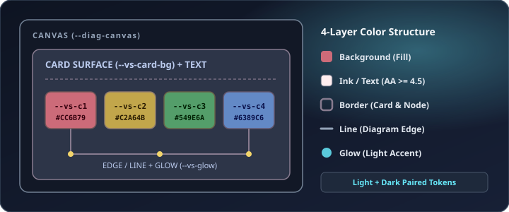

> 1 枚のポスターを分解すると、背景・文字・境界・線の 4 つの役割に分かれる。Lucivo のトーンは、色ごとに「その色を背景にしたときの文字色」を組で持っている。美しさは、読めることを犠牲にしてはいけない。色の見え方が違う人、暗い部屋で読む人、疲れた目で読む人。読めない美しさは、誰かを置き去りにする。

## 比率がつくるリズム

### 同じ三色、違う沈黙

色の数より効くのは、面積の比率だ。2 枚の色面は、琥珀の夕暮れの同じ 3 色で塗った。違うのは、色どうしがどれだけ譲り合っているかだけである。

<span style="display:block;margin-top:.9em;padding-left:.8em;border-left:.12em solid currentColor;font-size:max(.56em, 13px);line-height:1.6;max-width:62em;"><span style="display:block;font-family:'JetBrains Mono',ui-monospace,Consolas,monospace;font-size:.82em;letter-spacing:.2em;opacity:.65;">WORK 11　·　amber-sunset</span><span style="display:block;font-weight:700;margin:.15em 0 .1em;">《譲り合う色面》　<span style="font-weight:400;opacity:.75;">琥珀の夕暮れ／グラデーション＋ウォームシェード</span></span>左では、差し色が 5% に退くことで「灯り」になった。右では、3 色が同じ声量で話し、誰の話も聞こえない。均等であることが、いつも調和を生むとは限らない。</span>

### 色には順番がある

色は一度に決めない。基調を敷き、キー色を 1 つ決め、2 色め・3 色めをキー色との関係で足し、最後に差し色を 1 か所だけ置く。順番があるのは、色にも関係があるからだ。広間の図は、その順番を琥珀の夕暮れの実際の色で並べたものである。

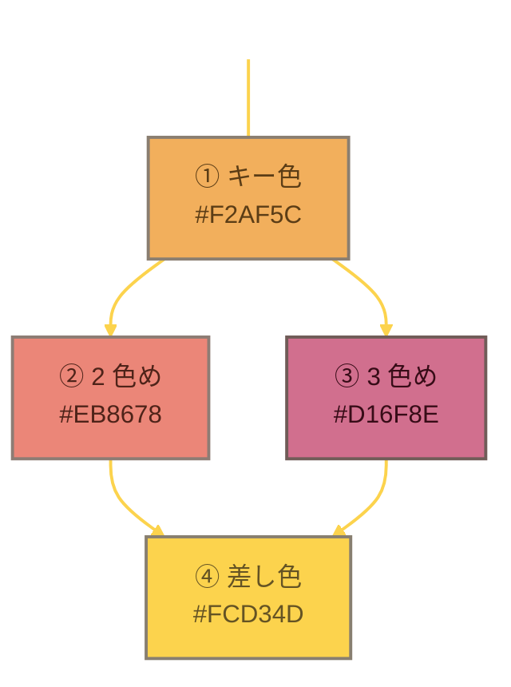

## 四季の間

### 同じ稜線、四つの季節

山の形は 4 枚とも同じ種から描いた。描き直したのは空気だけだ。春と夏は明るい地、秋と冬は暗い地のパレットで塗っている。季節を変えるのに、山を動かす必要はない。

<span style="display:block;margin-top:.9em;padding-left:.8em;border-left:.12em solid currentColor;font-size:max(.56em, 13px);line-height:1.6;max-width:62em;"><span style="display:block;font-family:'JetBrains Mono',ui-monospace,Consolas,monospace;font-size:.82em;letter-spacing:.2em;opacity:.65;">WORK 07　·　spring-mist</span><span style="display:block;font-weight:700;margin:.15em 0 .1em;">《春の稜線》　<span style="font-weight:400;opacity:.75;">春霞のさくら／カマイユ／ドミナント・トーン</span></span>花びらは、散るために咲いたのではない。けれど散るから、私たちは見上げる。</span>

<span style="display:block;margin-top:.9em;padding-left:.8em;border-left:.12em solid currentColor;font-size:max(.56em, 13px);line-height:1.6;max-width:62em;"><span style="display:block;font-family:'JetBrains Mono',ui-monospace,Consolas,monospace;font-size:.82em;letter-spacing:.2em;opacity:.65;">WORK 08　·　sea-glass-shore</span><span style="display:block;font-weight:700;margin:.15em 0 .1em;">《夏の稜線》　<span style="font-weight:400;opacity:.75;">シーグラスの浜辺／グラデーション</span></span>波に洗われたガラスは、角を失って美しくなった。時間に削られることを、劣化と呼ぶか、成熟と呼ぶか。</span>

<span style="display:block;margin-top:.9em;padding-left:.8em;border-left:.12em solid currentColor;font-size:max(.56em, 13px);line-height:1.6;max-width:62em;"><span style="display:block;font-family:'JetBrains Mono',ui-monospace,Consolas,monospace;font-size:.82em;letter-spacing:.2em;opacity:.65;">WORK 09　·　terracotta-courtyard</span><span style="display:block;font-weight:700;margin:.15em 0 .1em;">《秋の稜線》　<span style="font-weight:400;opacity:.75;">テラコッタの中庭／ウォームシェード</span></span>夕焼けの色は、色コードで正確に残せる。けれど、あの日の帰り道までは残せない。色は記録で、記憶は別の場所にある。</span>

<span style="display:block;margin-top:.9em;padding-left:.8em;border-left:.12em solid currentColor;font-size:max(.56em, 13px);line-height:1.6;max-width:62em;"><span style="display:block;font-family:'JetBrains Mono',ui-monospace,Consolas,monospace;font-size:.82em;letter-spacing:.2em;opacity:.65;">WORK 10　·　nordic-frost</span><span style="display:block;font-weight:700;margin:.15em 0 .1em;">《冬の稜線》　<span style="font-weight:400;opacity:.75;">北欧の霜柱／クールシェード</span></span>冷たい色ほど、灯りの温かさを教えてくれる。寒さのない世界では、誰も窓に灯をともさない。</span>

> 季節を伝えるのに、鮮やかさはいらない。春はうすく、夏は澄んで、秋はにごり、冬は暗く冷たく。トーンを動かすだけで、空気は入れ替わる。

## 二〇三の収蔵庫

### 名前を与えられた色

収蔵庫には 203 のトーンが眠っている。どれにも「朝の窓辺」「夜を編む図書館」のような名前がある。色コードは機械のための名前で、イメージ名は人のための名前だ。名前を与えた瞬間、色は記憶と結びつき、誰かの思い出を借りはじめる。

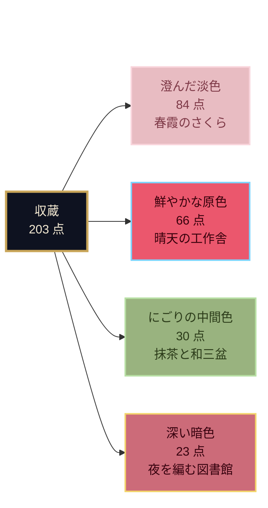


<span style="display:block;margin-top:.9em;padding-left:.8em;border-left:.12em solid currentColor;font-size:max(.56em, 13px);line-height:1.6;max-width:62em;"><span style="display:block;font-family:'JetBrains Mono',ui-monospace,Consolas,monospace;font-size:.82em;letter-spacing:.2em;opacity:.65;">WORK 12</span><span style="display:block;font-weight:700;margin:.15em 0 .1em;">《収蔵庫の壁画》</span>203 のトーンを番号順に並べ、1 マスに主役から 4 色めまでを詰めた。近くで見れば 1 つずつに個性があり、遠くから見れば地層になる。一覧は便利だが、一覧の中で色は少しだけ無口になる。</span>

> この展示の色は、人が名付け、機械が並べ、いま、あなたが見ている。作者は誰か。たぶん、最後に心を動かされた人も、その一人に数えてよい。

## あなたの色で、はじめる

### 展示を持ち帰る

気に入ったトーンは、ヘッダーの「カラートーン」メニューから自分の文書に着せられる。URL に `tone`・`theme`・`present` を付ければ、同じ色と同じ演出のまま、誰かに手渡せる。

```text
?tone=midnight-library&theme=dark&present=museum-walk
```

> [!TIP]
> 迷ったら、色から選ばずに、届けたい気持ちから選んでください。夜の発表には「夜を編む図書館」、子ども向けの案内には「晴天の工作舎」、和の催しには「抹茶と和三盆」。
