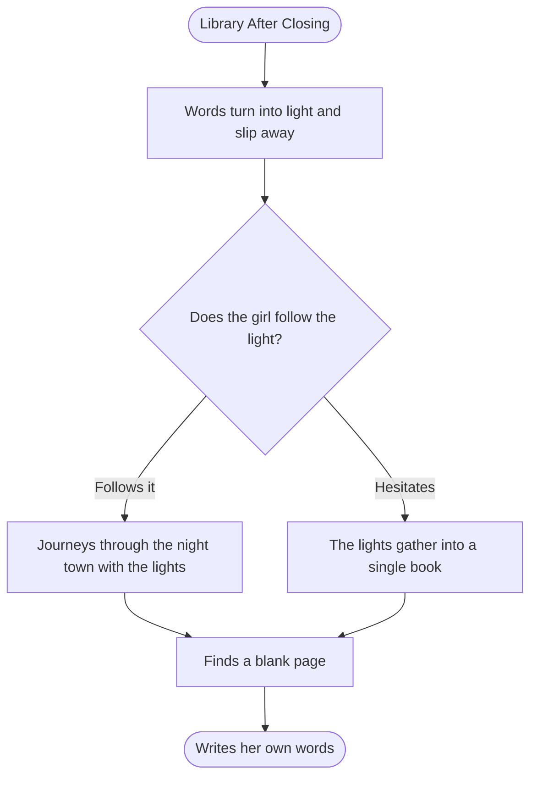
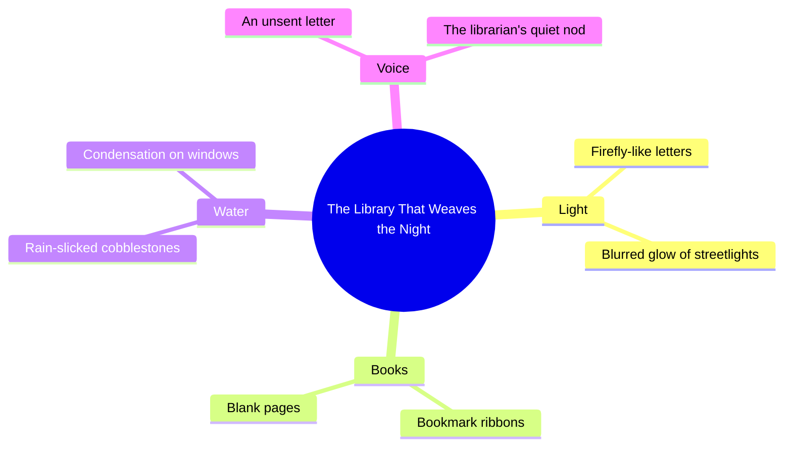
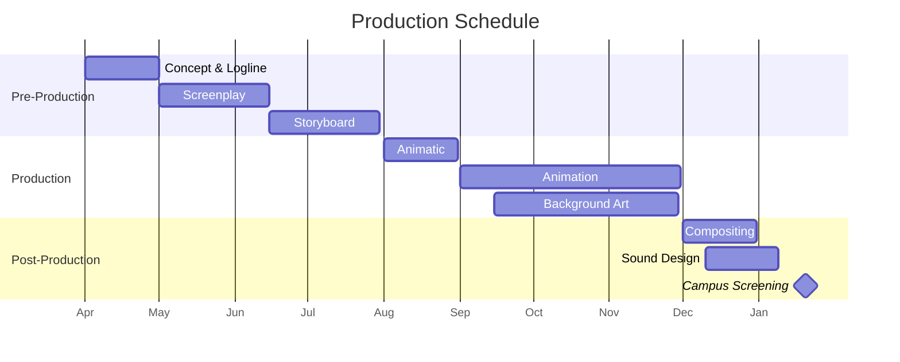

# The Library That Weaves the Night

## In a Nutshell

After closing time at the library, words from the books turn into light and drift out into the town. This is a 12-minute story about a girl who is losing her voice, following those lights to find her own words again.

## What We Want to Deliver

> Even words left unsaid have not vanished. Somewhere on a page, they are waiting to be read by someone. We want to create a work that shines a light on those "waiting words."
>
> — From the Production Notes of Team "Hikari no Shiori"

## Three Pillars of the Work

We established one guiding pillar each for story, visuals, and sound. Whenever we hesitate during production, we return to these three principles.

- **Words Become Light**: Letters lift off the pages and drift through the town like fireflies, turning the act of reading into a visible phenomenon.
- **Watercolor Night**: Golden light layered solely over deep indigo and ultramarine watercolors, capturing the quiet warmth of night through soft bleeds and open space.
- **A Silent Protagonist**: The protagonist does not speak until the final scene, conveying every shift of emotion through expression, gesture, and music alone.

## Production by the Numbers

- **12 min**: Runtime—compact enough to fit a single slot at our campus screening while meeting entry requirements for short film festivals.
- **1,800 frames**: Hand-drawn artwork—all key frames and in-betweens are drawn by hand, with light particles painted on a separate layer from the backgrounds.
- **270 days**: Production schedule—from initial concept to final delivery, aligning visuals and sound at weekly test screenings.
- **4 members**: Core team—dividing responsibilities clearly across direction, animation, background art, and sound design.

## Story Arc

The narrative unfolds across four classical acts. It traces a single continuous line as the protagonist chases the glowing words and finally writes her own words into a book.



## Characters

| Character | Age | Role | Theme Color |
| :-------- | --: | :--- | :---------- |
| Akari | 14 | A junior high school student who struggles to get her words out | Ultramarine |
| Shiori (Librarian) | 62 | A quiet librarian who watches over the library at night | Ash Violet |
| Word Fireflies | — | Words that escaped from books; they have no names yet | Gold |
| Minato (Older Brother) | 19 | Akari's brother living in a distant town; appears only through letters | Pale Green |

## Motifs Shaping the World



## Production Workflow

1. **Concept**: Define the logline and three pillars, aligning the whole team around a shared vision.
2. **Screenplay**: Script silent scenes through detailed physical actions and sound cues rather than dialogue.
3. **Storyboard**: Draw every shot and establish camera angles and light trajectories.
4. **Animatic**: Add temporary audio and timing to the storyboard to verify the 12-minute pacing.
5. **Animation & Art**: Paint key/in-between animation and watercolor backgrounds on separate layers.
6. **Compositing & Sound**: Composite the glowing light layers and finalize the musical score and foley.

## Milestones

- **April 2026**: Launch the project and finalize the logline and three core pillars.
- **July 2026**: Complete the screenplay and storyboard, verifying pacing with the animatic.
- **October 2026**: Enter full animation and background art production with weekly screening reviews.
- **January 2027**: Complete compositing and sound mixing, and premiere at the campus screening.

## Schedule



## How the Proposal Evolved

- **Before (Initial Draft)**: Explained why the protagonist lost her voice through spoken dialogue, leaving too much exposition and little room for audience imagination.
- **After (Current Draft)**: Reveals her backstory solely through letters from her brother and half-written pages, letting negative space carry the emotion.

## Production Glossary

- **Logline** — A one-sentence summary of the film that serves as the anchor for all creative decisions.
- **Storyboard** — A visual blueprint illustrating the framing and motion of every individual shot.
- **Animatic** — A timed video reel combining storyboard frames with temporary sound to test pacing.
- **Color Script** — A single-sheet visual map charting how colors evolve from scene to scene.
- **Layer** — Separate planes for backgrounds, characters, and light effects composited together in the final stage.
- **Negative Space** — What is intentionally left undrawn to invite imagination—the most vital form of expression in this film.

## Folder Structure

Our shared team repository is organized sequentially by production phase.

```
yoru-library/
├── 01_Planning/
│   ├── proposal.md          # This document
│   └── color-script.png
├── 02_Screenplay/
│   └── script_v3.md
├── 03_Storyboard/           ← All shots
├── 04_Animation/
│   ├── Keyframes/
│   └── Inbetweens/
└── 05_Audio/
    └── temp-score.wav
```

## How to Present This Proposal

> [!TIP]
> Switch to **Visual Mode** in the header to turn this proposal into an exhibition-grade layout panel. Try switching between the four visual themes on the top style bar.

> [!NOTE]
> Click **Present** (or press `P`) to display each chapter full-screen one scene at a time. During critiques, press `O` for the Light Table overview, `L` for the optical pointer, and `B` for the intermission curtain.

> [!IMPORTANT]
> This entire document is written in plain Markdown. Simply refine your text—no separate slide deck creation is needed to make it presentation-ready.

## Closing

Shining a light on words left unspoken—please join us in watching these twelve minutes of night unfold.
