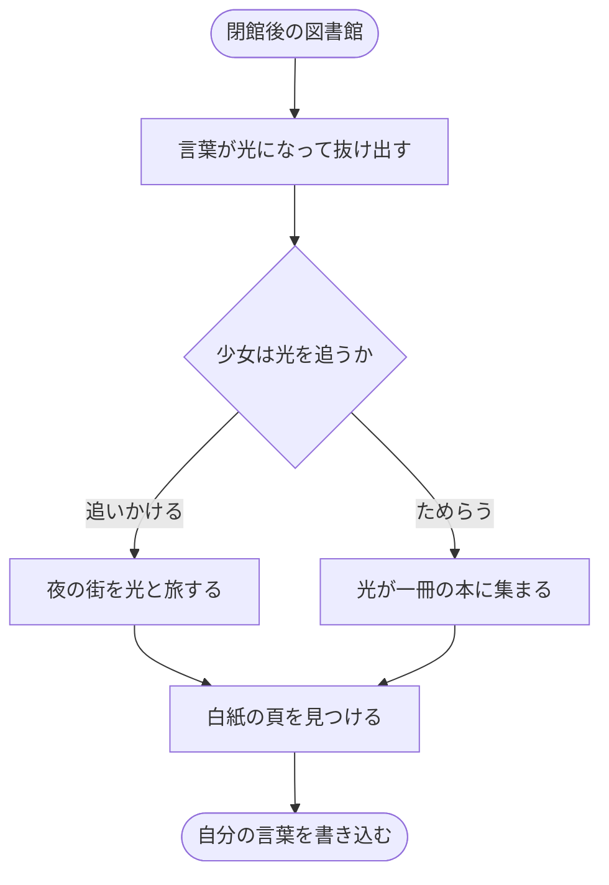
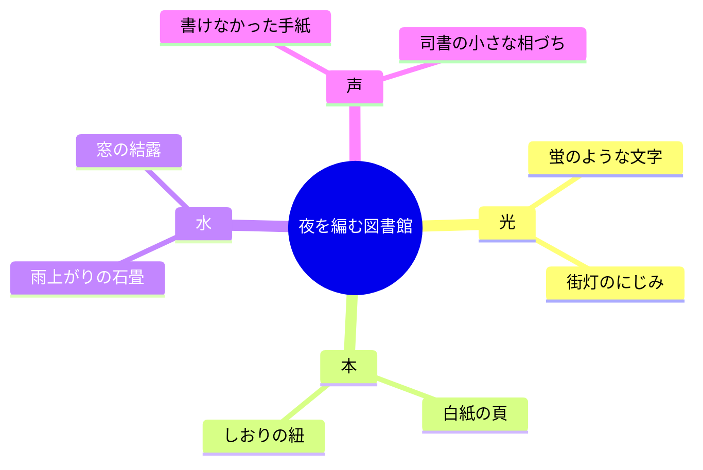
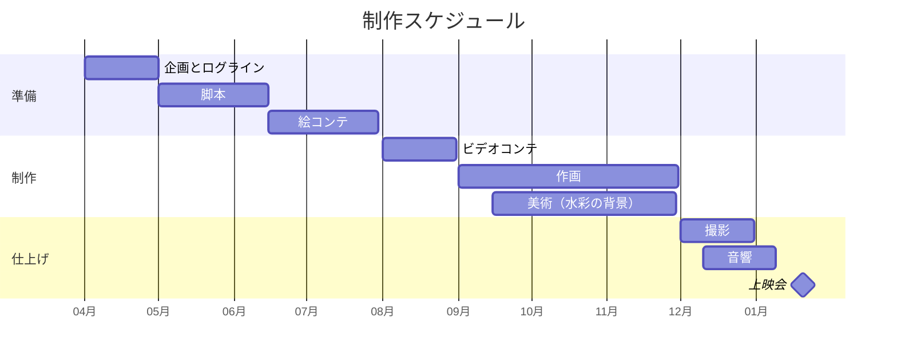

# 夜を編む図書館

## ひとことで言うと

閉館後の図書館で、本の言葉が光になって街へ流れ出す。言葉を失いかけた少女が、その光をたどって自分の声を取り戻す、12分の物語です。

## この作品で届けたいこと

> うまく言えなかった言葉も、消えたわけではない。どこかの頁で、だれかに読まれるのを待っている。わたしたちは、その「待っている言葉」に光を当てる作品をつくりたい。
>
> — 制作チーム「ひかりのしおり」企画ノートより

## 作品の三つの柱

物語・絵・音のそれぞれに、ひとつずつ柱を立てました。迷ったときは、この三つに立ち返ります。

- **言葉は光になる**: 文字が頁から浮かび、蛍のように街を流れる。読むことを、目で見える出来事に変えます。
- **水彩の夜**: 紺と群青の水彩に、金の光だけを重ねる。にじみと余白で、静かな夜の温度を描きます。
- **声を使わない主人公**: 主人公は最後の場面まで話さない。表情としぐさと音楽だけで、心の動きを伝えます。

## 数字で見る制作

- **12分**: 上映時間。学内上映会の一枠に収まり、映画祭の短編部門にも応募できる長さです。
- **1,800枚**: 作画。原画と動画をすべて手描きし、光の粒は背景とは別の層に描きます。
- **270日**: 制作期間。企画から完成まで、毎週の試写で絵と音をすり合わせます。
- **4人**: 制作メンバー。監督・作画・美術・音響に役割を分けて進めます。

## 物語の流れ

物語は、起承転結の四つの場面でできています。主人公が言葉の光を追いかけ、最後に自分の言葉を本に書き込むまでを、一本の線で描きます。



## 登場人物

| 人物         | 年齢 | 役割                                   | 色   |
| :----------- | ---: | :------------------------------------- | :--- |
| 灯（あかり） | 14   | 言葉がうまく出なくなった中学生         | 群青 |
| 司書の栞     | 62   | 夜の図書館を守る、口数の少ない司書     | 灰紫 |
| 言葉の蛍     | —    | 本から抜け出した言葉。名前はまだない   | 金   |
| 兄の湊       | 19   | 遠くの街で暮らす兄。手紙だけで登場する | 薄緑 |

## 世界観を形づくるモチーフ



## 制作の進め方

1. **企画**: ログラインと三つの柱を決め、チームで共有します。
2. **脚本**: 台詞のない場面を、しぐさと音の指示で書き起こします。
3. **絵コンテ**: すべてのショットを描き、カメラと光の動きを決めます。
4. **ビデオコンテ**: 絵コンテに仮の音をつけ、12分の流れを確かめます。
5. **作画と美術**: 原画・動画と水彩の背景を、別の層で描きます。
6. **撮影と音響**: 光の層を重ね、音楽と効果音を仕上げます。

## 制作の予定

- **2026年4月**: 企画を立ち上げ、ログラインと三つの柱を決める。
- **2026年7月**: 脚本と絵コンテを仕上げ、ビデオコンテで流れを確かめる。
- **2026年10月**: 作画と美術の本番に入り、毎週の試写で調整する。
- **2027年1月**: 撮影と音響を仕上げ、学内上映会で発表する。

## スケジュール



## 企画で変わったこと

- **Before（最初の案）**: 主人公が言葉を失った理由を、台詞で説明していた。説明が多く、見る人が想像する余地がなかった。
- **After（今の案）**: 理由は兄からの手紙と、書きかけの頁だけで見せる。説明を減らし、余白で感じてもらう作品にした。

## 制作で使うことば

- **ログライン** — 作品を一文で言い表したもの。企画の軸になります。
- **絵コンテ** — ショットごとの画面と動きを描いた設計図。
- **ビデオコンテ** — 絵コンテに仮の音と時間をつけた映像。流れを確かめます。
- **カラースクリプト** — 場面ごとの色の移り変わりを一枚に並べた色の設計図。
- **レイヤー** — 背景・人物・光などを分けて描く層。あとから重ねて仕上げます。
- **余白** — 描かないことで想像させる部分。この作品では、いちばん大切な表現です。

## 制作データの置き場所

チームの共有フォルダは、工程ごとに分けて整理します。

```
yoru-library/
├── 01_企画/
│   ├── 企画書.md          # この文書
│   └── カラースクリプト.png
├── 02_脚本/
│   └── 脚本_第3稿.md
├── 03_絵コンテ/          ← 全ショット
├── 04_作画/
│   ├── 原画/
│   └── 動画/
└── 05_音響/
    └── 仮の音楽.wav
```

## この企画書の見せ方

> [!TIP]
> ヘッダーの **「Visualモード」** で、この企画書が展示パネルのような誌面になります。上のスタイルバーで、4 種類の見た目を切り替えてみてください。

> [!NOTE]
> **「発表」**（または `P` キー）で、章を 1 枚ずつ全画面で見せられます。講評会では、`O` で全体の一覧、`L` で光のポインター、`B` で幕間の画面を出せます。

> [!IMPORTANT]
> 書いているのは、ふつうの Markdown です。スライドを作り直さなくても、文章を整えるだけで、そのまま発表の資料になります。

## さいごに

言えなかった言葉に、光を当てる。12分の夜を、いっしょに見届けてください。
