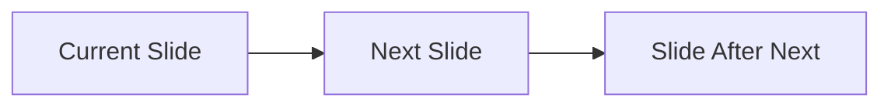
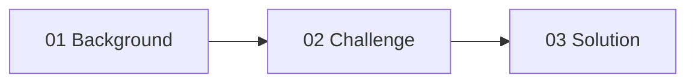

# Wandering Documents

There is no "Next" button in this corridor. The document advances as far as you walk; stop, and the words on the wall turn toward you.

## Background

### Flipping Slides Makes You Lose Your Bearings

Slides switch one frame at a time. The audience only ever sees the single current frame, relying entirely on the speaker's words to know where they are in the whole story.

- A static screen becomes an isolated flat page
- Transitions are passive animations you merely watch
- Surrounding context disappears from view

> "Where you are in the talk" is communicated through spatial position.

## Challenge

### Remaining a Space Even When You Stop

Instead of turning pages, you move through space. Because preceding and upcoming headings and diagrams remain visible along the corridor, you naturally grasp your current footing.

- Stop, and the words on the wall turn to face you
- Walk forward, and the space ahead opens up
- Major headings stand as portals you pass through

## Solution

### Walking Becomes Reading

Markdown headings, paragraphs, and diagrams are transformed directly into corridors, halls, and alcoves. Readers trace the entire architecture of the document at their own pace.

- Chapter headings (`h2`) form architectural gates dividing the space
- High-ceilinged halls open up before Mermaid diagrams
- Blockquotes and callouts rest like quiet plaques inside side alcoves

> [!TIP]
> Select **Museum Walk** from the Present menu to walk through this document as a 3D gallery corridor. Move with `↑` `↓` or the scroll wheel, drag to look around, press `T` to toggle light/dark mode, `G` for gaze control, and `R` to return to the entrance.
