# Lucivo Sample Document

This sample demonstrates the core Markdown and Mermaid syntax supported in Lucivo. Edit the text in the left editor to see your changes reflected immediately in the right preview. You can toggle the YAML front matter at the top using the **YAML** button in the header.

## 1. Headings and Paragraphs

### Level 3 Heading

#### Level 4 Heading

Separate paragraphs with a blank line.
Add two trailing spaces at the end of a line  
to insert a line break.

In `Split` view, moving the cursor to another chapter in the editor automatically scrolls the preview to that chapter's heading.

## 2. Text Formatting

- **Bold**, *Italic*, ***Bold and Italic***, ~~Strikethrough~~
- Inline code: `const answer = 42;`
- Link: [Mermaid Official Site](https://mermaid.js.org/)
- Autolink: <https://marked.js.org/>

## 3. Lists

- Bulleted list
  - Nested bullet item
    - Deeply nested item
- Bulleted list

1. Numbered list
2. Numbered list
   1. Nested numbered list

- [x] Completed task
- [ ] Incomplete task

## 4. Blockquotes

> This is a blockquote.
>
> > This is a nested blockquote.

> [!TIP]
> Blockquotes written with GitHub-style alert syntax become styled callout panels. Examples of all five alert types are available in Chapter 13 of the Extended Notation Sample (`notation_sample_extra1.md`).

## 5. Code Blocks

```javascript
function greet(name) {
  return `Hello, ${name}!`;
}
```

```bash
npm run dev
```

## 6. Tables

| Left-Aligned | Center-Aligned | Right-Aligned |
| :----------- | :------------: | ------------: |
| Apple        | Red            |           120 |
| Banana       | Yellow         |            98 |

## 7. Horizontal Rules and HTML

Separate sections above and below with a horizontal rule.

---

You can write HTML directly inside Markdown.

<details>
<summary>Click to expand (details / summary)</summary>
<p>This content was collapsed.</p>
</details>

Keyboard shortcuts <kbd>Ctrl</kbd> + <kbd>S</kbd>, <mark>highlighted text</mark>, H<sub>2</sub>O, x<sup>2</sup>

## 8. Math Equations

Wrap inline math in single `$` signs: $E = mc^2$, $\alpha + \beta = \gamma$, $x_{n+1} = x_n - \frac{f(x_n)}{f'(x_n)}$.

When `$` touches a space on the inside—such as prices like $5 and $10—it is not parsed as math. Escape it as `\$` to display a literal dollar sign: \$100

Wrap block math in `$$` lines:

$$
\int_0^\infty e^{-x^2}\,dx = \frac{\sqrt{\pi}}{2}
$$

$$
\begin{aligned}
f(x) &= \sum_{n=0}^{\infty} \frac{f^{(n)}(a)}{n!}(x-a)^n \\
A &= \begin{pmatrix} 1 & 2 \\ 3 & 4 \end{pmatrix}
\end{aligned}
$$

## 9. Flowchart

Process flow from order intake through inventory check to shipping. In Visual Stage, chapters consisting of body text and a single diagram are automatically arranged in a two-column split layout.

- If stock is available, proceed directly to shipping
- If out of stock, place a restock order before shipping

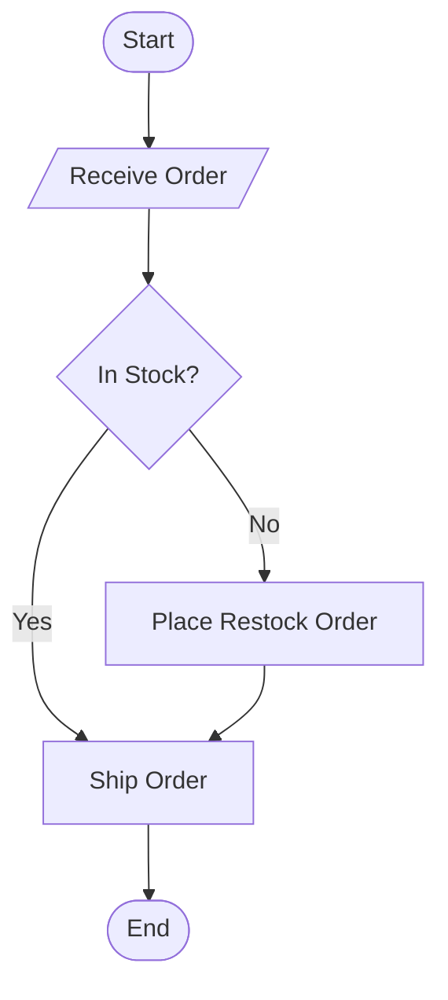

## 10. Sequence Diagram

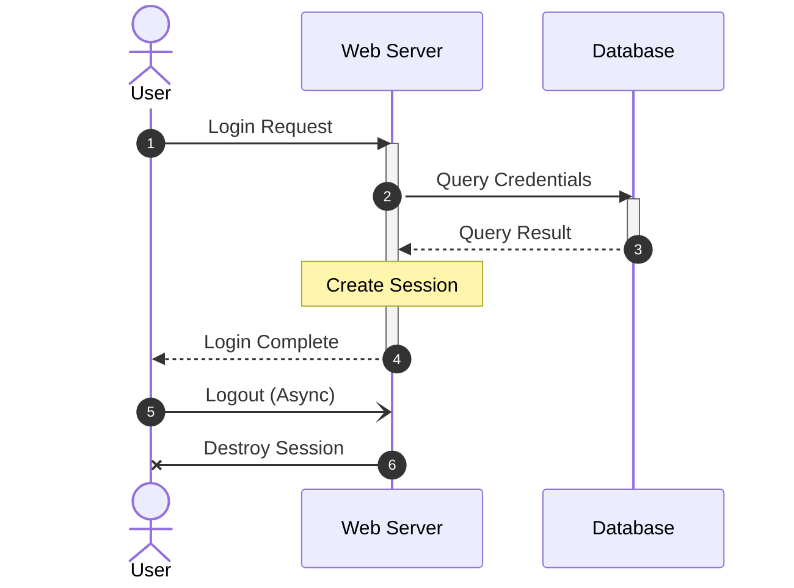

## 11. Class Diagram

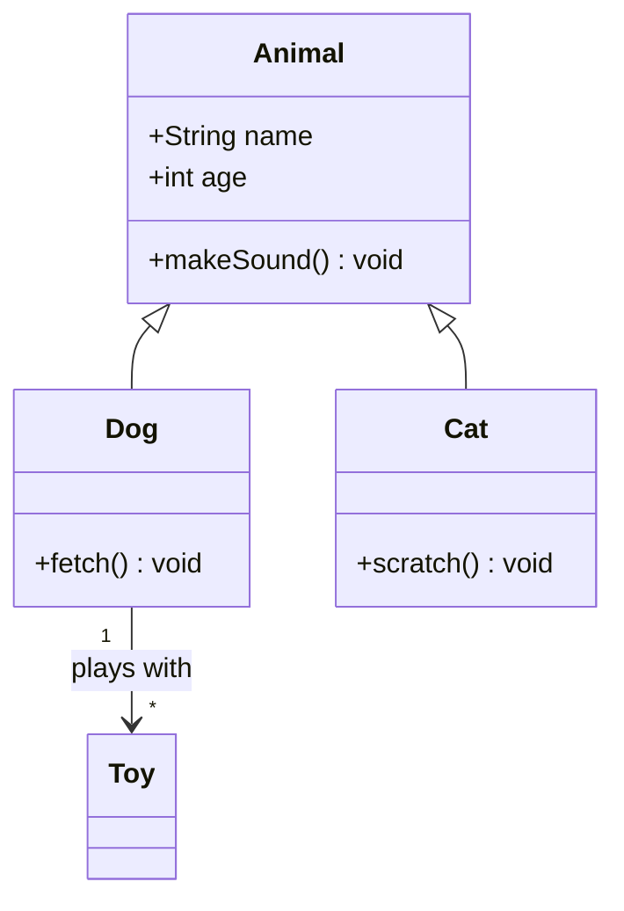

## 12. State Diagram

State transitions of a job across Idle, Running, and Paused states, including nested substates inside Running.

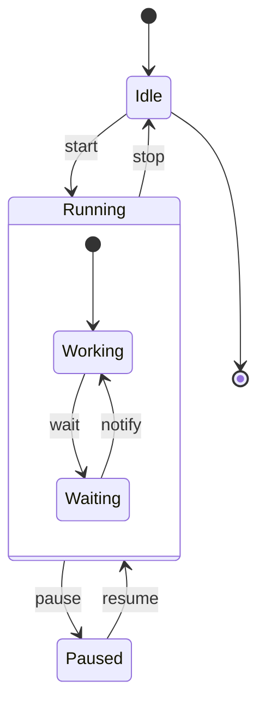

## 13. ER Diagram

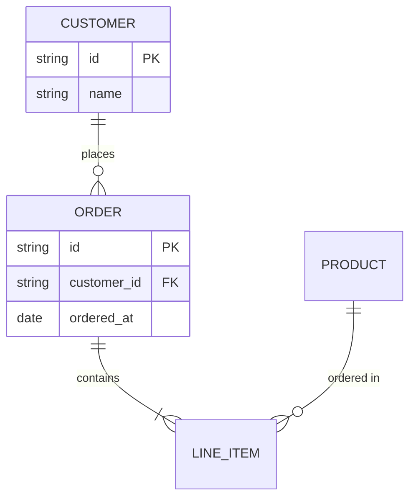

## 14. Gantt Chart

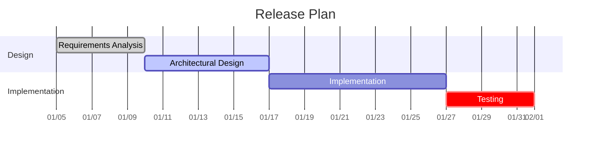

## 15. Pie Chart

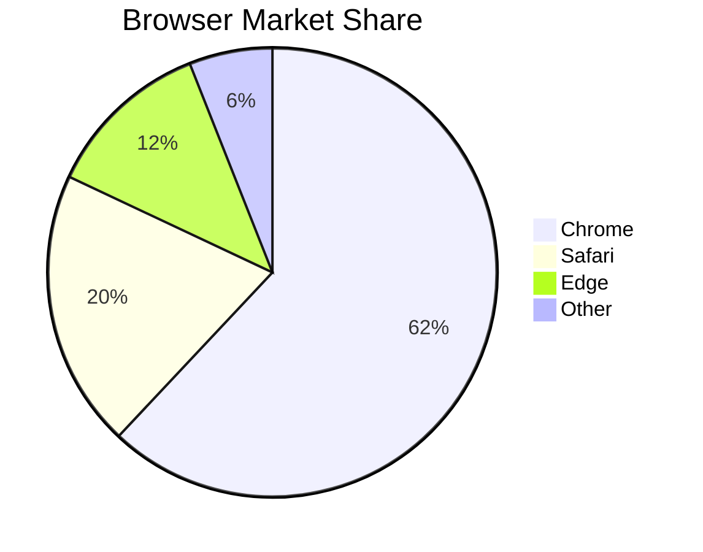

## 16. User Journey

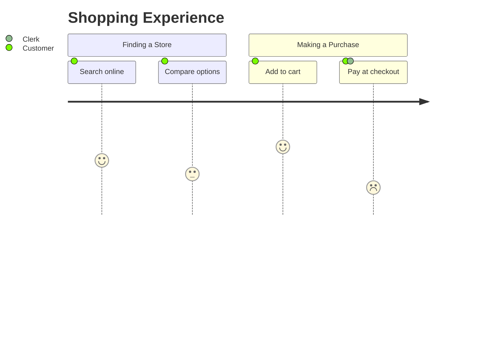

## 17. Quadrant Chart

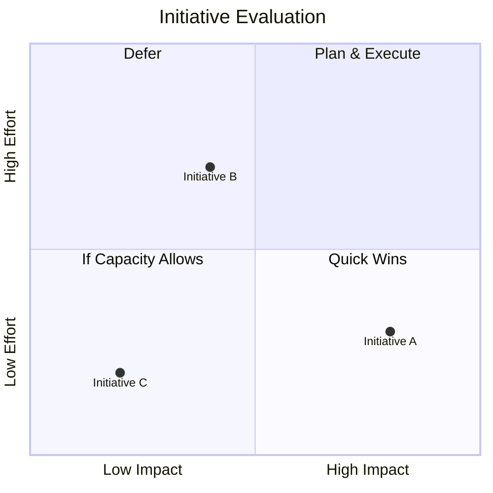

## 18. Requirement Diagram

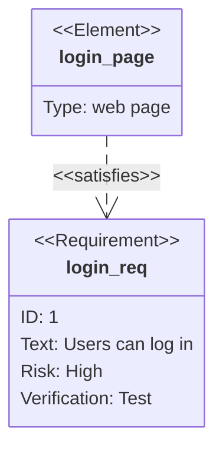

## 19. Git Graph

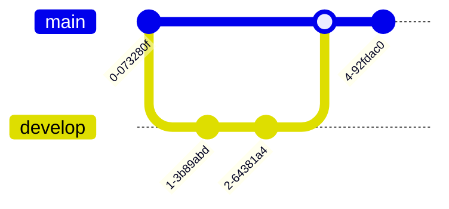

## 20. Mindmap

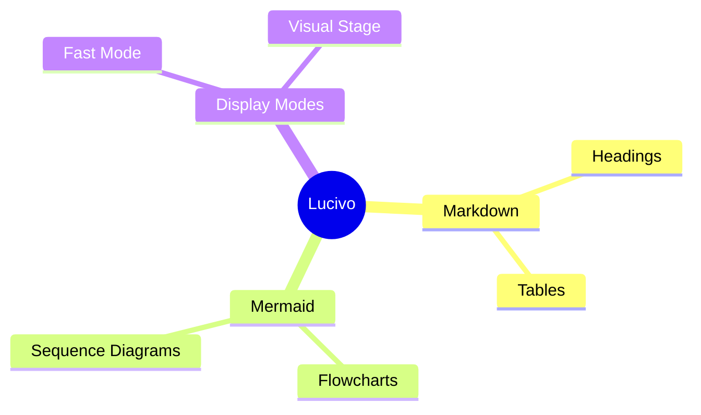

## 21. Timeline

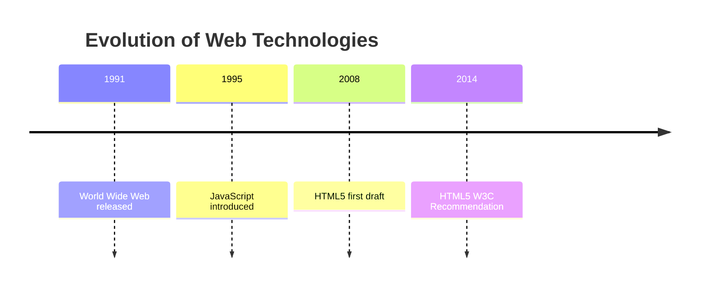

## 22. XY Chart

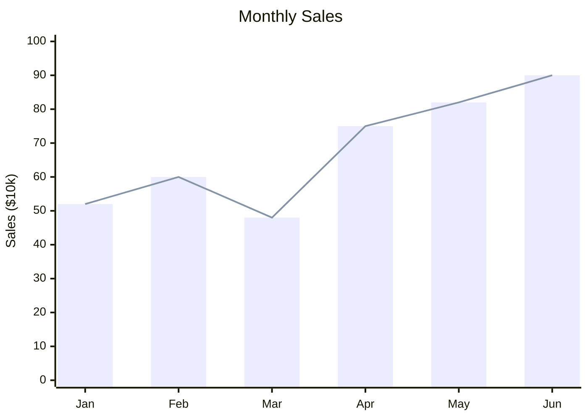

## 23. Large Flowchart

An example diagram with many nodes. Use `Fit` to view the entire diagram, or `1:n`, `100%`, and `Expand` to inspect details.

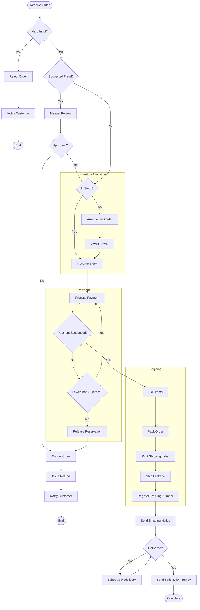

## 24. Large State Diagram

An example diagram with complex states, including composite states, decision branches (`choice`), and concurrent flows (`fork` / `join`).

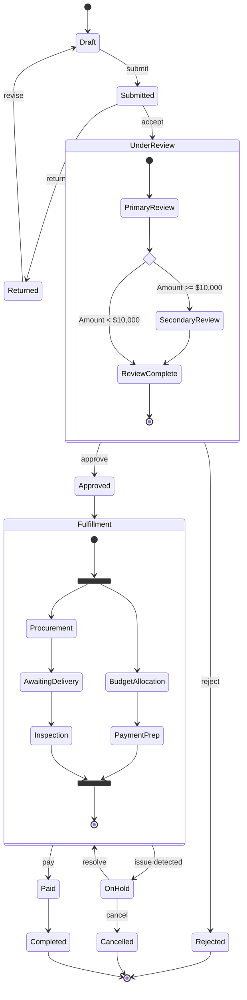

## 25. Math Inside Diagrams

In flowcharts and sequence diagrams, you can embed LaTeX equations inside labels by wrapping them in `$$`.

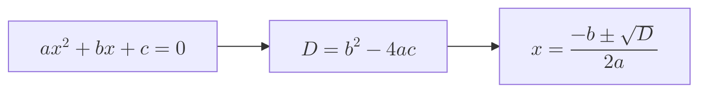

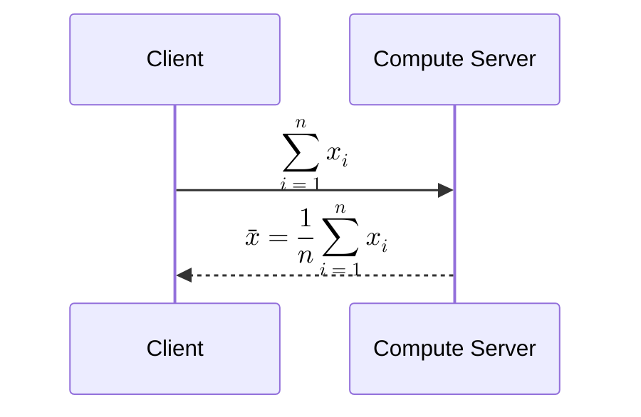

## 26. Key Point Cards

Chapters containing only a short bulleted list are rendered as numbered key point cards in Visual Mode.

- **Fast**: Fast Mode gets you from launch to reading without waiting
- **Exhibition Quality**: Visual Mode formats your document into layouts ready for talks and exhibitions
- **Standard Syntax**: No proprietary extensions—just write plain standard Markdown

## 27. Process Steps

Chapters containing only a short numbered list are rendered as a visual step-by-step flow diagram.

1. Open Markdown
2. Switch to Visual Mode
3. Choose a Style
4. Export as Image or HTML

## 28. Statement

> Light and stage for your syntax.
>
> — The Lucivo Philosophy
