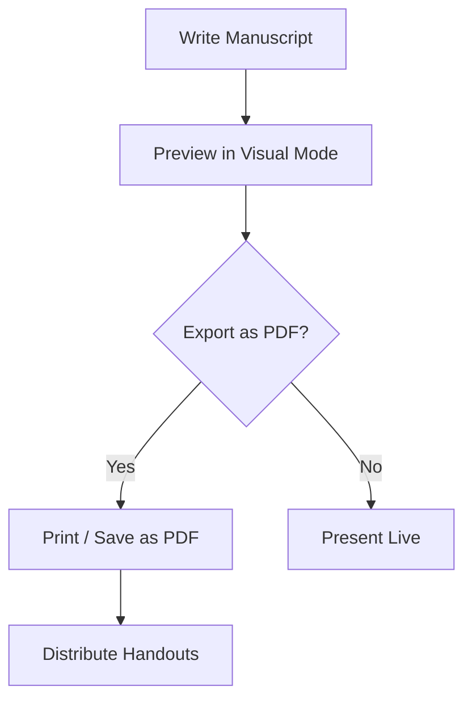

# Print & PDF Verification Sample

Use this document to verify A4 landscape PDF output in Visual Mode via **Save** → **Print / Save as PDF…**. Each chapter includes a **What to Verify** note describing the expected print layout. The cover page fits a table of contents of up to 15 chapters on a single page.

## Cover and Diagram Chapter

What to Verify: Page 1 displays both the cover title and the table of contents together without pushing the table of contents onto Page 2. This chapter fits together with its diagram on a single page, without leaving the chapter heading and diagram caption orphaned on the previous page.

## Short Body Chapter

What to Verify: This chapter fits on a single page, and the following chapter starts on a fresh page.

This chapter contains only a few lines of body text. Because each chapter triggers a page break, the lower half of the page intentionally remains blank.

## Chapter with Short Text Before a Subheading

What to Verify: The subheading "Subheading After 4 Lines of Body Text" remains on the same page with its following paragraph (since it sits near the top of the page, it should not be pushed to the next page).

### Subheading After 4 Lines of Body Text

When the body text preceding a subheading is short, ample space remains beneath the subheading, so it stays on the current page. This paragraph demonstrates body text continuing directly beneath a subheading. During print verification, confirm that the subheading and its body text appear together on the same page.

## Chapter Where a Subheading Approaches the Bottom of the Page

What to Verify: The subheading "Subheading Near the Bottom of the Page" starts cleanly at the top of a new page rather than leaving the heading and its first few lines stranded at the bottom of the previous page.

The length of preceding body text determines where a subheading lands on the page. This chapter uses longer introductory text so the subheading approaches the bottom edge. On an A4 landscape 16:10 print area, excluding slab padding and the chapter heading, roughly 17 lines of body text fit on one page.

When less than roughly one-third of the page (about 7 lines of body text) remains beneath a subheading, the subheading is pushed together with its content to the next page. If only the heading and 1–3 lines remain at the bottom of a page, readers must turn the page immediately to find the rest of the thought. Starting at the top of a new page lets readers take in the heading and text at a glance.

This paragraph and the next push the subheading farther down the page. Varying the line count changes where the subheading lands. When testing pagination rules, comparing chapters with gradually increasing line counts reveals the exact threshold where the break occurs.

Inside paragraphs, pagination avoids leaving 1–2 orphan or widow lines at the bottom or top of a page. Long paragraphs split only when at least 3 lines can remain on the preceding page and 3 lines on the next. By the end of this paragraph, the subheading falls within the bottom third of the page.

### Subheading Near the Bottom of the Page

This subheading should appear at the very top of a new page. If the heading alone—or the heading with only its first few lines—appears at the bottom of the previous page, the pagination rule is not working properly.

The body text below the subheading continues seamlessly on the same page.

## Chapter with Numbered Subheadings and Sections

What to Verify: Neither numbered subheading—"③ Properties of Tangent" nor "⑤ Special Values and Limits"—is left orphaned at the bottom of a page, and the lower subheading begins cleanly at the top of a new page.

### Properties of Trigonometric Functions

This example organizes properties of trigonometric functions under individual subheadings using `####`. In mathematical handouts, short numbered headings like these often appear in sequence with brief explanations underneath.

#### ③ Properties of Tangent

The tangent of an angle is the ratio of sine to cosine and is undefined wherever cosine equals zero. Its period is 180 degrees—half that of sine or cosine—and its graph rises and falls steeply near its asymptotes.

As an angle increases from 0 to 90 degrees, its tangent grows steadily, equaling exactly 1 at 45 degrees. This property is frequently used to calculate road gradients or the height of objects viewed at an angle.

This paragraph pushes the next numbered subheading toward the bottom of the page. In documents where each subheading has only a few lines of body text, headings and 1–2 trailing lines are especially prone to stranding near page breaks.

The tangent addition formula expresses the tangent of the sum of two angles in terms of their individual tangents. Because the denominator subtracts the product of the two tangents from 1, the formula is undefined whenever that product equals 1.

#### ⑤ Special Values and Limits

Values at 0, 30, 45, 60, and 90 degrees serve as standard reference angles. While tangent is undefined at 90 degrees, its value grows without bound as the angle approaches 90 degrees from below.

This section heading should sit cleanly at the top of a new page.

## Chapter with Varying Table Row Counts

What to Verify: Both the 3-row table and the 8-row table stay intact on single pages without splitting across page boundaries, and the first few rows are never stranded at the bottom of a preceding page.

Here is a 3-row table:

| Item | Value | Notes |
| :--- | :---- | :---- |
| A    | 10    | Short table |
| B    | 20    | Only 3 rows |
| C    | 30    | Keep together on one page |

When preceding text is long, the table moves closer to the bottom of the page. This paragraph and the next push the 8-row table down toward the page break. Leaving only the header row and first couple of data rows at the bottom of a page separates headers from data and hurts readability.

Any table that fits within a single page is moved intact to the top of the next page. The paragraph immediately before the table stays on the previous page, while the table starts cleanly on the new page. Only tables taller than a full page split between rows, repeating the table header at the top of each continuation page.

Here is an 8-row table:

| Month | Visitors | MoM Change | Notes |
| :---- | -------: | ---------: | :---- |
| Apr   |    1,200 |          - | Launch month |
| May   |    1,450 |       +21% | Holiday week |
| Jun   |    1,380 |        -5% | Rainy season |
| Jul   |    1,900 |       +38% | Summer break |
| Aug   |    2,100 |       +11% | Peak attendance |
| Sep   |    1,650 |       -21% | More weekdays |
| Oct   |    1,700 |        +3% | Campus event |
| Nov   |    1,500 |       -12% | Row 8 (final row) |

## Chapter with a Multi-Page Table

What to Verify: The 30-row table begins immediately beneath the chapter heading and spans multiple pages (without creating an almost-empty page containing only the heading). Subsequent pages repeat the column header row ("No. / Name / Category / Status"), and no row is sliced mid-line.

| No. | Name | Category | Status |
| --: | :--- | :------- | :----- |
|   1 | Item 1 | A | Completed |
|   2 | Item 2 | B | In Progress |
|   3 | Item 3 | C | Not Started |
|   4 | Item 4 | A | Completed |
|   5 | Item 5 | B | In Progress |
|   6 | Item 6 | C | Not Started |
|   7 | Item 7 | A | Completed |
|   8 | Item 8 | B | In Progress |
|   9 | Item 9 | C | Not Started |
|  10 | Item 10 | A | Completed |
|  11 | Item 11 | B | In Progress |
|  12 | Item 12 | C | Not Started |
|  13 | Item 13 | A | Completed |
|  14 | Item 14 | B | In Progress |
|  15 | Item 15 | C | Not Started |
|  16 | Item 16 | A | Completed |
|  17 | Item 17 | B | In Progress |
|  18 | Item 18 | C | Not Started |
|  19 | Item 19 | A | Completed |
|  20 | Item 20 | B | In Progress |
|  21 | Item 21 | C | Not Started |
|  22 | Item 22 | A | Completed |
|  23 | Item 23 | B | In Progress |
|  24 | Item 24 | C | Not Started |
|  25 | Item 25 | A | Completed |
|  26 | Item 26 | B | In Progress |
|  27 | Item 27 | C | Not Started |
|  28 | Item 28 | A | Completed |
|  29 | Item 29 | B | In Progress |
|  30 | Item 30 | C | Final |

## Long-Form Chapter

What to Verify: Across chapters spanning two or more pages, paragraphs never leave 1–2 isolated lines at the bottom or top of a page, and the subheading "Second Section of Long Text" is never left stranded at the bottom of a page.

### First Section of Long Text

Long chapters start on a fresh page and flow naturally across subsequent pages. When a paragraph splits across a page break, at least 3 lines stay at the bottom of the first page and at least 3 lines move to the top of the next page, ensuring readers never lose the thread of the sentence after turning the page.

When printed as handouts, documents preserve the exact on-screen color palette, including background fills and gradients. Because paper is static, animated light beams and transitions are rendered in their completed resting state. Heavy drop shadows on slabs are replaced with crisp hairline borders so they never print as muddy gray smudges.

In chapters with substantial prose, section breaks frequently occur near the bottom of a page. If a section heading and only its first couple of lines remain on the preceding page, readers turning the page lose track of which section they are reading.

This paragraph pushes the next section heading toward the bottom of the page. Because changing line counts shifts where headings land, acceptance testing checks documents with incrementally varied line counts to guarantee reliable behavior.

When a section break falls too close to the bottom edge, the entire section heading moves to the next page. If enough vertical space remains for roughly 7 lines of body text beneath the heading, the heading stays on the current page.

### Second Section of Long Text

This is the body text of the second section. Verify that the heading and its opening text appear together on the same page.

Also verify that whenever a page break occurs mid-paragraph, no 1–2 line orphans or widows are left behind.

## Lists and Blockquotes Chapter

What to Verify: List items and blockquotes never leave 1–2 detached lines across page boundaries.

- The first list item is a short sentence.
- The second list item is also a short sentence.
- The third list item is slightly longer so we can verify line wrapping behavior and confirm that individual list items do not split mid-line across pages.

> Blockquotes are kept together as a single unit without splitting mid-quote. Only when a lengthy blockquote exceeds a full page height does it break cleanly between lines.

## Closing

What to Verify: No blank trailing page appears after the final page.

With a cover/preface and 10 chapters, this document renders as an 18-page PDF using Lucivo's bundled fonts—a page count verified automatically by E2E test `TC-VTPL-029`. Changing paper size or margins from defaults in your browser's print dialog will alter the page count and page break positions.
