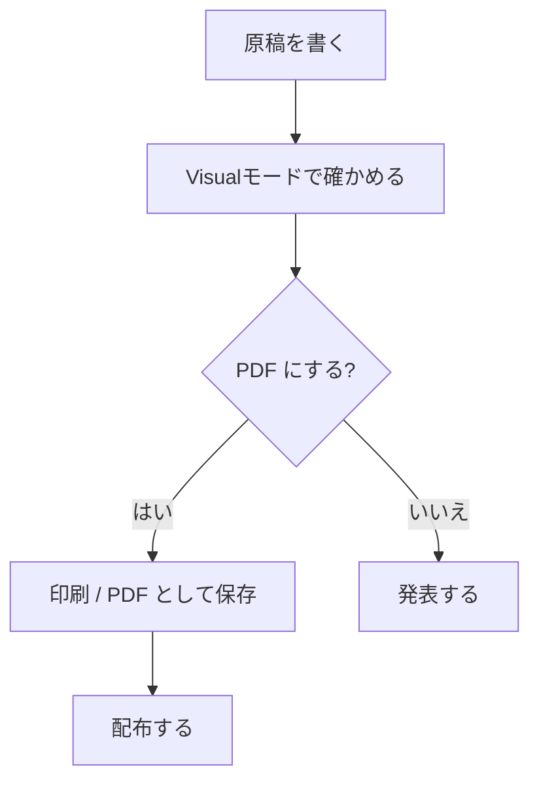

# 印刷・PDF の確認サンプル

Visualモードで「保存」→「印刷 / PDF として保存…」を選び、A4 横の PDF にして確かめる文書です。各章の「確認すること」に、正しく刷れたときの見え方を書いています。表紙には、15 章までの目次が 1 ページに収まります。

## 表紙と図の章

確認すること: 1 ページ目に表紙の題名と目次がそろって載り、目次だけが次のページへ送られていないこと。この章は図ごと 1 ページに収まり、章の見出しと図の札だけが前のページに残っていないこと。

## 短い本文の章

確認すること: この章は 1 ページに収まり、次の章は新しいページから始まること。

本文が数行だけの章です。章ごとに改ページするため、ページの下半分は空いたままになります。

## 小見出しの手前の本文が短い章

確認すること: 小見出し「本文 4 行の後の小見出し」は、その下に本文が続く形で同じページに載ること（ページの上のほうにあるため、送らない）。

### 本文 4 行の後の小見出し

小見出しの手前の本文が短いときは、小見出しの下に十分な余白があるため、小見出しを次のページへ送りません。この段落は、小見出しの下に本文が続く形を見せるための文です。印刷の確認では、小見出しと本文が同じページにそろって載っていることを確かめます。

## 小見出しがページの下のほうに来る章

確認すること: 小見出し「ページの下のほうの小見出し」は、前のページの末尾に見出しと最初の数行だけが残らず、新しいページの先頭から始まること。

本文の長さで、小見出しがページのどのあたりに来るかが変わります。この章は、小見出しがページの下のほうに来るよう、手前の本文を長くしています。印刷の版面は A4 横の 16:10 で、章の枠の余白と見出しを除くと、本文はおよそ 17 行が 1 ページに入ります。

小見出しの下にページの約 1/3（本文 7 行ほど）が残らないときは、小見出しごと次のページへ送ります。見出しと最初の 1〜3 行だけが前のページの末尾に残ると、読み手は見出しを見た後にページをめくり、続きを探すことになります。新しいページの先頭から始めれば、見出しと本文をひと目で読めます。

この段落と次の段落は、小見出しを下へ押し下げるための本文です。本文の行の数を変えると、小見出しの来る位置が変わります。改ページの規則を確かめるときは、行の数を少しずつ変えた章を並べて、どの位置で送られるかを見比べます。

段落の途中では、ページの末尾と先頭に 1〜2 行だけ残さないようにしています。段落が長いときは、少なくとも 3 行を前のページに、3 行を次のページに置いて分けます。この段落までで、小見出しはページの下から 3 分の 1 より下に来ます。

### ページの下のほうの小見出し

この小見出しは、新しいページの先頭に載っているはずです。前のページの末尾に、見出しだけ、または見出しと最初の数行だけが残っていたら、改ページの規則が効いていません。

小見出しの下の本文は、見出しと同じページに続けて載ります。

## 項と番号付きの小見出しの章

確認すること: 番号付きの小見出し「③ 正接の性質」と「⑤ 特殊値と極限」は、どちらも見出しだけが前のページの末尾に残らないこと。下のほうに来るほうは、新しいページの先頭から始まること。

### 三角関数の性質

三角関数の性質を、項ごとに小見出しを付けて書いた例です。項の見出しは `####` で書いています。数学の資料では、このように番号付きの短い見出しが続き、見出しの下の本文が短くなりがちです。

#### ③ 正接の性質

正接は、正弦を余弦で割った値です。余弦が 0 になる角では定義されません。周期は 180 度で、正弦や余弦の半分です。グラフは、定義されない角の近くで上下に大きく伸びます。

正接の値は、角が 0 度から 90 度へ近づくにつれて大きくなります。45 度のときにちょうど 1 になります。この性質は、坂の傾きや、斜めに見上げたときの高さを求めるときに使います。

この段落は、次の項の見出しをページの下のほうへ押し下げるための本文です。項の見出しの下に本文が数行しかない資料では、見出しと本文の 1〜2 行だけがページの末尾に残りやすくなります。

正接の加法定理は、二つの角の和の正接を、それぞれの角の正接で表す式です。分母に 1 から二つの正接の積を引いた値が来るため、積が 1 になる組み合わせでは定義されません。

#### ⑤ 特殊値と極限

角が 0 度、30 度、45 度、60 度、90 度のときの値は、特殊値としてよく使います。90 度の正接は定義されませんが、角を 90 度に近づけると、正接の値はいくらでも大きくなります。

この項の見出しは、新しいページの先頭に載っているはずです。

## 表の段数を変えた章

確認すること: 3 行の表と 8 行の表は、途中で分かれずにそれぞれ 1 つのページに載ること。表の最初の数行だけが前のページの末尾に残っていないこと。

3 行の表です。

| 項目 | 値   | 備考           |
| :--- | :--- | :------------- |
| A    | 10   | 短い表         |
| B    | 20   | 3 行だけの表   |
| C    | 30   | 分けずに載せる |

表の前の本文が長いと、表がページの下のほうに来ます。この段落と次の段落は、8 行の表をページの下のほうへ押し下げるための本文です。表の最初の数行だけが前のページに残ると、見出しの行と最初のデータだけが離れて読みにくくなります。

1 ページに収まる表は、途中で分けずに表ごと次のページへ送ります。表の手前のこの段落は前のページに残り、表は新しいページの先頭から始まります。表が大きく 1 ページに収まらないときだけ、行の境目で分け、次のページにも見出しの行を付けます。

8 行の表です。

| 月   | 来場者数 | 前月比 | 備考               |
| :--- | -------: | -----: | :----------------- |
| 4 月 |    1,200 |      - | 初回               |
| 5 月 |    1,450 |   +21% | 連休               |
| 6 月 |    1,380 |    -5% | 雨が多い           |
| 7 月 |    1,900 |   +38% | 夏休み             |
| 8 月 |    2,100 |   +11% | 最多               |
| 9 月 |    1,650 |   -21% | 平日が増える       |
| 10 月 |   1,700 |    +3% | 行事               |
| 11 月 |   1,500 |   -12% | 8 行目（最後の行） |

## 1 ページに収まらない表の章

確認すること: 30 行の表は、章の見出しの直後から始まり、複数のページにまたがること（章の見出しと説明だけのページができないこと）。2 ページ目以降の先頭にも見出しの行（「番号・名前・区分・状態」）が付き、行の途中で切れていないこと。

| 番号 | 名前         | 区分 | 状態   |
| ---: | :----------- | :--- | :----- |
|    1 | 第 1 の項目  | A    | 完了   |
|    2 | 第 2 の項目  | B    | 作業中 |
|    3 | 第 3 の項目  | C    | 未着手 |
|    4 | 第 4 の項目  | A    | 完了   |
|    5 | 第 5 の項目  | B    | 作業中 |
|    6 | 第 6 の項目  | C    | 未着手 |
|    7 | 第 7 の項目  | A    | 完了   |
|    8 | 第 8 の項目  | B    | 作業中 |
|    9 | 第 9 の項目  | C    | 未着手 |
|   10 | 第 10 の項目 | A    | 完了   |
|   11 | 第 11 の項目 | B    | 作業中 |
|   12 | 第 12 の項目 | C    | 未着手 |
|   13 | 第 13 の項目 | A    | 完了   |
|   14 | 第 14 の項目 | B    | 作業中 |
|   15 | 第 15 の項目 | C    | 未着手 |
|   16 | 第 16 の項目 | A    | 完了   |
|   17 | 第 17 の項目 | B    | 作業中 |
|   18 | 第 18 の項目 | C    | 未着手 |
|   19 | 第 19 の項目 | A    | 完了   |
|   20 | 第 20 の項目 | B    | 作業中 |
|   21 | 第 21 の項目 | C    | 未着手 |
|   22 | 第 22 の項目 | A    | 完了   |
|   23 | 第 23 の項目 | B    | 作業中 |
|   24 | 第 24 の項目 | C    | 未着手 |
|   25 | 第 25 の項目 | A    | 完了   |
|   26 | 第 26 の項目 | B    | 作業中 |
|   27 | 第 27 の項目 | C    | 未着手 |
|   28 | 第 28 の項目 | A    | 完了   |
|   29 | 第 29 の項目 | B    | 作業中 |
|   30 | 第 30 の項目 | C    | 最後   |

## 長文の章

確認すること: 2 ページ以上にわたる章でも、段落の途中で 1〜2 行だけがページの末尾や先頭に残っていないこと。小見出し「長文の 2 つ目の節」は、見出しだけが前のページの末尾に残っていないこと。

### 長文の 1 つ目の節

長文の章は、章の先頭で改ページした後、本文の流れに沿って次のページへ続きます。段落の途中で分けるときは、少なくとも 3 行をページの末尾に、3 行を次のページの先頭に置きます。読み手は、ページをめくった直後に文の流れを見失わずに読み進められます。

配布資料として刷るときは、画面と同じ配色で、背景の色やグラデーションも省かずに刷ります。紙は動かないため、光の演出や動きは止めた最後の状態で刷ります。スラブの大きな影は、紙では灰色のにじみに見えるため消し、代わりに細い枠でスラブの輪郭を保ちます。

本文の量が多い章では、ページの下のほうで節が変わることがよくあります。節の見出しと最初の数行だけが前のページに残ると、次のページをめくったときに、どの節の続きかが分からなくなります。

この段落は、次の節の見出しをページの下のほうへ押し下げるための本文です。行の数を変えると見出しの来る位置が変わるため、受け入れテストでは、行の数を少しずつ変えた文書でも確かめると安心です。

ページの末尾に近い位置で節が変わるときは、節の見出しごと次のページへ送ります。見出しの下に、本文の 7 行ほどが入る余白が残っていれば、見出しはそのページに置きます。

### 長文の 2 つ目の節

2 つ目の節の本文です。見出しと本文が同じページに続いて載っていることを確かめます。

段落の途中でページが変わるときも、1〜2 行だけが離れて残っていないことを確かめます。

## リストと引用の章

確認すること: リストの項目と引用が、途中で 1〜2 行だけ離れて残っていないこと。

- 項目の 1 つ目は短い文です
- 項目の 2 つ目も短い文です
- 項目の 3 つ目は、少し長めの文にして、折り返したときの見え方を確かめます。行の途中で改ページされないことも確かめます

> 引用は、途中で分けずにまとめて載せます。長い引用が 1 ページに収まらないときだけ、行の境目で分けます。

## さいごに

確認すること: 最後のページの後ろに、白紙のページが付いていないこと。

この文書は、表紙・前書きと 10 章で、Lucivo に同梱のフォントで刷ると PDF は 18 ページになります。ページ数は、E2E テスト（`TC-VTPL-029`）が確かめます。ブラウザの印刷画面で、用紙サイズや余白を既定から変えると、ページ数と改ページの位置は変わります。
