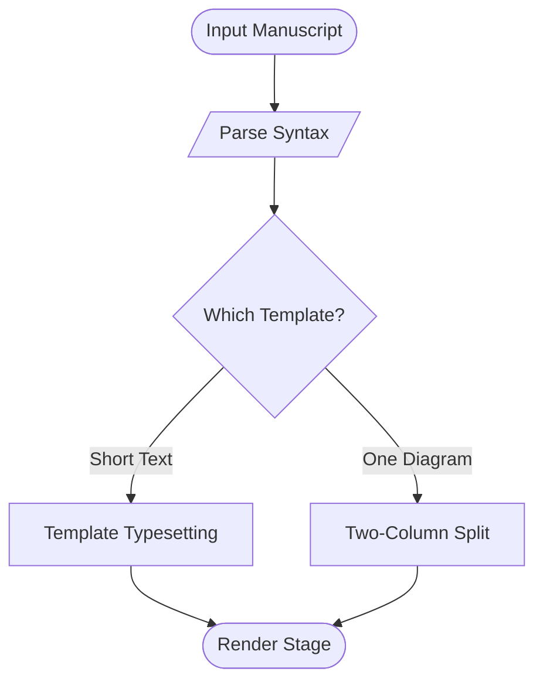
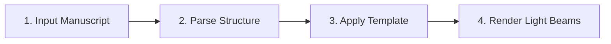
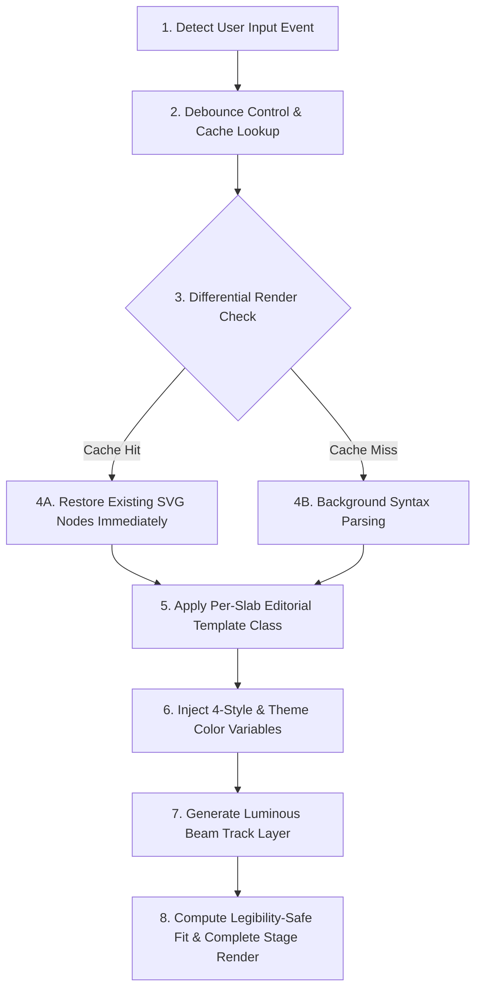
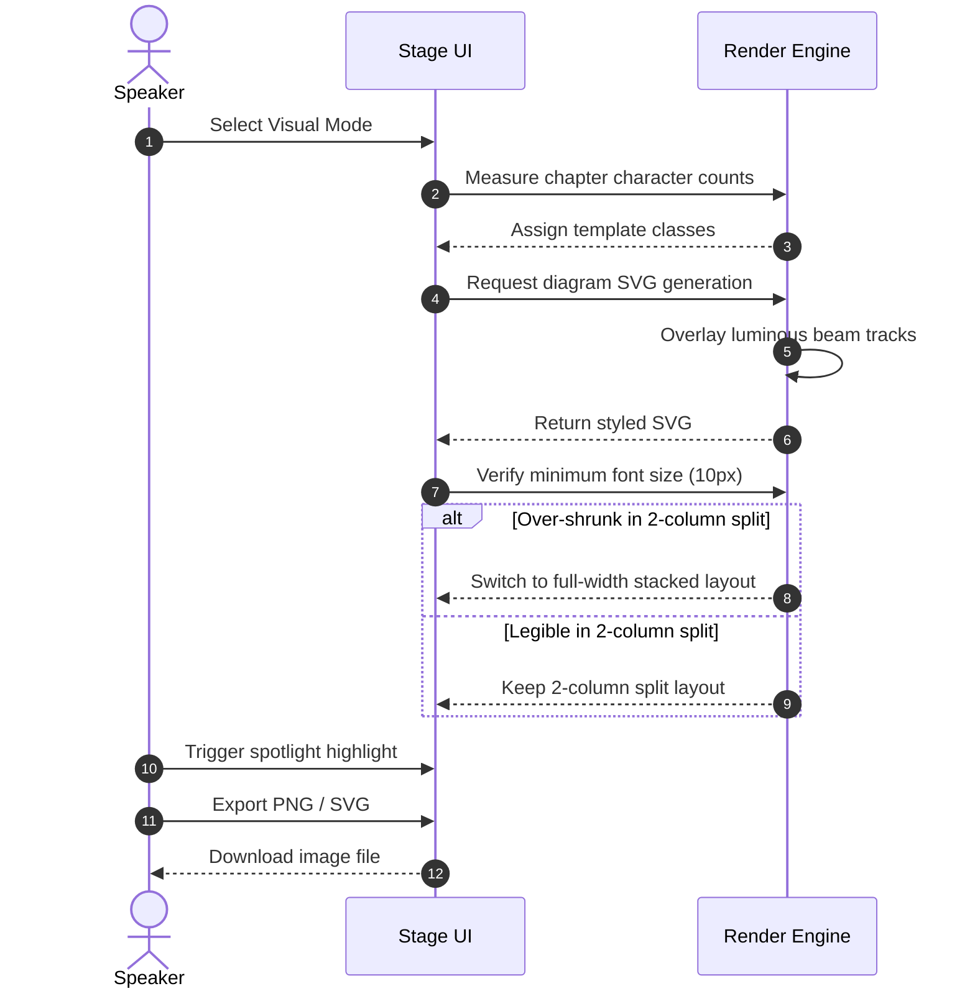
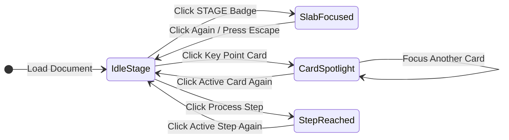

# Lucivo Editorial Templates, Volume & Diagram Size Comprehensive Sample

This document is a comprehensive sample designed to inspect and compare the editorial templates automatically applied to each chapter (`h2`) in Visual Mode based on its structural pattern, **Luminous Flow** light animations, and typesetting behavior when **paragraph text volume is large** or **diagram dimensions are wide or tall**.

## 1. Lead Template (`lead`): Short Introduction (Up to 160 Characters)

When a chapter consists of 1–2 paragraphs totaling 160 characters or fewer, the Lead template is applied automatically. A four-color gradient bar and prism spark along the left edge highlight the core message at a glance.

Generous whitespace and bold typography provide a refined aesthetic ready to serve directly as the opening slide of a talk or exhibition.

## 2. [Volume Comparison] Large Paragraph Text Volume (Long-Form & Multiple Paragraphs)

When a chapter contains 3 or more paragraphs or exceeds 160 characters in total, it automatically switches to the **Standard (`standard`) body typesetting** to prevent the visual heaviness of oversized lead typography. Beyond large-screen exhibitions, sections meant for deep reading—such as technical manuals and white papers—maintain long-form legibility with a calm font size (`1rem`) and airy line height (`1.8`).

For example, when discussing the design philosophy behind a product or architectural trade-offs in detail, a single chapter often spans several hundred to over a thousand characters. Applying the emphasized lead font (`clamp(1.1rem, 1.8vw, 1.35rem)` bold) to all of that text would make the page feel oppressive and bury key concepts. Lucivo measures character volume and paragraph structure in real time, seamlessly distinguishing between "display introductions" and "readable prose" using the exact same criteria a human DTP designer applies.

Furthermore, even when inline elements such as `inline code`, **bold emphasis**, or mathematical expressions like $T_{\text{render}} \le 16\text{ ms}$ appear mid-paragraph, the baseline and leading remain undisturbed. Across consecutive paragraphs, consistent vertical margins (`0.875rem`) guide the reader's eye naturally from top to bottom without visual fatigue.

## 3. Key Points Template (`points`): 3-Column Cards (Standard Volume)

When a bulleted list has 2–6 items of up to 100 characters each, it transforms into a grid of numbered cards. Starting a bullet item with `★` elevates it to a full-bleed, enlarged hero card (`FR-059`). Clicking any card spotlights it individually.

- **Snappy Responsiveness**: Fast Mode strips away ornaments to preview edits in milliseconds.
- ★ **Exhibition-Grade Layouts**: Visual Mode delivers designer polish for talks and exhibitions.
- **Pure Standard Syntax**: No proprietary syntax—write plain Markdown to get rich layouts.

## 4. Key Points Template (`points`): 4-Column Cards & KPI Metrics Showcase

With 4 items, cards arrange into 4 columns (1 row) on wide screens and a 2×2 grid on medium widths. Moreover, cards whose bold title is a numerical metric (`120ms`, `99.98%`, `3.2x`, etc.) automatically promote to **KPI Metric Cards** (`FR-027`) with large monospaced typography. KPI cards can also be designated as hero cards with `★`.

- **120ms**: Instant millisecond response from initial render to cached redraws.
- ★ **99.98%**: Preserves the Last Known Good (LKG) diagram even on syntax errors.
- **3.2x**: Cuts preparation time from Markdown draft to live presentation.
- **0 Requests**: Zero network calls—runs 100% offline directly via `file://`.

## 5. [Volume Comparison] High Item Count or Long Bullet Descriptions (Auto-Fallback to Standard List)

When a bulleted list contains 7 or more items, or when any single item exceeds 100 characters, it automatically renders as a **Standard (`standard`) bulleted list** to avoid overly tall cards or cramped text.

- **Automatic Fallback Threshold (Item Count)**: Once a list reaches 7 or more items, scanning across a card grid increases eye travel, so Lucivo switches to a clean vertical list optimized for top-to-bottom scannability.
- **Automatic Fallback Threshold (Character Length)**: When an item contains detailed specifications or caveats exceeding 100 characters, rather than squeezing it into a narrow card column, Lucivo renders it as a full-width list row across the slab.
- **Preserving Nested Hierarchies**: Lists containing nested sub-items also render as standard lists rather than cards so indentation hierarchies remain crystal clear.
- **Harmony with Inline Elements**: Code snippets such as `--fit-max-width`, equations, and bold emphasis sit neatly within list items without disrupting line spacing.
- **Balancing Scannability and Searchability**: Ideal for exhaustive checklists, functional requirements lists, and reference inventories where completeness matters.
- **Unified Style Palette**: Even in standard lists, bullet markers and text contrast adapt dynamically to the active Visual style and Light/Dark theme.
- **Real-Time Dynamic Re-Evaluation**: Adding or removing items in the editor across the threshold immediately toggles the layout between cards and a standard list.

## 6. Steps Template (`steps`): Horizontal Flow (Up to 4 Items with Luminous Flow)

Numbered lists with 4 or fewer items render as a horizontal process flow. Light pulses travel along the connecting lines, illuminating each step node upon arrival. Clicking a step highlights the path leading up to that stage.

1. **Write Manuscript**: Author prose and diagrams using standard Markdown syntax and fenced code blocks.
2. **Auto-Detect Template**: Lucivo selects the optimal editorial template based on chapter structure and text volume.
3. **Apply Luminous Styling**: Applies a four-color style palette and animated light-flow accents.
4. **Present & Export**: Deliver talks with spotlight controls and export crisp PNG or SVG assets.

## 7. Steps Template (`steps`): Vertical Flow (5–8 Items with Vertical Luminous Track)

For processes with 5–8 items—or on narrower viewports—the layout automatically switches to a vertical flow where light travels top-to-bottom along a vertical track on the left.

1. **Requirements Analysis (SWE.1)**: Define usage scenarios and visual quality requirements with clear evaluation metrics.
2. **DTP Design (Phase 1)**: Design typography, whitespace, color palettes, SVG ornaments, and layout wireframes.
3. **Architecture Design (SWE.2)**: Architect a zero-network single-bundle structure and rendering pipeline.
4. **Detailed Design & Implementation (SWE.3)**: Implement template classification logic and Luminous Flow animations.
5. **Automated E2E Testing (Test)**: Verify all templates, diagram sizes, and contrast ratios in a headless browser.
6. **Design Proofing (DTP Phase 2)**: Inspect live galley proofs for typesetting, spacing, and visual rhythm.

## 8. Statement Template (`quote`): Highlighting a Key Message (Up to 240 Characters)

> Light and stage for your syntax. When a chapter consists of a single blockquote of 240 characters or fewer, it becomes a centered Statement layout crowned with an oversized quotation monument to give core principles unmistakable presence.
>
> — Lucivo Design Philosophy

## 9. Split Template (`split`): Standard Flowchart with Light Beam Effects

Chapters containing one body element and one diagram automatically arrange into a two-column split layout: commentary on the left (5 columns) and diagram on the right (7 columns). Light flows from the root of the diagram down through its edges, backlighting each node as it arrives.



## 10. [Diagram Size Comparison] Wide Diagrams (Auto-Switching from Two-Column Split to Full-Width Stacked Layout)

Even in a "one body element + one diagram" chapter, if a diagram is so wide that shrinking it into the right 7 columns would drop its label font size below the `10px` legibility floor, Lucivo automatically switches to a **full-width single-column stacked layout** (`.is-stacked`). Wide pipelines stay crisp and legible, and extra-wide diagrams support horizontal scrolling or toggling to `100%` native scale.



## 11. [Diagram Size Comparison] Tall Diagrams (Multi-Step Flowcharts & Long Sequence Diagrams)

Verifies rendering for tall multi-step flowcharts and lengthy sequence diagrams with many message exchanges. To prevent compact or tall diagrams from stretching awkwardly across the width, the maximum upscale factor is capped (`MAX_FIT_SCALE = 1.15`) and the diagram is centered in balanced proportions.

### 11.1 Deep Multi-Step Flowchart (Top-to-Bottom Light Flow)



### 11.2 Long Sequence Diagram (Light Beams Traveling Along Message Arrows)



## 12. [Diagram Size Comparison] Wide Multi-Column Tables & State Diagrams

Verifies high-density data tables with many columns alongside curved-edge state diagrams. Wide tables stay neatly within the slab's printable width through automatic text wrapping and responsive scroll containers.

| Template ID | Template Name | Primary Trigger Condition (Structure) | Volume Threshold (Upper Limit) | Vector Ornaments Applied | Dynamic & Interactive Effects | Auto-Fallback When Threshold Exceeded |
| :---------- | :------------ | :------------------------------------ | :----------------------------- | :----------------------- | :---------------------------- | :------------------------------------ |
| `lead`      | Lead          | Only 1–2 paragraphs (`p`)             | 160 characters total           | 4-color gradient bar + prism spark | Linked to slab STAGE focus | Switches to `standard` body prose |
| `points`    | Key Points    | Optional intro `p` + 1 bullet list (`ul`) | 2–6 items, up to 100 chars each | Top-right card corner ornament | Click individual cards to spotlight | Switches to `standard` bulleted list |
| `steps`     | Steps         | Optional intro `p` + 1 numbered list (`ol`) | 2–8 items, up to 80 chars each | Inter-step chevron arrows | Luminous track flow + highlight up to clicked step | Switches to `standard` numbered list |
| `quote`     | Statement     | Optional intro `p` + 1 blockquote     | Quote up to 240 chars, 1–2 paragraphs | Top-center quotation monument | Linked to slab STAGE focus | Switches to `standard` left-bordered quote |
| `split`     | Split         | 1 body element + 1 diagram            | Diagram font size >= `10px`    | Diagram header + style-matched backdrop | Luminous beams flowing along diagram edges | Auto-switches to full-width `.is-stacked` |
| `standard`  | Standard      | Chapters with subheadings, tables, math, multiple diagrams, or long text | Unlimited (handles any length) | Numbered `STAGE` badge | Per-chapter focus & diagram zoom toggle | Guaranteed clean fallback typesetting |

Numeric-only columns are right-aligned with tabular monospaced figures so decimal places and digits line up cleanly (the first column is bolded as the row header).

| Template   | Min Items | Max Items | Per-Item Limit | Total Limit |
| ---------- | --------- | --------- | -------------- | ----------- |
| Lead       | 1         | 2         | —              | 160 chars   |
| Key Points | 2         | 6         | 100 chars      | —           |
| Steps      | 2         | 8         | 100 chars      | —           |
| Statement  | 1         | 3         | —              | 240 chars   |

### Luminous Beams and Spotlight Transitions in a State Diagram



## 13. Standard Template (`standard`): Composite Sections with Subheadings, Math, Code & Long Quotes

Verifies composite chapters combining subheadings (`h3`), block math equations (KaTeX), syntax-highlighted code blocks, and long blockquotes exceeding 240 characters.

### 13.1 Mathematical Typesetting and Algorithm Definition

The scale factor $s_{\text{fit}}$ used to fit a diagram within its viewport while preserving legibility is computed from the viewport width $W_{\text{view}}$, natural diagram width $W_{\text{svg}}$, and minimum diagram font size $f_{\min}$ as follows:

$$
s_{\text{fit}} = \min\!\left(S_{\max},\; \max\!\left(\frac{W_{\text{view}}}{W_{\text{svg}}},\; \frac{F_{\text{limit}}}{f_{\min}}\right)\right), \quad S_{\max} = 1.15,\; F_{\text{limit}} = 10\text{ px}
$$

### 13.2 Standard Blockquote Styling for Long Quotes (Over 240 Characters)

> Even when a chapter features a blockquote (`blockquote`), if it appears alongside subheadings or other elements—or if the quoted text exceeds 240 characters—Lucivo renders it in the **Standard blockquote style** with a left accent bar rather than a centered Statement layout.
>
> This ensures that multi-paragraph literature citations and specification excerpts remain left-aligned and comfortable to read from start to finish. Because visual presentation adapts automatically to the nature and volume of your prose, writers can focus entirely on refining their ideas without worrying about manual layout adjustments.

### 13.3 Code Showcase Integration (`FR-031`)

In Visual Mode, code blocks are automatically styled in a dark console frame featuring rounded carets (`AST-109`), a language badge, and a one-click `Copy` button.

```javascript
// Example: Computing light departure timestamps in earliest-arrival order
const arrival = new Map([[root, 0]]);
edges.forEach(edge => {
  edge.start = arrival.get(edge.from);
  arrival.set(edge.to, edge.start + edge.length / speed);
});
```

### 13.4 Stage Presentation Intermission Curtain (`B` / `Q`) and Auto-Advance Loop Ambient Pulse (`A`)

When you launch Stage Presentation via the **Present** button in the header (or by pressing `P`), you can use the following live presentation features:

- **Intermission / Q&A Standby Curtain (`FR-028`)**: Pressing `B` or `Q` (or clicking **Curtain** on the bottom bar) during a presentation lowers a standby curtain featuring a brand light-leak backdrop (`AST-107`) and slowly rotating luminous orbits (`AST-108`). Clicking any chapter pill (`00`–`18`) along the bottom jumps straight to that chapter for Q&A (press `Esc` to raise the curtain without exiting the presentation).
- **Vivo Ambient Pulse on Auto-Advance Loop (`FR-033`)**: Pressing `A` (or clicking **Auto**) advances automatically through the final scene and loops back to the cover (Scene `00`), activating a gentle breathing glow (Vivo Ambient Pulse) across the cover emblem and title.

## 14. Timeline / Roadmap Template (`points` Variant): Chronological Pill Badges & Connector Guides

When every item in a bulleted list begins with a date, quarter, phase, or version label (`2026 Q1`, `Phase 1`, `v1.0`, etc.), it automatically promotes to a **Timeline / Roadmap layout** (`FR-029`) connected by monospaced rounded pill badges and dashed guide lines.

- **2026 Q1**: Established the core rendering engine, four signature infographic styles, and zero-dependency offline bundle.
- **2026 Q2**: Integrated Signal Light animations, full-screen Stage Presentation, Light Table overview, and the optical pointer.
- **2026 Q3**: Released KPI metric cards, timelines, Before/After comparison cards, and the intermission standby curtain.

## 15. Before / After Comparison Pair Cards (`points` Variant): Contrasting Problem and Solution

When a two-item bulleted list pairs a problem/legacy state (`Before`, `Legacy`, `Challenge`, etc.) with a solution state (`After`, `With Lucivo`, `Solution`, etc.), it renders as **Comparison Pair Cards** (`FR-030`)—muting the Before card in a dashed slate frame while highlighting the After card with a 6px top accent bar and crisp border.

- **Before (Traditional Slide Authoring)**: Teams had to manually copy content from specifications into slide decks and rebuild diagrams by hand, creating duplicate maintenance overhead with every revision.
- **After (With Lucivo)**: The Markdown documents and Mermaid diagrams you already write become exhibition-grade layouts and stage presentations directly—eliminating manual transcription completely.

## 16. Glossary / Definition List Template (`glossary`): Two-Column Term Dictionary

When every item in a bulleted list is written as `**Term** — Description` (a bold term followed by an em dash), it renders as a structured **Glossary** (`FR-035`) aligning monospaced terms with their definitions. Lists of 7 or more items arrange into two columns on wide viewports.

- **Slab** — The visual panel unit holding a single chapter (`h2`). Styled with rounded corners and elevation, each slab selects its own template automatically.
- **Scene** — A single frame displayed during Stage Presentation. Each chapter becomes one scene, navigated with the `→` key.
- **Signal Light** — Light traveling along diagram structures from root to downstream nodes, illuminating reached nodes with a subtle backlight.
- **Light Table** — A live bird's-eye overview showing miniature renders of every scene simultaneously (`O` key).
- **Pointer** — An optical spotlight cursor for pointing out details on large screens (`L` key).
- **Curtain** — A standby screen lowered during breaks or Q&A sessions (`B` / `Q` key).
- **Callout** — A semantic alert panel written with GitHub's `> [!NOTE]` syntax, styled with meaning-specific colors and icons.
- **Handout** — Print-ready A4 landscape pages generated via browser print, placing the cover and each chapter onto individual pages.

## 17. Callouts (GitHub Alerts) & Print / PDF Handouts

Blockquotes using GitHub alert syntax (`> [!NOTE]`, etc.) render in Visual Mode as **semantic callout panels** (`FR-034`) with dedicated colors, icons, and labels. Alert colors remain consistent by severity regardless of the active visual style.

> [!TIP]
> Choose **File → Print / Save as PDF…** (or press `Ctrl+P` / `⌘P`) to export **handouts** (`FR-036`) with the cover and each chapter laid out one per A4 landscape page. Headers, editors, UI buttons, and animated light effects are automatically omitted from print output.

> [!IMPORTANT]
> Documents print using the exact on-screen color scheme—if Dark appearance is active, handouts export in Dark mode complete with background fills and gradients.

> [!WARNING]
> Long chapters that exceed a single page break cleanly onto subsequent pages without slicing mid-card, mid-step, mid-diagram, or mid-table-row. Keeping chapters concise produces clean one-chapter-per-page handouts matching exhibition panels.
