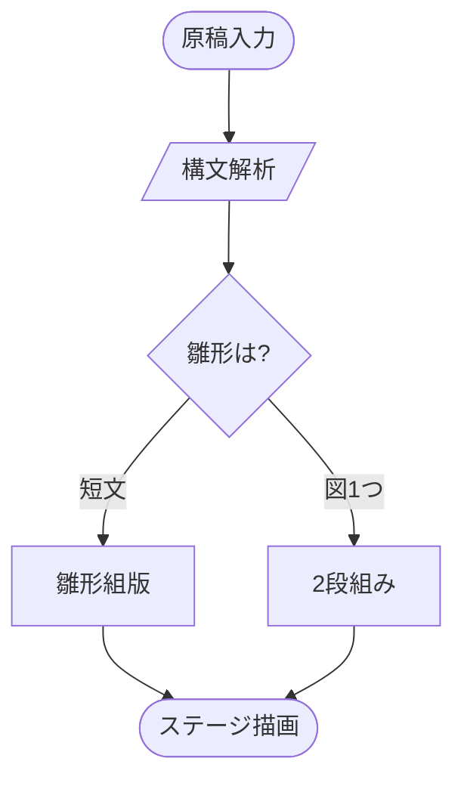
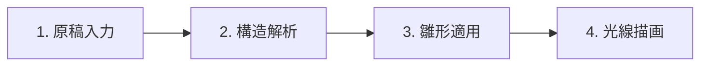
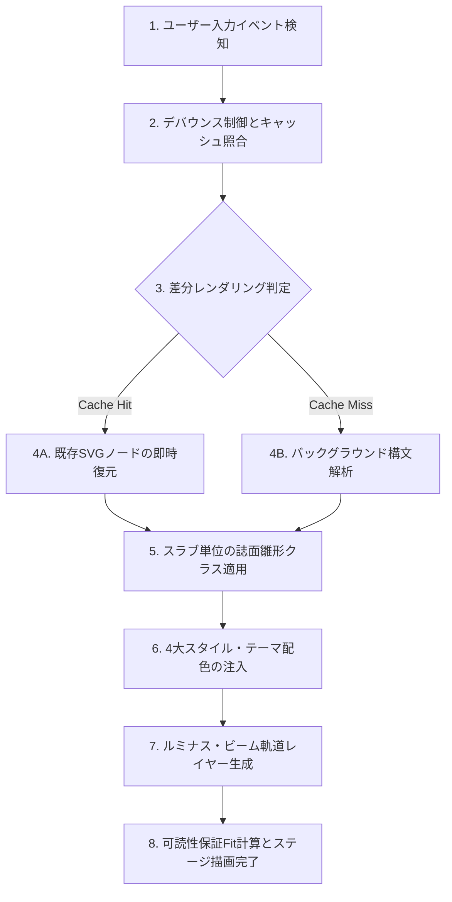
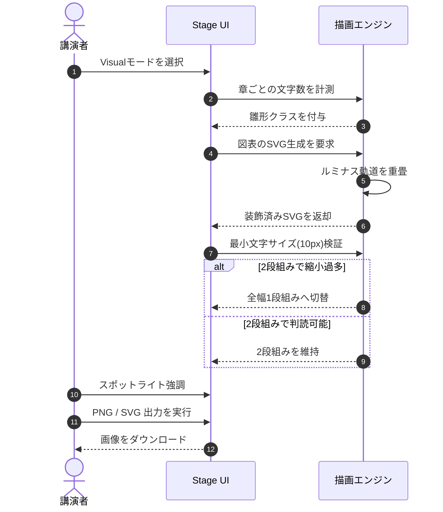
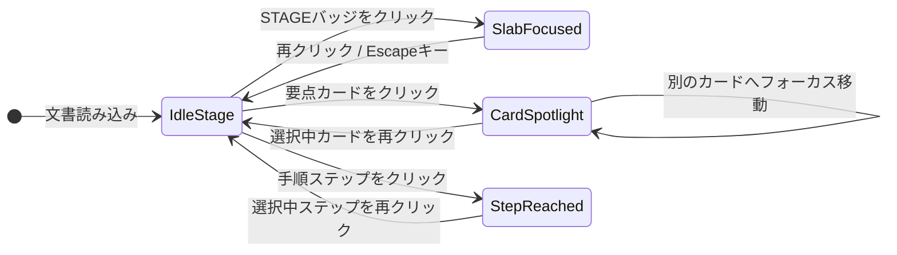

# Lucivo 誌面雛形・ボリューム＆図表サイズ総合サンプル

この文書は、Visualモードで各章（`h2`）の記述パターンに応じて自動適用される誌面雛形と、**ルミナス・フロー（光の流動演出）**、さらに**段落の文書ボリュームが多い場合**や**図表のサイズが縦・横に大きい場合**の組版挙動を一覧で確認・比較するためのサンプルです。

## 1. リード型（lead）：短文導入（160字以内）

章の本文が1〜2段落かつ合計160字以内の場合、リード型が自動適用されます。左端の4色グラデーション帯とプリズムスパークが、章の核心を一目で印象づけます。

余白と太めのタイポグラフィにより、講演や展示の冒頭スライドとしてそのまま使える品格を備えます。

## 2. 【文書量比較】段落の文書ボリュームが多い場合（長文・複数段落）

章の段落数が3段落以上ある場合や、合計文字数が160字を超える場合は、リード型の大文字組版による圧迫感を防ぐため、自動的に**標準型（`standard`）の本文組版**へと切り替わります。大画面での展示だけでなく、技術解説書やホワイトペーパーのようにしっかりと文章を読ませたいセクションでは、落ち着いた文字サイズ（`1rem`）とゆとりある行間（`1.8`）によって長文の可読性を確保します。

たとえば、プロダクトの背景にある設計思想やアーキテクチャ上のトレードオフを詳しく論じる場合、1つの章の中に数百字から千字規模のテキストが含まれることが珍しくありません。もしこれらすべてにリード型の強調フォント（`clamp(1.1rem, 1.8vw, 1.35rem)`・太字）を適用してしまうと、紙面全体が重くなり、かえって重要なキーワードが埋もれてしまいます。Lucivo では文字量と段落構造をリアルタイムに計測し、人間がDTPソフトで組版するときと同じ判断基準で「見せる見出し導入」と「読ませる本文」をシームレスに使い分けます。

さらに、段落の途中には `inline code`（インラインコード）や **太字による強調**、数式 $T_{\text{render}} \le 16\text{ ms}$ などのインライン要素が混在しても、ベースラインと行送りが乱れないよう設計されています。複数の段落が連続する際も、段落間に適切なマージン（`0.875rem`）が保たれるため、視線が迷うことなく上から下へと自然に流れます。

## 3. 要点カード型（points）：3列カード（標準ボリューム）

箇条書きが2〜6項目かつ各100字以内の場合、番号付きカードのグリッドに変換されます。クリックで特定のカードをスポットライト強調できます。

- **軽快なレスポンス**: 高速モードは無駄な装飾を排し、ミリ秒単位で素早くプレビューします。
- **展示会品質の誌面**: Visualモードは大画面での講演や展示に耐えるトップデザイナーレベルの品格を提供します。
- **標準記法を維持**: 独自記法は一切不要。プレーンな Markdown をそのまま記述するだけで誌面化されます。

## 4. 要点カード型（points）：4列カード＆KPIメトリクス・ショーケース

項目数が4個の場合は広い画面で4列（1行）、中間の幅では2×2グリッドに整列します。さらに太字の題が数値・指標（`120ms`, `99.98%`, `3.2x` など）のカードは、自動的に大判等幅タイポグラフィの**KPIメトリクス・カード（`FR-027`）**へ昇格します。

- **120ms**: 初回描画からキャッシュ再描画まで、思考を止めないミリ秒単位のレスポンスを実現します。
- **99.98%**: 構文エラー時も直前の正常な図表（LKG）を保持し、ライブ登壇中の表示破綻を防ぎます。
- **3.2x**: 従来のスライド作成ツールと比較して、原稿執筆から登壇準備までの所要時間を大幅に短縮します。
- **0件**: 外部通信件数ゼロ。CDNやバックエンドAPIを一切使わず、`file://` 直開きでオフライン完結動作します。

## 5. 【文書量比較】箇条書きの項目数・文字量が多い場合（標準リストへの自動切替）

箇条書きの項目数が7個以上ある場合や、1項目あたり100字を超える長文解説が含まれる場合は、カード化による縦伸びや文字詰まりを避けるため、自動的に**標準型（`standard`）の箇条書きリスト**として組版されます。

- **自動フォールバック閾値（項目数）**: 箇条書きが7項目以上に達すると、グリッドカードでは視線の移動距離が大きくなりすぎるため、縦一覧性に優れた標準リスト表現へ切り替わります。
- **自動フォールバック閾値（文字数）**: 1つの項目が100字を超える詳細な仕様説明や注意事項である場合、狭いカード幅に押し込めず、スラブ全幅を使った読みやすいリスト行として描画します。
- **階層構造（ネスト）の維持**: 親項目の下にサブリストがネストされている場合も、カード型ではなく標準リストとして階層インデントを正確に表現します。
- **インライン要素との調和**: リスト項目内に `-- fit-max-width` のようなコード片や数式、強調表現が含まれていても、行間を損なわずに整然と並びます。
- **一覧性と検索性の両立**: 要件定義書の機能一覧やチェックリストなど、項目数が多く網羅性が求められるセクションで威力を発揮します。
- **スタイルパレットとの統一**: 標準リストであっても、マーカーの色やテキストのコントラストは選択中のVisualスタイルおよびLight/Darkテーマに連動します。
- **リアルタイムな動的再判定**: エディタ上で項目を追加・削除して閾値を跨ぐと、即座にカード型と標準リスト型が切り替わります。

## 6. 手順型（steps）：横並びフロー（4項目以下・ルミナス・フロー演出）

番号付きリストが4項目以下の場合、横並びの手順フローになります。接続線上を光が走り、届いた工程の丸が反応します。工程をクリックするとそこまでの到達経路が強調されます。

1. **原稿の記述**: 標準の Markdown 記法とコードブロックで文書と図を記述します。
2. **雛形の自動判定**: 章ごとの構造と文字量から最適な誌面テンプレートを選択します。
3. **ルミナス装飾**: スタイルに応じた4色パレットと光のフロー演出を適用します。
4. **ステージ発表・出力**: スポットライト操作で講演し、PNGやSVGへ書き出します。

## 7. 手順型（steps）：縦並びフロー（5〜8項目・垂直ルミナス・トラック）

工程が5〜8項目の場合や画面幅が狭い環境では、左側の垂直トラック上を上から下へ光が流れる縦並びフローへ自動切替されます。

1. **要求分析（SWE.1）**: 利用シーンと視覚品質の要件を定義し、評価指標を明確化します。
2. **DTP設計（Phase 1）**: タイポグラフィ・余白・色彩・SVG装飾素材とラフ案を設計します。
3. **アーキテクチャ設計（SWE.2）**: 外部通信ゼロの単一バンドル構成と描画パイプラインを設計します。
4. **詳細設計・実装（SWE.3）**: 雛形判定ロジックとルミナス・フロー演出を実装します。
5. **自動E2Eテスト（Test）**: 全雛形・図表サイズ・コントラスト比をヘッドレスブラウザで検証します。
6. **デザイン校正（DTP Phase 2）**: 実画面のゲラ出力で文字組・余白・視覚リズムを検収します。

## 8. ステートメント型（quote）：キーメッセージの強調（240字以内）

> 構文に、光と舞台を。章が240字以内の引用1つで構成される場合、上部に引用符モニュメントを冠した中央揃えのステートメント型となり、理念やキーメッセージを力強く印象づけます。
>
> — Lucivo Design Philosophy

## 9. 解説＋図版型（split）：標準サイズのフローチャートと光線演出

本文要素と図が1つずつ存在する章は、解説文（左5カラム）と図版（右7カラム）の2段組みで自動配置されます。図の根から下流へ結線をたどって光が伝わり、届いたノードの輪郭が逆光で浮かびます。



## 10. 【図表サイズ比較】横に大きい図表（2段組みから全幅1段組みへの自動切替）

同じく「解説文＋図1つ」の構成であっても、図が横に広く、右7カラムに縮小収容すると図内の文字サイズが判読下限（`10px`）を下回る場合は、自動的に**全幅の1段組み**（上下配置・`.is-stacked`）へと切り替わります。これにより、横長のパイプライン図でも文字が潰れず、さらに広い図は横スクロールまたは `1:1`（実寸）切替で細部まで確認できます。



## 11. 【図表サイズ比較】縦に大きい図表（多段フローチャートと長尺シーケンス図）

縦方向にステップ数が多いフローチャートや、多数のメッセージが交わされる長尺のシーケンス図の表示確認です。小さな図や縦長の図が過剰に横へ引き伸ばされて間延びしないよう、拡大率の上限（`MAX_FIT_SCALE = 1.15`）が制御され、中央に端正な比率で配置されます。

### 11.1 縦に深い多段フローチャート（上から下への光の流動）



### 11.2 縦に長いシーケンス図（メッセージ線上を走る光線）



## 12. 【図表サイズ比較】列数・情報量が多いワイドテーブルと状態遷移図

列数が多く情報密度の高いデータテーブルと、曲線エッジを持つ状態遷移図（State Diagram）の表示確認です。多列の表もスラブの版面幅に収まるよう自動折り返しとスクロールコンテナで制御されます。

| 雛形ID     | 雛形名称         | 主な適用条件（構造）                      | ボリューム閾値（上限）         | 適用されるベクター装飾素材     | 動的・インタラクティブ演出               | 閾値超過時の自動フォールバック             |
| :--------- | :--------------- | :---------------------------------------- | :----------------------------- | :----------------------------- | :--------------------------------------- | :----------------------------------------- |
| `lead`     | リード型         | 段落（`p`）のみ 1〜2 個                   | 合計 160 字以内                | 4色グラデーション帯＋プリズムスパーク | スラブSTAGEフォーカス連動         | 標準型（`standard`）の本文組版へ切替       |
| `points`   | 要点カード型     | 導入段落（任意）＋箇条書き（`ul`）1個     | 2〜6 項目・各 100 字以内       | カード右上コーナーオーナメント | クリックで個別カードをスポットライト強調 | 標準型（`standard`）の箇条書きリストへ切替 |
| `steps`    | 手順型           | 導入段落（任意）＋番号付きリスト（`ol`）1個 | 2〜8 項目・各 80 字以内      | ステップ間シェブロン矢印       | 接続線上のルミナス・トラック流動＋到達工程強調 | 標準型（`standard`）の番号付きリストへ切替 |
| `quote`    | ステートメント型 | 導入段落（任意）＋引用（`blockquote`）1個 | 引用 240 字以内・1〜2 段落     | 上部中央の引用符モニュメント   | スラブSTAGEフォーカス連動                | 標準型（`standard`）の左線付き引用へ切替   |
| `split`    | 解説＋図版型     | 本文要素 1 個＋図版 1 個                  | 図内文字サイズ 10px 以上を維持 | 図表ヘッダー＋スタイル別背景   | 図表結線上のルミナス・ビーム流動         | 全幅 1 段組み（`.is-stacked`）へ自動切替   |
| `standard` | 標準型           | 小見出し・表・数式・複数図・長文を含む章  | 制限なし（あらゆる長文に対応） | 番号バッジ（`STAGE`）          | 章単位フォーカス・図表の Fit/1:1 切替    | フォールバック先として常に端正な組版を保証 |

数値だけの列は、右揃え・等幅の数字で桁をそろえて表示されます（先頭の列は行の見出しとして太字になります）。

| 雛形             | 最小項目数 | 最大項目数 | 1 項目の上限 | 合計の上限 |
| ---------------- | ---------- | ---------- | ------------ | ---------- |
| リード型         | 1          | 2          | —            | 160 字     |
| 要点カード型     | 2          | 6          | 100 字       | —          |
| 手順型           | 2          | 8          | 100 字       | —          |
| ステートメント型 | 1          | 3          | —            | 240 字     |

### 状態遷移図におけるルミナス・ビームとスポットライト遷移



## 13. 標準型（standard）：小見出し・数式・コード・長文引用を含む複合セクション

小見出し（`h3`）、数式ブロック（KaTeX）、シンタックスハイライト付きコードブロック、240字を超える長文引用などが組み合わさった複合セクションの表示確認です。

### 13.1 数式組版とアルゴリズム定義

図表の可読性を保ちながら表示枠に収める縮小率 $s$ は、表示枠の有効幅 $W_{\text{view}}$、図の自然幅 $W_{\text{svg}}$、および図内の最小文字サイズ $f_{\min}$ から次の式で決定されます。

$$
s_{\text{fit}} = \min\!\left(S_{\max},\; \max\!\left(\frac{W_{\text{view}}}{W_{\text{svg}}},\; \frac{F_{\text{limit}}}{f_{\min}}\right)\right), \quad S_{\max} = 1.15,\; F_{\text{limit}} = 10\text{ px}
$$

### 13.2 長文引用（240字超）の標準引用スタイル確認

> 引用ブロック（`blockquote`）であっても、小見出しや他の要素と混在する場合、あるいは引用文が240字を超える長文である場合は、中央揃えのステートメント型ではなく、左端にアクセントラインを配した**標準引用スタイル**で組版されます。
>
> これにより、複数段落にわたる文献引用や仕様書からの抜粋であっても、行頭が揃った状態で落ち着いて通読することができます。文書の性質やボリュームに応じて最適な視覚表現が自動的に選ばれるため、執筆者はレイアウト調整に気を取られることなくコンテンツの推敲に集中できます。

### 13.3 コード・ショーケースとの組み合わせ（FR-031）

Visualモードのコードブロックには、丸端キャレット（`AST-109`）・言語ラベル・ワンクリック `Copy` ボタンを備えた暗色コンソール枠が自動適用されます。

```javascript
// 光の出発の時刻を、到達の早い順に求める例
const arrival = new Map([[root, 0]]);
edges.forEach(edge => {
  edge.start = arrival.get(edge.from);
  arrival.set(edge.to, edge.start + edge.length / speed);
});
```

### 13.4 ステージ発表の幕間カーテン（B / Q）と自動進行ループ待機演出（A）

ヘッダーの **「発表」** ボタン（または `P` キー）で開始するステージ発表では、以下のライブ演出を体験できます。

- **幕間・質疑（Q&A）スタンバイカーテン（`FR-028`）**: 発表中に `B` キー・`Q` キーまたは下部バーの「幕間」ボタンを押すと、ブランド・ライトリーク背景（`AST-107`）とゆっくり自転するルミナス・オービット（`AST-108`）を備えた待機幕が下ります。下部の章番号ピル（`00`〜`15`）をクリックすると、質疑応答で指定された章へ即座にジャンプできます（`Esc` キーで発表を終了せずに幕だけ閉じます）。
- **自動進行ループ時の Vivo アンビエント・パルス（`FR-033`）**: 発表中に `A` キー（または「自動進行」ボタン）を押して最終シーンまで進み、先頭の表紙（シーン 00）へ自動ループ帰還すると、表紙のエンブレムと題名に緩やかな呼吸光（Vivo アンビエント・パルス）が灯ります。

## 14. タイムライン・ロードマップ型（points派生）：時系列ピルバッジと接続ガイド

箇条書きの全項目の題が日付・四半期・フェーズ・バージョン（`2026 Q1`, `Phase 1`, `v1.0` など）で揃っている場合、等幅角丸ピルバッジと破線ガイドで結んだ**タイムライン・ロードマップ表現（`FR-029`）**に自動昇格します。

- **2026 Q1**: コア描画エンジンと4大インフォグラフィックスタイル、オフライン完結バンドルを確立。
- **2026 Q2**: シグナル・ライト、全画面ステージ発表、俯瞰ライトテーブル、光のポインターを統合。
- **2026 Q3**: KPIメトリクス、タイムライン、Before / After比較カード、幕間スタンバイカーテンを公開。

## 15. Before / After 比較ペアカード型（points派生）：課題と解決の対置

箇条書きが2項目で、1項目目が課題側（`Before` / `従来` / `課題` 等）、2項目目が解決側（`After` / `導入後` / `解決` 等）の対になっている場合、課題側を破線スレート枠で抑え、解決側を上端6px帯と強調枠で際立たせる**比較ペアカード表現（`FR-030`）**になります。

- **Before（従来の資料作成）**: 仕様書とは別にスライドへ手動転記・図表を再配置する必要があり、原稿更新のたびに二重管理の手戻りが発生していました。
- **After（Lucivo 導入後）**: 普段書いている Markdown と Mermaid 図がそのまま展示品質の誌面・ステージ発表になり、転記工数をゼロにします。
